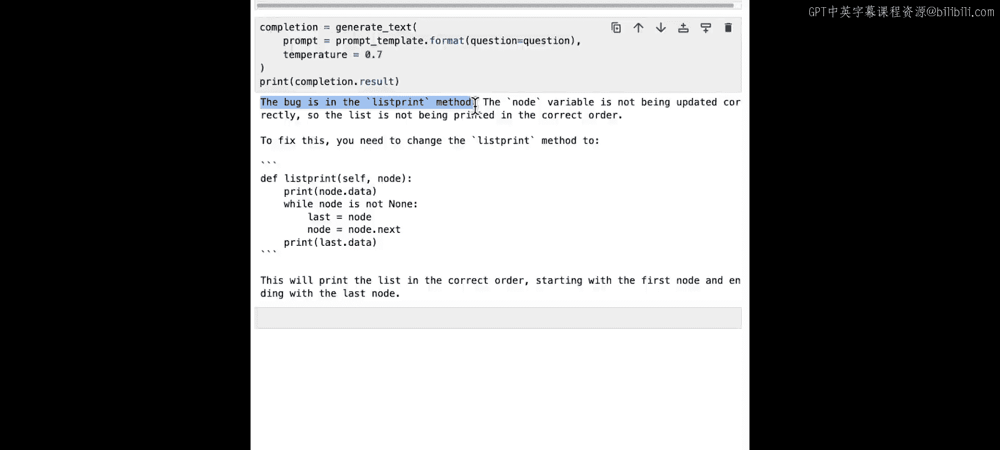

# 吴恩达《使用大型语言模型进行配对编程》Pair Programming with a Large Language Model - P4：SC-Laurence_L3_v04.zh - GPT中英字幕课程资源 - BV16u4y147b2

Coming up now， I've created a bunch of scenarios where you can see how an L L M can be a valuable assistant that responds to your coding needs。

 as opposed to something that just replaces programmers。 Let's dive into a few of them。

 But I'm sure you can think of many， many more。 And I hope that running through these will inspire you to think of some of your own。

😊，One thing that's important to note at this point is that generated code is prone to hallucination。

 Be sure to test everything thoroughly before putting it into any kind of serious use。 Also。

 the code that you get， might be different from the one that I got。 So if you see any variations。

 it's because of that level of randomness in the model's output。

 I've written up a bunch of them in the notebook for you to try out。

 And these are all scenarios where there's existing code。 Maybe you wrote it。

 maybe you inherited it from someone else。 or maybe an LLM even created it for you。

 But we're going to work through some of them together。

 And you'll see how you can get help from an LLM in doing many common tasks。 The first of these。

 of course， is to improve existing code。 And it's common that when you're creating code。

 particularly in a language that you aren't already heavily experienced in。

 that you might want to write code that is good enough。

 but isn't necessarily the best way of doing something。 For example。

 Python is a very simple language to learn。 And if you're coming to Python from another language。😊。

You may do things more in the way of that language than in the ways that Python is best at。

 And here's where an LLM is going to be really helpful。 In a moment。

 we're going to take a look at it in at the notebook。

 and the code that I have written is technically correct。

 but it's not the best way to do it in Python。 And the LLM will not only fix it for me。

 but also explain why it did it。 And this will help me be a better coder。

So to get started with the notebook， there's a few things that we need to do。

 and these are to import and set up the environment。 So first of all。

 we do want to have our API key from Us， I'm going to import the API key I'm going to use the Google do generative AI libraries。

 import them I like to call them palmm and then I'll just palm configure passing it the API key。

 So now Pam itself is set up with an API key。 Our next step will be to go through the models and to find the model that supports generate text and as we saw earlier on this was going to be modeled byson I'm just going to run it again and we'll see that the one model that we have at the moment and by the time we're running this sometime after I filmed it the maybe other ones and you can look at using those if you wanted to。

 but I'm going to be using model slash text byson 001 that supports that。And then finally。

 the last of the three things that you need to do to get up and running is to set up the generate text helper function that we were talking about earlier on and that we've been using all along and in this case we're going to import the retry and then this retry will when it's doing a backend called to a backend service as we're doing with palm it's just going to make sure that if anything fails that it will as the name suggests retry it and then our generate text wrapper function will wrap palms generate text function passing the parameters to it but then in this case for example doing something like overriding the temperature。

 the default temperature as you can see for bison is 0。7 we're going to overwride that with 0。

0s just so we can have some more deterministic output。So now that we have everything up and running。

 let's start looking at the code that I was talking about。

So I'm going to use a simpler version of the prompt template that we're using in the last lesson where I've just hard coded the priming and the decorator。

 So in this case， my priming is， I don't think this code is the best way to do it in Python。

 Can you help me， And then the decorator is please explain in detail what you did to improve it。

 And then， of course， the question will be where I insert the code。

 So that's my prompt template is set up。 So here's my question。😊，My question is。

 I have this function in Python， and this function in Python on an array will iterate through the length of that array and print out the details of that array。

 Pri out like array at I。 So what what the contents of the array is at a particular index。 Now。

 is that a good piece of Python code or is that a bad piece of Python code。 Well。

 we're asking the engine to say， you know， we don't think this is the best way to do it。

 Can you help us。 What's the engine going to give us。 Well， let's give a try。 So now let's see。

 let's get the completion equals generate text。😊，And then we're going to say our prompt equals prompt templates。

Thatt formats。Question equals question。And we'll close our brackets。I always forget that。

 and then print completion dot result。So here we can see we have a completion that we're going to be asking for。

 And all that's doing is passing this question into the prompt template and printing out the results。

 So let's run that。 And now we'll see what has happened is it says。

 This is a better way of doing this fun X。 instead of iterating for I range L array print array I。

 we can start using this star operator。 and then it will come back and it will tell me I improve the code by using the star operator to unpack the array into individual arguments to print function。

 and this is much more concise and efficient than using the for loop。

 I've learned something new today。 I hope you did to。😊，So this was nice。

 This gave us one way of doing it。 a more pythonic way of doing it。

 If you had come from learning basic or C or Pascal or Java or something like that。

 you're probably more used to the type of loop that I was using in the question。

 But can we take this a little bit further with a new prompt。

 there are maybe multiple ways of doing this。 So let's try and see if there's another way that we can do this。

 So I'm going to update the prompt template。😊，And I'm gonna to add a new decorator。So。Please。

 explore multiple。Ways of solving the problem。And explain。Each。So that's my new prompt。

 And let's see what it does。 So the question is going to be the same。 It's the same piece of code。

 So I'm just going to。Do the same thing。 Completion equals January text， passing at the new prompt。

 which is this prompt template and producing the result。 And let's see what it gives back to us。Okay。

 so now we've got this lot of text coming back First there's a few ways that we can improve it。

 First is using a list comprehension and we can see that this will allow you to do print element for element in array list comprehension is a very pythonic way of doing these things。

 Next is the enumerate function if we wanted to do that。

 It's returning an iterator that will yields the index and value of each element in the array。

 we can use them to print it out。 or if we wanted to， we can use the map function。

 The function then applies another function to each element。

 making it an inable and allows us to print each element with some kind of custom formatting if we wanted。

 and then what's really nice is it gives us this table comparing the three methods。 Unfortunately。

 the formatting of the table that output doesn't look great in the Jupyter notebook that we can see here。

 but ultimately we can see the three methods。 L comprehension is concise。

 but can be difficult to read for complex code， enumerate is easy to read。

 but requires an extra variable and extra。😊，Memory to store the index and the map is flexible。

 but the con of courses requires that custom function to format the output。 So there are many。

 many ways that you can slice this problem。 And I think one of this really。

 really nice things about being able to use a large language model is by just the tiniest changes in the prompt and being more explicit in what we're asking for。

 we can get lots and lots of valuable data back and we can get lots and lots of things that we can use to further look up how to do this and to experiment with our code and to make our code better back And yeah。

 so just I would encourage you to think about the code that you have and even a very simple piece of code like this was able to generate a lot of intelligence for me。

 think about the code that you have， think about a prompt like this one and use prompts like this to be able to understand that code better so that you can just be a better coder。

Now， you've probably heard the word Pythonic。 and people are always wondering。

 what's the most pythonic way of doing it。 Well， you know。

 you can ask 10 different people and they'll have 10 different opinions。

 So why don't we ask a large language model and see what the large language model's opinion is。

 So I'm going to paste my prompt template back in here。 And as well as saying。

 explore multiple ways of solving the problem and explain each。 why don't I just say。

 please explore multiple ways of solving the problem， and tell me which is the most pythonic。

 Now we're actually asking it to have an opinion， which is really interesting territory to be in。

 So now have my new template， Please explore multiple ways of solving the problem。

 tell me which is the most pythonic。And as before， my completion， generate text。

 pass it the prompt and then print the completion result。 So let's run that and see what we get。Okay。

 so now it's giving us quite a few things。 There's a few ways to solve it。

 The most pythonic way would be to use the list comprehension syntax。

 which was the first one that we had earlier on， where we use print element for element in array。

 Another way to solve this problem would be to use the map and another way would be to use the enumerate function。

 The fun part right at the bottom here is it's giving us its opinion of these three solutions。

 the most pythonic is the first one， which uses the list comprehension syntax。

 This is because it's the most concise and readable solution。 So again。

 we're seeing that not only is it generating code， not only is it improving our code。

 but it can also have an opinion about that code。 And like from these opinions。

 maybe we can also learn to be better developers。😊，Okay， next， let's take a look at simplifying code。

 and similar to the previous example， it's a common scenario where you've written code that works。

 But you wonder if the ongoing maintenance of the code could just be improved by making the code simpler。

 Often you'll have a code reviewer that looks at your code to make suggestions。

 but maybe just as often， you may not have one。 And here's where an LLM can come to the rescue。

 In the notebook。 we're going to take a look at a perfectly good linked list class that's been implemented in Python。

 But there's some parts of it that just maybe aren't the prettiest than the code reviewer might pick up on that and ask you to change it。

 But let's see if the large language model using the Parm API can do the same thing for me。😊。

So let's start with my simple prom template where I'm just saying。

 can you please simplify this code for a linked list in Python as my primer。

 I'm going to pass it the question and then my decorator。

 I'm just going to say explain in detail what you did to modify it and why。

So if I run that I'm starting to set up the prompt templates and now I'm going to paste in my linked list code。

 so here's my question and I'm pasting in my question as the code for a linked list and does any computer science professors in the room you might want to look away now because it's not a very pretty one but let's talk about it a little bit。

 So in linked list every linked list is made up of a number of nodes and those nodes contain a value which I've just called dataval and a pointer to the next node which I've just instantiated as none because I'm just defining the class here。

And then when I create my single linked list， I'm going to create my first node。

 and that's going to have a head value。 And so the linked list。

 the first node in that is called the head。 So we're going to start with head valve just being none。

 So now I'm going to start instantiating these things that I've defined the class。

 So list one will be an S linked list list one's head valve is going to be a node called Monday。

 And then I'm going create a node called E2。 And this is going to be a node where the data is Tuesday and E3 is going to be a node where the data is Wednesday。

 So now if I want this to be a linked list Well list ones head valves next Val is going to be E2。

 So the head valve of month is going to point to E2， which is Tuesday， and then E2's next Val is E3。

 which will be Wednesday。 And this just isn't very pretty where I'm creating a list and then I'm creating individual nodes。

 and then I'm specifying the lists heads valves next Val is one of those nodes and all of these kind of things。

 It's not very pretty code as you。😊，As you can just tell so but what I've asked the prompt to do is can you please simplify this code and I've cheated a little bit because I'm telling it it's already a linked list I'm not asking it to try and figure out that it's a linked list or not and then most importantly I think is to explain in detail what you did to modify than why and this decorator is where you can start getting creative and you can experiment as we've shown earlier on to see if we can get better results。

😊，So now we're going to go and with our usual code。

 we're going to get our completion and print out our completion。Let's run it and see what happens。

So here's the output and the output you can see that the class for the node doesn't hasn't really changed that much and the class for the linked list itself hasn't really changed that much either。

 it's tied it up a little bit by using data instead of data Valel and stuff like that。

 so it's a little bit cleaner。But the big thing that it has done that has given us this helper function。

 And it describes the helper function below and what it's doing。

 And when using a helper function like this， instead of me having code， if you recall earlier on。

 my code， whereas like putting parameters into a node like Tuesday and Wednesday and Monday。

 that the data itself is in a list。 Monday， Tuesday， Wednesday and the helper function。

 create linked list is then going to parse through that list and use those values to create nodes here what they're called new node equals node of data and then to link the previous node to the new node Thus creating a singly linked list。

 Now， it looks pretty good。 but we might be able to make it even better。😊。

So how would we make it better， Well， let's go back and maybe change our prompt a little bit。

 So as well as saying simplify this code for Linklist in Python。

 I'm going to say you are an expert in Pythonic code。And as well as saying。

 explain in detail what you did to modify it and why I'm also going to say。

Please comment each line in detail。And explain in detail what you need to。

 what you did to modify it and why。 So I've changed my prompt to be that。

And now if I generate my text because the question has remained the same。

 let's see if it gives me a different output。And here's my new output。 So now we can see things like。

 for example， I had defined my class as a node， and it's given me a comment for that。

 It's also giving me comments on what I was doing to initialize the node。 Similarlyly。

 now it's my S link list class got a lot more to it。

 instead of it just being able to initialize with self dot head being none。

 It's actually added a helper function， add to the head。 And it's added another helper function。

 print out the list。 And now in my python， I can just do list1 equals S link list。

 list one add to head， add to head to add to head Wednesday， and then print out the list。

 As well as it's then giving us all of these details on what it's done。

 and it believes it makes these changes to make the code more concise and easier to read。

 But like I've said all along， you don't always want to fully trust the output code from something like this。

 And one thing that I've spotted is like it's called that function add to head。 But when you。😊。

Creating a link list。 you're not actually adding to the head every time， right， You know。

 the first element that you add to a linked list is going to be the head will be it will become the head。

 But then the second element of the list is that the first element is pointing to it。

 The third element of the list is the second element is pointing to that。

 So the name of this function is probably not the best one Add to head maybe just call it add node or something like that。

 So these are the kind of things to watch out for。 But as you can see。

 the code is generating is still really helping me with the linked list that I created。

 It's making it much much tidier。 despite this one little error。

 And that tidiness is the kind of thing that you would be getting if you were having a human code reviewer looking over your shoulder。

 But you're getting this out of a large language model now。As the person who wrote the code。

 you're often too close to your code to really test it and figure out corner cases and other potential places where your code can fall down As such good automated testing is important。

 And the first step in that is creating some unit tests to ensure that your code will work as expected with large language models you can take your code and ask it to generate test cases for you。

 So in the case of the linked list that we did earlier on where PalmM splified my code。

 let's go back to the notebook and see if we can generate some test cases for all of those methods in my class very easily。

😊，So we're going to start with our usual prompt template being a primer of the question and then the decorator。

 So my primer is going to be， can you please create test cases in code for this Python code。

 I do want to express that it's in codes。 Sometimes it might create just some text saying you should test this to test that。

 So I'm being very explicit。 I'm going to pass it in the code as the question。

 and then my decorator again is as usual， explainplain in detail what you're doing and what these test cases are designed to achieve。

 So let me run that。 And now I'll give it the piece of code。

 And this was one of the linked lists that we output earlier。 if it looks familiar。

One of the first ones that we did。 So here is my code。 I'm just running it。 and it's my usual。

 I have my node being created I my link list being created。

 And this is the one where I had the list Monday， Tuesday。

 Wednesday and it iterated through that list。 So let's see what a set of test cases for this would look like。

😊，So as before， I'm going to get my completion by generating the text。

 and then I'm going to pass at the prompt with the question being passed in。

 So let's run this and see what we get。Okay now we have lots and lots of code has been created for us。

 so I have this new class has been created called test S linked list。

 I'm also importing the unit test libraries and Python which is a good looking start and what's happening now is that it's going to test creating the linked list it's going to test inserting a new node into the linked list it's even going to test deleting a node from the linked list and then it's going to define that these are what they all are。

 So for example， it will tell me how it can delete a node itll actually write the code for that and will make sure that the values that it gets back are correct。

😊，So this is a really， really good example， it's a very， very simple code that we're using。

 but it's a nice example of where some test cases were figured out for us。 Now you may have realized。

 for example， that we didn't do anything to delete a node and our linked list but one of the things that generally you would have if you want to test a linked list is what it looks like when you're deleting a node so this might inspire you to realize that your linked list might need to be better that you could go back with a new prompt to your linked list and say can you please add some code for deleting a node and then this code could be used for testing it So this is how the machine will really help you as a developer by like I said。

 it sparks inspiration， it gives new ideas and it might help you spot things that you haven't done without explicitly telling you So it's again a great thing is to be able to do this unit testing not just to have the code generated to do the testing for you but for it to think up of test cases that you may not have thought of yourself。

😊，Now， something I find particularly exciting about using LLMs as a pair programmer is that when it analyzes code。

 it's doing it from a position of neutrality， it's not really invested in any particular algorithm or methodology and as such。

 it can give you a very fresh perspective on your code that can help you with efficiency。

 For example， when playing with palm and a binary search tree algorithm。

 I use code that did the binary search tree the way I'd always learned it using recursion。

 without realizing that that might be somewhat of a gratuitous use of recursion。

 and maybe not the best way to search a binary tree。

 An LLM can spot this right off the bat and give you suggestions about how to improve your code by maybe not using memory intensive recursion。

 It's a great reminder to have LLMs as a pair programmer to explore your code。

 you never know what ideas it could generate。 So let's pop over into the notebook and let's take a look at what we can do to make our code more efficient。

😊，So let's start with our prompt。And our prompt is going to be。

 as before we're going to prime it by saying hey， can you please make this code more efficient。

 we'll pass in the question and then our decorator。

 I really like decorator some you've probably seen it a few times now。

 explain in detail what you're doing， what you've changed and why。😊。

So now I'm going to give the question and the question here is where I'm creating a binary search tree。

And in my binary search tree here's the code right it's a naive tree。

 it's doing some things that might be good， it's doing some that may not be great。

 I'm doing a little bit of like pretty big if else case here and then I'm recursing by having the binary search function call itself。

So is recursion going to be the best way of doing this， Well， let's see what the engine tells us。

 Well， first of all， let me run the cells with my prompt template and with my question in them。

And now my usual。Completion equals generate text， passing at the prompt and printing out the results。

 So let's run this and see what we get。Now it takes a moment。

 and it's going to give us this code here， binary search。

 But one of the interesting things it says it used the bisect function to find the index of the middle element of the array。

 and the name would suggest that。But if you look at the documentation for the bisec function in Python。

 what that actually does is it does the binary search for you。

 It will continually split the list until it finds that element。

 So what's happening here is this element， it's not really the middle of the list。

 but it's searching for X in the array， And then if that is found。

 it will tell you where it found it。So if we could take this Python code， for example and。

Put it in our own cell and run it and see what happens。So biSec needs to be imported。

 so I'm going to import bisSect。And then run this。 And let's see。Okay， oops， get rid of this。

And run this。 And now it says the element is present at index 3。 So 0，1，2，3。 So 10 was there。

 If I change x， for example， to be 14， and I run it。

 it's going to tell us that the elements not present in the array。 And if I， for example。

 change it to 40。Whi， as you can see is the last element in the array。

 it's actually finding it at index 4 so it's like 0，1，2，3，4。 so it's actually working correctly。

 but here's a really good example of where we have to be super careful with hallucinations because the code that here that's been created for us is leading us to believe that it's finding the index of the middle element of the array because that's what it says but bisect does a whole lot more than just that and even the variable name made it sound like it was the middle of the array being found also the output from the model saying it used the bisec function to find the index of the middle element of the array but what it's actually doing is the binary search on our behalf。

And then it also said that it used a brake statement to exit the recursive function early。

 But there's no brake statement in here。 So this is a great example of， you know。

 we're getting much more efficient code。 We're getting the result that we want。

 But hallucination could lead us down the wrong alley。

 Try it for yourself and see what you can come up with。😊。

An L L M's ability to understand code doesn't end with all of these things that we've been looking at。

 These are just a few simple examples。 And one really nice one， of course。

 is to be able to spot bugs in your code。 and often bugs aren't found if theyre not crashing bugs。

 There can be bugs that only arise in certain cases。So for example。

 when you go to the notebook in a moment， I took some Python code that implements a doubly linked lists that came from an online tutorial。

 but I deliberately left out one line， and you know maybe it was if I was a learner。

 I would have missed entering that and the code in this case will run without any bugs。

But as you use it， you'll see that the missing line of code will can lead to crashes because of null pointers。

 Now， the large language model， let's see if it's smart enough to spot this。

 find the bug and suggest a fixed。Let's switch over to the notebook and give it a try。 As always。

 I'm going to start with my prompt and my prompt template0 plate is。

 Can you please help me to debug this code， I'll paste them the code and then explain in detail what you found and why you think it was a bug。

 So I'd run this cell。 Now， here's the doubly linked lists。

 And here's the code for it that I got from an online tutorial。😊。

And I deliberately introduced the bug into this code。 So this comment can't be seen by the model。

 And so it's just there for you。 but I've put the bug in the print function。

 So there's the circumstances where nodes can be null and trying to print them would give a null error。

 So let's see if the model can find that。 So this is our question， this is our prompt template。

 And as always， we are going to get a completion for this and print out that completion。

 So let me add that code。So let's generate our text now in our good oldfashed unusual way where we're getting a completion and we're generating the prompt using the prompt template and getting the completion result。

 So let's run this and we'll see well It's done a pretty good job。

 It's found that the bug is in the list print function， which is correct。 However。

 if we look at the code that it's created for us it's not quite right。

 So what has happened here is that the null value and node is being checked for and it's thinking we should put that check in。

 but it's still printing that no dot data before we get there。 So it's not quite right。

 and a great teachable moment， a great example for us to be able to really be inspired by the type of output that's coming from the model to help us understand the bugs that we can fix them ourselves but we should also really use this as an opportunity to understand our code well and to look at what's going in our code and to really find ways to fix problems that are in our code that are inspired by the L。

😊，As opposed to just copying and pasting directly from the LLM。 But for a bit of fun。

 this is also a good teachable moment with the temperature that we were talking about earlier on。

 So I've set the temperature to be 0。 but with the model the byson model， the default is actually 0。

7 So the closer the temperature is to0 the less likely there is going to be random variance in the model。

 so with the value of like 0。7， which is closer to one we'll be getting some variance in the model。

 So when I run this， we might get different results。

 and it can help us maybe to understand our code a little bit better。

 And again it's finding it in the list print function and it's the same as we were getting earlier on。

 So despite there being randomness in the model it's almost always finding the bug to be in the list print method。

 So this in and of itself is very useful so that we can become better at spotting bugs and to try and test code or test some of the code that the model gives us to be able to be better at fixing those bugs。

