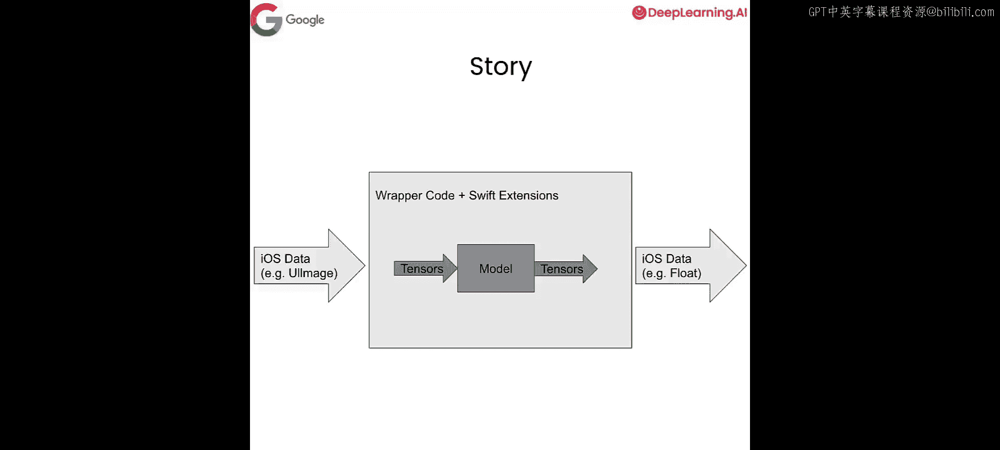

# 吴恩达《使用大型语言模型进行配对编程》Pair Programming with a Large Language Model - P5：SC-Laurence_L4_v04.zh - GPT中英字幕课程资源 - BV16u4y147b2

While there's no magic solution to all technical debt。

 there is one massive way that LLMs can be enormously helpful in overcoming it。

Technical debt usually arises from complex code being handed down from developer to developer over time。

 You have to maintain it， but often barely understand it because it was written a long time ago or is overly complex or has too many dependencies that you can't change our update for fear of bringing down the entire system。

 Is this a place that L L Ms can help。 Maybe Let's explore one scenario。

So let's start by just setting up our APIs all of that good stuff from Us。

 I'm going to import get API key I'm also going to need to import the Google do generative AI libraries。

 I'm going to call them palm and then Pa do configure API key so that I'm setting up my API key for the palmm libraries。

 Once I've done that， I'm going to look at my models and take a look at the models that are available to me So if you recall in Pam。

 there were a number of different models each which different capabilities。

 but we want to use the one that has the generate text capability。

 So if I run that and output it we'll see that we're going to be using one called models text bison 001。

 remembering at the time that you record this， you may have a different set of models that are available to you you can actually pick the ones that you might find is more appropriate for you to use。

 but given that there's only one at the moment， I'm going to just use models at zero。

 which is that one。And then the final thing that I want to do just to prepare is to set up just a helper function called generate text。

 And I'm going to do that here。 I'm going to import Google API cores retry。 and then on retry。

 I'm going to pass generate text and generate text is just going to pass my prompt。

 My model and my temperature to palm to be able to get it to generate the text。 And in this case。

 I'm overriding the default temperature with 0。0。 You'll see the default temperature is actually 0。

7 on the model itself， I'm going to overwride that to be 0。

0 just so that I can have some deterministic output and reduce any kind of randomness。

 So with that we're now ready to go to start exploring our code。

 And what I want to do with the code in this case is to take a look at the idea of technical debt。

 And in the case of technical debt in this case， I'm。😊，I have some very。

 very complex code and this code is actually swiftt code in i that was taken from a book that I wrote about creating machine learning models to run on mobile。

 It's a very long block of code。 So I'm just going to paste it in and what it does is it's all in a comment it's all in text at the moment but what this piece of code does is allows you to take an image from an i device pass that to a Tensorflow light model and then have a classification done using the Tensorflow light model where this gets really complicated is in order to be able to do that conversion of the image you actually have to read the underlying memory of that image and you're accessing memory on the mobile device by doing that If you're a mobile developer you realize that any time you start accessing memory there's a chance that the operating system can think you're doing something naughty and that the app store could shut you down So they have some very complex。

And very secure APIs that allow you to be able to access memory on a device。 So as a result。

 this piece of code that I had to write， first of all。

 to take the orGB data of the image and to convert it into tensors and then also to safely access the memory of the device in this case。

 an iPhone As you can see it's a lot of code I'm scrolling through it here and there's a lot of code here and this to me is a great example of technical debt where if somebody had built an application that has this code in it。

 and now you inherit this application then you really need to understand what this application is doing。

 how is it going to work， how are you going to be able to use it and all of that kind of things。

 So here's a great example now where we can actually use a large language model to help us understand this code。

So I'm going to start with a prompt。And I'm going to use my usual prompt template and I'm just going to say。

 can you please explain how this code works， I'm going to pass it the question。

 and then I'm going to do the decorator of use a lot of detail and make it as clear as possible。

 So I have the prompt template I can run my code completions generate text。

 just passing it the code block and asking it to talk to the LLM to explain how this code works。

 and here we can see the results have come out。So the results now are going to really go into a lot of detail。

 right， It's telling me model data handler is a tenflow model handler。

 It has the following properties。 It has the following initials。 It has the following methods。

 even explaining what those methods are。 And perhaps most interestingly。

 it even tells me about my extension methods。 And this is a。

A swift specific thing to allow you to extend your classes and you'll see there's an extension data and extension array in here。

 there's extension array and the extension data， and this is where the advanced stuff is going on doing the copying the buffers of memory。

 using understanding that we're using unsafe pointers into direct memory。

 but because we're doing it the way that Swift expects us to do it that this kind of thing would hopefully get past App store wouldnt it would not realize wouldn't suspect that we're writing some kind of virus as something to access lower level memory when we're doing this kind of thing and now I have all of the code explained to me for doing it。

But as well as explaining the code， Well， guess what， it could actually also document the code。

So let's start with a new prompt template where I'm going to ask it to write technical documentation for this code and make it easy for a non Swt developer to understand。

And I'm going to ask it in the decorator to output the results in Markdown because a lot of tech doc nowadays is going to be using Markdown。

 which is a fantastic format。And let me now， then。Add a new cell to this in which I am going to just get my completion。

 So I will run this prompt templates， and then I will generate my completion。

 And let's see what happens when it finishes running。

And now I have tech docs and they are actually done for me in markdown format。

 If you're familiar with Markdown。 So here it's giving me the model data handler class handles all the data preprocessing makes calls run inference on a given frame dot dot dot dot。

 It's documenting the public properties。 It's doing it in bullets here in markdown and in heading sector headings with the hashes in markdown。

 and I now have a markdown document that I can use as the beginning of tech documentation for this class。

 So as a result， we can see like using large language models like this can be really。

 really handy in avoiding tech debt。 This is just one example that I've given。

 I've had to explain some complex code I've had to document the code。

 But as you can see using the same techniques there's so many ways that you could use this type of thing to reduce your own technical debt。

 and I'd love to see what kind of things you'll build with it。While working on my book。

 AI and Maine Learning for on device Development， I had to step out of my comfort zone somewhat and write code in Swift for iOS devices。

Now， this was a lot of fun to work on， and Swift can be a really powerful language。

 but there were also some circumstances where I， as a relatively No Swift developer。

 encountered difficulties。And I usually had to spend hours searching for code samples that might help me。

 Now， one such example was to pass images to a mobile neural network。 In this case。

 I would have to convert the underlying data in the C V Pix buffer format into raw or G B data。Now。

 namely that would mean I would have to read memory and because of security concerns。

 particularly on mobile devices， this can be quite difficult to do。Eventually。

 and with a lot of help， I ended up with the RGB data from buffer function in the code that you'll see in the notebook book。

 And it was a few years back。 And I was left wondering what would happen if I needed to maintain it。

😊，I now have the technical debt to support code that I can barely remember。

So I shared the code in the notebook， along with a couple of scenarios。

 one to help explain it to someone else。 should they inherit it and the other to do the obvious job of documenting the code and maybe even outputting that as marked down。

 Try it for yourself and see what you can come up with。

