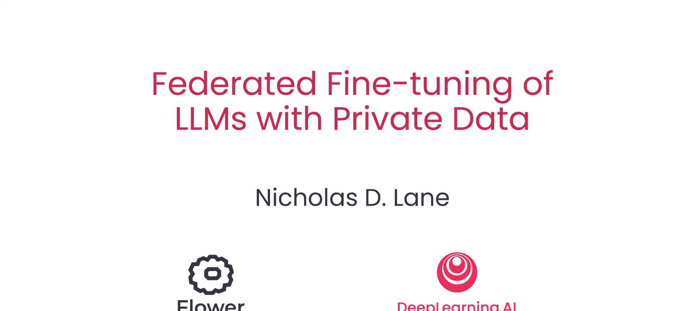
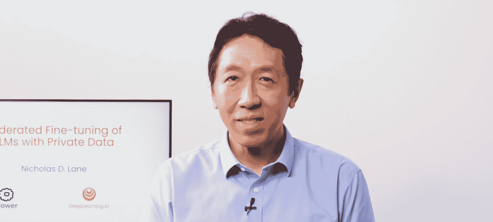
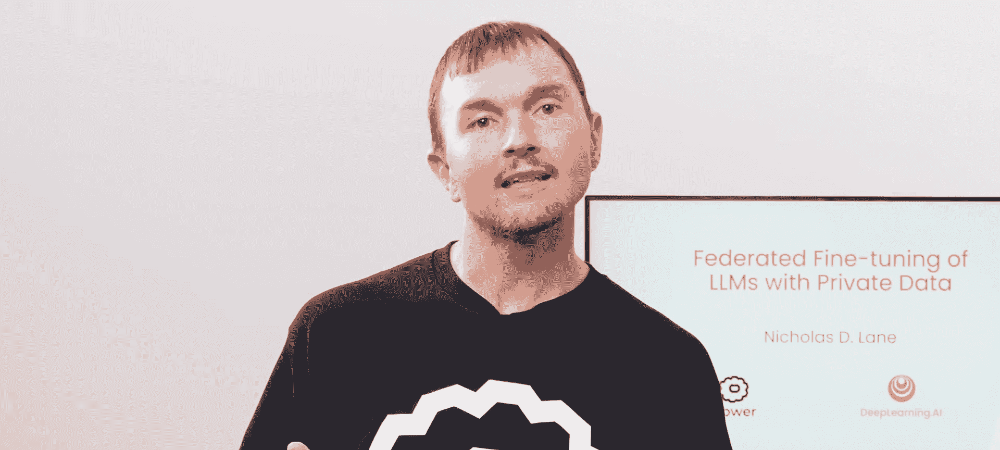
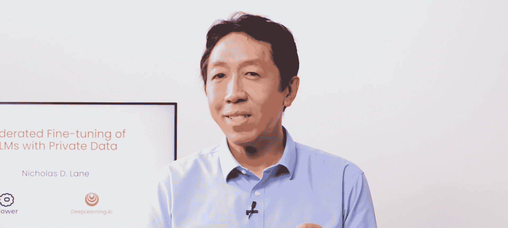
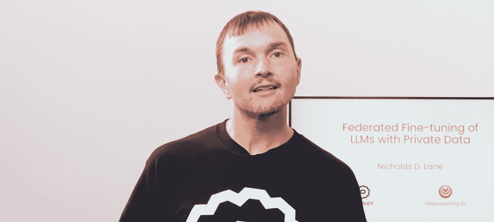
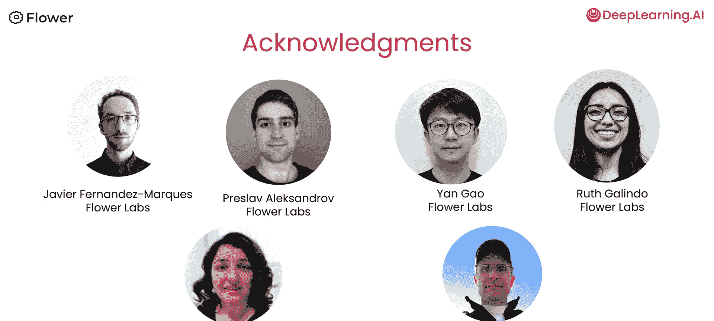
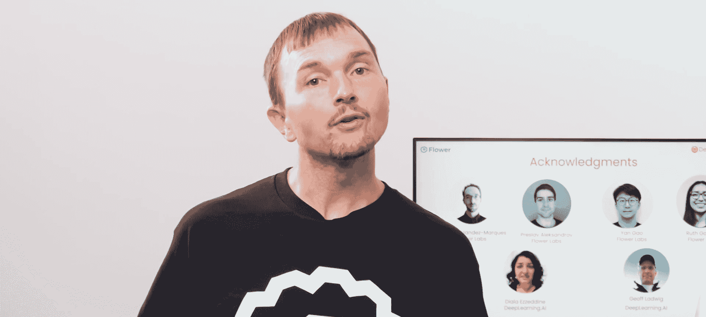

# 吴恩达《使用私人数据进行大语言模型的联邦微调｜Federated Fine-tuning of LLMs with Private Data》中英字幕（豆包翻译 - P1：1.intro - GPT中英字幕课程资源 - BV1uE421w7Xz

欢迎参加与Flower Labs合作的《联邦微调LLM大语言模型。

与私有数据》课程。我很荣幸介绍本课程的讲师Nick Lane，他是Flower Labs，的联合创始人兼首席科学官，也是剑桥大学的教授。谢谢，Andrew。很高兴能来到这里。

假设你在一个多地点的医疗保健提供商工作，希望开发一，个大语言模型来回答健康相关的问题。用于训练模型的数据分布在多个地点，但隐私限制阻止你，直接访问所有这些数据。

在之前的Flower Labs课程《介绍联邦学习》中，你可能已，经了解到，联邦学习允许你将模型训练分发到数据而不是，将数据带到模型。在本课程中，你将学习如何将这个概念应用于微调LLM。现在。

LLM通常具有数十亿个参数。在联邦学习中，你将模型分发到数据，然后在每个训练迭代，中与其他地点交换参数。这可能涉及大量数据的交换。

完全正确，Andrew。在本课程中，你将学习两种技术，可以显著提高整个过程的，效率。首先，不要试图从头开始训练LLM，而是使用预训练模型，并，使用私有数据进行微调。

现在有许多非常好的开源LLM可以作为一个很好的起点，加，快整个过程。其次，你将进一步优化标准的微调方法，采用参数高效微调，（PEFT）。在微调过程中，PEFT只需修改LLM权重的一小部分，而不是。

更新所有参数。在本课程中，你将看到，这可以仅用总量的0。1%来实现。

开发者担心的一个问题是，训练好的LLM是否可能泄露敏感，的训练数据。例如，如果某人的个人信息，如家庭地址或信用卡号码，不，知何故出现在训练数据中，LLM是否会泄露这些信息？

在本课程中，你将看到一些示例，说明即使是当前的开源，LLM也可能恢复训练数据。然后，你将学习如何应用联邦学习和差分隐私技术，在微调，LLM时最小化私有数据被曝露的风险。在本课程示例中。

每个医疗保健地点在训练过程中无需传，输数据，这要归功于联邦学习。这为你打下了坚实的基础，可以进一步建设。通过差分隐私，模型更新已经添加了校准噪声，使数据恢复，变得更加困难。

这种结合使得数据变得更加难以恢复，同时您还可以了解，到，通过添加额外的方法如加密，可以进一步增强数据的隐，私保护，如果您的数据需要的话。

有很多人为创建这门课程作出了贡献。我想要感谢Flour Labs的哈维尔·费尔南德斯-马奎斯、普，雷斯洛夫·亚历山德罗夫、高岩、鲁思·加林多，以及，DeepLearning 。

ai的迪亚拉·埃扎丁和杰夫·路德维希。

第一课将介绍联邦LLM以及使用LLM进行联邦微调的主要优。

势。听起来很棒。