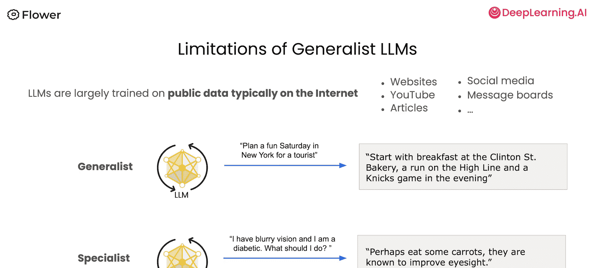
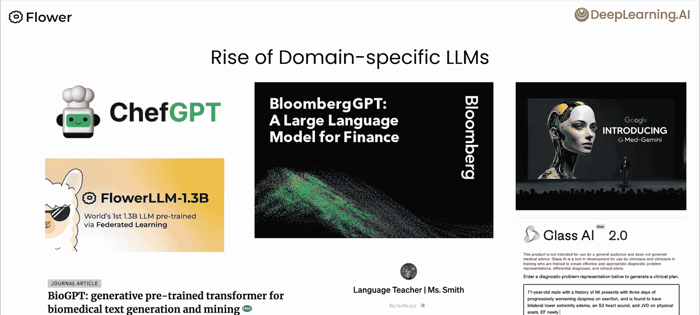
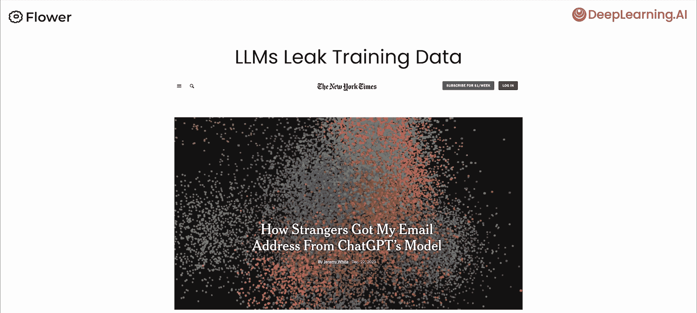
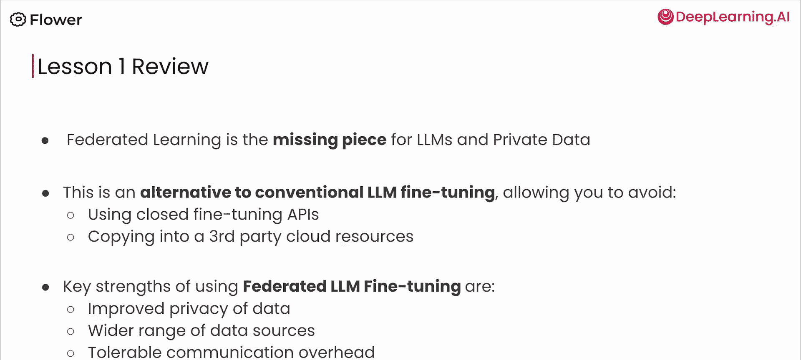

# 吴恩达《使用私人数据进行大语言模型的联邦微调｜Federated Fine-tuning of LLMs with Private Data》中英字幕（豆包翻译 - P2：2.smater LLMs with private data - GPT中英字幕课程资源 - BV1uE421w7Xz

我经常对大型语言模型能做的事情感到惊讶，但如果它们，能安全地在各种私有数据上进行训练，例如个人医疗记录，或你公司的敏感信息，它们可能会更好。在这节课中，你将了解到用于训练现有大型语言模型的数。

据的当前限制，以及联邦大型语言模型微调帮助改变这一，状况的潜力。让我们深入探讨。大型语言模型，它们令人难以置信地令人印象深刻，但今天，有趣的是，世界上大部分数据都不在任何大型语言模型中。

一旦你开始列出所有不在大型语言模型中的数据，你就会，觉得你永远不会停止。你有私有数据，所以我们说的是你手机里的数据，你电子邮，件里的所有数据，有各种各样的敏感数据，有些是私有的，有些不是。

但只要想想图像里的数据，你门铃摄像头里的数，据，你的智能扬声器可能听到的声音，所有这些今天都不在，大型语言模型中。有受到高度监管的数据，所以我们说的是银行和金融机构，持有的数据，医学和医院里的所有数据。

这些数据通常都不，在大型语言模型中。在企业的数千台计算机中也有数据，世界各地的孤立物联，网、机器人、制造机器和工厂，所有这些类型的计算机都，有有价值的信息，而且它们又不在大型语言模型中。

如果你开始思考这一点，这是非常了不起的，因为我们认为，大型语言模型是这些包含世界上大部分信息的巨大的数十，亿参数模型，但当我们开始分解它时，我们意识到这些大型，语言模型错过了世界上这么多的信息。不用说。

如果我们能开始利用我们今天知道不在大型语言，模型中的世界上的所有这些数据，我们预计会在它们能够，做的事情上看到显著的进步。那么考虑到所有这些，这些大型语言模型到底是在什么上，训练的呢？嗯。

它们是在公开的数据、互联网上的数据、网络上的数，据上训练的。所以如果你开始列举这些是什么，你会看到网站上有文本，YouTube 上有视频，大众媒体、博客、杂志、社交媒体的，一部分、留言板上有文章。

这就是我们所知道的嵌入在大，型语言模型中的那种数据。因此，这对它们能给我们提供的回应类型有切实的后果。所以我喜欢大型语言模型。你可以问它们这样的问题，比如，为游客在纽约计划一个有，趣的星期六。

它们会给你很好的回应。对于这种问题，他们的回答完全可以理解，比如建议你从克，林顿街面包店开始一顿早餐，然后在高线公园跑步，最后观，看尼克斯队的比赛。这对我来说听起来是个美好的星期六。但问题是。

如果你开始问一个专业领域语言模型的问题，我，们就来试试吧。让我们问一个涉及医学的问题。你可能会问一个合理的问题，比如说，我有模糊视觉，我是，糖尿病患者，我该怎么办？通常情况下。

普通语言模型可能会给出的回答是，也许吃些，胡萝卜，因为它们已被认为能改善视力。这种回答的来源是因为有一个关于胡萝卜如何改善视力的，都市传说。但关键是，这是对一个非常重要问题的非常不理想的答案。

当你问一个普通的语言模型医疗问题或许多其他类型的领。

域时，你得到的答案就可能是这样。因此，出现了各种领域特定的语言模型。这些语言模型擅长特定任务。因此，其中一些是基于非私有数据训练的，它们专注于包含，更多信息的数据集，这些信息通常不常见。例如。

Chef GPT类型的语言模型可能会接受大量烹饪信息，的训练，包括许多食谱和其他类型的信息，以便回答那些准，备食物并提出相关问题的人。还有一些语言模型帮助你学习语言或其他学科领域的知识。

然后还有一些语言模型是基于特定领域专有数据训练的。许多位于医学领域。例如，Bio GPT，Gemini Glass AI。这些是经过医学数据训练的语言模型的例子，具有显著增，强的能力。

可以回答健康和医学相关的查询。我最喜欢的例子之一是早期形式的这些领域特定的语言模，型之一，Bloomberg GPT。这是一个训练有素的500亿参数语言模型，广泛使用彭博社，的内部档案进行训练。因此。

它们拥有所有这些财务文件，这些文件被用来训练，Bloomberg GPT，并赋予它在金融领域的增强能力。因此，这一点人们已经知道，语言模型一旦获得特定形式的，数据，就可以开始在这些领域中表现出色。

但我们一般不这。

样做。为什么会这样呢？嗯，原因很多，但其中一个最大的问题是，语言生成模型，（LLMs）会泄露它们训练数据的部分内容。所以，当你开始使用私密数据、受管制数据、分布式数据，或其他非公开数据时。

你必须非常谨慎，因为这会让你深思，熟虑。这正是这张幻灯片的核心所在，是2023年12月《纽约时报，》的一篇文章中提到的。文章讲述了作者的个人经历，他们发现自己的电子邮件地。

址出现在了一个名为Chat GPT的公共模型中，因为这个地，址曾出现在其训练数据中。因此，作为开发者，作为对构建LLMs感兴趣的人，你在处理，和使用这类敏感数据时必须极为小心谨慎。这意味着。

你可能已经了解的传统方法，比如对LLMs进行常，规的微调，对于使用私密数据并不适用。

因此，这门课程的重点之一，使它显得非常独特，是我们将，深入探讨你需要使用的方法，来基于私密数据构建LLMs。当我们使用私密数据时，这是一个总称。它不仅包括你立刻会想到的私密数据，比如手机上或个人。

邮件中的内容，还包括通常不会出现在LLMs中的其他类型，数据。正如我之前提到的，受管制数据、房产数据、IoT和工厂中，隔离的数据，所有这些从未出现在LLMs中的数据类型，我们。

都希望探讨如何利用这些数据，因为这将能够显著提升，LLMs的质量。那么，我们如何实现这种魔法呢？嗯，我们将专注于一种传统LLMs微调的替代方法。这种替代方法被称为联邦LLMs微调。

这个动画简要地传达了核心理念。你在这里看到的插图相当具有代表性。这是一个医疗例子。有三家医院。每家医院都有与患者的医疗记录等高度相关的高度私密数，据。我们要做的是将这些信息嵌入到LLMs中。

而联邦LLMs微调允许我们不必将数据复制到中心位置，然，后进行微调。相反，您将能够让数据驻留在这些医院，在每个数据的不同，隔离部分上进行训练，然后只传输您所学到的内容，只将更。

新后的LLM模型权重传输到第三个服务器位置，那里只有信，息被汇总以更新该模型。因此，请注意，在此示例中，数据永远不必离开其所在地。这是一个基础构建模块，我们可以与其他类型的方法和技，术一起使用。

以提供对训练数据的隐私保护以及其他能让，我们接触各种私密数据的重要特征。所以，正如我们将在随后的课程中学到的，这种方法，即联，邦LLM微调方法，将使我们能够利用私密数据并克服许多其，他相关的障碍。

如数据量、法规、硬件限制和数据主机等，但我想强调的是，这需要吸收很多信息。我们谈论LLM的微调，我们谈论联邦学习，这里涵盖了很多，主题。因此，我建议您，如果尚未这样做，请查看其他提供的短期，课程。

专注于基础知识。它介绍了联邦学习的领域。如果您先参加该课程，我们将描述的许多信息会更快地变，得更加清晰。但不要担心，这门课程本身也是独立完整的。所以，如果您想继续，请随时。

但我强烈建议您先从联邦学习的介绍开始。这就是第一课的结束。让我们回顾一些作为我们在本课程中进展的背景使用的主，要信息。有三件主要的事情我希望您考虑。第一，也许令人惊讶的是。

大部分世界的数据尚未进入LLMs，所缺少的是大量的数据类别，如私密数据、受监管数据、，分布式数据以及诸如医疗、金融、企业等重要的关键领域，第二，也许最重要的原因是，这类数据尚未被广泛包含在。

LLMs中的最重要原因是LLMs被广泛知晓易于泄漏训练数据，每当您构建LLMs时，都必须牢记这一点。因此，这意味着传统的包含私密数据的方式，如集中式微调，通常不能在此情况下使用。这就引出了第三点。

您将在本课程中学习到的答案是联邦LLM微调。这是一种让你利用私有数据并在将其嵌入大型语言模型时，保护该信息隐私的方法。并且它还允许你解决使用此类数据的许多其他相关障碍。我们想要做的是通过使用更多数据。

并能够仔细纳入新类，型的私有数据源，然后我们可以制造出更智能的大型语言，模型，特别是能够在医学等领域回答特定领域的问题并整。

