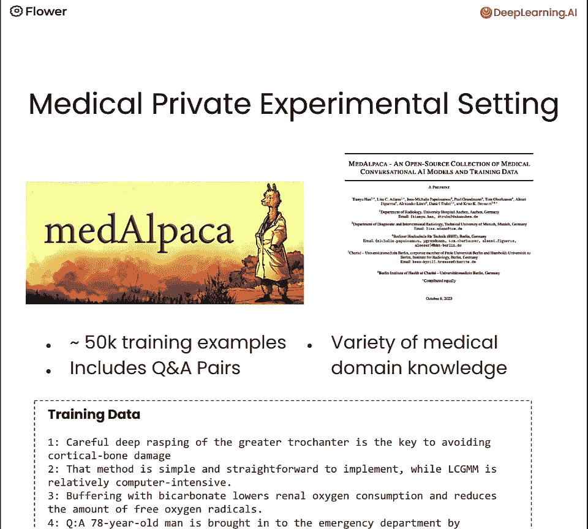
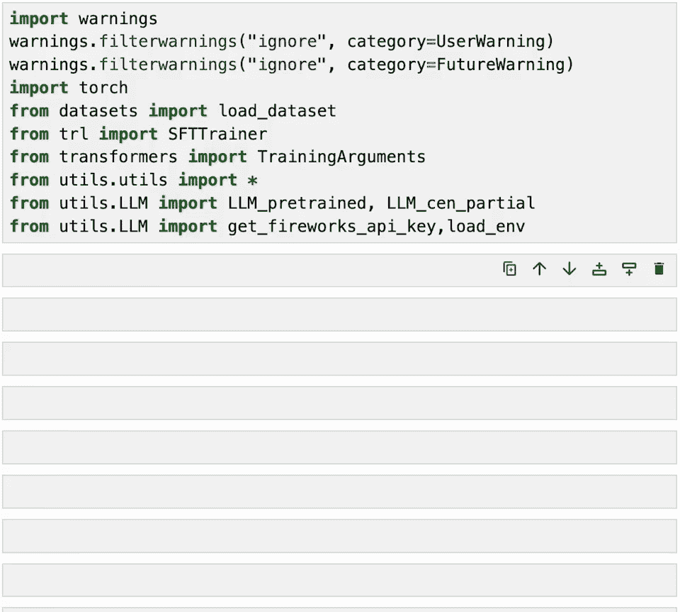
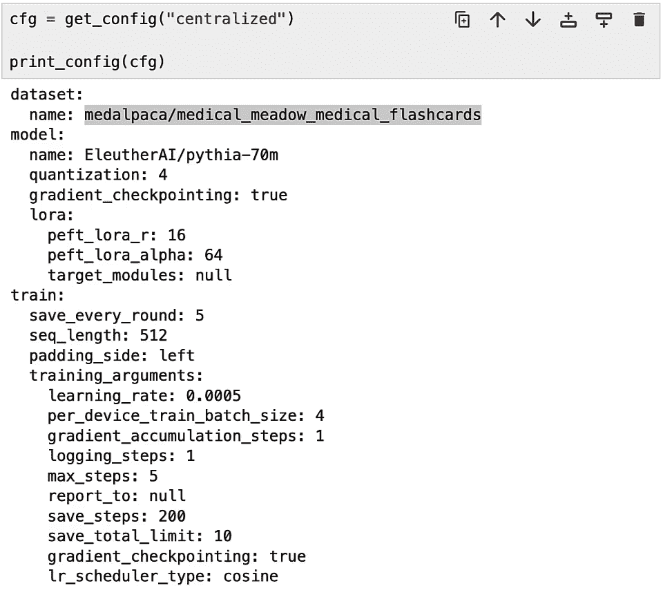
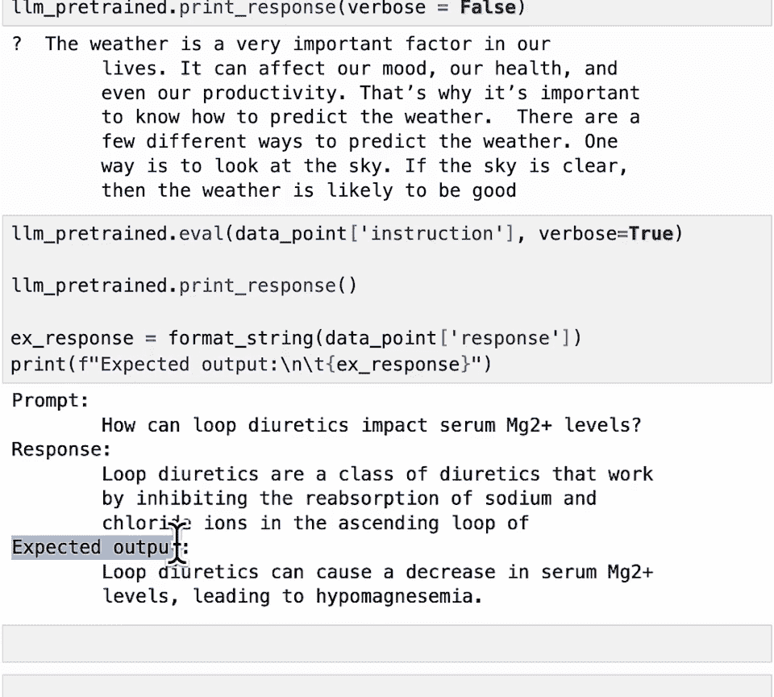
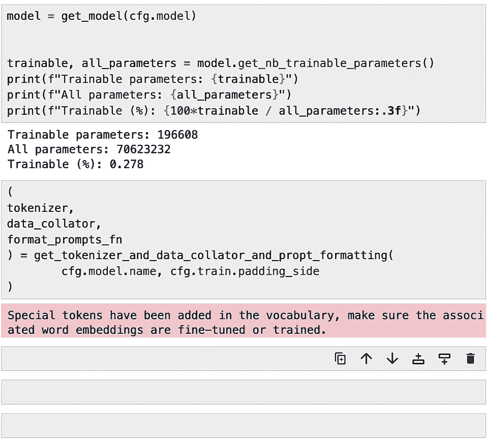
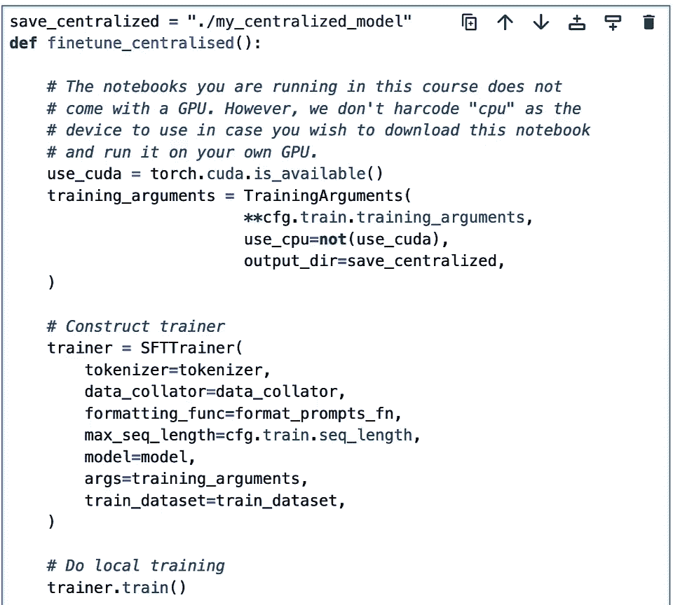
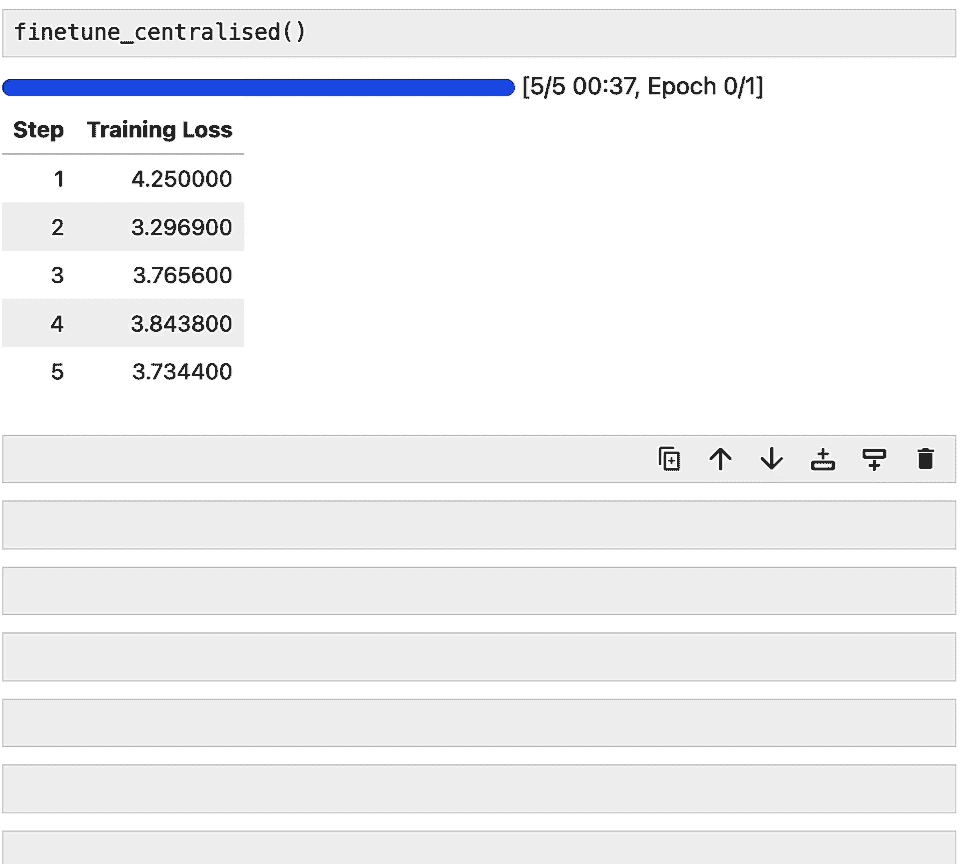
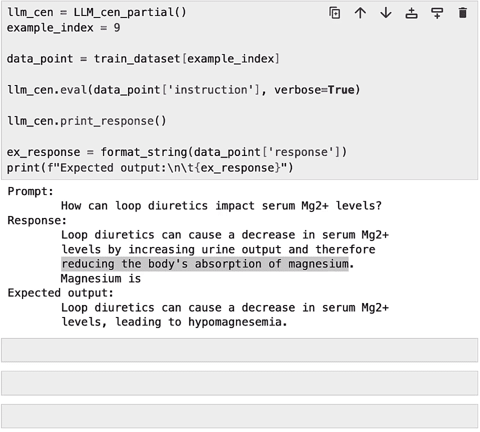
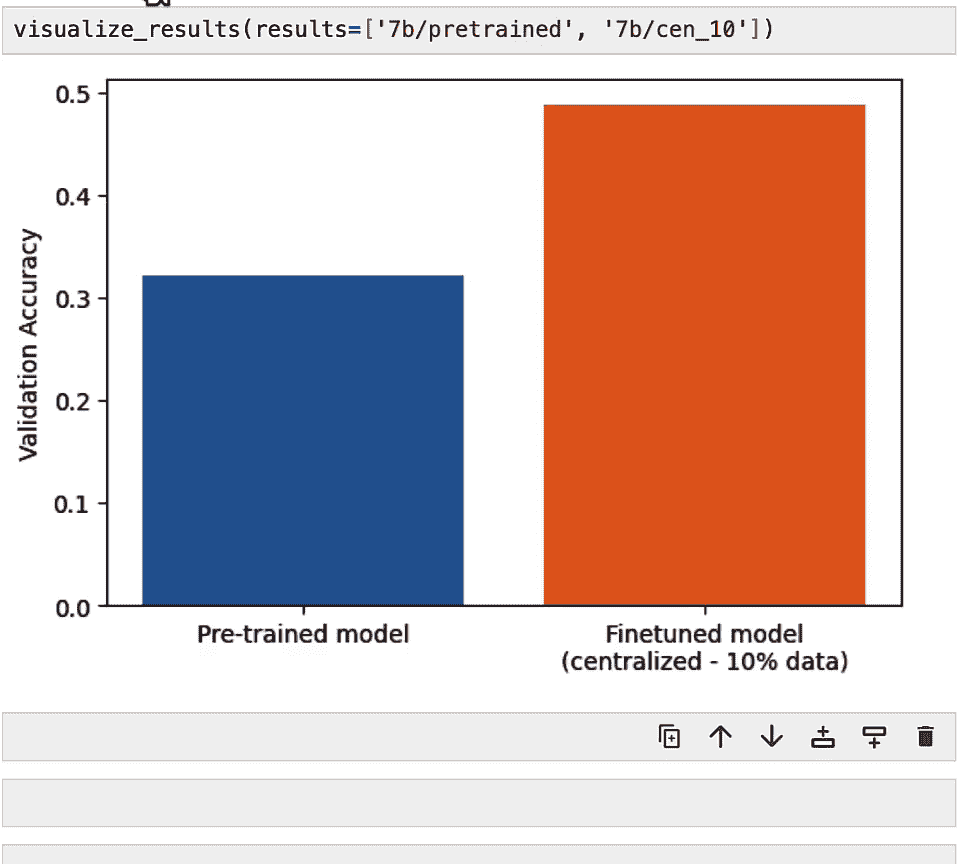
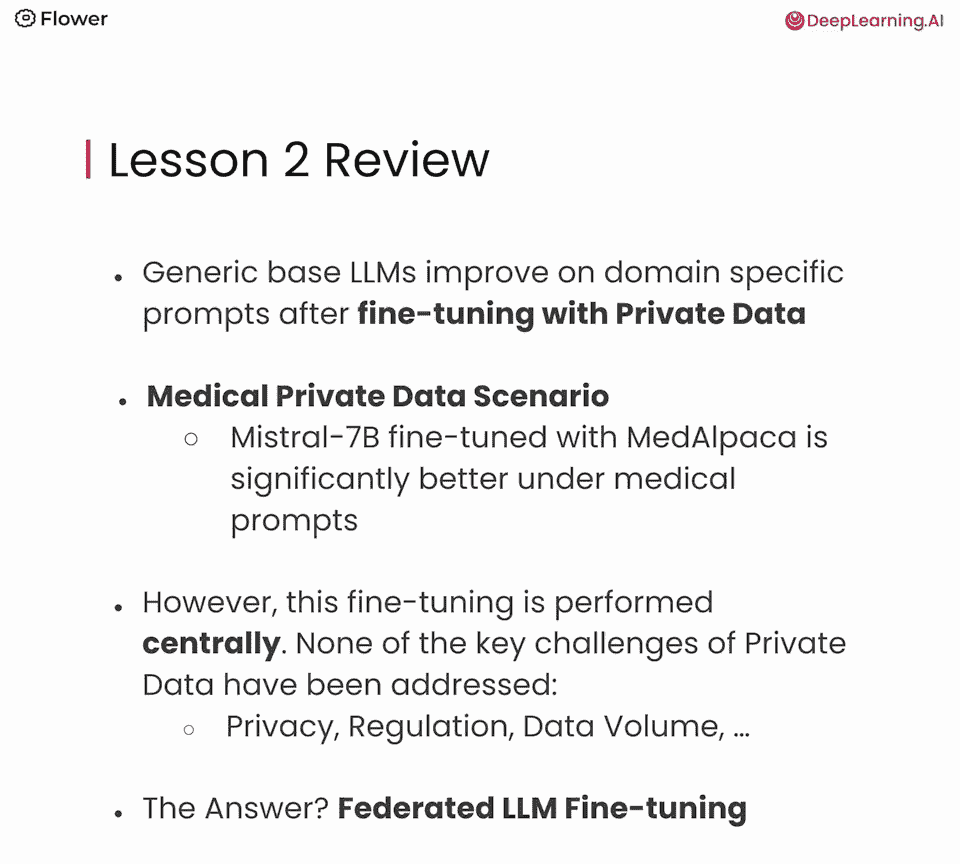

# 吴恩达《使用私人数据进行大语言模型的联邦微调｜Federated Fine-tuning of LLMs with Private Data》中英字幕（豆包翻译 - P3：3.L2_Centralized_LLM_Fine-tuning - GPT中英字幕课程资源 - BV1uE421w7Xz

那么当一个大型语言模型能够使用私有数据时，它能好多，少呢？在这节课中，你将构建一个在私有医疗数据上进行微调的，大型语言模型，然后你将能够看到它回答复杂医疗问题的，能力有多好。

你将通过使用现有的集中式微调方法开始这样做，这样你，可以更好地欣赏联邦方法所提供的好处。好的，我们开始吧。让我们首先介绍我们将在本课程所有剩余课程中使用的场，景。你在这个动画中看到的场景。

有多个医疗位置。你可以在这个动画中看到它们，就是底部的三座建筑。每个位置都有高度敏感的医疗数据。你想用这些数据微调一个大型语言模型，从而提高大型语，言模型对医疗问题的响应能力。

尽管你将使用的数据是医疗的，但基本场景在各个行业和，应用中广泛推广，法律、企业、金融等等。在这节课中你不会使用联邦学习。相反，目的是看看当一个大型语言模型能够访问我们非常，感兴趣利用的那种私有数据时。

它能提高多少。这里的动画实际上说明了我们将在这节课中使用的传统集，中式微调方法。所以在动画中你可以看到数据离开这些不同的医疗机构，到达服务器，之后进行微调并更新大型语言模型，这正是你。

将在接下来的代码中要做的。

在我们到达那里之前，让我们稍微谈谈你将使用的数据。为了给我们提供一个私有数据的代表性例子，我们使用 ，MedAlpaca。这是一个很棒的资源，包含各种不同类型的医疗领域知识，至关重要的是。

它还包括问答对，所以虽然评估一个大型语，言模型的响应并理解它是否有所改进可能是主观的，因为，在这个代码示例中这个数据集使用问答对，这意味着如果，大型语言模型在回答质量上实际上在改进，评估起来会更，容易。

因为我们知道对于数据集中这些特定的问题和答案，示例，离散的响应是什么。通过使用完全在线且开源的 MedAlpaca，它也可以作为私，有数据是什么以及它如何有益于大型语言模型的一个非常，有力的代理。

你将能够体验和看到当你开始将其应用于你，可能工作的不同领域的自己的私有数据时我们所期望的改，进。

我们去看看代码吧。那么让我们首先导入几个我们将需要的包和实用函数。你在这里会看到我们将使用带有 PEFT 的抱抱脸转换器库，PEFT 是一种用于执行微调的参数高效方法，我们将在接下，来的这节课中解释。

你还会看到我们从实用模块中导入了几个函数，这将帮助，我们保持笔记本整洁。在本课程的笔记本中，你将使用 Hydra。它是一个管理配置文件的强大工具。

不再多说，让我们加载描述集中微调如何执行的配置文件，让我突出一下该配置文件中几个感兴趣的部分。你可以看到你正在使用的数据集的名称。它是 MedAlpaca 的抽认卡问答子集。

你也可以看到我们正在使用的模型。我们正在使用来自 Eleuther AI 的 7000 万参数的大型，语言模型。我们将使用 PEFT 和 LoRa 来训练这个，但是会在下一节。

课中解释 PEFT 和 LoRa。你可以看看训练部分，你会在那里找到当你训练一个大型，语言模型时你会期望的典型超参数。所以对于这节课，它们已经针对我们正在执行的微调进行，了调整。

特别是我们已经更改了这些值，以便微调可以在这，个笔记本中在短时间内完成。

在开始微调之前，让我们先看看 MedAlpaca 数据集。让我们首先使用抱抱脸数据 API 加载它并提取训练分区，的 10%。记住在这里你扮演的是一个科学家的角色，只能访问已经。

分布在你正在合作的各个医院的总数据的 10%。打印语句向我们展示该数据集包含两个列，指令和响应，并，且这个 10%的子集包含将近 3400 个训练示例。让我们看一个例子。

在这种情况下是第 10 个训练示例。你可以看到它分为两部分，指令和响应。我们有一个关于利尿剂的高度医学问题，然后我们在这个，数据集中看到理想的响应，这又是一个相当技术性的响应。

关于利尿剂将如何导致体内某些水平的增加。在开始实际微调之前，让我们了解一下我们的起点。让我们看看一个预训练的 70 亿参数的大型语言模型如何，首先对一个一般问题然后对一个更专业的问题做出响应。

让我们首先通过 fireworks。ai API 加载一个预训练的 ，70 亿 Mistral 大型语言模型的评估器。可以随意更改并尝试不同的提示，但我们将从一个询问如，何预测天气的提示开始。

你可以看到得到的回答有点模糊，但仍然相当可以接受且，合理。让我们评估一下这个预训练模型在面对特定领域问题时的，表现。我不是医生，所以我们将从 MedAlpaca 数据集中取一个例，子。

所以我们对它进行一个非常特定领域的医疗领域查询，的强测试。让我们看看我们得到的答案。你首先可以看到提示，这是我们问模型的问题，就像我之前，说的，它来自 MedAlpaca 数据集。

这是一个与利尿剂有关的非常技术性的医学问题。你可以在这里看到模型的回应，有趣的是它在这里做了很，好的尝试。它实际上没有回答我们所问的问题，而是主要依靠为我们，提供利尿剂的定义，所以这不是一个糟糕的尝试。

但它显然，没有包含我们所要求的那种信息。在这个回应下面，我们看到了训练集所寻找的实际真实答，案，所以你可以看到这个回应更直接地回答了所问的问题。

。现在很明显，预训练的大型语言模型在能够回答特定领域，问题方面不会让我们走得很远，你可以开始引入在我们实，际微调这个模型之前所需的代码。首先，让我们实例化模型。

这里是开始谈论与模型相关的一些提取统计信息的好地方，因为我们已经加载了配置并做好了开始训练的准备。你可以看到我们即将使用 PEFT 微调的 7000 万参数的大。

型语言模型实际上只会修改 17 万个参数，换句话说，不到，总参数的 0。3%。我们将在下一节课中详细描述 PEFT，但有趣的是，修改如，此小部分的总参数可以使这种微调非常高效，我们在下一。

节课中也会使用到这一点。与所有大型语言模型一样，你需要定义一个分词器。在这里我们还构建了在将训练示例传递给大型语言模型时，将使用的辅助对象。所有组件都准备好了，模型、数据集、分词器，你准备好开。

始微调了。唯一缺少的部分是将所有东西在一个函数下粘合在一起。

所以让我们这样做。让我们看看微调下划线集中函数的作用。首先，我们检测笔记本中可用的设备。这里没有 CUDA，所以微调将使用 CPU。然而，如果你在自己的系统上运行这个笔记本，你可能有一。

个 GPU 可用，所以这些行应该允许它根据你运行此代码时，可用的硬件类型进行动态调整。然后，我们利用抱抱脸的训练器来连接之前实例化的所有，组件。最后，训练开始，之后，你将保存一个检查点。注意。

这个检查点将只包括微调参数。

让我们进行一些微调。在这里，大型语言模型将只微调五个步骤，并且我们将使用，一个小批次大小，所以你会看到损失慢慢下降。这可能需要一分钟才能完成，就是这样。我们已经完成了微调过程中的五个步骤，损失已经下降。

通过你已经看到的上面的代码单元，你拥有微调任何大型，语言模型所需的一切。到目前为止，你只对较小的 7000 万参数的大型语言模型，进行了微调，并且只进行了少数步骤。要微调一个大得多的 70 亿参数模型。

你可以运行完全相，同的代码，但你需要加载不同的配置。像这样加载完整配置，然后从笔记本的开头运行单元。请记住，对于此，建议在至少有一个 GPU 的机器上运行。还有一个问题。

这个微调后的大型语言模型是否比我们一开始看到的未微，调模型的行为更好？我们看到即使是一个 70 亿参数的大型模型也难以给我们，对一个详细的医疗问题的好回答，所以现在我们已经微调，了它，它会改进吗？

让我们再测试一下。所以为此，我们将再次在同一个训练示例上进行测试，但请，注意这里我们再次在 70 亿参数的 MRA 模型上运行，但这，次它已经在我们使用的数据的 MedAlpaca 子集的 10%上。

进行了微调。正如你所看到的，从这个微调模型中，我们这次得到了一个，好得多的答案。让我们再看看这个问题。这是我们之前看到的关于袢利尿剂如何影响这些不同水平，的同一个问题。这在提示中显示在这里。在底部这里。

再次，我们有这个基本事实，这个在数据集中，关于理想回答的答案。那是直接和切中要点的，解释了袢利尿剂可以导致这些水，平的降低，甚至给出了这种效果的技术术语。所以现在让我们把注意力转向模型的实际表现。

你在这里，看到的是一个好得多的响应。它直接回答了问题，并解释了袢利尿剂如何确实能够降低，这些水平，甚至还稍微解释了一下这会产生什么影响，比如，因此它会减少身体对镁的吸收。所以这是一个好得多的答案。成功！

到目前为止，我们看到了一个很好的响应，但这只是针对一，个单一问题。实际上，我们需要在大量问题上观察模型的行为，然后才能，确切知道是否有系统性的改进。做这种类型的事情需要相当长的时间。

我们需要提示模型并在大量例子上观察它的响应，所以我，们所做的是离线进行并将结果保存在一个数据结构中，然，后我们现在要为你可视化它。但我要提到的是，在笔记本中，在 Markdown 中，你会看到。

自己运行这个所需的代码，所以你可以自己生成这个有这，些结果的结构。如果你愿意，你可以针对不同的模型和不同的数据集合进，行完全相同的分析，但在这里这个变量“结果”已经由我们，使用你可用的代码填充。

在那里我们向大量问题提问以查，看是否有系统性的效果和益处。

就是这样。你可以清楚地看到微调模型相对于预训练模型有相当明显，的改进。让我为你多解释一下这个图，这样你就能理解是怎么回事，y 轴本质上是来自这些问答例子的准确性，在那里很清楚，什么是正确答案。

什么是错误答案，所以这对我们来说评估，很容易，然后我们问了两个不同的模型，没有任何微调的 ，70 亿参数模型，以及用 10%可用的中羊驼数据微调的同一，个模型。

然后我们看到了对于那组问题准确性指标发生了，什么。我们观察到了什么？我们看到准确性从略高于 30%跃升到几乎 50%，尽管我们，使用的只是整个可用数据集的相对较小部分。

这就是第 2 课的结束。我们在代码中看到了我们如何可以采用一个通用的大型语，言模型，在私有数据上微调它，并在医学领域看到明显的响，应。这是我们在本课程剩余部分的许多课程中将要贯穿的一个，运行示例。

这个医学私有数据场景，在那里我们使用用中羊，驼数据集微调的米斯特拉尔 7b 模型，正如我们可以看到，响应的准确性显著提高。为什么这很重要？嗯，这展示了使用通常无法获得的私有数据所能获得的价。

值和收益类型。接下来是到目前为止我们实现这一点的方式是通过使用集，中式微调。正如我们在第 1 课中讨论的，由于大型语言模型能够复述，训练数据，在私有和敏感数据上这样做是危险的。那么答案是什么呢？

我们将在下一节课中查看答案，实际上答案将是联邦大型。

