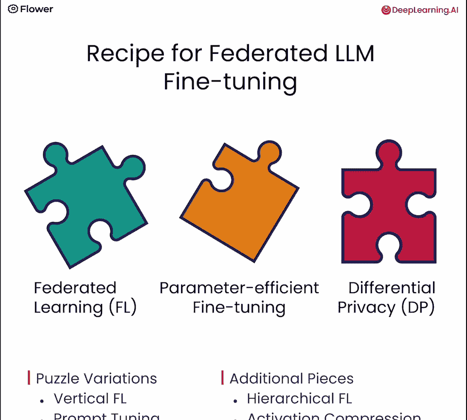
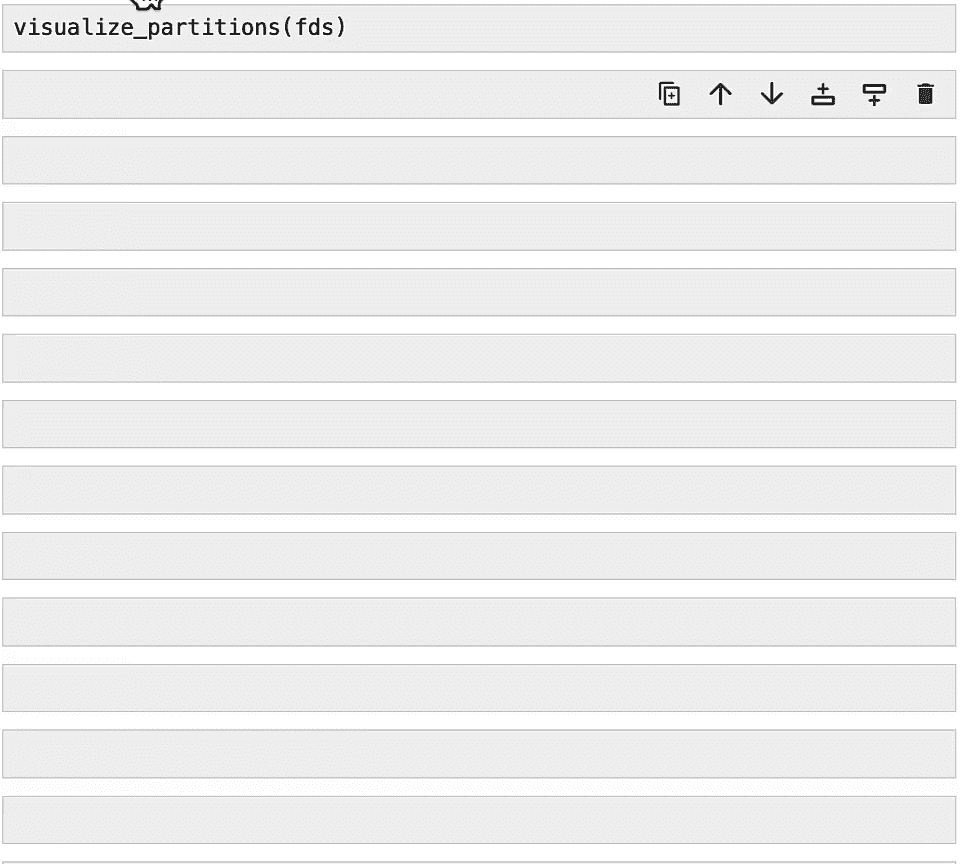
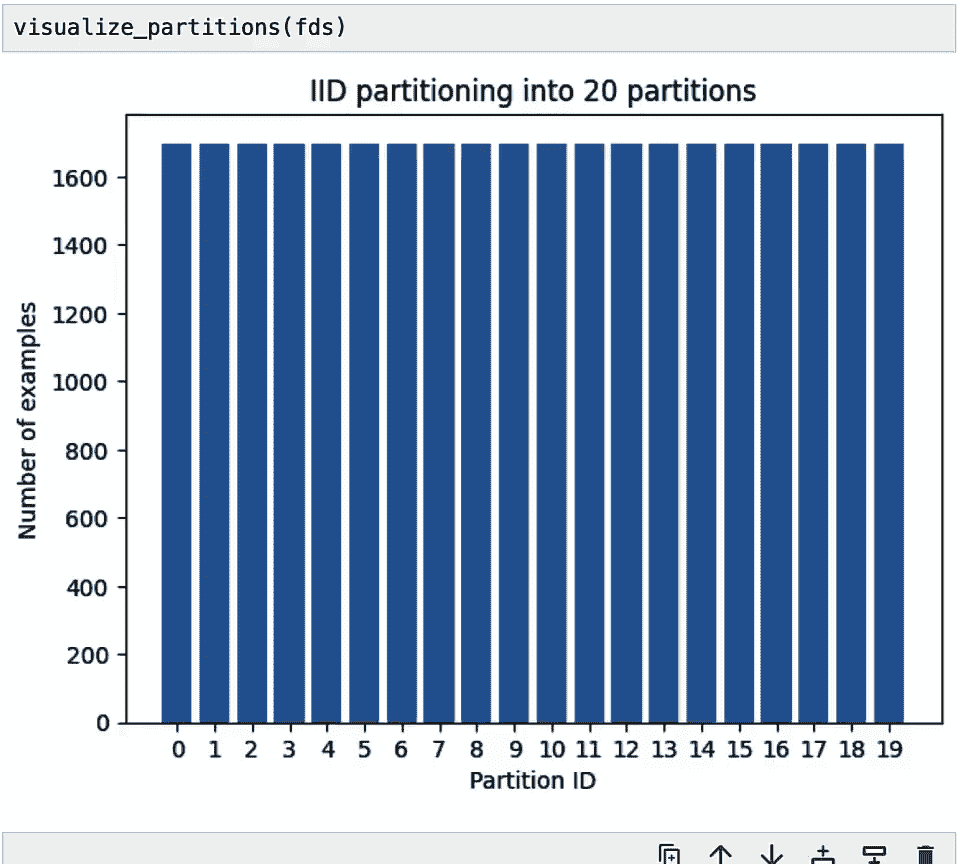
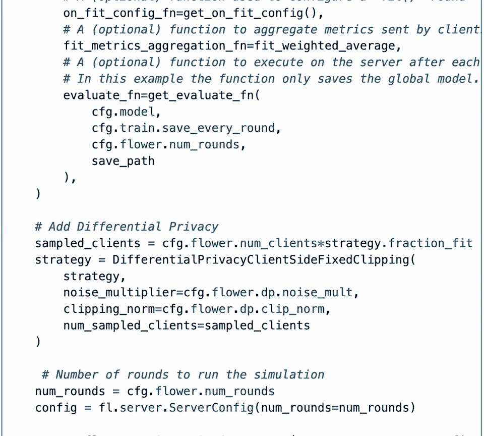
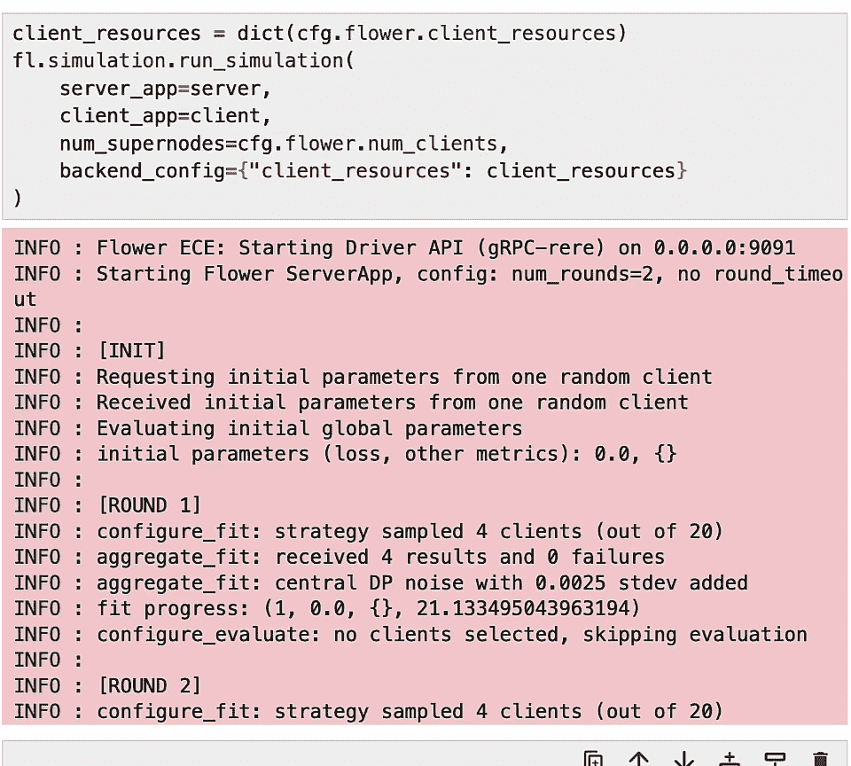
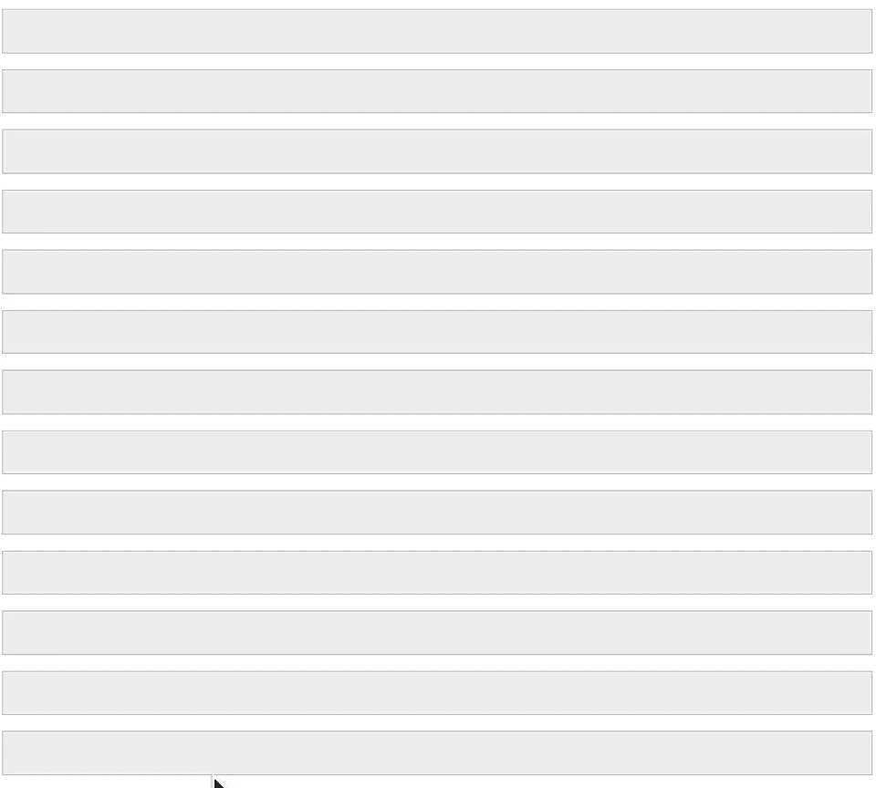
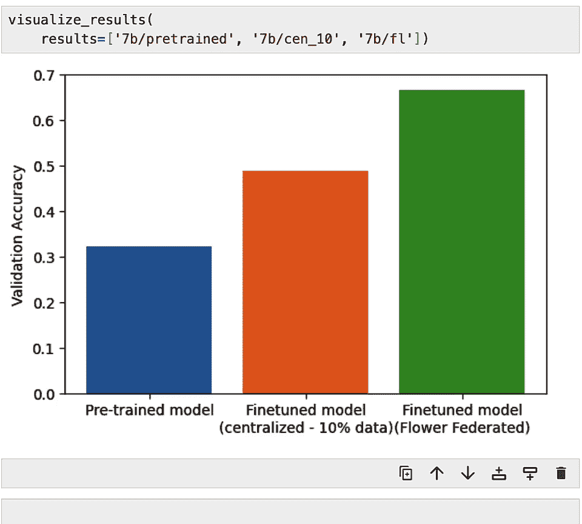
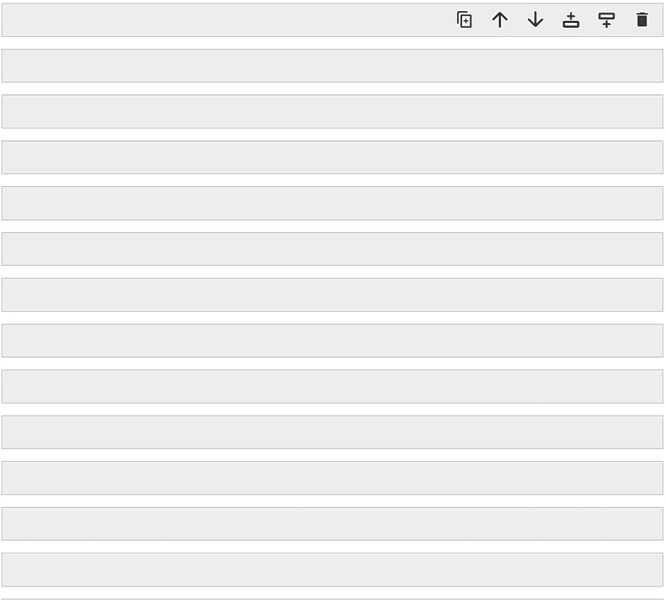
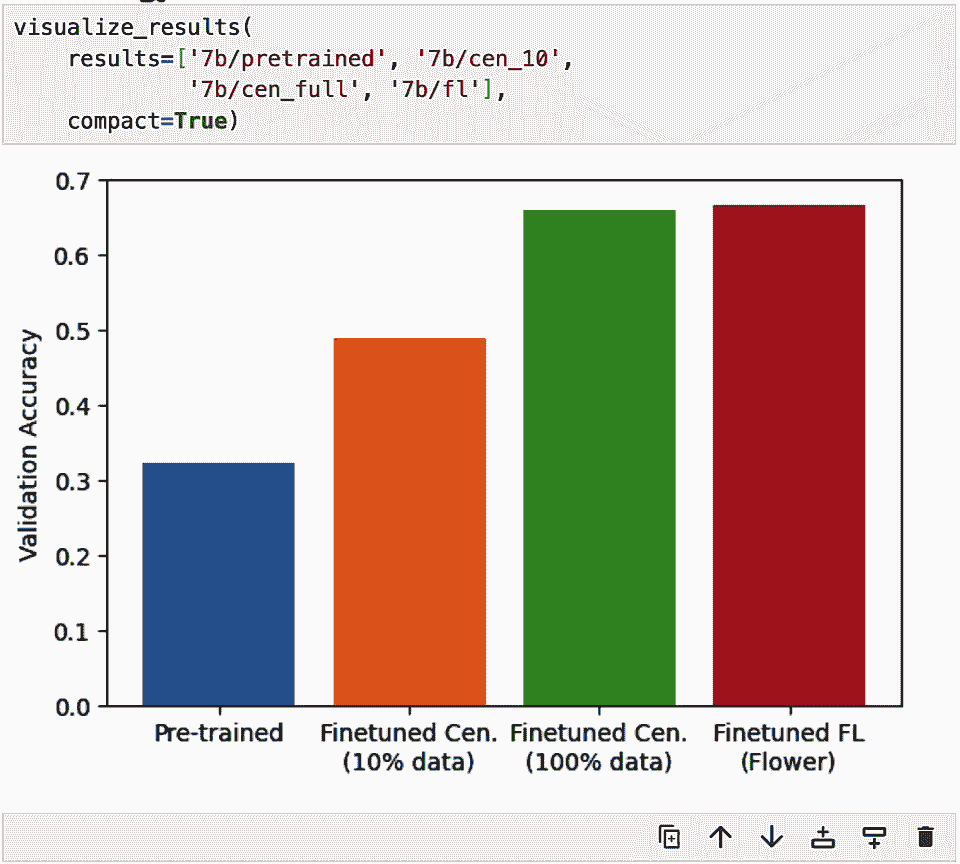
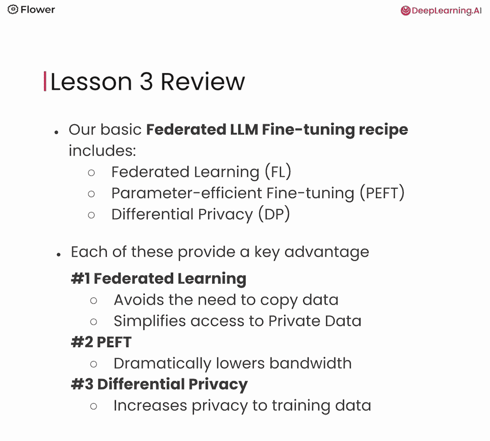

# 吴恩达《使用私人数据进行大语言模型的联邦微调｜Federated Fine-tuning of LLMs with Private Data》中英字幕（豆包翻译 - P4：4.L3_Federated_LLM_Fine-tuning - GPT中英字幕课程资源 - BV1uE421w7Xz

为了将私有数据用于大型语言模型，你可以使用的最佳工，具之一是联邦大型语言模型微调。在本节课中，你将首先了解这种方法是如何工作的，以及如，何克服像隐私和效率这样的各种挑战，然后你自己使用它。

来构建你自己的联邦大型语言模型。好的，让我们来构建一些东西。在我们进入代码之前，让我们先确保联邦大型语言模型微，调的所有主要概念都首先清晰。让我们从基础开始，而所有这些中最重要的成分是联邦学，习。

如前所述，这个大的想法是训练过程将转移到数据，这就是，你在这里看到的这个动画所说明的。在本节课中，你的理解将从你在这个动画中看到的、隐藏，了很多细节的内容，转变为一个你可以欣赏所有共同起作。

用以使这种学习实际发挥作用的核心技术的理解水平。但在我们到达那里之前，让我们再次停下来，并与你在上一，节课中刚刚使用的方法进行比较。回想一下，你使用了集中式微调方法，这需要在微调开始之。

前将数据复制到服务器。并且，你再次看到这在这里的动画中发生。我们在每个单独的医院，数据必须在微调能够发生之前被，移动到服务器。然后这就是我们在本课程中研究的两种方法之间的根本区，别。最后再提一下。

本课程专注于大型语言模型、私有数据以，及这与联邦微调的关系。但请查看关于联邦学习的其他介绍课程，以获取更广泛的，关于联邦学习的所有其他细节。很快，在你将看到的代码中，我们将使用一个执行联邦大型。

语言模型微调的基本配方。你可以把它想象成一个拼图，其中有三个主要部分被使用，我们将联邦学习、参数高效微调和差异隐私一起使用，形，成一个配方，这将使我们能够执行这种特定类型的微调，并。

拥有我们到目前为止所讨论的所有那些好处。我可以用例如垂直联邦学习来替换你将要看到的联邦学习，部分。我可以用可能与提示微调有关的东西来替换你看到的微调，我们可以研究差异隐私的不同变体。

所以有很多不同的方法来执行这个动作，而我们正在看一，个非常基本的表述。另一件你需要记住的事是，我们可以根据你的应用程序和，数据需求，将额外的部分放入这个拼图中。

所以你可以在这三个拼图部分的组合中加入一个支持分层，联邦学习的部分，或者执行某种类型的模型压缩，或者包含，同态加密。你将使用这些变化和添加来满足隐私、准确性或你正在使，用的特定架构的需求。但现在。

我们将首先只解释这种大型语言模型微调技术的，基本形式，并一个一个地进行。

为了在这个过程中建立一定的理解深度，让我们从联邦大，型语言模型微调的最基本形式开始，一开始甚至不使用差，分隐私或参数高效微调。它们将一点一点地被引入，这样，你也将能够看到为什么它，们是需要的。

但让我们从这里开始，你可以看到这个图示实际上使用了，我们在前一课中描述的场景，我们正在使用来自许多不同，医院的私有数据。你可以看到它们在图的底部被展示出来。在你很快将使用的代码中。

我们在那个笔记本中使用了米，斯特拉尔 70 亿参数基础模型，这就是为什么我现在把它，添加到了这张图中。你可以看到它在那里，与全局模型相邻，正好位于服务器上，方。

这就是你将通过利用私有数据和客户端来改进的大型语言，模型。在这种制度下进行微调的第一步是进行客户端选择。你可以看到这也在这个图中发生了。并且已经选择了两个客户端。它们现在正由这两个蓝色箭头指示。现在。

根据情况，你可能有这样的设计，即你有完全的客户，端参与，所有客户端在一轮训练中同时活跃。但能够选择客户端的一个子集允许我们管理像通信开销这，样的问题。在这种情况下，这个例子中。

这两个客户端将对他们在本地，可用的模型架构，也就是这里的这个米斯特拉尔模型进行，标准训练。所发生的是每个客户端训练将进行，并且这个大型语言模，型的权重将再次仅仅根据客户端拥有的数据进行更新。

如果我们现在向前推进，下一步是然后每个客户端更新后，的模型权重将被发送到服务器，在那里需要进行一个聚合，阶段。来自客户端的更新被聚合。比如，我们会使用类似 FedAverage 的方法，这是一种所有。

这些模型更新直接平均在一起的方案。然后这个更新应用于现有的模型，即这个 Mistral 模型，以对其进行微调以考虑本地客户端存在的数据。每个平均步骤称为一轮，需要完成多个这样的联邦学习轮，次。

直到微调完成。所以现在我们已经描述了一种对大型语言模型进行联邦微，调的完整方法。那么接下来是什么？嗯，你可能已经注意到可能存在一些通信开销。原因是大型语言模型比联邦学习通常使用的模型大得多。

所以当我们谈论传输模型更新时，实际上我们经常谈论的，是在客户端到服务器之间传输整个模型。现在，当你有相对较小的架构时，这可能没问题，但显然在，大型语言模型领域，这可能很快就会失控。因此作为参考框架。

Mistral 模型，即这个 70 亿参数的模，型本身，可能大约是 27 吉字节，这取决于你对参数使用的，精度。现在，如果我们在多个客户端和服务器之间实际传输 27 ，吉字节，每次一轮发生时。

并且我们在多个轮次中这样做，那么发送的数据量，甚至传输这些数据所需的时间，可能会，开始变得不可接受地慢。这在非大型语言模型设置中不是你通常会如此强烈遇到的，事情。那么我们该怎么办？

这就是我们引入 PEFT，即参数高效微调的地方。PEFT 将降低每轮从客户端到服务器必须发送的参数数量，让我们看看这是如何做到的。在这张幻灯片中，我所做的是在幻灯片左下角展示了典型。

的整体拓扑结构幻灯片的一个片段，这样我们可以保持我，们的参考框架。你可以看到客户端与服务器交换模型更新。但在这里的右边，我在说明使 PEFT 能够极大地降低客户，端和服务器之间需要传输的数据量的概念。

因此在 PEFT 中的关键思想，我们碰巧在你很快将使用的，代码中使用 Laura 作为我们的 PEFT 形式，关键思想是我，们实际上能够冻结模型的大部分权重。你可以在客户端层面的图表中看到这一点。

突然间我们将，模型的很多部分从这种黄色颜色变成了很多蓝色。而这是考虑到在模型更新过程中，这是通过 PEFT 技术在，本地发生的，那些权重是冻结的，在模型更新期间实际上并，没有被更新。现在。

我们所要做的只是不传达这些冻结的权重，而只传达，那些被允许改变的权重。有趣的是，因为这种技术似乎是一个在这里相当概念上容，易的技术，这里的关键因素是，即使将冻结参数的百分比调，高到极高水平。

这种技术也已被证明是有效的。所以在这里你可以看到，我举例说明，98%的权重在这个过，程中表现为冻结，只有 2%的权重能够被改变。现在，有趣的是，即使在那个水平，我们仍然可以有非常好，的微调水平发生。

基础模型真的能够适应并提取我们需要，的大量信息，尽管这些权重中的大部分都没有改变。但是通过这个过程，我们现在有一个设施，模型本身可以更，新，但需要交换的数据量大大减少。当我们查看代码时。

你会看到关于这意味着什么以及这如，何在如此大的程度上提高性能的实际数字。但这里我们刚刚提到了两个重要因素。两个大挑战。一个是，现在在大型语言模型的情况下变得非常尖锐的带，宽问题已经得到了很好的管理。

还有二阶效应，比如所需的，计算量也减少了，因为我们不必修改那么多参数。我们还可能有其他什么类型的挑战？嗯，整个课程的一个重点领域一直是隐私，我们知道大型语，言模型在某些情况下能够复述训练数据。

所以即使联邦学习的一个核心构建块是数据不再需要传输，但这本身是不够的。所以我们要在这个难题中加入我们的最后一块，那就是差，分隐私这一块。你可以在我们的图表中看到它与 PEFT 一起展示。

让我们深入了解在这种情况下差分隐私是关于什么的。所以再次，我想说对于更详细的解释，请查看我们关于联邦，学习介绍的配套课程，该课程查看了所有实现类似结果的，变体和其他配套技术。

但我们只是要为你勾勒出这里如何使用差分隐私。再次，看左边。我在这里有这个很好的参考框架图，它提醒你这些客户如，何与服务器通信。在右边，我们正在深入研究在这种情况下通过引入差分隐，私而发生的一些具体变化。

实际上，差分隐私引入了许多技术，你可以用这些技术来掩，盖个别训练样本的一些具体细节，以降低它们被泄露的机，会。所以你在幻灯片右侧看到的是一个例证，在客户端层面，我，们在训练期间故意校准噪声。

所以你看到的这条红线概念化了这样一个概念，即通过学，习最终减少模型误差的个别样本而获得的信号被故意添加，了噪声。并且选择和应用噪声，以便信号可以在重要方面被仔细掩，盖。

当我们添加这种噪声时发生的模型更新然后与服务器共享，而这些噪声模型更新就是我们在这个过程中如何增强训练，数据的隐私保护水平。在这个特定应用中合理的保护分辨率是在个别训练样本的，层面。

但根据你可能拥有的不同应用，你可能有不同的主题需要，保护。所以不是担心个别训练样本，你可能在生成大量样本的作，者的粒度上工作，并试图将其作为一个群体来掩盖。从稍微更技术的角度来看。

我们可以开始看看差分隐私试，图为我们实现什么。这里的这张幻灯片展示了两个不同的模型，LLMA 和 LLMB，这些模型之间的唯一区别是，一个是用特定的训练实例训，练的。

一个是在没有该实例存在的情况下训练的。差分隐私通过添加噪声试图实现的是，即使在一个模型中，有训练样本而在另一个模型中没有，这两个模型也应该产，生无法区分的结果。通过这种方式。

它提供了一种合理的否认形式和获取底层，训练数据的难度，这有助于防止诸如模型反刍它所接触到，的训练数据的方面等问题。所以差分隐私帮助我们能够提高训练数据的保护水平，它，与更基本的核心机会一起工作。

以提供一个更私密和安全，的系统，例如数据不再需要被复制这一事实。现在，要加入到这个讨论中的一个重要因素是，为你提供一，点关于差分隐私如何工作及其与添加噪声的关系，同时仍，然允许我们学到一些东西的直觉。

所以我想在这里给你提供这个图示，给你这点直觉。所以你看到这张图像，它实际上是在一个非常有趣的活动，叫做花卉 AI 峰会时拍摄的。结果它成为了世界上最大的联邦学习会议。

你可以看到人们在这个活动中玩得很开心。上面的图像，这再次为我们提供了关于差分隐私如何工作，的概念性理解。上面的图像是未被触动的。我们可以在这个数据中潜在地看到隐私敏感信息。我们看到人们的脸。

我们看到背景中的文本。我们可以看到很多不同的信息，这些信息可能不是执行我，们想要的学习所根本需要的。然后在它下面，我们又看到了同样的图像，但是我们有策略，地模糊了，对非常敏感的某些区域添加了噪声。

所以人们脸的区域，它们被掩盖了。背景中的单词，它们被掩盖了。但是你观察到的是，仍然有可能从那个有选择性噪声放置，在上面的图像中理解和学习，宏观模式。例如，你可以学习房间里有多少人。你可以看到房间的类型。

你可以看到活动的类型。而我们通过这个额外的噪声所做的是使识别某些特征，如，脸，变得更加困难。这希望能给你一个强烈的直觉，关于这个机制实际上是如，何为我们运作和工作的，以及如何保护单个训练样本，同时。

仍然允许我们学习这些对模型成功非常重要的宏观模式。所以现在我们已经到了描述所有一起工作以使联邦大型语，言模型微调能够发挥作用的各个部分的结尾。现在是时候转换到代码了。就像一个简短的提醒。

我们将回到我们喜欢的医疗场景，在，那里我们想从许多不同的私有数据源中学习，以便改进一，个大型语言模型的通用骨干，这样它就可以然后以高得多，的保真度回答非常具体的医疗问题。让我们深入代码。在这第三课中。

你在这里的主要目标将是学习如何在一个，大型语言模型上进行联邦微调。正如我们在前一个笔记本、前一节课中看到的，很多时候，我们将使用一个 7000 万参数的较小的大型语言模型，但。

我们也会为你提供微调一个 70 亿参数模型所需的一切。还记得在前一个笔记本中，你扮演了医院里的一位科学家，的角色。所以这位数据科学家只能利用医院里可用的数据。但现在通过使用联邦学习。

我们将允许这位数据科学家获，取并利用他们周围许多不同医院的数据。通过这样做，让他们突破这占总数据 10%的障碍。我们将看到当你允许模型接触到越来越多的数据时会发生，什么。在这个特定的笔记本中。

你将使用花朵模拟引擎来模拟一，个有 20 个客户端的真实联邦学习系统。而这些每个都将代表一个不同的医院。让我们首先再次导入一些我们将需要的包和实用函数。这个笔记本还使用了抱抱脸转换器库和 PIFT。

让我强调一些对这个笔记本特别相关的导入。首先，你可以看到我们正在导入花朵。正如我提到的，花朵将被用来运行花朵模拟引擎。我们还将使用花朵数据集。这是一个库。

它允许我们将 MedAlpaca 数据集分割成 20 ，个不相交的独立数据集，这对应于在你将运行的这段代码，中的 20 个不同医院中的每一个。这个例子还使用了差分隐私。所以我们需要导入一个模块。

使客户端，在这种情况下，花，朵客户端，能够使用差分隐私，并且作为一个包装器，用于，在聚合后应用差分隐私的花朵策略。所以你可以在这里看到我们导入花朵策略和将应用于花朵，客户端的特定差分隐私模块。

接下来让我们首先开始加载配置。正如你可以看到的，它的内容与我们在专注于集中微调方，法的第二节课中使用的非常相似。所以你可以看到这个配置使用了 MedAlpaca 数据集。正如我们多次提到的。

当我们在笔记本中运行这个时，我们，使用的是碰巧是 7000 万参数的较小版本。你可以在这里看到。然后你可以看到一些其他更通用的超参数。你可以看到这里指定了非常相似的值，就像我们在集中式，训练设置下一样。

不过，如果我滚动到这个配置的下部，我们会看到在这个花，标签下有几个新的条目。所以在这个配置中，我们可以看到它指定了客户端的数量，它还指定了将要进行的联邦学习轮次的数量。你应该注意到这里我们指定了 2。

所以是相当少的数量，但，我们这样做是为了它能在笔记本中快速完成。此外，你可以看到在这个配置的客户端资源标签下，你可以，调整在模拟中使用的并行程度。所以这是在一个学习轮次的客户端选择阶段。

我们只会与 20%的客户端交互。另外，你可以看到在这个配置的客户端资源标签下，你可以，调整在模拟中使用的并行程度。这些值代表分配给客户端的资源。直观地说，如果你降低它们，更多的客户端将能够在同一硬。

件上运行。对于 7000 万参数的大型语言模型设置，我们为每个客户，端使用两个核，因为这对于这个演示来说足够了。然而，如果你稍后在 GPU 上使用这个笔记本，你可能想要，增加它。最后。

这个配置的 DP 部分指定了范数裁剪和噪声乘数参，数。这些中的每一个都定义了在微调过程中对训练数据提供的，保护程度，降低了数据泄露发生的机会。

现在让我们开始将 MedAlpaca 数据集分割成 20 个不相，交的集合。这些不相交的集合中的每一个都将成为与我们即将模拟的，联邦中这 20 家医院之一的数据相对应的本地数据集。在这里回想一下。

一个客户端对应一家医院。要做到这一点，你将使用 flower 数据集。所以这是一个专门为联邦数据集设计的工具包，用于协助，下载、处理，在这种情况下，正确地分割数据集。有趣的是。

数据集分割可能会变得相当复杂，尤其是当你开，始将不同形式的数据异质性引入其中时，这在更现实的联，邦学习设置中是常见的。有了 flower 数据集，它带有几个内置的分割方案，你可以，完全忘记这一切。

把你所有的注意力都放在你的架构和算，法的设计上，并跟踪那些表示性能的关键指标。在这里，我们将采用最简单的方法，使用独立同分布划分器，来分割数据，这意味着所有分区都将通过从整个数据集中，均匀抽样来构建。

让我们运行代码并检查第一个分区的元数据。就像我们在前一个笔记本中看到的那样，整个数据集包含，两列，所以在这个分区，即数据集的第零个分区，它也包括，两列，指令和响应。

现在让我们对每个数据分区进行简单的可视化，这将显示，每个分区拥有的训练数据量。

如你所见，所有 20 个分区都大约有 1700 个训练示例。Y 轴是每个这些分区数据孤岛中存在的示例数量，你可以，看到有 20 个，其中 X 轴是每个分区的标识符。现在数据集准备好了。

让我们继续进行运行联邦所需的其，他组件。就像我们在前一个笔记本中看到的那样，让我们加载分词。

器和其他预处理大型语言模型输入所需的组件。在 Flower 中，客户端是使用客户端应用来定义的。客户端应用可以通过指定一个客户端函数来构建，该函数，返回一个客户端对象，该对象知道如何做两件事，实例化模。

型，然后运行训练循环，因为这些是每个客户端在联邦轮次，中需要做的必要事情。客户端基本上在本地运行这些轮次，就像你在第一个笔记，本中编写的微调函数一样。最后，因为这个客户端将使用差分隐私。

你会在这里的客户，端规范中看到，一个差分隐私模块，一个 DP 模块被传递。如果你需要了解更多关于这个特定模块的信息，你可能想，查看 flower。ai 上提供的 Flower 文档。

你可以在这里底部看到，被指定的模块是固定裁剪模块，它，为我们提供了一种特定类型的差分隐私。定义了客户端应用后，让我们把注意力转向服务器端。在服务器应用的核心，有一个策略。

一个 Flower 策略负责抽样客户端，向客户端传达指令，从，客户端接收模型更新，运行模型聚合以及其他一些较小的，记账项目。在这个笔记本中，你将使用 FedAverage，如前所述，这是一，种相对简单。

但在服务器级别聚合模型更新非常有效的方，法。在这节课中，你将使用差分隐私增强联邦学习。为了做到这一点，你将使用一种包装策略，该策略将维持你，刚刚创建的联邦平均策略的行为，但也将添加差异隐私所。

需的必要额外功能。在这种情况下，这种额外功能意味着向聚合模型的结果添，加校准噪声。现在策略准备好了，并且包含了差异隐私，你还可以通过指，定你希望运行模拟的轮数来实例化一个服务器应用程序。默认情况下。

模拟将运行两轮，但你可以随意增加这个数字。

。让我们回想一下我们在哪里。我们有数据集、客户端应用程序和服务器应用程序都准备，好了。你现在准备好启动模拟了。要做到这一点，你只需要运行模拟函数。在这些笔记本中，运行模拟应该需要几分钟。别忘了。

你实际上将用一个小的但仍然有 7000 万参数的，大型语言模型进行几轮微调，每一轮将涉及四个客户端。所以如果你想一想，运行模拟花几分钟不算太糟。现在我们准备好运行模拟了。让我们看看进展如何。

随着模拟运行，你会注意到它生成了一些信息日志，这些日，志被分成四个部分。我们需要等待几分钟直到它完成，然后我们可以查看这个，日志数据，然后看看它告诉我们关于模拟进展得如何以及。

发生了什么。在这里我们看到完成的模拟，并且可以查看所有的日志信，息。你可以在这里看到它被分成四个部分。其中的第一部分是关于模拟初始化过程的日志信息。然后我们看到与两轮训练相关的两个部分，即两轮联邦学。

习。最后在底部，你看到总结部分，那里有模拟过程的总结。我认为这里最有趣的一行是最后一行，因为它显示了每个，客户端的平均训练损失。请注意，在这个例子中，没有进行集中评估，这就是为什么。

你看到集中评估的损失为零。现在你已经对一个 7000 万参数的大型语言模型进行了联，邦学习微调，让我们看看你如何对一个大 100 倍的模型，即这个米斯特拉尔 7B 大型语言模型进行微调。

现在是时候看看改进情况或者判断进行这次微调的结果是，什么。回想一下，尽管我们在较小的 7000 万参数模型上进行了，微调，但我们现在要过渡到较大的 70 亿参数模型，只是希。

望看到它在接触所有那些有趣的新私有数据后的改进情况，我们所做的是离线对较大的 70 亿参数模型进行了全面微，调。我们使用了你们刚刚看到的完全相同的代码，但我们在数，据上进行了微调并保存了一个模型检查点。

我们现在要将那个模型检查点加载到系统中，并使用 ，Fireworks。ai API 对这个模型进行推理，这样我们就能了，解到在对这个私有医疗数据进行微调并采用联邦方法后。

它在响应医疗领域问题方面到底好了多少。所以我们首先做的是加载这个先前的模型检查点。而且现在，就像在上一节课中提到的，我不是医生，所以我，不是提出问题来挑战这个模型的合适人选。

所以我们要回到 MedAlpaca 数据，选择一个训练示例，并，将其用作向模型提问的问题，看看它能做得好多少。我们在这里使用的示例是第六个。你们可以随意更改这个数字并自己试验不同的问题会如何。

导致我们微调模型的不同类型的响应。但对于这个特定的问题，即第六个，我们向微调模型提出，低血糖和高 C 肽水平的可能原因是什么？而我们模型的响应是它在谈论这些类型的因素如何由它提，到的一个因素引起。

即胰岛素瘤这种情况。它提到这是一种罕见肿瘤。如果我们看预期输出，那是来自训练集的输出，我们也可以，看到这个黄金标准响应也指向了同样的胰岛素瘤问题。所以这是一个相当好的响应，通过比较私有数据上这个微。

调模型的响应，然后也比较与事实真相的响应。我认为这个模型在这里做得相当好。这里重要的因素还有，与上一节课不同，在那里我们也实现，了模型回答医疗问题能力的提升，记住，我们是通过集中微，调做到的。

这意味着我们实际上是将数据复制到服务器上，才使其成为可能。在这里，我们取得了类似的结果，模型的质量改进和行为有，了很好的提升，但我们是通过联邦学习做到的，我们通过差，异隐私做到的。

并且我们还使用了 PEF 使其保持良好和高，效。如果您还记得，在上一节课中，我们觉得仅仅展示几个问题，的例子，然后查看回答，看到模型有所改进，并表明它回答，医疗问题的能力有系统性的整体提高是不够的。

所以实际上唯一的方法是对大量不同的问题进行广泛的系，统性分析，然后我们才能放心地说上一节课中的集中微调，模型确实更好。所以在联邦学习设置下我们显然也想做同样类型的分析。这就是我们所做的。

进行所有这些分析需要很长时间，它涉，及对许多不同类型问题的推断。所以我们离线进行了这个过程，进行了这个系统性分析，将，这些结果保存到一个变量中，一个叫做结果的结构中，现在。

我们要为您做的是可视化这个分析的结果。

如果我们把注意力转向离线进行的结果所呈现的这个图，我们可以开始看看它告诉我们什么。在 y 轴上，我们报告的验证准确率就像我们在上一节课中，做的那样。它包括我们在上一节课中看到的前两个柱状图所代表的两。

个数据点，在那里您可以看到预训练的 70 亿参数米斯特，拉尔模型在被问到一系列医疗问题时表现相当差，只有略，高于 30%。然后我们看了进行集中微调的情况，我们将自己限制在可，用数据的 10%。

在您是在一家医院工作的数据科学家，而这就是您所能获，得的所有数据的这种情况下。最后，在绿色中，我们可以看到我们在这节课中取得的结果，我们看到的是，通过在联邦制度下，让同一个米斯特拉尔模。

型接触更多在这些不同医院，这 20 家不同医院中运行的，私有数据，您可以看到模型的准确率进一步提高，并开始达，到真正有用的水平。您可以想象，如果我们继续向我们的联邦网络中添加越来。

越多的医院，准确率很可能也会继续提高。最后，让我们再看看这个分析的另一个变化。同样，这个分析是离线进行的，因为它非常耗时。这次我们重复了一直到目前为止我们所描述的完全相同的，分析评估。

但我们觉得展示如果你向我们在前一课中看到，的集中微调方法提供相同数量的数据会发生什么也很重要，就像我们在这一课中使用联邦大型语言模型微调方法进，行训练一样。

有趣的是我们想看看联邦式和集中式的模型精度是否会相，似，还是会有一些差异。那么让我们来看一看。

在这个新结果中，我们可以看到除了包含一个额外的条形，图之外，一切都保持不变。在这种情况下，条形图恰好是绿色的，这是当我们在前一课，中的集中方法被提供与我们在这一课中对联邦方法提供的。

相同数量的私有数据时所得到的结果。你可以观察到精度非常相似。所以大致来说，对于这种特定设置、这个特定数据集，这两，种方法达到了相同的精度水平。然而，请记住，在现实世界的许多情况下，我们受益的那种。

数据由于各种不同的障碍目前没有在大型语言模型中使用，这些障碍无法通过集中微调方法来满足。例如，法规以及与无法将敏感医疗数据复制到机构或医院。

之外有关的问题。在结束这个笔记本之前，让我们也检查一下与较小模型，即，我们实际上能够在这个笔记本中使用的 7000 万参数大型，语言模型相关的通信成本。我们为你提供了一个叫做计算通信成本的函数。

所以它所做的是使用花下的联邦系统配置，然后为我们提，供一些重要通信和系统因素的估计。那么让我们运行这个看看我们得到什么。如你所见，多亏了我们在联邦大型语言模型微调方法中包，含的解决方案。

通信成本降低了 300 多倍。如果你能够通信整个模型，仅在这个笔记本中你刚刚进行，的微调就会通信超过 4 吉字节的数据。但因为你在底层使用了 PIFT，客户端和服务器只需要通信。

仅仅 12 兆字节的数据。非常令人印象深刻。下面，我们也可以看到全规模 70 亿参数配置的输出以及，如果我们实际上在这种规模的模型上进行联邦模拟会是什，么数字。那么让我们这样做。

现在让我们看看当我们在描述一个 70 亿参数模型配置的，数据上运行时，那个完全相同的函数会产生什么。所以这就是我们刚刚在笔记本中看到的完全相同的输出。

但这次它考虑了运行米斯特拉尔 70 亿参数模型的情况。你实际上可以看到通信节省等方面的收益甚至更大。所以我们可以看到在我们的特定配方中使用 PIFT 有千倍，的减少。

我们也可以看到正在交换的数据量是一个合理的数量。所以有两种分析直接跃然眼前。一是你可以看到在 70 亿参数模型规模上使用 PIFT 的通，信节省超过千倍。所以你真的大大节省了很多通信量。那是为什么呢？

那是因为我们能够通过只修改整个模型参数数量的极小一，部分来进行这种微调。这意味着对于模型更新，因为我们只触及少量参数，大多数，参数是冻结的，只有少数实际上仍然可以修改。

即使是这个巨大的 70 亿参数模型的一次更新也只需要我，们传输 26 兆字节。你可以在那里看到我们假设是每秒 20 兆比特的链接，我，们有一个只需要 10 秒的上传。这种开销在联邦学习下是可以承受的。

因为通信和传达这，些更新所需的时间不是一个压倒性的因素。你现在已经到达了第三课的结尾。让我们回顾一下你在这节课中学到的一些关键内容。第一，我们在这节课中使用的配方包括三个主要成分。第一，联邦学习。第二。

参数高效微调。第三，差异隐私。所以正如你所学，正是通过这些拼图的每一块的合作，我们，实际上能够提供一种在大型语言模型上进行联邦学习的方，法，并且可以做一些事情，比如允许大型语言模型微调过程。

利用私有数据，同时仍然尊重该数据的隐私，这样做没有过，高的开销，并允许我们使用联邦学习，这意味着数据不必传，输。当我们在代码中应用这些概念时，你看到在这种方法下微。

调后的最终大型语言模型确实通过接触这种在现实世界中，如果不使用这种方法就无法获得的私有数据而有了显著的，改进。因此，我们看到大型语言模型能够对特定的高度技术性医，疗问题做出比未微调时更恰当的回应。此外。

你看到在这种设置下，在这个应用数据集和架构下，这种联邦微调方法能够与我们在上一课中研究的集中式方。

