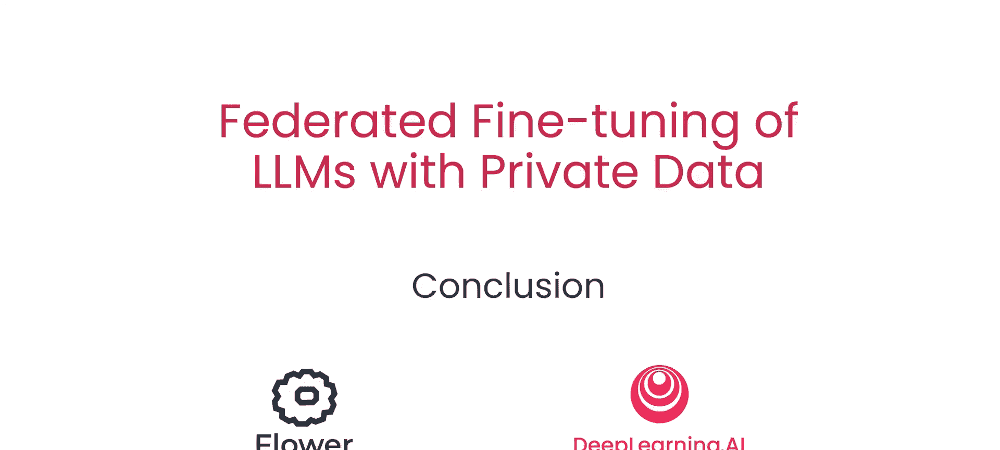
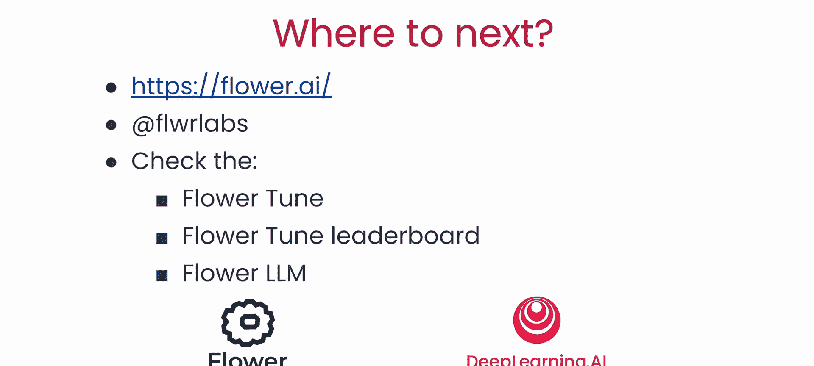

# 吴恩达《使用私人数据进行大语言模型的联邦微调｜Federated Fine-tuning of LLMs with Private Data》中英字幕（豆包翻译 - P6：6.conclusion - GPT中英字幕课程资源 - BV1uE421w7Xz

恭喜完成本课程。在本课程中，您了解了利用联邦学习利用私有数据使大型，语言模型更加智能的潜力。特别是，您了解了这种方法如何帮助您处理在将联邦学习，和大型语言模型结合在一起时出现的关键隐私和效率问题。

那么现在您已经在大型语言模型和联邦学习这条道路上有，了一个开始，接下来是什么呢？您可以通过访问 flower。ai 或在 x。com 上关注我们 ，flowerlabs。

或者加入 flower 社区 slack 中的数千名志，同道合的人工智能研究人员和工程师，找到更多关于这个，主题、新配方、新方法、示例。

我还特别建议您查看 FlowerTune、FlowerTune 排行榜以，及我们称为 FlowerLLM 的新大型语言模型预训练技术。

最后，感谢令人难以置信的 Flower 社区。我很高兴看到你们所有人即将构建的令人惊叹的联邦大型。