# 吴恩达《利用向量数据库构建多模态搜索｜Building Multi-Modal Search with Vector Databases》中英字幕 - P1 - GPT中英字幕课程资源 - BV1K2421T7PB

Hi everyone， My name is Diana Chan Morganorgan and I run all things community here at deep learninging。

 AI Today we are so excited to host an amazing workshop about leveraging the power of vector databases like weviate in conjunctionject with multimodal embedding models to power at scale production ready applications capable of understanding and searching text images。

 audio and video data where all of you can expect to take away from the workshop today is how machine learning models can embed multimodal data how vector databases like weviate enable realtime semantic search how vector databases can be used to scale the use of these models to billions at scale code implementations of performing any to any modality search applications enabled by at scale multimodal search and retrieval so we will be dropping a link in the chat where you can ask all the questions and vote upon which questions you want answered by the speakers This session will also be recorded and the slides will be sent out afterwards。

😊，And to introduce our event partner WeV8 WeVA is an open source vector database and allows you to store data objects and vector embeddings from your favorite ML models and scale seamlessly into billions of data objects they just released our short course with us last week with Sebastian one of our speakers Ve databases from embeddings Ts。

I'd love to introduce our first speaker Sebastian Sebastian is the head of Deil Aweviiate and an expert in vector database technology he is passionate about helping developers build and productize AI based applications that take advantage of the latest cutting edge developments in machine learning Hey Sebastian happy to have you here today。

😊，Hey Diana， yeah， thanks for having me Yeah I'm super excited about this session so great absolutely and our next speaker is Zane Zane is a senior developer advocate at weV8 he's an engineer in data scientist training who pursued his undergraduate and graduate work at the University of Toronto building artificially intelligent assistive technologies He then founded his company developing a digital health platform by leverage machine learning he's passion about open source software。

 education community and machine learning Pei Zane thanks for joining。😊，Hey everybody。

 super excited to be here and really looking forward to this workshop。

 getting her hands dirty with multimodal data， performing search over it。

 couldn't be more excited to be here with you guys。Absolutely， well。

 I'll have Sebastians start to take it away。哎。😊，Perfect all right okay so we thought that like before we even jump into multimod might be good to split in maybe into two parts to give you a little bit of intro into vector search and kind of like the ideas behind it and kind of like basically warm you up to the main portion of the session which then later on deliver but before I get into that like Diane mentioned earlier we launched a pretty cool course with Andrew which is basically title vector databases from embeddings to applications so please enroll it's I'm super proud of working De learning team on this and with Andrew so yeah the moremerrr so super excited about this so let me do a quick intro now to like vectors vector search vector databases and all this kind of stuff and trust me I'm going to take just a few minutes of slides because actually I prefer to lead in the code and that's going be。

😊。

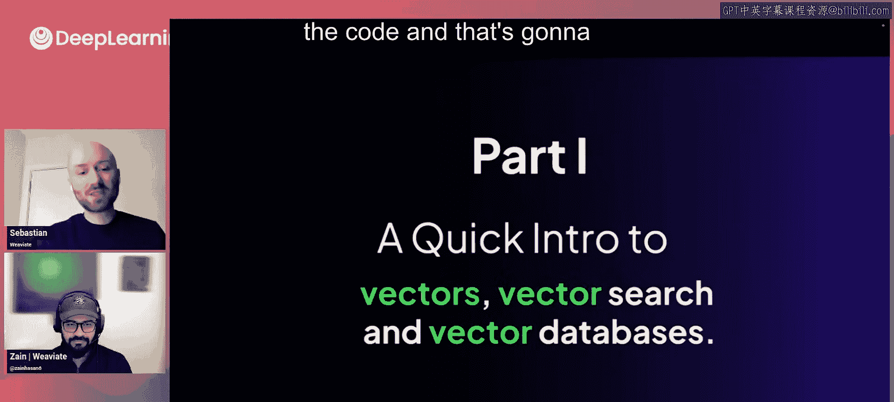

Like my favorite part of the session。But what I want to talk about is like。

And I've been talking about this actually for years where in the world or like at least on the internet。

 everything we do starts with search whether you want to look for music or you want to watch movies or you do shopping or you're looking for information all of it starts with search and we've been doing that for decades so what's the problem everything fine why search works the things that with some of the classical methods there's some challenges with traditional search if you run a query like why do airplanes fly you may get the response like this which basically talks about like hey you know fly the expensive error。

 because it does this this and that but doesn't really explain why do airplanes fly but it matches on keywords right like technically that should be the right result but practically it doesn't answer the question。

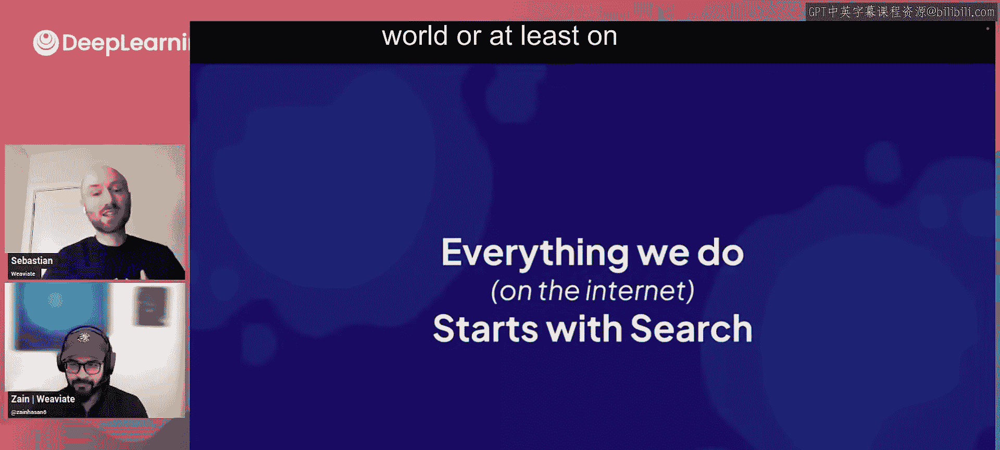

So yeah we asked for one thing but we really got like a completely different thing and it's more of an ad in this case than the answer to our question where semantic search comes to the rescue it kind of looks at the whole thing from a different perspective it's not about like matching the words that are in our content but about matching the meaning what is it that we mean by this question and what is it that we need and with semantic search you are more likely to get a response like this that maybe come from NASA that basically explains that you know to make air move faster over the top of the wing so and so happens and this is more of an answer and this is not about matching the keyword but what's that we're looking after and in summary I think this meme explains pretty well like with a lot of cool standard is happening in the ML space we're getting like amazing new tools of doing our jobs better so how does this work so let me explain to you。

😊。

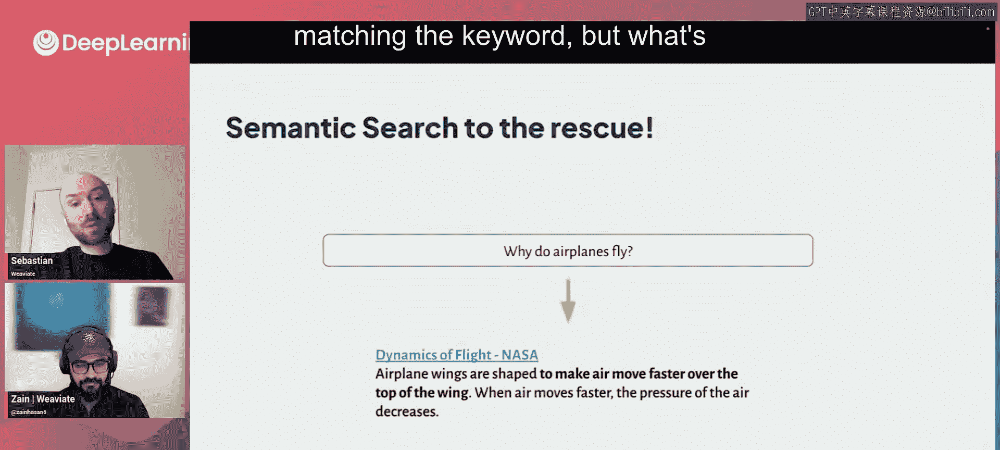

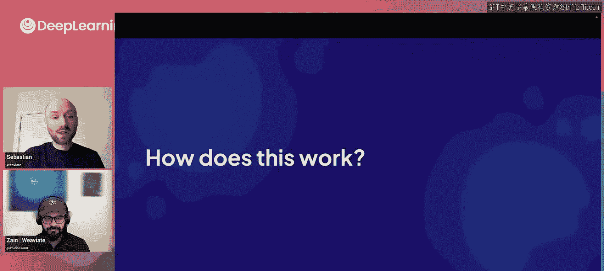

Like maybe not a five year old， but a little bit like a 10 year old。

 like a little bit of math might be required， but not too much。😊。

And the idea is like this so we have those amazing machine learning models that can take content of any type pretty much depending on the model and then if you fit it in what you get back on the other side you get a vector embedding and basically vector embeddings like a bunch of numbers and array of numbers that is the way of machine learning understanding the meaning behind the original data right and if we took like our original examples where we have like the two responses and let's say run it through the machine learning model and then take the second one would get like a bunch of different vector embeddings and each of them will be already somewhat different and if we then took dose and moved it into like a multidial space what you would probably notice very often is that the vector embeddings that represents a similar kind of data will be stored together so like when we' trying to visualize here like a cat。

😊，And a dog they'll be a lot closer to each other like chicken will be somewhat further away while for example things like apples and bananas will be in completely different space and this is a simplified version of how those vector embeddings look because we can only like imagine spaces in like three dimensions。

 but those vector em beddings go into like 1000 or 1500 or even more dimensions which basically means that it can capture more information and more meaning。

😊，So to summarize the whole thing of how the whole thing works and how the query works is as follows。

 so if we took our original query， why do airplanes fly and we already have our vector space embedded with our data。

😊。

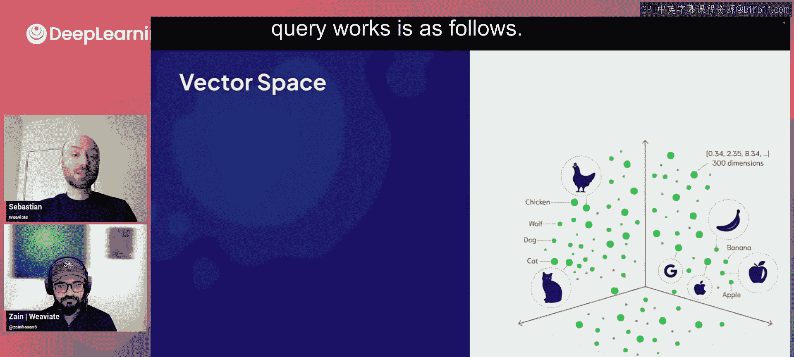

If we then feed in that query through the machine learning model well get a vector embedding again so this one actually represents our query and now from here we can map it to our vectors space and basically the area around here that we're pointing to is probably where the most likely article or answer is to our original question and very likely we'll find our NASA article finding it and this is how basically it works in a nutshell。

😊，So let me show you how all of this works in practice so I have a notebook that is prepared and I think we can also share a link to it so I like to walk you through this so a little thing so what I'll be using I'll be using WI our open source vector database which is pretty awesome and recently we were working on a brand new Python client which changes how we interact with Vivi8 is still under Beta but I think it's so close to be released that I thought it was ready for us to actually show you it in action and I would love if you were actually following and coding along with me as I go through this so of course as one of the first steps you have to do is go and install the client and then this will basically installed the latest version of the WA client which is still。

So that's why we need this like for dot star。So once we have that。

Basically there's different modes or different ways to deploy Viviate。

 we could use ViviD embeddedbed， we could use selfhosed so selfhosted like could actually run it with a Docker composeos and then we also have a cloud deployment the cloud deployment is not compatible just yet with the latest V client it's going to come next week so for today I'm just going to focus on running this on my machine so if you want to use embeddedbed then you can follow me along if you prefer using Docker composeos there's already a Docker file in here that if you're familiar a Docker you could just go and kick it off but I am going to stick to this one so the way it works the kind of things that we need to do first is this where you need to import Viviate I'm also importing OS because I don't want to actually share my keys with you in plain textex。

But usually the idea is， what we need to do is just call something like you know， weviate。

 connect to and then basically。You can say either connect to embedded or connect to local and for the purpose of this presentation I'll be using open AI and cohere so if you want to use one of those you can just replace it here as a plain text or it's better if you use environment variables and that should be it right so if I run this code oh yeah I need to。

Connect to my Jupyter notebook find what this will do the first time you run it we it will go or the client will go and download a binary like an embedded binary from Wi it for you and then you run it for you locally on your machine so it's pretty much no instance required for as long as you have the WiI client so I already have an instance running and from now on I can interact with wvi it through this client。

So as part of this demo I want to use a couple of data sets they're super simple。

 so one is like just 10 objects and then it has things like category and question and answer right like with some content for us to play with。

And then the other one is good like a thousand0 objects so we can run like a second test and it's good like some additional properties as well。

 so we'll get to that。So if I run this code。Basically what we do is just like load the data from giving a path and then convert into adjacent。

 so this is like a previous well locally of like one of the objects。Perfect， okay。

 so we have our data pretty much ready。 so what we need to do is create a new collection with let's say。

Classical databases， a collection won be a table in our case。

We call them collections because they're not actually tables underneath so what we do is call collection。

 clientient do create。嗯。Okay， sometimes I need to reload my VS code and reconnect just to get my toolts showing and hopefully you'll be able to see them too。

I see。So yes， there we are so basically as part of this in order to create the most basic collection we just have to have a name right let's let's call it questions。

And then if I create a collections like this， it will be one of those collections that you can bring in your own vectors。

 but in this case I want to take advantage of with it's a module system which allows you which actually can help you vectorize your data so what I will do I will add like a quick import with called ViI classes where we have like a lot of helper classes that help you actually write to record a lot faster so if I just follow this I want to configure my vectorizer and I want to use text to V cohere right so cohe they have like an amazing multimodal model I'm just going to use the default one and let me call it。

Justll questions fine。What happened干 here。😔，Oh， I was playing with it earlier。

 I already have this collection so let me I should have cleaned up my my。😊，My environment。

 but that's fine， so we can do very quick one， like if the collection exists called questions。

Then we can just delete it。All right， I am collections。And delete。Os。好。Let rerun this。

 and that that basically creates like a brand new collection for us。 And then from this moment。

 in order to add data into with it， I can just go into my client collections。

 And what I will do is get our questions， kind of object。 I can call it。Let's say I call it Q。

 let's call it questions。And then I can say questions dot data dot insert many and you remember earlier we loaded this data right so I'm going to just grab these 10 objects and then straight up insert them here。

And then something interesting is going to happen so as part of this， what we do is insert the data。

So let me show you a quick preview， so response。And this get this gets actually pretty interesting so response questions the query。

 and then maybe I can。Ftch some objects and I'm going to grab， let's say， for objects。And if I just。

Print the， the response。Could see like we already got like a bunch of objects that we good back。

 and then I can actually drill in specifically to objects and maybe just drill just print the。

Property of the first one， right， so this is one of the objects that we got in。

The other interesting thing is and you're going to like this so often we need to kind of like take care of vectorization in this case。

Let's call item the vectors are already there， so what I can do， not client queries。Qu。Questions。

 of course， God。Questions， query。Thattch object by ID and then I'm just going to grab one of the ideas that we had from before。

And what I can do is say include vector， so this object already has a vector。

But I can print it like this， metadata vector。And you can see that's like that this is the vector of the first object so the important thing to understand is when did we get this vector how did that happen it actually happened here so when we went and decide to insert this object we it went like okay I'm going to add all this object into the database but also I would go and use cohere to vectorize since that's how we define the collection and that's kind of like the idea。

The other thing is and let me show you like a different example。

 so I'm going to recreate this collection， oops， and this time I'm going to use open AI。

So let me just go text to V。Open AI and technically， I mean， if you want。

 we could even just specify like a specific model like other version model version， yeah。

And then kind of do zero2， etca etc ce， but that's kind of like the model we use by default anyway so I'm just going to skip that for now but that's how more or less we would do it and we could also add like a generative config and this generative config is interesting because that's how you can for example and we have like support for open AI palm cohere you could also run on Azure but in this case I'm just going to use open AI and we could even just specify like which model we want to use like we could say hey。

 I want to use GP4 etc etc right。So let's recreate this collection。And。

That basically can load the data sorry that's like a brand new collection that will work for us。

And let's add a new one。 so this time if I import， I can for example。

Try importing again it's pretty much same code it's gonna work with 1000 technically if you have like a bigger batch of objects if you have like a million objects I wouldn't necessarily recommend running just insert many and just passing a million objects because you can run all sort of problems but in this case for like 1000 of text objects I should be able to just run this and then this actually takes like  a thousand00 objects and then vectorize them using my API key and then those objects will be pretty much available to query very soon and I can even verify client。

Oops so okay， so we have our questions collection here again so I oops questions。

 I can even very quickly verify how many objects we have in there。

So let's see let's just print the response that should give us yeah。

 so we have1 thousand objects there。 it should be all vectorized etc Okay so this is the first part This is how you kind of get in get the data into weiate how and you can perform all sort of operations on it right so if you have questions data you can you know delete objects you can like inserting of course。

 but like you can update objects you can let's say I could grab one by ID and then delete it etc etc So that's kind of the idea so the second part is querying and this this is where things get even more interesting so let I just need to reconnect to our client because this is a separate Jupyter notebook and hopefully I will get like all the。

Support， so I am going to use the same code as before， where we can connect to our。Questions。

And using the questions， I should be able to say query。New text。And what did we have in our data？

So we have like this object vectorized， right？嗯。So maybe you could search for something like death or yeah。

That's a bit of a more morbid one yeah， let's not look for a Abraham Lincoln Lincoln。

 but yeah like we have something about rhyming pigment so that's for now just search for。Pigment。

Right， and we。Andで should。Do the trick。So wait， that's not the right thing。 Okay。

 so query equals exactly。Pigments。 and we want to return。Maybe the first。Five objects。

And ourAnd then maybe you can print。Response objects。There technical I should do like a little。

 but I'm lazy。I find copying like this faster， all right？Maybe not。 That was a terrible。

 I should I'm done a loop。 Al right， let's do a look， Okay for。Item in this。Pos， objects。Yeah。

 print item。Property， so then we can see what we got back。Okay。

So this basically code here where I spend more time on printing than actually the query。

 it shows like how you can run a vector search that uses this as the query and then we get this response back and then we could look for color。

嗯。And then we will search through that as well there's as well like something yeah and you can see like reference to color or green we could have like we have wax and this is interesting I can actually search a query using in different language so in polish of wax is vsk and we should probably。

Get something like a Po。which is air， so let's see what sort of oh we're using open Air not coherent anymore。

 but it's still kind of like a find information that it's sort of relevant like musical instrument。

And then it finds like a durablewin instrument etc cetera right so it finds info on all sort of stuff so that's how we can run like a vector search using just just text we could also add a filter。

And so we could， for example， say， find something where value is， let's say。

 because value is like maybe number of points， at least 500， right？So in this case， to do that。

Let's import。We get。Now， this should be Python of markdown。Okay， fine， I'll add a new code。

Mo here okay， so I'm going to import w classes again as WVC and to add a filter it's actually pretty straightforward so we can say filters。

And we are searching on value。Okay， so search on value and we want something that is greater than by00。

And then this time the results we're getting back are at least 500 or more well。

 there are more than 500， we also can use hybrid search。

 which is a pretty interesting concept where basically instead of like new text，We could do hybrid。

And the hybrid search what it does， it combines a keyword search using BM25 and vector search into one query and we have this alpha parameter so if alpha is one we basically say we are going to use 100% of the score from the vector search if it's zero we want to use 100% of the keyword search but maybe we want to say like hey。

 I want to use zero like 70% of the vector search versus the keyword search so in this case we will try to both match the keywords and。

And the vectors and that also runs and performs performs the search where hybrid is useful is when maybe the mall is not necessarily trained for the type of data that you're searching for。

 but you still want to be able to match exactly on something or maybe like you have serial numbers or all sort of other things。

And the final one that I want to maybe show you which is pretty exciting is retail augmented generation so as in here you saw when I was creating the open AI collection I added this GPT4 to that collection。

 so what we could actually say is。Use a different query so it generate。

don't yeah near text as the syntax。 So in this case， what we can do is say like， okay， I want to get。

 let's say four objects。And then I can add a single prompt。

And then the prompt can be says something like explain。Oh， all right， a short。Tweet about。

And then we want， yeah。About the question。And I think that should do the trick。

 So when I run this well it basically what we do it it runs in two steps first。

 it runs the query and retrieves those four objects and then after that it passes basically the question value together with the rest of the prompt and and then generates a response。

Where did that go。Okay， so。We should， let me just grasp。I'm just going to go to the documentation。

 that's usually the safest thing。So with the generation。On single prom， oh yes。

 instead of going for properties， I should have printed。😊，Genative。On the item， Oops。

 not on the on hybrid， find。so I just need to add this， so let's rerun it。

 you only took six seconds last time， so it shouldn't be too bad。And there you go， so basically。

This took the original information from our question property and then turned it into a tweet so for each of those there's another one that is called group task。

 so maybe I'll just do very quickly， so group task basically instead of doing it pair object。

It can basically generate a single response for all of it so we could just say like hey explain what。

This content is about。And then in this case， the response should content just generated already as a one global thing。

So one last code example。And that should kind of take again。

 like the this fine like these four objects。And then create like a single summary across all of it。

 So this contains about the collection of questions and answers from the game。 show Jeeopardy。

 each entry includes the error date episode。 and then it goes on and on and kind of like explains。

What this content is all about， which is actually pretty awesome。So yeah。

 I hope you were able to follow through， I know I was like flying through it but I guess like one of the benefits of watching it fashion maybe later on YouTube you may be able to pause at the right moments etc。

 but yeah I hope this gives you a pretty good basis to the kind of things we can do and then hopefully I can pass the baton to Zen but yeah if you want to learn as well about with it in our documentation you can definitely go to with it docs and start with the quick start because that also takes you through a similar workflow but yeah that's me for this part of the fashion。

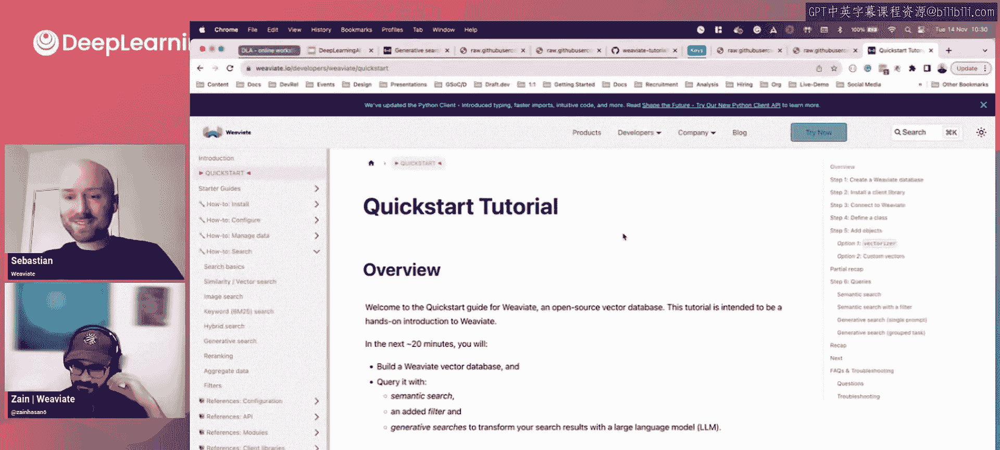

Alright。 thank you， Sebastian。 So let me share my screen now。 Go ahead here。Alright。

So that should be coming up Sebastian， can you verify， you see that？Yes。

 I can see to vector databases Yeah all right， we're in business Okay。

 so Sebastian spent the last half an hour talking about how you can get started with vector databases and how you can use them to do this semantic search over text and even showed you this idea of sending the output of the vector database to a large language model for it to reason off of and I was having conversations with people in the chat talking about the unique applications of vector databases and comparing them to other types of databases。

One of the most unique aspects of vector databases is exactly what you have in screen here right the fact that they can handle a lot more than text and so the last 30 minutes we have together I want to spend talking about going from text data。

 understanding text data searching over text data to doing a lot more than that understanding audio data video data images and then searching over it and if we have time at the end I'll even add a little bit of multimodal calling the new the GBT4 vision model for it to understand the images that we're retrieving from our vector database so let's start off from fundamentals and let's see how we can pass in more than just text to our vector database。

So。

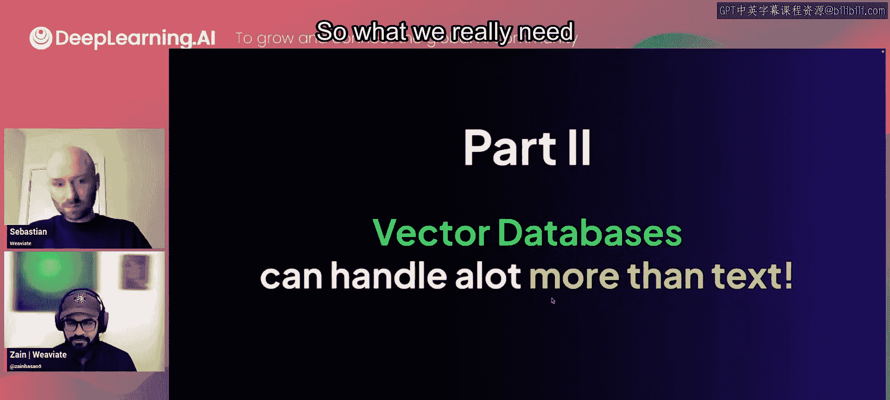

What we really need is a model that understands multiple types of data right so what I've got on screen here is not just a sentence。

 the lion is the king of the Savannnas， but also the image of a lion。

 maybe the sound of a lion roaring， I've got a video of lions running around。

We need models that can understand each of these modalities and can then convert these into corresponding vectors。

And the trick here is that because the input data points。

 the types of objects that I'm passing in are quite similar in meaning。

 I either have the image of the lion or the lion roaring or a sentence describing a lion。

 the corresponding vectors should also be similar and this goes back to what Sebastian was talking about where no matter what type of data you pass into the vector database。

 if it's semantically related if it has a similar meaning。

 the vector data points should be close together in vector space and so as you can see here。

The vector for the sentence is quite similar to the vector for the actual image of the lion。

 and that is also similar to the sound of the lion roaring。And in order to do this。

You need to have models that can understand each one of these modalities。

 there's a couple of ways to do it， one way to do it is to have one model that understands each modality separately and then you unify them。

And so once you have this capability to understand and extract meaning from different modalities。

 then what you essentially have is one unified vector space。

Regardless of what type of modality you bring in， if the model has been trained to understand and embed it into vectors。

You can now have this unified vector space where your videos， images， audio files。

 text files all live together。And this translation from human understandable versions of data。

 videos that we can watch， audio files that we can listen to。

Translation from this human understandable version of data to machine understandable vectors still preserves the meaning behind the vectors still preserves the meaning behind the data。

 so the images of the chicken and the video of the chicken and the sound of a chicken should all be in close proximity in vector space。

And so this is where things get really exciting because now you can literally take all the files on your computer。

 whether they be video images， audio text files， and you can embed them into the same vector space。

And the reason why this is pretty exciting is because now once you have the ability to embed all of these files into one unified vector space。

You can now do any to any search， and so what do I mean by any to any search？

You can take any of these modalities and you can turn them into questions let's say you want to return。

Media that is similar to the concept that's encoded in this sentence or is similar to the image that I've shown here。

 or the video that I've shown here， all of these can become queries as Sebastian was showing earlier。

 and they can go into your vector space and you can perform vector search using these multimodal queries and not only that but because you have images。

 audio video in your vector database already what comes out can be any of these data modalities as well so you can retrieve audio files。

 you can retrieve images， video files and text documents as a relevant object to any of these modalities that you pass in。

And this is quite unique because vector database vector databases because they represent data through vectors。

 it doesn't matter what the original modality of the data was。

 if the machine learning model understands it， then it generates a vector and the vector database is optimized to search over it。

And so with that short intro to multimodal multimodality， let me show you how you can。

Take what Sebastian taught and you can use that to build up a multimodal search engine using VV8 So this is part two of the workshop。

You can also get access to this notebook on the same repository that Sebastian shirtd。

 there's a second folder there， to set this up， we're going to be using Docker。

 so what I would recommend is go ahead and if you don't already have it， download an install Docker。

And then once you've got that， you're going to go into your terminal。

 you're going to get the Docker image， this is going to give you a Docker file。

 and then you're going to go ahead and run that Docker file。

You're going to compose it and then it's up and running。

 so I've already got this up and running so as you can see here。Over here。

 I've got this up and running， I've got the deep learning AI environment running。

 and it's got both my containers。Well we'll see the utility of both of those in just a second。

 so let me go back here。That will will be as much darker as you need。

 there's a couple of other dependencies here as well so Sebastian has already set you up with this one。

 the neweviate Python client。For this notebook， you'll also need the Open AI Python API。

So we're going to install those。And then we're going to go ahead and connect to our locally running version of Wevi8。

So in this case。This code is very similar to what Sebastian showed you。

 I'm going to go ahead because Docker is running in the background。

 I've got weV8 running locally on my computer， I'm going to go ahead and connect to it。

 verify that it's connected， and then I'm going to go ahead and get some metadata about the instance that's running。

So here， one thing that you'll notice is that。I've got this running locally。

 and then the module that I'm using is a multiative X bind。 and this is particularly important。

 This goes back to what I was talking about earlier where in order to embed and store。Media files。

 you need to have a model that can translate those media files into vectors and that's exactly what the module system would weiate does right so the multi divide bind is one of our modules。

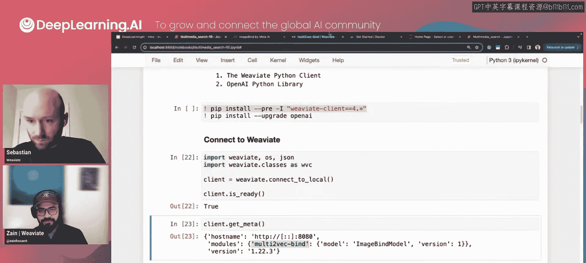

And this modules， I go to the documentation here。This module。

Allows you to pass in any one of these modalities that are listed here， so most importantly。

 text documents， images， video and audio， and that's what I'll be showing off today。

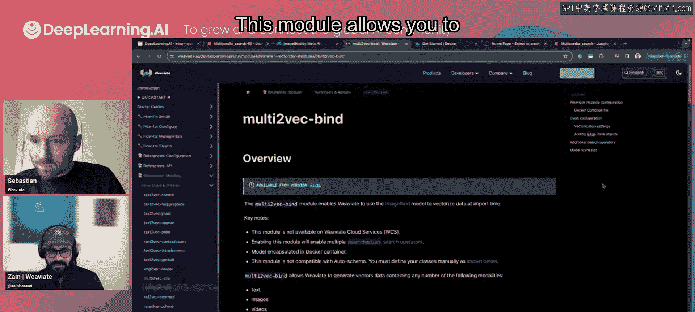

And all you need to specify is in your Docker file。

 you need to specify which module you want to get up and running。

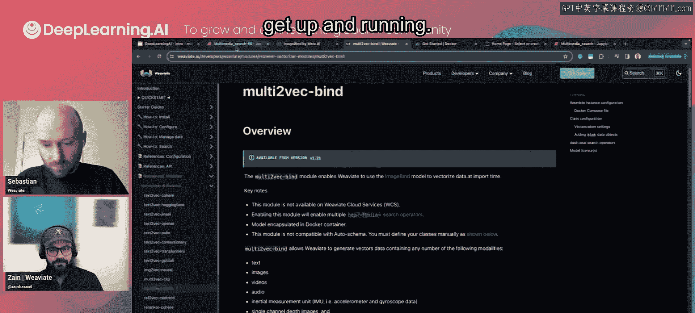

And so we can see that we have the correct module， you've got the correct version of weviate。

 so we're all good to go。The next thing we're going to do as Sebastian showed is we're going to create a client。

 so here we have a quick check that sees if the animals collection is already there。

 delete it and we're going to recreate it from scratch。

This is very similar to Sebastian's code where I'm going to go ahead and create a new collection called animalsims。

 and then I've got。Code that's slightly different here。

 so what I'm going to specify is a vector config because I need to tell weiate how to vectorize my multimedia data once it has past it。

So here I specify that I wanted to use the multiivect bind module。

This is how I can pass in audio images and video and specifically I need to tell it where these where these files will will live in the database so which properties these files will will。

Be called from。So the audio fields， I tell it that the property name will be audio。

 the image fields will live in a property name called I and the video fields it can access through the property name video and this is quite important because if you think back to how multimodal embeddings work。

 actually underneath the hood in image mind we have multiple models and it needs to understand how to take the correct modality of data and route it to the correct embedding model and then generate the embeddings。

So here we set it up for success by telling it where to access the right types of files and vectorize them accordingly using the right model。

We're going to go ahead and get that running and that creates our collection for us。

We've got a helper function that you'll understand the importance of in just a second。

 anytime you pass in multimedia audio images， video files intoiate， it needs to be base 64 encoded。

 so this is going to help us do that for all of our file types。

Then we're going to go ahead so I've got a repository of images， audio files and video files。

 and I'm going to insert them into the collection that I just created in real time。

So this is quite similar to the code that Sebastian showed as well。

 what I'm going to do is loop through all of my image files。

 I'm going to add them to a list to an empty list， a Python list。

 and I'm going to pass it the name of the file the path on my computer where that file resides and I'm going to pass it the actual image。

 so I'm going to base 64 encode the image， and then I'm going to pass it in。

I'm also going to tell reiate what type of data I'm passing it by giving it a media type property over here。

So we're going to go ahead and take that list and we're going to insert many objects here。

So as this is going on， what's happening underneath the hood is。Wevi8 gets the image。

 it knows that I wanted to use the multidect bind module。

 It's going to pass that image to the inference container that's running on my laptop locally it。

Goes ahead and vectorizes all of these images and then it returns and it tells me successfully I've added all of these objects toeviate。

 and these are the unique identifiers for every single object。

In order to make sure I like to be vigilant， I'm just going to go ahead and run a aggregate query that shows me whether all of the objects have been added so here I've got nine image files。

I can run this aggregate overall query。That'll tell me how many objects I've got stored in my database right now right and that checks out so far。

So we can now keep on going I've now got images my in my database and I've got vectors for those images as well。

Now I'm going to go in and insert audio files。 So in this case， my audio files。Are also。 So here。

 if I show you。I've got about I think six or seven audio files。

 Yeah I've got six audio files everything from birds to apes to roosters， dogs and and cats。

 I'm going to take each one of those files。 I'm going to loop over them and i'm going to add them to the database as well the only thing that's different now is that I have to。

Specify the right property and because the multidect bind module understands that these are audio files。

 because of the name of the property， I have to use the correct property name here outside of that all I'm doing is looping through all of my audio files I'm adding them to a Python list and then once that's ready I'm just going to go ahead and insert all of them into into weviate and behind the hood this is actually going to use batching。

For a small amount of files， that's not that relevant， but if you're inserting millions of files。

 then that becomes a lot more relevant。So I'm going to go ahead and run this。

 it goes through the exact same loop， except now it's going to use a different model。

 it's going to use the audio model to perform inference， create the vectors。

 and then store the vectors into intoeviate。And so now all these vectors are stored into WV as well。

So just to do another quick sanity check here， we had nine images and then we've got six audio files。

 we've got a total of 15 objects in the database stored altogether now。

So now comes the interesting part。😊，I'm going to take video files and I think I have four or five video files here in my repository。

 I've got six video files here， similarly concept of animals。

 I'm going to loop through them and I'm going to specify that I'm inserting videos now everything else is the same I store the name of the video。

 the path to the video where it's stored and then I tell this is a video type。

And this is mainly for filtering later on when I want to do query。

So I'm going to go ahead and run this。And this one， as you'll notice。

 I'm doing something different here I'm inserting one video at a time as opposed to inserting。

Inserting all of them together so I'm not using insert many。

 I'm using one video at a time and the reason for that is because video files are large。

 it takes time for the model especially running my on my Mac to generate the vectors for those video files so I don't want the database to time out I wanted to know that everything is okay。

 it just takes longer to create vectors for these files。So I add them in one by one。

And what's happening underneath the hood here is it takes the video file。😊。

And it passes it through the video model， actually an image bind the video model is very similar to the image model。

The only difference is that it looks at per second of video and then it breaks it down into frames。

 it generates vector embeddings for those frames and then it combines them to output one single vector for every video。

So as this is happening， I can talk a little bit about。😊，The next steps here。

So now that I have my database， I've got vectors for each one of these types of modalities。

 so I have the video of the mirror catt digging cat playing。

 I've got the audio of these animals and I've got the images of these animals all living in the same vector space。

And what I said that this enables is the ability to do this any to any search and that's the really exciting part because now I can pass in audio files as questions or queries and I can get back the most semantically relevant data points so I can get back images or video files and that's really easy to do in actually it's a single query where you can pass in the file that you want to use as a question and then you get back the relevant objects。

 you can control how many objects you want you can control which properties of the objects you want as well so if I just want the name of the file。

 the path of the file in the type of media， I can specify that and it will only give me those data points。

We're almost on here we're just vectorizing the last video。

By the way I should say a couple of words so if you're using this in production what I would recommend is running the model。

 the inference model， the large embedding model on a computer that has a lot of GPU so that you can inference a lot quicker and then I would recommend running weviate on a computer that has access to to RA because that's what weveate need so as we've been speaking I've inserted my six videos in here as well so now we should have a total of 21 objects nine images。

 six audio files and six video files so we do a quick sanity check here we've got 21 objects in here。

Belonging to multiple modalities， all living in the same vector space。

So now I can go in and actually print out everything that lives in my vector database。

 if I wanted the unique ID for these as well， I could loop through it。

 but I don't really want those so I'll just take out the name of the images and I'll print those out。

As you can see here， I've got all of these different multimedia files in the database。

So now I'm going to， I've got a couple of helper functions here that allow me to visualize these multimedia files right so I'll be able to play videos and images directly in the notebook。

And I've also got a helper function here that I can pass it a dictionary and it will visualize whatever modality is in there This is also one of the reasons why I had the media type encoded in the database as metadata because I can then parse it out and then show you images。

 video and audio data points as well I'm going to run these helper functions here。嗯。Oh。

 this one I don't I'm just gonna run this， but I we've already got the base 64 functions there as well。

 So that should be， that should be fine。 Okay， so now we get to the searching portion， right。

 this any to any search， which is probably the most exciting part。😊，I'm going to go ahead and。

point a variable to the collections Anim collection。

And then we go in and we can query this and the interesting part here is because we're using a multimodal module with weviate。

I can go in and do any type of search， I can search with audio files， images。

 I can search with text files with video files， or let's say somebody just brings me a vector and says I want to know what object is close to this vector。

 I can also do a with near vector search。And I'll demo all of the multimodal searches that I spoke about earlier。

So here I'll do a near text search and in this one all I need to do is pass in a natural language query as Sebatian was showing earlier so if I search for dog with stick。

 it's going to go in， it's going to vectorize this query。

And then it's going to go in and return to me the three closest object。

And I can go ahead and plot those all out。The most semantically similar concept here is this video of a dog running with a stick。

And then I've also got audio files here， this is the audio of a dog barking。

 I'm not sure if you'll be able to hear it。But yeah。

 you can you can play around with this once you have the notebook。

 and then this is the image of the dog。And in order to go from text search to image search。

 it's as easy as passing in the image that you want to use as a question so here if I've got the if this is my query image。

 this image of a cat， I can pass this and I can convert it to a base 64 image I can do a with near image search and then I can ask it to return to me the name of the closest image where they're stored and what type of files they are。

 and I can run this query。And this vectorizes the image。Generates a vector for me。

 And then I can see what objects are close to this image。 So here I got the image of this cat。

 It's pretty close。These are all images of cats essentially。

 and it matches pretty well just based on image similarity。And then you can even do audio search。

 so here this is the audio of a dog marking。You can can play around with this later on I'm going to pass this in as a query when I do with near audio。

 I'm going to convert it to base 64 and then everything else remains similar I'm going to limit this to one so I only get one output。

And then we can have a look at what that one output is。

And so this is another audio file of a dog barking， so this is one second that was two seconds。

We can also do video search right so if I've got this video of a mirrorca looking around。

 I can use this as the input query。Like so again， same step， right very simple。

 convert it to base 64 and then return the closest objects that I've got here。

This one takes slightly longer because again， videos take longer to vectorize and embed the machine learning model running on my computer。

Needs to crunch a lot more numbers to get the vectors。

So one of the last things that I wanted to show you。 and that I've got a section on multimodal rack。

 Okay， so that's completed。 So let me show you what came back right。 So here I've got。

I've got this video。Of a mirror cat， this is all truncated。

 but you'll be able to play around with this later。Again。

Very semantically similar I've got this image of the mecat and then I've also got this image of a mirrorcat standing on a log and so this is pretty cute so what I what I decided to do was introduce this concept of multimodal rag and multimodal rag is a very new concept。

😊，There was a paper about it earlier this year， but Sebastian talked about。

Rag I want to talk a little bit about multimodal ragg so let me take two minutes and talk about what that is so how does all of this multimedia searching actually help with large language models everybody is interested in large language models。

 how can it improve these large language models。Well。

 let me let me start off with this right Sebastian talked about retrieving text and then passing it off as context。

 but isn't it true that a picture can encode a lot more meaning than text？

So then the question is why stop at just retrieving text right if now I've shown you that you can retrieve audio files。

 video files and images。We can go ahead and retrieve all of these different types of modalities so now your RAG workflow looks a little different。

Where you can go ahead and store all of these images， text audio files in weve8。

 and you can also retrieve them。 So let's say I retrieve an image like that that image of the mirrorca on the stump。

 Now I can pass that off to a large。Multimodal model。

 a large language model that can understand images and I can get it to answer questions on top of those images and this is the very basic concept of multimodal rag if i'm retrieving different media from my vector database and then i'm sandwiching it into the prompt and getting the large language model to answer questions on those images I perform multimodal rag that's the very last demo that i'm going to show you this is the most probably the most exciting part。

So what we'll do here is we'll retrieve this image of this Micat standing on a log from VV8。

 and then I'm going to pass it off to the large multimodal model， chat， the GBT4 Viion from Open AI。

And then I'm going to get it to output text and then I'm also going to use Dally3 to get it to repaint。

 recreate this image but just more cuter right so maybe I want to get this framed and put it up on the wall so I want to show you how to do that so I'm going to perform a near text query and I want to get out this particular image so I'll describe it right mecat on a log and I'll only get back one and I'm also going to pass in a filter here that only returns images because for now chatTBT for vision only understands images it doesn't understand audio audio files。

So I only want to filter for images， so I'm going to run this query。

And then I get back this Micat image that I wanted to pass to GP4 Vi and this code I got from OpenAI I have a new API key that allows me to access GP4 Vi。

 the preview， and I give it a prompt that says this is an image of my PE。

 please give me a cute and vivid description and I pass in the base 64 image as well to this to this call to Open AI。

And then I'll show you the description that it returns for me， right the answer on this prompt。

So we're going to run this。It's going to make an API call to Open AI。

And we'll see in a second what it comes back with。Okay。

So it gives me this really nice description of the mirrorca， charming site， your pet mirror cat。

 and then it describes the mirrorca。So that this this is one application of multimodal rack right I've given it an image and I've got it to describe the image for me I'm going to go one step further I'm now going to take this description and I'm going to pass it off to a model that can understand text and generate images so that's Dally3 which was released last week so now I'm going to call Dally and I'm going to tell it to create a image a higher resolution image based off of this description that I have here so this is potentially something that I can frame and put up on my wall。

😊，then I'll show you what that image looks like。Here。Again。

 this takes a little bit longer because it's generating the image after I run the code。

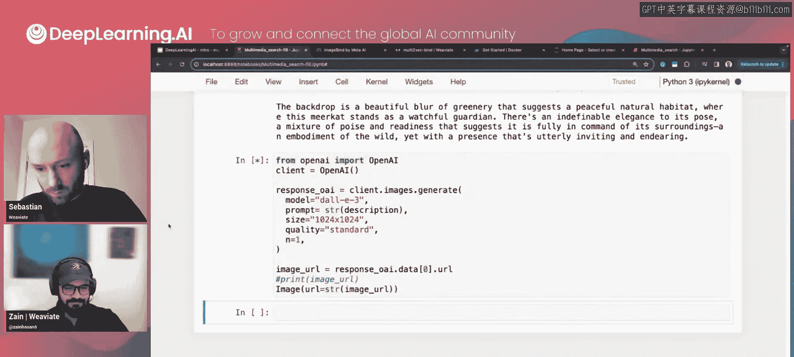

All right。So this is purely off of the text description。

 I've got the mirrorcat on the log and I can print this out。

 I can get this turned into a poster and this can go up on my wall。

And this is the power of vector databases used synergistically with generative models that can understand all the modalities that you can retrieve from vector databases and you can do this at scale so here I've shown you a quick kind of toy demo where I've got 21 files。

 but these could be billions of files and you can retrieve them and pass them off as context and。

So this is what I was super excited to show you all。If you have any questions we'll take those now。

 if not， check us out， we think a lot about this， we work a lot on this， completely open source。

 join our Slack community， thank you very much folks。😊。

Absolutely well thank you so much Sebastian Zane i'm sure our community learns so much from you guys and really appreciate the thoroughau workshop you put together I think we have time to answer maybe two or three questions before we end today I know datada in the audience since Sebastian and I saw you hop in and answer some questions in the live chat but I think our number one question。

😊。

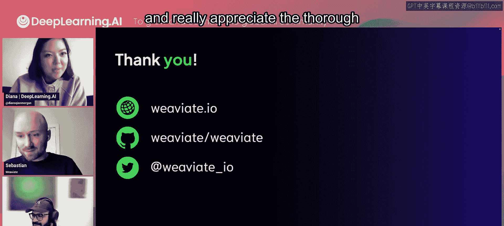

Right now is if you were to compare the cost of keyword search versus vector search。

 how much is vector search more expensive on average？😊，Interesting。

 is that like in a monitor way or yeah， that that's， that's an interesting question。

 I don't have a clear like a perfect answer。 Z do you have a good take。 Yeah， I guess the。

 So that's a pretty。😊，It is a difficult question， but I think what。

You have to account for is that when you're doing vector search。

 you have this added component of having a machine learning model that you need to perform inference with and so as you saw in the multimodal space that inference can be very costly。

 it might require a lot more GPUs it requires its own infrastructure so from that component it might be more costly for keyword search for classical search。

 you don't need GPUs， you don't need machine learning models。

Although you wouldn't necessarily use keyword search on an image right because thats the that's the labeling or something yeah exactly so what are you if you're setting up this computer that has GPU that can understand images video。

 the added benefit that you pay for is that now you have this ability to semantically search over any modality really that you can encode as a vector。

It would be very hard for you to do keyword search over images or video or audio unless you。

You have some sort of detailed description or metadata of it， which then you can use to filter so。

Yeah， but that's， that's a very interesting question， Great one。Absolutely。

 and I think the last question for today， how do you keep data current。

 are there optimal methods for updating the vector database once a day。

 nightly different than updating more frequently？Yeah。

 I would say so it depends on your needs within like your business if you like basically so that's one of the benefits of WID it's got full crap support that is live so basically as you go even if your data changes every second you could continuously keep updating the data and then the vector space or the vector index gets updated immediately so the question here is it depends on what does your business need so if you always need the data like immediately to be like all the time like I don't know you're running a social media platform in this case like you need to be constantly if you're running a local library maybe you could do it once a week so it all depends on what do you need in terms of that frequency and yeah there's no one perfect answer but the beauty of WiI is that you could very easily keep it in track like life。

If you want to create a system that continuously sends updates， that's not a problem at all。

Absolutely well I want to once again thank Sebastian and Zane and Duta for speaking today answering questions。

 helping us learn more about weviiate and vector databases once again please don't forget to register for their short course I'm sure you will not be disappointed and learned so much more than what we also learned in this workshop today we also dropped a community survey in the chat so happy to take topic suggestions for our next event maybe even another course of wevi8 we're always open to feedback and suggestions and we hope to see you next time here at us at deep learningarning。

AI see you guys soon thank you bye Thanks hello thanks for having。😊。

