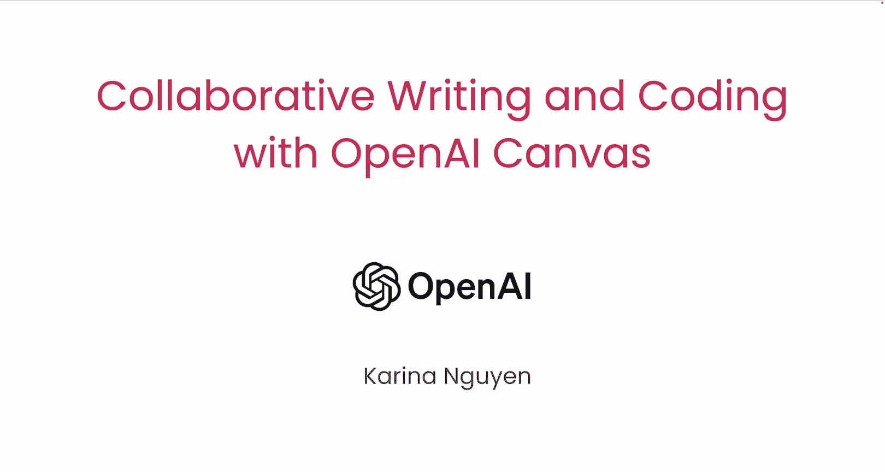
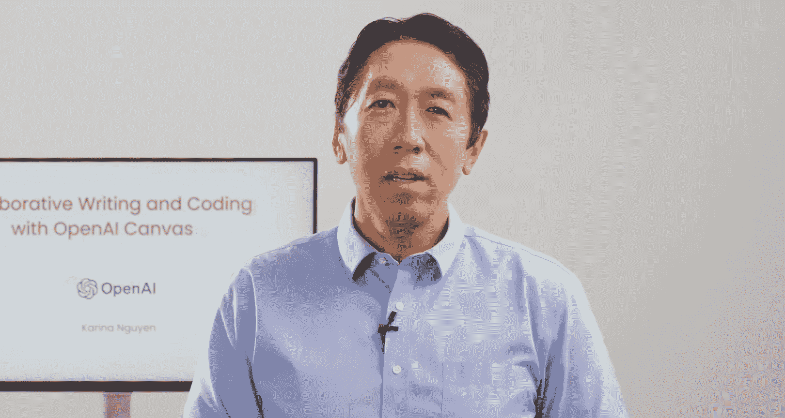
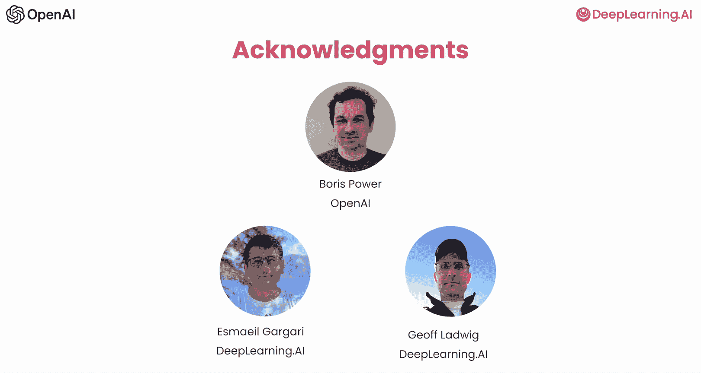

# 吴恩达《协作写作与编码：OpenAI Canvas｜Collaborative Writing and Coding with OpenAI Canvas》 - P1：1.intro.zh_en - GPT中英字幕课程资源 - BV14EqzY9EcD

Welcome to collaborativellab Writing and Cod with Open eye Cands。

 built in partnership with Open AI and taught by Kaina Yuan。😊。

This is a very short course to introduce a fun new tool that I think you enjoy trying。

OPI Canvas is a new interface that provides a side by side workspace where you can collaboratively edit and refine texto code together with ChGT This makes brainstorming and drafting and iterating on the text few more natural and more effective。

In this course， you learn to use canvas for writing and for coding。

 The instructor Corinina Nuen is one of the co creators of Cans。 welcomecome。 Thanks， Andrew。

 Canvas makes both writing and coding with AI more fun and a lot easier for writing。

 it allows you to highlight specific sections of your text for targeting edits。

 You can also adjust the length and complexity of your text。 Additionally。

 Canvas provides tools to apply grammar checks and clarify enhancements。 These iterative features。

 make writing more flexible and efficient with Canva。

 lots of people are using AI to help with coding。 Canvas is several tools can help you create code better and faster。

😊，After creating the first version of your code， Canvas can review it and give suggestions for how to improve it。

 For example， if theres a syntax or logic error in your code or your code can be simplified or made faster。

 Canvas might be theppointees out for myself， I'm sometimes a bit lazy of writing comments。

 and I think Canvas is great at that。😊，It also helps with debugging by letting you add logs。

 making easier to find and fix problems。Another feature is the ability to translate code between different programming languages like Python。

 JavaScript， and Java with just a few clicks。😊。

You learn in depth how all of these were by creating games like space Baship。

You also see how you can use a picture， literally a picture of a database architecture and input that and have canvass write code for you to implement that architecture in code and also write SQL queries against that We'll also go behind the scenes and look at what it takes to train the model to create an interface like Canvas I'll also touch on of the best practices with synthetic data to develop a model like this Many people have words to create a course。

 I like to thank Boris Power from Open AI and from Deepbled AI Ashshb Gagari and Jeff Ladwig also contributed to this course This course is going to be a lot of fun Let's go to the next video to get started。

😊。

