# 吴恩达《协作写作与编码：OpenAI Canvas｜Collaborative Writing and Coding with OpenAI Canvas》 - P4：4.build a spaceship game.zh_en - GPT中英字幕课程资源 - BV14EqzY9EcD

Okay， now let's do a really fun demo of creating some game and how collaborate with the model to create an interesting game and I'm going to ask the model to create a speechship battle game with some competitive scoring system and being very interactive and have some retrofuturistic fuel。

😊，So let's see what it will come up with。Again， we asked the model to generate in self contained HTML file so that it will be easy for us to pass。

I'm going to copy。I'm also going to ask the model to add some logs。

 so it would be easier for us to debug later。 And while we're doing that。

I'm going to copy and paste in the HTML file。And let's see the result of it。

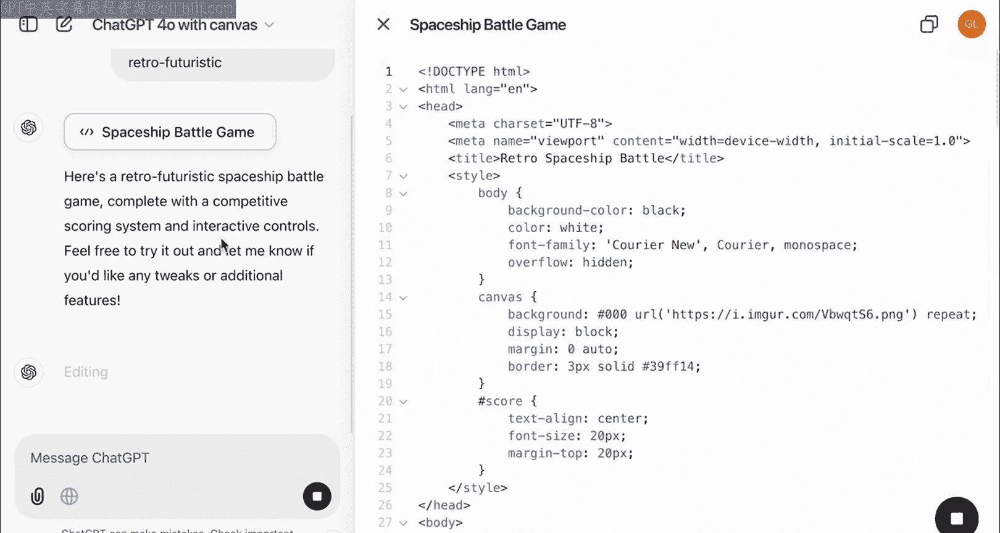

Okay， so as you seen in this visualization， it was trying to like add some image where we don't have access to。

 So I'm gonna find where it's trying to do that and we'll select a targeted edit and ask it to replace it with some more like a space field background。

 replace this with black background。😊。

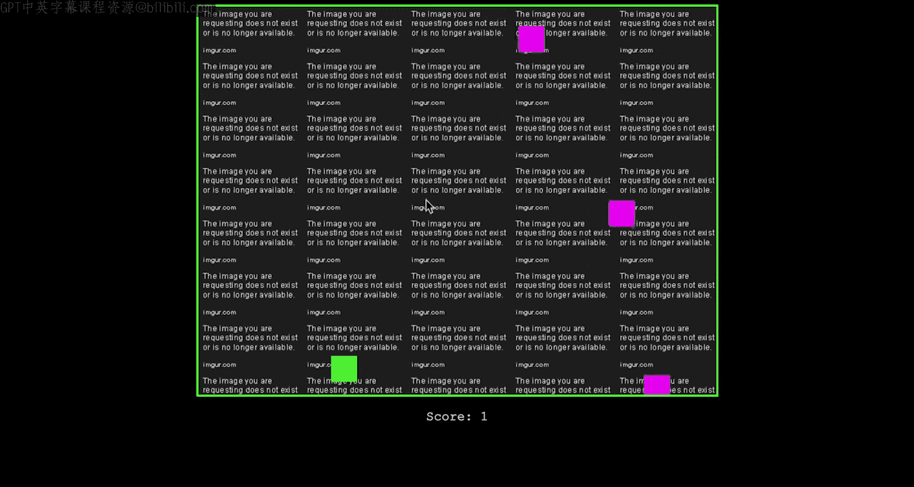

And then as you can see， it changes the background color。 So let's see if it made it change。 And yes。

 it created the background。 And as you can see， if I press key space。

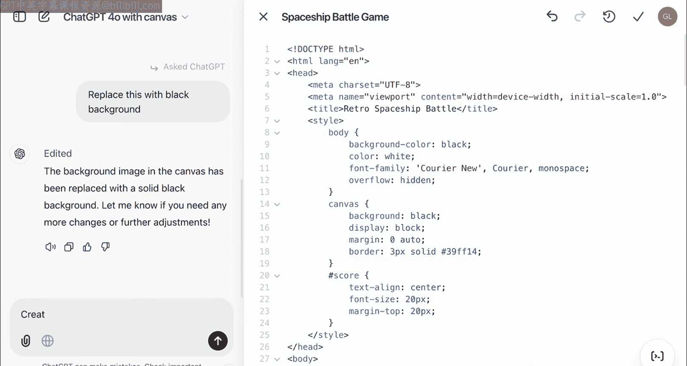

It will start shooting。But as you can see the logic a little bit of because I want the game to end when my green square interacts with the purple one。

 So let's add this logic in。 something then not prompted in a following way。

 I want't implement the logic where it would fail when my square would hit the right square。

 make it like a game with failures and leveling。

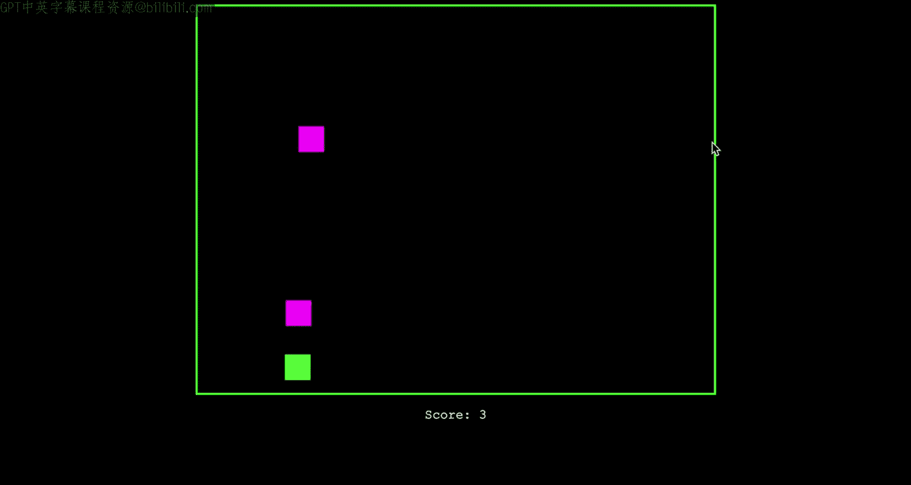

And we can see exactly where it made changes。So it created this function check ship collision and let's see if it worked。

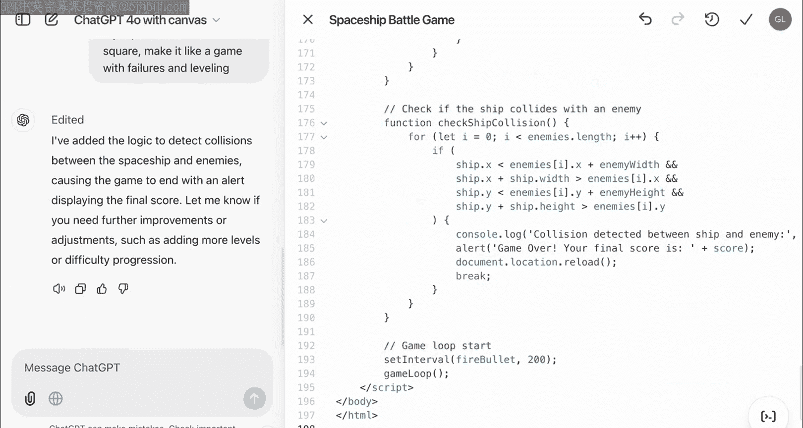

So now if I try to hit the square。

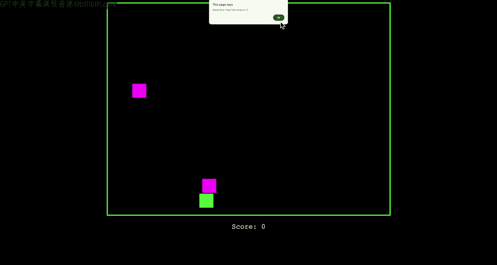

The game is Al。Cool， maybe we can add some logic when the game is over， when the game is over。

 display the results。Of the score and have a key to restart。So now it added the dev。Sayme game over。

 your final score is dot， press R to restart the game。And hopefully。

 the logic for the game over will be much。Smoother。So I'm going to copy and paste the code。

 put it here。😔。

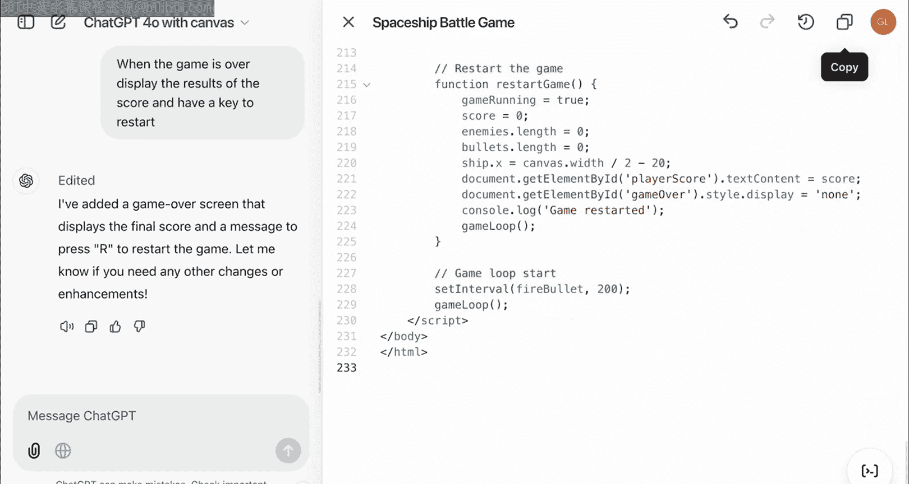

And see if it changed the logic。Okay， cool。 And now do her starts。Yeah。我看能说。😔，Collion。

 it reflects my score。 So now we can see the model reflected this final scoring game。

 and we can press R to restart the game。 So right now I'm like pressing the R。

 and it restarts the game。

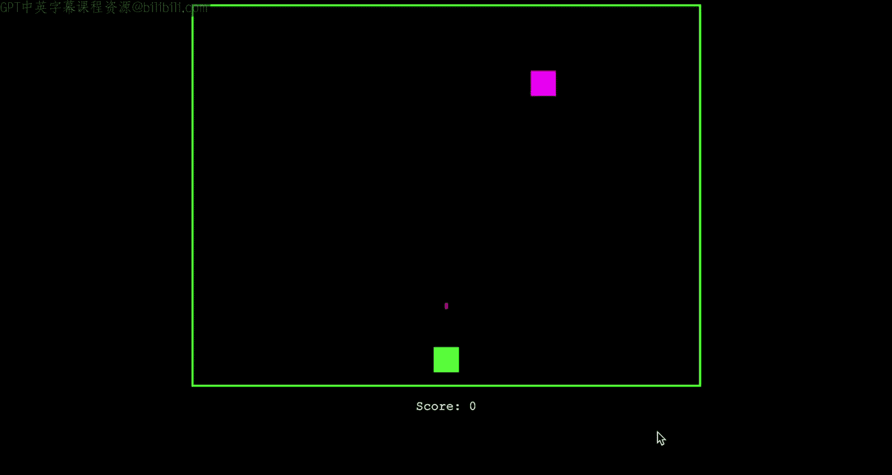

cool。Now， I would like to add some more visual features and prompted to create a feel of space with stars and moving orbits。

 So it does feel like a spatial battle game。 Let's see what it will come up with。

 So it creates drawer stars function。😊，It doesn't change any other parts of the game。

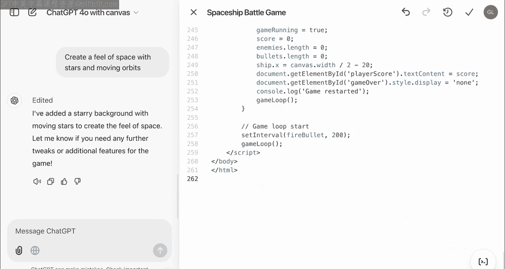

Well let's restart。Now， we can see。A march， futuristic。Hu。😔，About the game。And yeah。

 you can play it and share the game with your friends。 It's very exciting。

 We made a spaceship game from scratch。😊。

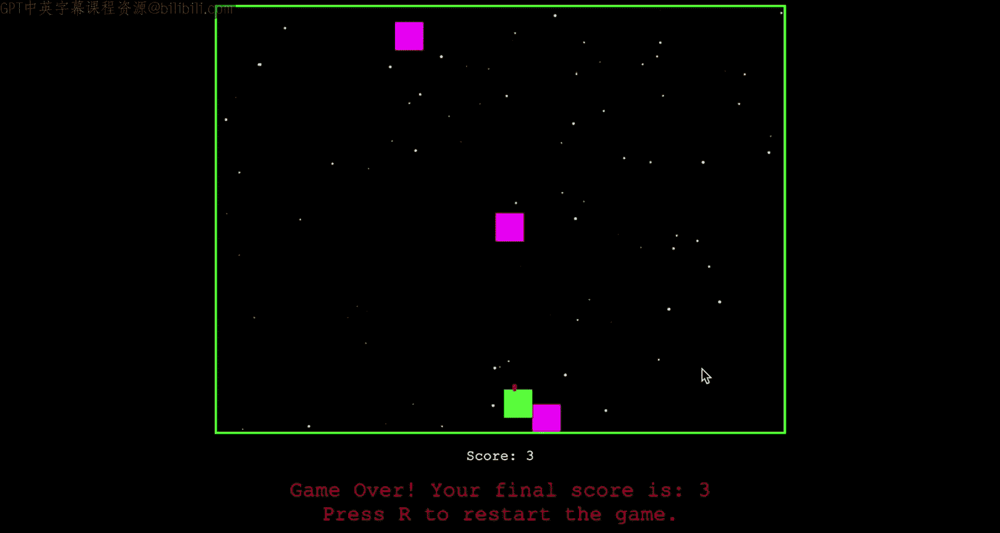

Let's make this game a little more fun and complicated by asking to make the enemy's spaceship。

 the pink ones to gradually spinning up。😊，So let's see what changes that actually mean。

 So here you can see it created the function。The verbal enemy sped。

So hopefully it will create the functionality for this。 let's try it again。😔。

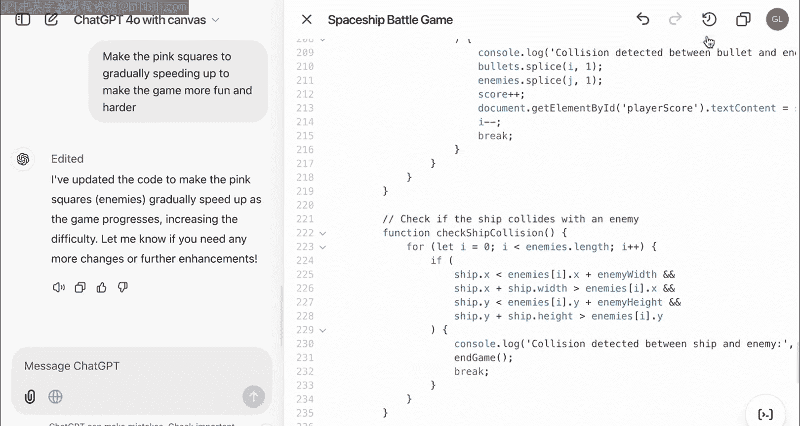

I'm not sure if they gradually moving faster， so let's make it here， make it faster。😔。

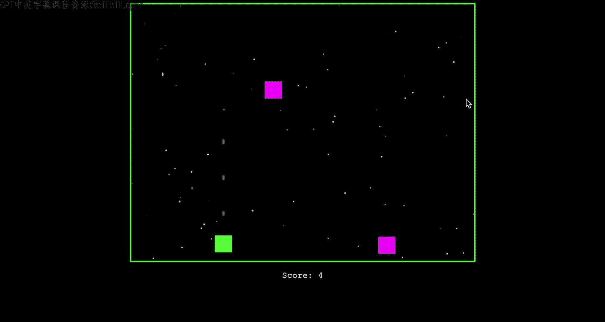

The model will try to rewrite the code， but usually not moving。

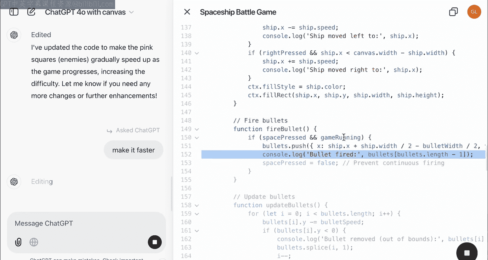

The large joke。Okay， so it。Hes like it be fast。Yeah， they， theyre different faster。Okay， cool。

 I guess we can。 You can continue iterate on this game and like make it more hotter and like more fun to play with。

 But this is a good starting point that we created a game from scratch。😊。

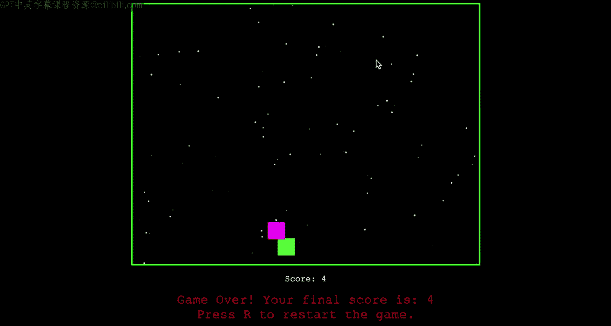

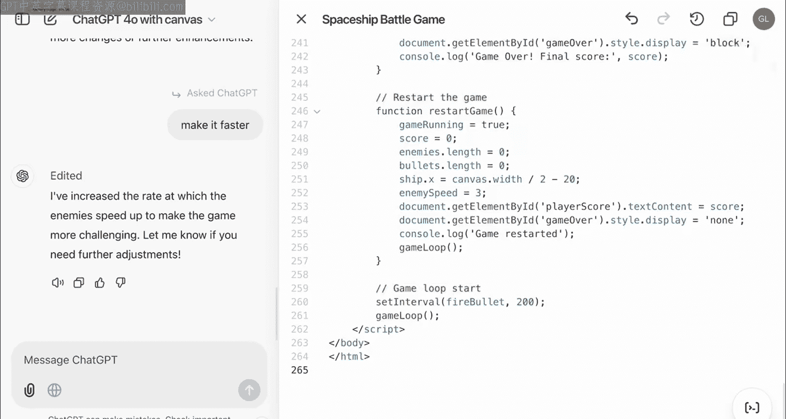

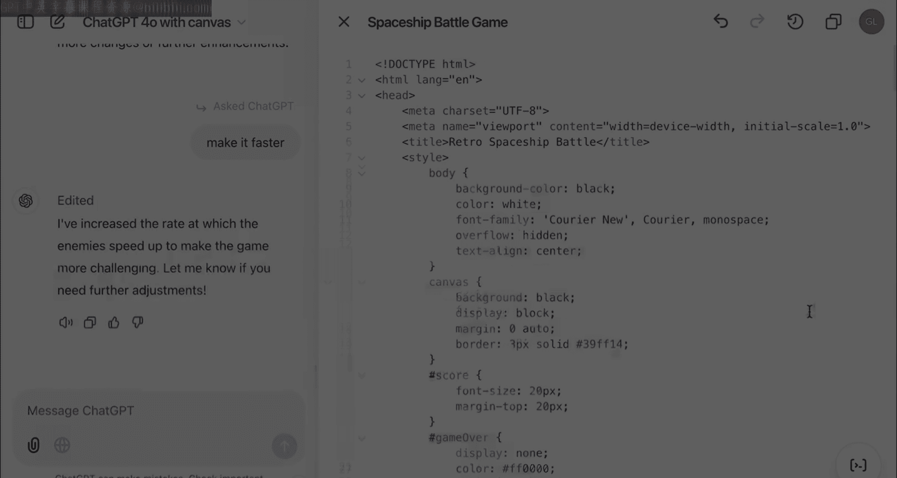