# 吴恩达《协作写作与编码：OpenAI Canvas｜Collaborative Writing and Coding with OpenAI Canvas》 - P5：5.create SQL database from architecture image.zh_en - GPT中英字幕课程资源 - BV14EqzY9EcD

Now let's explore some of the real world use cases that we can use CGPT canvass for。

 and I would like to create SQL database from the image of its architecture so let's go to one of the articles where we can use the example of the entity relationship model let's imagine you are scrolling down the article around the dimensional modeling and turn to learn a little more about different data models and you stumble upon the concept of entity relationship model and you would like to explore further of the diagram and one thing that you could do is to take a screenshot of this diagram and ask ChGPT to actually convert。

😊。

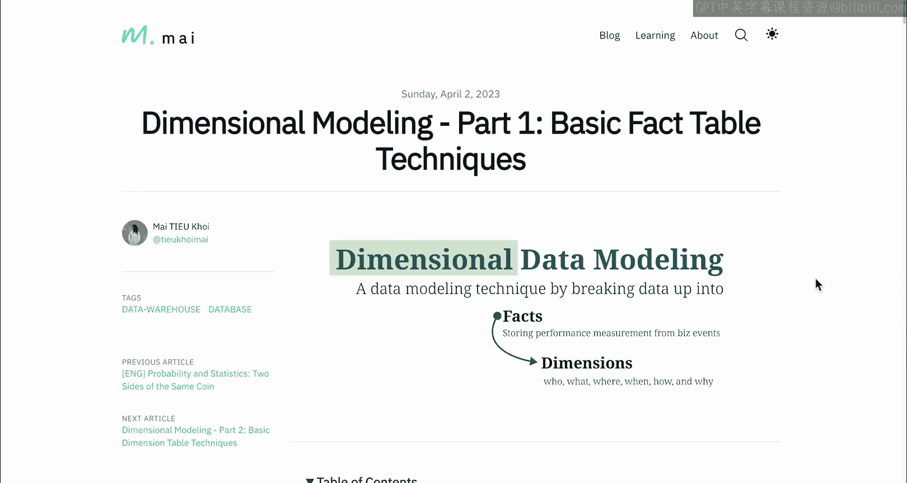

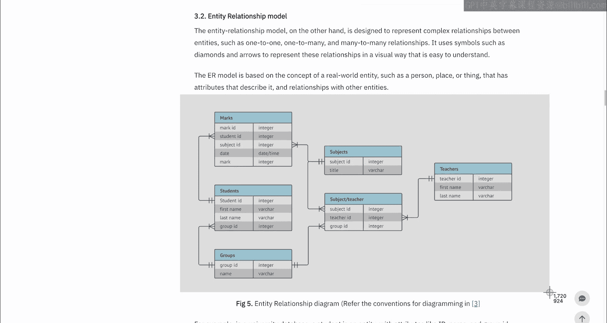

To askQL database based on the image above and populate with some data to have a more interactive feel of the database。

So now you can see it creates SQL。File with some of the populated fields。 Now。

 we have this website site called S KL for that will try to compile the table， the SQL database。

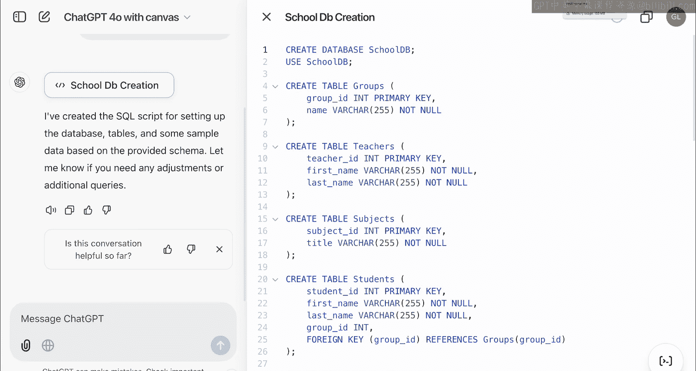

And as you can see， we are getting some errorss that we can try to。

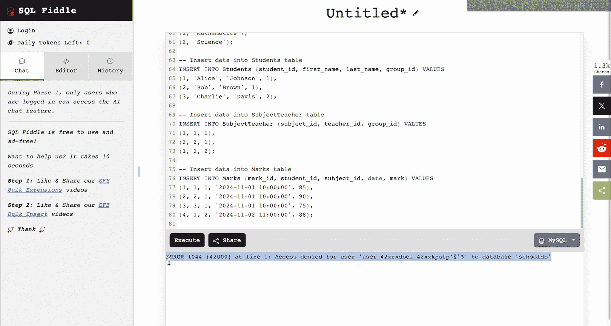

It array with the model to resolve， some words。So first。

 it didn't need to have it commented out to create to would access the night error。 and let's see。

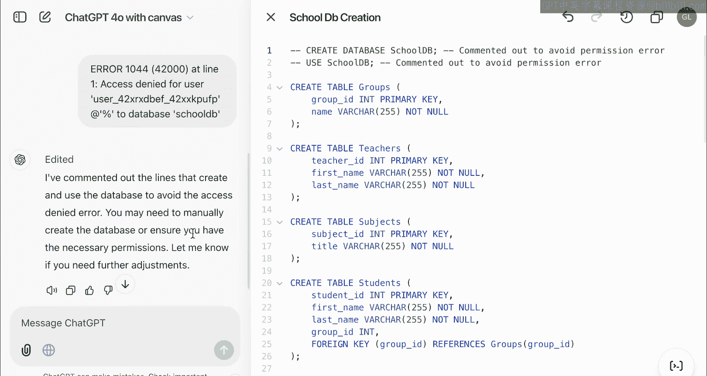

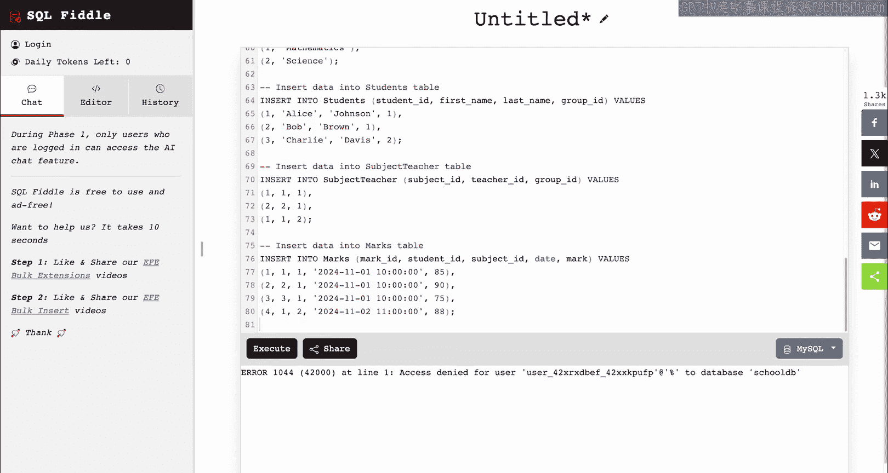

Now， there was a syndax highlighting error。You can copy and past and ask the model to fix it。And。

 as you can see。He just put the groups in quotation marks。

Now we can ask the model to fix the same issue with other tables。

 and it will try to create quotesation marks in every other table， as you can just see right now。

 Okay， so debugged the code by coughving and pasting the errors and the model finally figure out and now we can like easily render and query the databases。

As you can see it here。

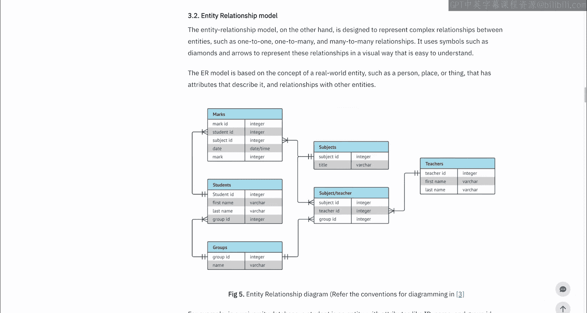

Now that the error was fixed， let's find all the teachers。

 so the way we would do this is to say select asterisk from teachers and as you can see it gave us an output of all the teachers available I'm going to ask the model to add more teachers and subjects and more students。

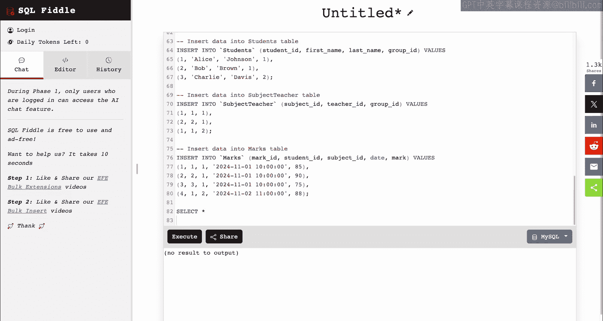

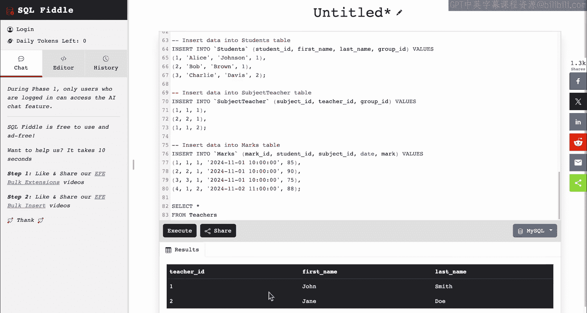

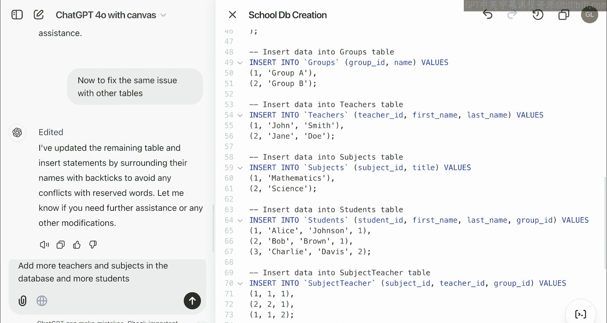

So you can see the model added more teachers， more subjects and more students now I'm going to ask the model to create a query for students who took math。

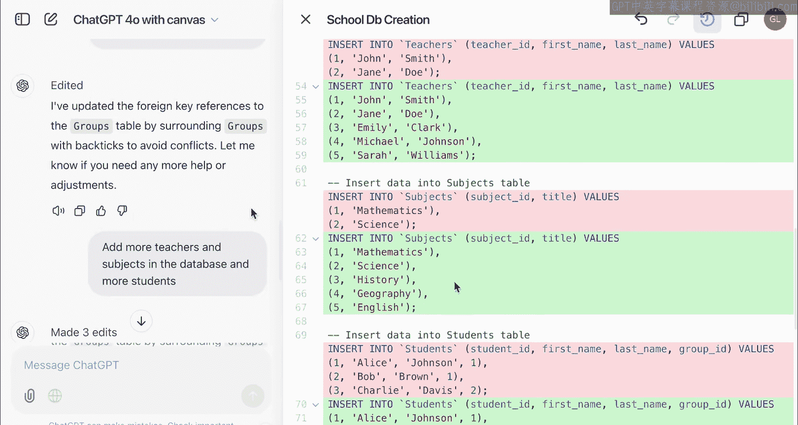

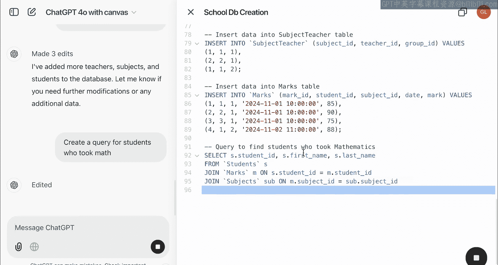

。

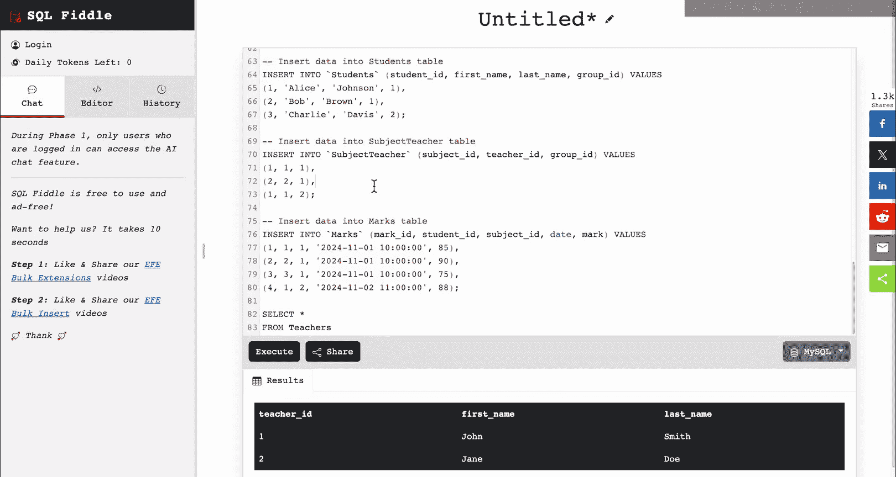

Okay， cool。 Now you can see all the students who took math subject。

 I'm going to ask the model to show the teacher for the student， as well。

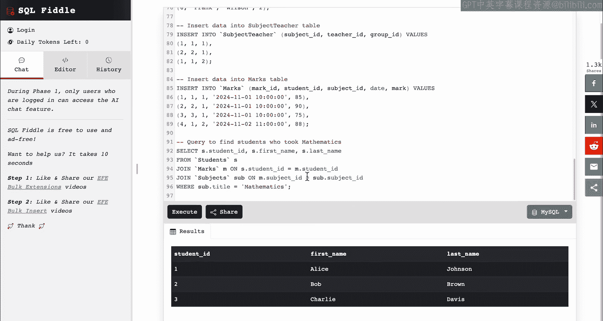

Let's make the query， and you can see the model so that as very particular。

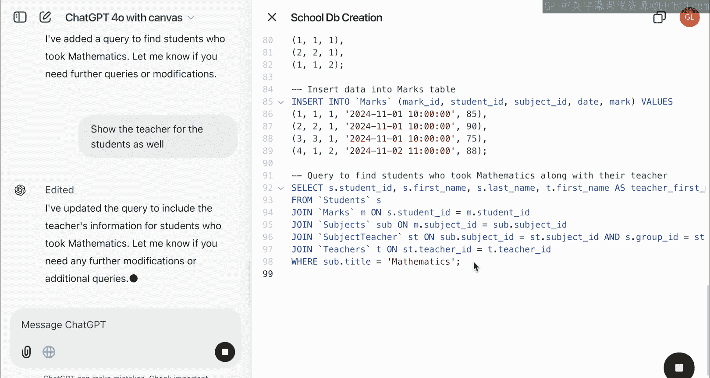

Section， so we can copy。😔。

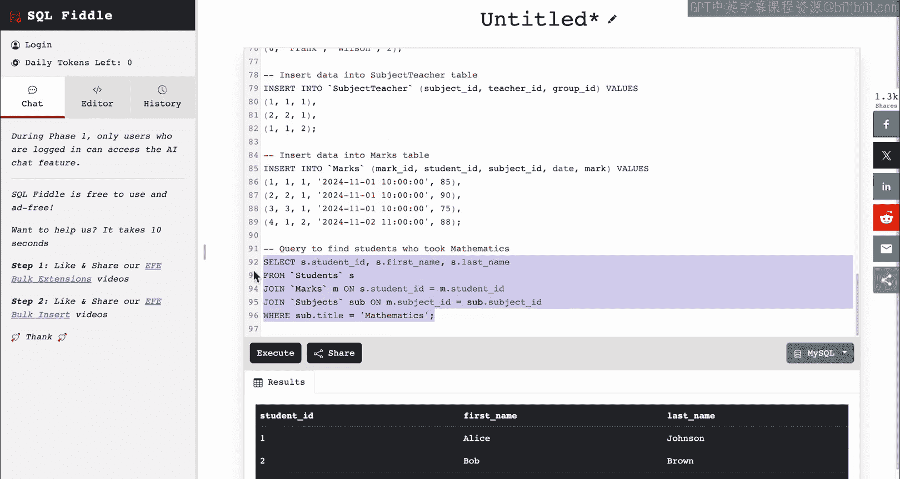

And paste the curry。Entry to execute。 So now you can see that only John Smith is a math teacher。

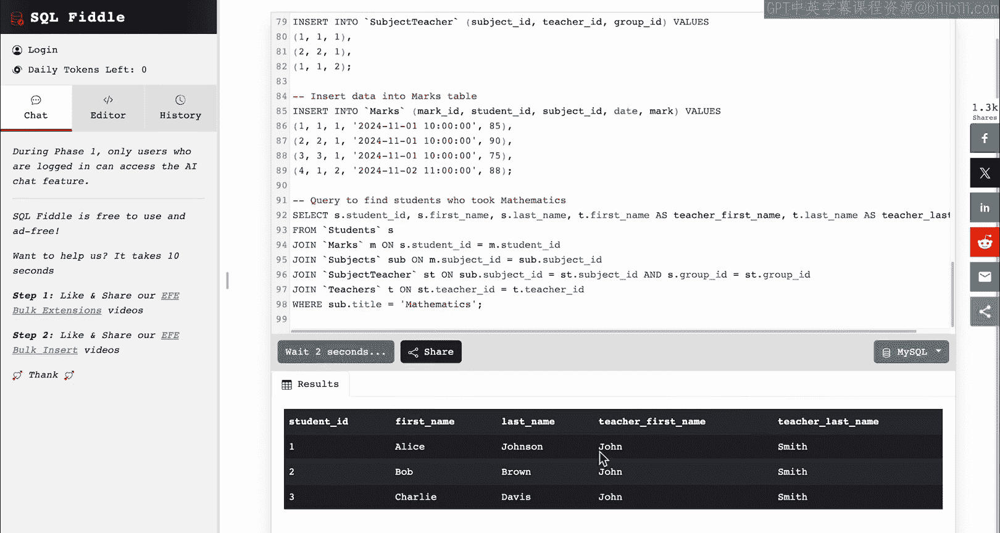

I encourage you to try out more complicated Squal praies and even create your own databases for your applications。

 or you can try to generate any game from scratch with your own game mechanics and rules and share it with other friends。

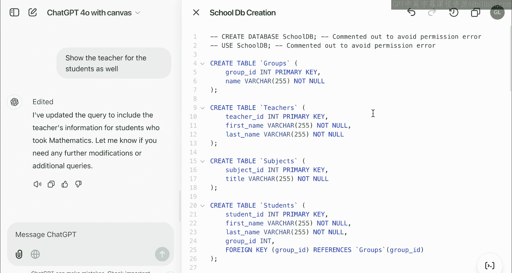