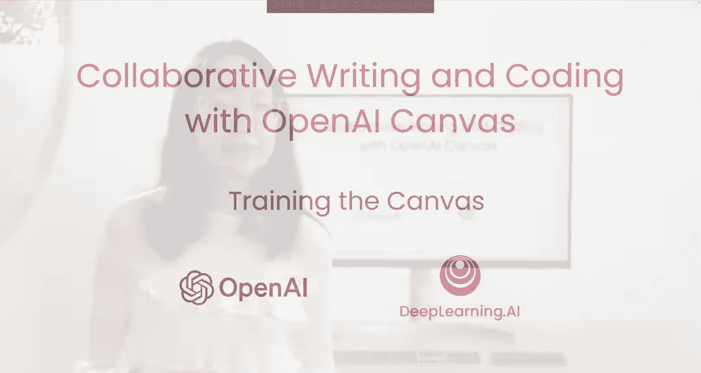
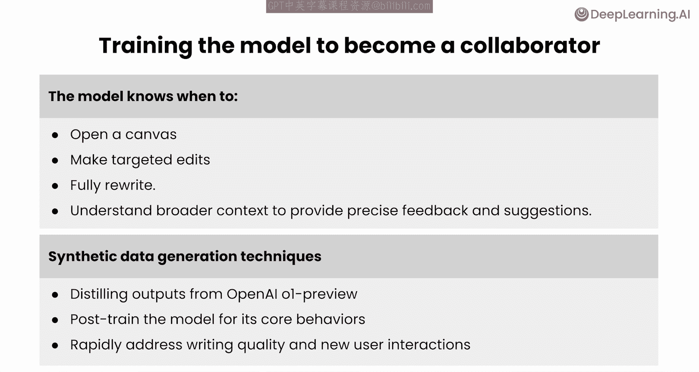
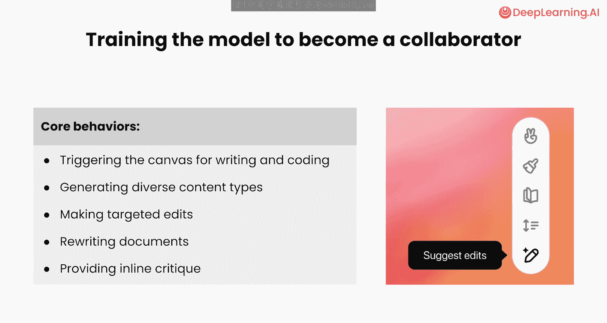
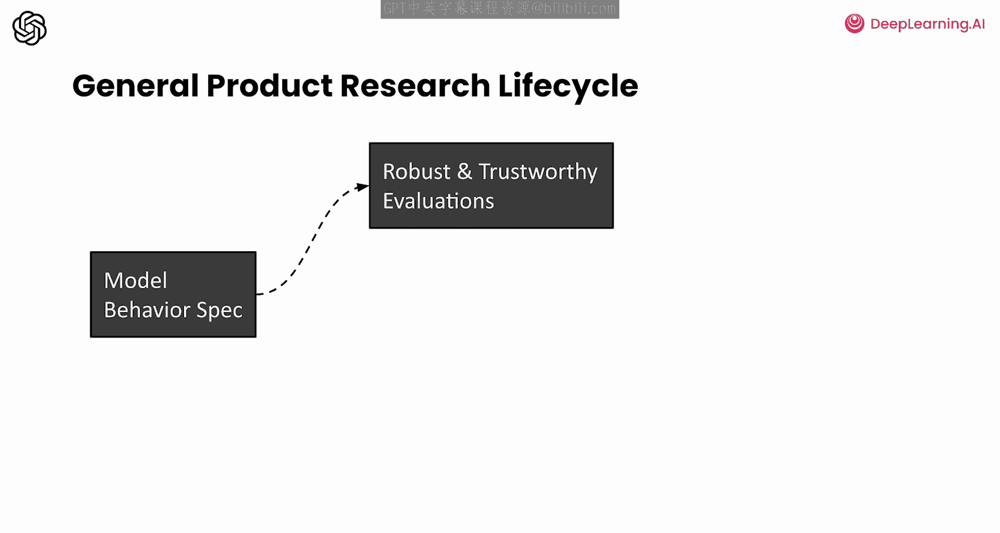
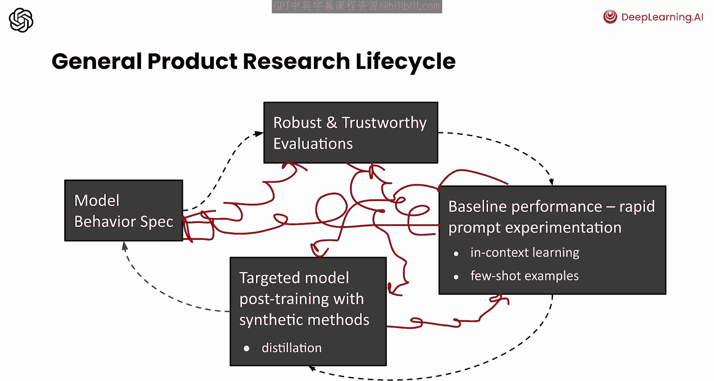
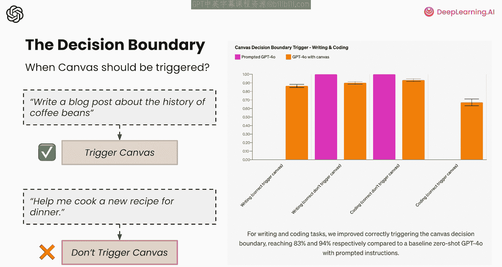
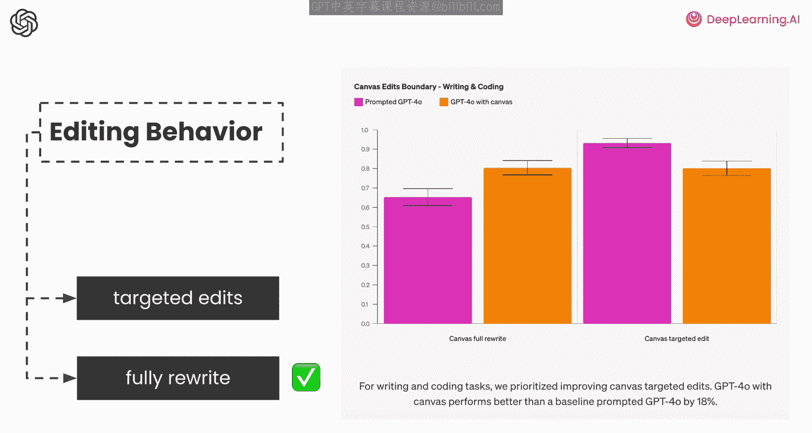
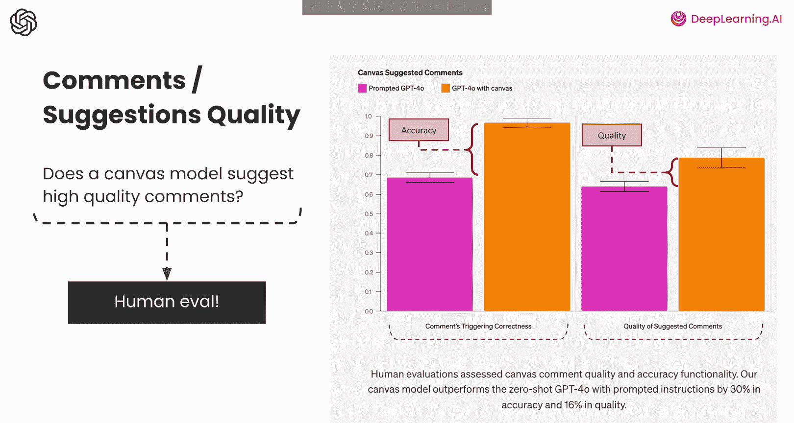

# 吴恩达《协作写作与编码：OpenAI Canvas｜Collaborative Writing and Coding with OpenAI Canvas》 - P6：6.training the canvas.zh_en - GPT中英字幕课程资源 - BV14EqzY9EcD

In this lesson， we will go behind the scenes and look what it takes to train the model to create an interface like Canvas。

 All right， let's go。 You learned how Canvas can make your writing and coding a log better。

 faster and move fun， if you are interested in knowing how the model behind Canva is traineded here we are going to have a very brief overview of the model development steps。

😊。

So you train ChipyD40 to collaborate as a creative partner， the model knows when to open Canvas。

 make targeted edits and fully rewrite， It also tries to understand broader context to provide precise feedback and suggestions on your document and a key innovation in the canvas model is that all postchaing was done via synthetic data。

 and we use techniques like distilling outputs from open AI preview smarter model to post the models for its core behaviors and this approach allowed us to rapidly address writing quality and new user interactions all without relying on humangene or human collected data。

 So our research team developed the following core behavior for this model。

 triggering the canvas for writing and coding， generating diverse content type making targeted edits。

Re're writing documents， providing in line critique and other features。

 we measured the progress over 20 automated internal evaluations that we built and continue evaluating more as we launched the product。

 So Canvas was developed by a group of designers， engineers， researchers and product managers。

 and we've worked together from the very beginning of the project till its launch on the way we've established a product during model development framework that I thought might be useful for you too。

 a general product research lifecycle in developing product features like Canvas might be of the following form。

 developing model behavior spec， designing robust and trustworthy evaluations。

 rapid prompt iteration to establish the baseline performance via prompting。

 and here you can use techniques like in contextext learning a few short examples。

Of your prompting technique and finally， once you establish the conviction of the product feature。

 you can post chain very targeted behavior into the model and more specifically in canvas everything was done via synthetic methods among which is called distillation obviously in reality everything as much mess see and it's not as streammind as I showed in the previous slide。

 so once you create a baseline performance， maybe you wanted to go back to the valuations and once you uncover new edge cases to the valuations。

 you need to update your model behaviors back in which then you change the strategy or how you might want to train the model So in the real world everything is more of like iterative development of the model and so let's stay deeper into what it takes to define the model。

BehaviorDeing model behavior requires very nuanced and detail oriented spec。

 thinking of edge cases and thinking more of the whole system interactions in for example。

 in canvas we have to think how that tool interact with other tools like search and do image generation and as the models becomes more complex。

 the complexity of the system increases， and so the scope of the newmod behavior spec also increases in the complexity personally。

 I have also learned that fixing language models behavior often involves applying similar principles from software engineering。

 and I can share some of the principles， reproducing model behavior is the same thing as reprodu a software bug But by doing that you can establish a much more。

B and termsworth the evaluation that you can optimize in the future。

 dissecting in software engineering is equal to obbling different parts of the components of your model to find out the root cause of the problem and finally you have to solve the problem holistically without breaking the other parts of the system and this is where the complexity of the model behavior arises because it's only during the training that you might observe some of the bugs or the model behavior goodnesses that you might want to fix as you iterate further。

More specifically， let's dive in into。What specific behaviors canvas model was posttrained。

 A key challenge was defining when to trigger a canvas， and we call it a decision boundary。

 We taught the model to open the canvas for prompts like write a blog post about the history of coffee beans。

 while also avoiding overtggering for general question and answering tasks。

 like help me cook a new recipe for dinner for writing tasks we prioritized improving correct triggers at the expense of correct non on triggers。

 reaching 83% compared to the baseline zero shot Gp for O with prompted instructions。

 It is worth noting in the graph on the right that the quality of such baselines is highly sensitive to the prompt that you used and with different prompts the baseline may still perform poorly。

 but in a different manner， for instance， by being even。Inaccurate across coding and writing tasks。

 resulting in different distribution of errors and alternative forms of suboptimal performance for coding。

 we intentionally bias the model against triggering to avoid disrupting our power users well continue finding this based on our user feedback。

A second challenge in the model behavior involved tuning the model's editing behavior once the canvas was triggered。

 more specifically deciding when to make a very targeted specific edits versus rewriting the entire content for prompts like change the second paragraph to be shorter。

 it's much more preferable for the model to specifically select that second paragraph rather than rewriting。

 and so between train the model to perform targeted edits when users explicitly select text or when the instruction is clear what in the text to select。

 otherwise favoring rewrites， and again， this behavior is continually updating as refine our model development。

Finally， training the model to generate high quality comments and suggestions requires careful iteration。

 unlike the first two model behavior cases which are easily adaptable to automated evaluation with thoroughromanial reviews。

 measuring quality in an automated ways particularly challenging。

 and so we used human evaluations to assess common quality and accuracy when to trigger suggestions and comments。

 our canvas model outperforms the zero shot g beautifulti O with prompt instructions by 30% in accuracy and 16% inequ quality showing that synthetic training significantly enhances response quality and behavior compared to zero shot prompting with detailed instructions。

All right， we covered some of the basic fundamentals of how we trained the Canvas model。

 although the focus of the course was obviously to share some of the delightful use cases that you should try in your writing and coding tasks and shared with the rest of the deep learning community。

😊。

