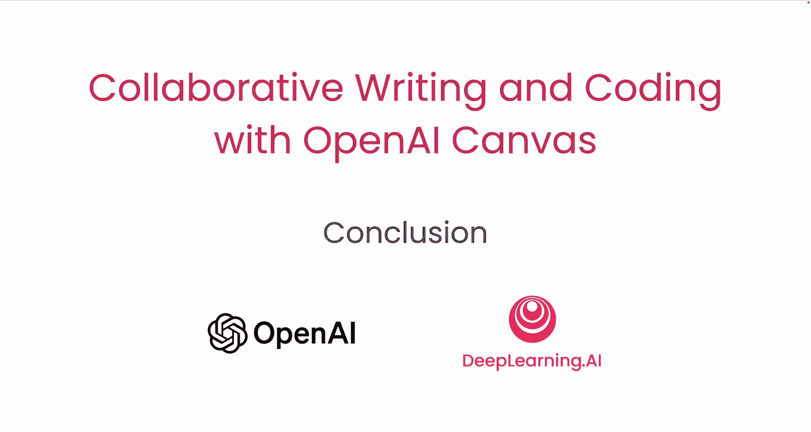

# 吴恩达《协作写作与编码：OpenAI Canvas｜Collaborative Writing and Coding with OpenAI Canvas》 - P7：7.conclusion.zh_en - GPT中英字幕课程资源 - BV14EqzY9EcD

In this course， you learned how Canvas can help you write and code it better and faster。

 You created a few fun games and learned how to comment， debu and enhance your code。

 You also learned how AI models behind Canvas are trained。

 I hope you enjoyed the course and I' am looking forward to seeing what you have built with Canvas。😊。

