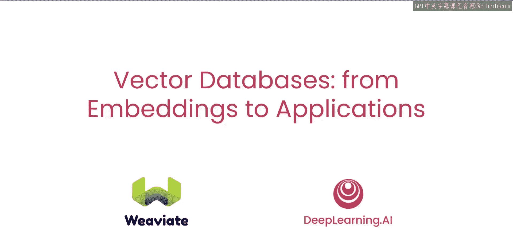
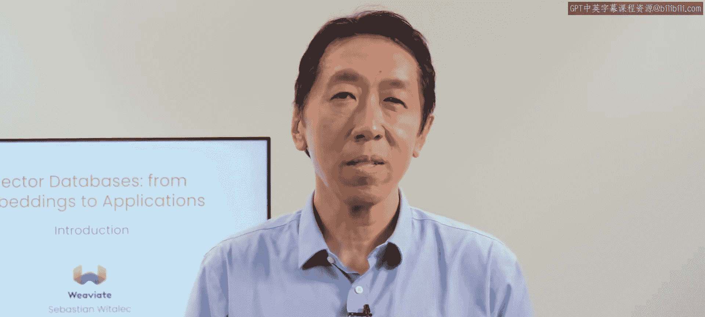
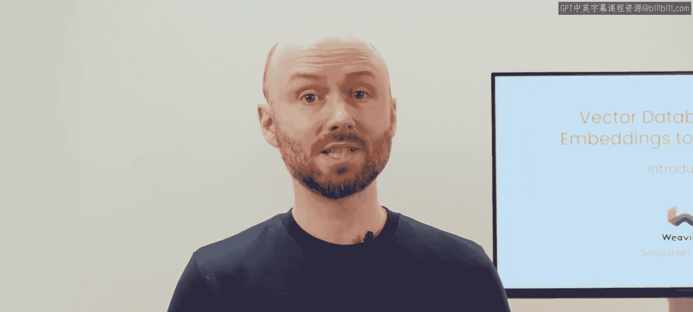
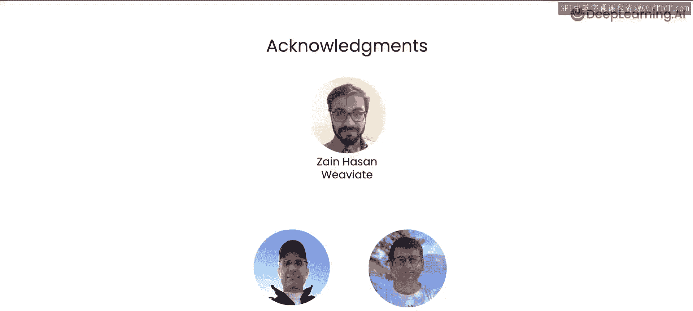

# 吴恩达《向量数据库：从嵌入到应用》Vector Databases： from Embeddings to Applications中英字幕 - P1：Weaviate_Intro.zh - GPT中英字幕课程资源 - BV14u4y1A7fB

Hi and welcome to this short course， Ve databases from embeddings to applications built in partnership with VV8 La language models have enabled many new and exciting applications to be built。

 but another shortcoming of LMs is that a trained language model does not have knowledge of recent events or knowledge available only in proprietary documents that it did not get to train on to tackle this problem you can use retrieval augmented generation or RAG and a key component of RAG is a vector database。

😊，Proprietary or recent data is first stored in this vector database。

 then when there's a query that concerns that information， that query is sent to the vector database。

 which then retrieves the related text data and finally this retrieved text can be included in the prompt to the LM to give it context with which to answer your question。

Vectctor databases actually preceded this recent generative AI explosion。

 They have long been a lot part of semantic search applications。

 These are applications that search on the meaning of words or phrases rather than keyword search that looks for exact matches as well as in recommended systems where they've been used to find related items to recommend to a user I think it would be really useful for you as a AI developer to understand how a vector database works what really goes on under the hood and I think this will allow you to use vector databases more effectively in your own project。

 So for example， you know how to decide when to apply spa search such as keyword search or dense search which is what you get with vector similarities or hybrid search which combines both spas and dense search。

😊，Understanding how different similarity calculations work will also help you to choose the best distance algorithm and understanding the challenge of scaling vector databases and search will help you to choose between different embedding search algorithms I'm thrilled to the instructor for this course is Sebastian Vitas who is head of developer relations at reiate and who has deep experience instructing users on how to build and use vector databases。

Thanks， Andrew， it's a real privilege to be working with you on this course。

 By the end of this course， you understand and implement many of the elements that make vector databases。

 things like embeddings， dense vectors that represent the meaning of phrase。

 distance metrics like dot product or cosine distance， different kinds of vector search。

 things like linear search where you look at all the entries in a database or approximate search where you speed up search by allowing for results that are close and also different search paradigms like sparse。

 dense and hybrid search and finally， you build real worldor applications of vector databases。

 creating a rack system with hybrid and multilingual search functionality。

 That's a lot of great stuff。 And so hopefully some of the ideas we cover with viau to continue your own Lm and machine learning journey by building on top of vector databases Quite a few people have contributed to this course。

 We're grateful to Zen Hasan。😊。

Weviiate， as well as Jeff Ludwig and Ismail Ggari from deep learningning do AI。

 So hopefully some of the examples we cover in this short course will inspire you to continue your own large language model and OM journey by building on top of vector databases。

 Let's go on the next video to get started。😊。

