# 吴恩达《向量数据库：从嵌入到应用》Vector Databases： from Embeddings to Applications中英字幕 - P2：L1_Embeddings.zh - GPT中英字幕课程资源 - BV14u4y1A7fB

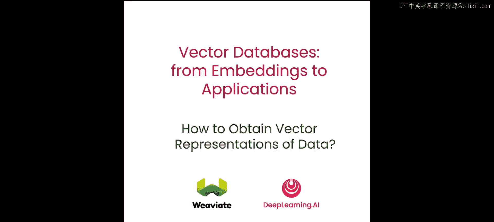

In this lesson， you learn where the vectors in vector databases come from。

 You will start off by looking at how neural networks can be used to represent and embed data as numbers。

 but also you will be building an auto encoder architecture to embed images into vectors。

You then go over what it means for data objects to be similar or dissimilar and how to quantify this using the vector representations of data。

Let's get into it here's the auto encodecoder and to illustrate how it works。

 we will use the M00 in digits data set， which will then if we pass a digit like an image of a digit like this。

 which by the way has 28 by 28 pixels in dimension which makes it for 784 dimensions and then if you run it through this the encoder will compress it and then decoder will decompress it and then we'll end up with another image and you can already see that the two images they don't exactly much This is why we have to run this to multiple training sets。

 each will run it， the internal weights will get adjusted and then each time will get a better and better much until eventually the mold is being trained and we can be quite happy with the results of coming in and out the important thing to notice here is that the output is generated using only the vector in the middle so that the vector contains the meaning of that image and。

Call that the embedding we'll go and code it in a minute。

 but this is how the model looks in on the inside。 So in here we can see a group of dense layers。

 and then you can see that as we pass the image through dense layers it gets compressed through 256 and 128 dimensions until we reach the two dimensions and then likewise for the decoder which will take the vector embedding from two dimensions into 128 to 56 until we reach the final output。

 And the reason we chose the vector embedding in the middle to have two dimensions it's purely to make it easier for us to visualize it during the lesson but in fact very often vector embeddings have way more dimensions than just often reaching100 or more And here's a nice example of how we can take any kind of data so we could take an image and then convert it into machine understandable vector embedding or we could take a whole piece of text and also generate vector embedding from it。

 And I can stress enough but basically。Vor embedding captures the meaning of the underlying data。

 and you can think of vector embedding as machine understandable format of the data。Cool。

 so let's go and see how it all works in code。Alright so as the first step we need to load in some libraries and we'll be using Tensorflow to make that work very nice just like as I mentioned earlier。

 we'll be using MN to load our data set so let's go and do that and what this will give us is a training set and a test set which we can use later on so next step what we need to do is normalize this data and in reality。

 what we are doing is basically taking this 28 by 28 image and then turning into a flattened structure and then if we print out the shapes of what we had before and after we'll see that we had 60000 training objects which before we're 28 by 28 and now there are 784 mentioneds and the same thing for the test data and now let's set up some parameters for our model so the batch size here is going to be 100 objects and it will run across 50 ebooks。

And then the idea is that will start with 256 dimensions for the hidden state and the objective is to generate vector embeddings of two dimensions Now let's have a look at an example of an input image and you can see that this one looks very much like a zero which is great next we need to construct a sampling function which will allow us to grab number of images during the training phase next we need to construct an encoder and just like I mentioned earlier on will have two dense layers the first one will have a dimensions of 256 the next one will have dimensions of 128。

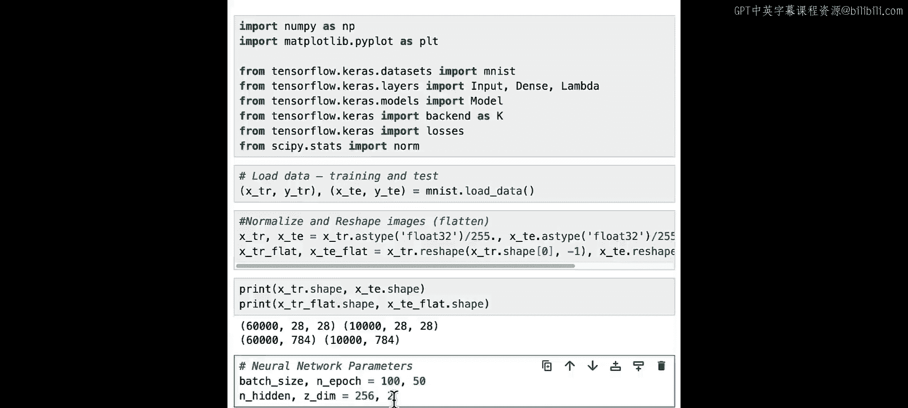

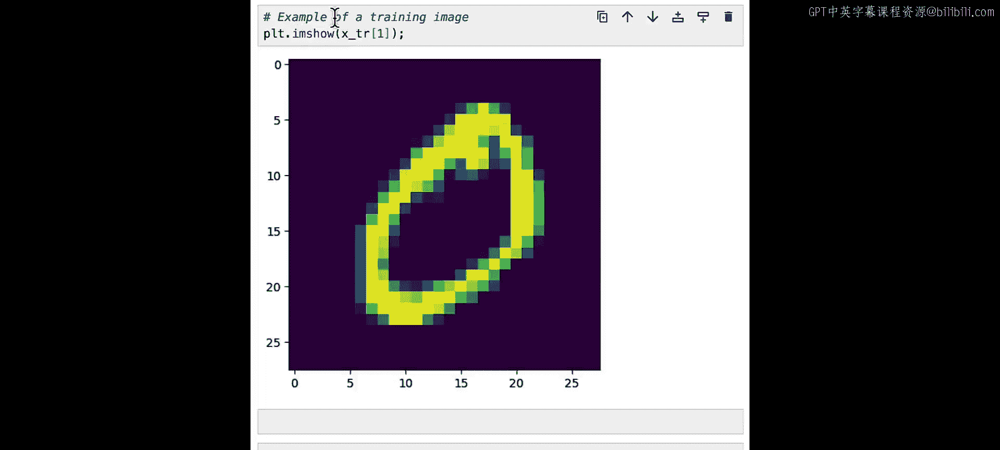

Next we need to normalize the data Now let's build a matching decoder and in a very similar way this time starting from two dimensions we'll be moving into 128 and 256 dimensions over here and eventually we can create decoder function and this is our loss function to train the autoencoder which is also known as variational autoender and basically the idea here that is optimized to to much of the inputs much outputs in a really good fashion。

And now that we have all the pieces we can begin training that will run across 50 epochs and then each time training across 100 objects。

 so this will take a few minutes so speed it up in posts。Now that the training is done。

 we can go and visualize our data。 Let's start and build a flat encoder。

 and then we can add a piece of code to plot our vector embeddings onto。

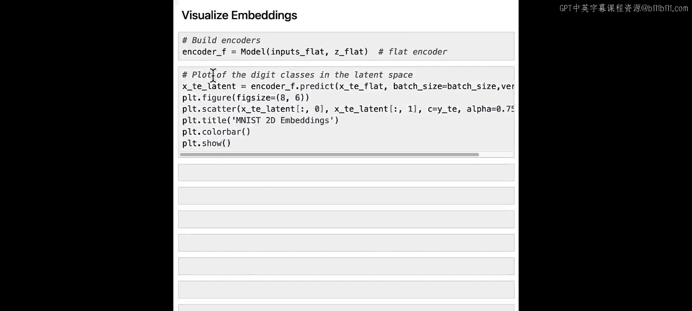

A graph and you can see in here that similar vectors are clustered together within the vector embedding space and then just like you can see that like zeros are close together here。

 lines are close together in here and the whole space is actually demonstrated or displayed in two dimensional space and those two dimensions are the two dimensions that we have inside the vector embedding。

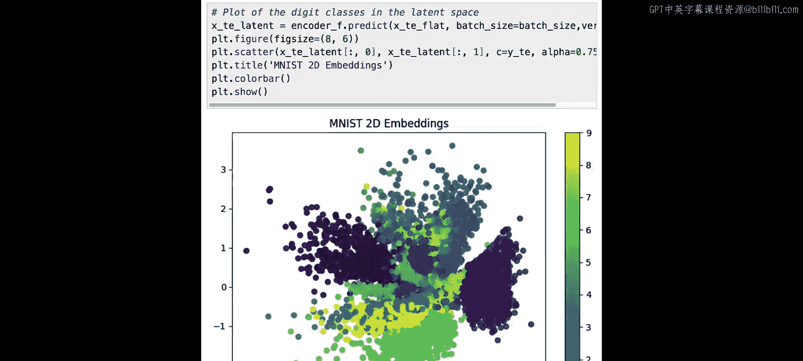

So now we can get into a phase of comparing vector embeddings， so let's give it a new section。

And let's grab three different images。 So we'll grab。

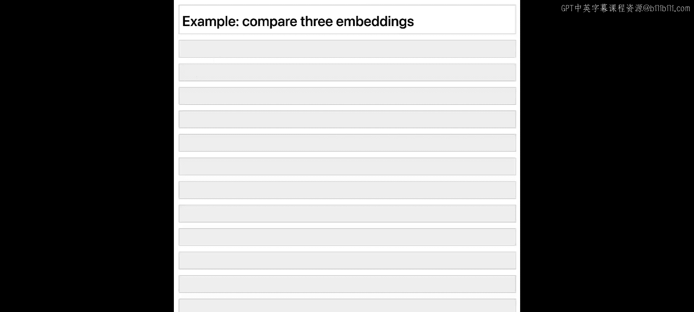

1，0， which is this one。

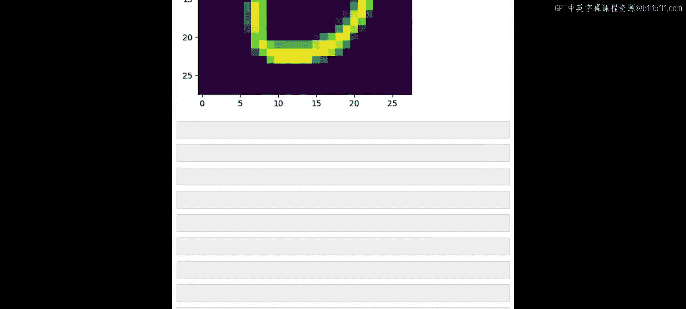

You can grow up another zero。We have this one。

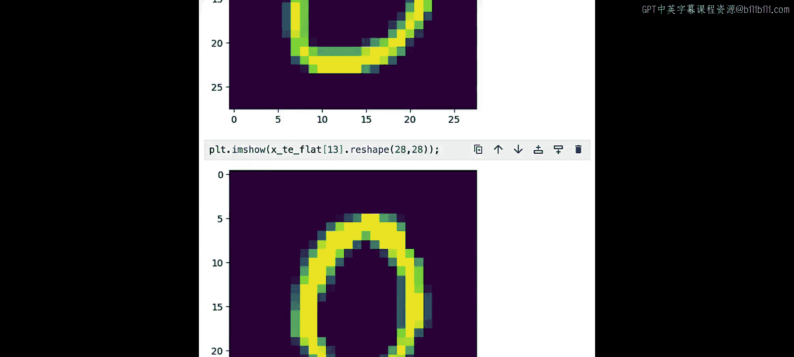

And let's grab up one image that represents digit number one。

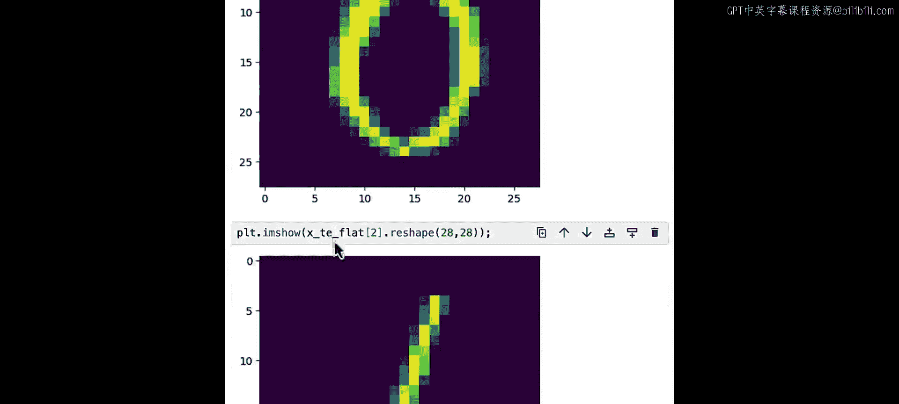

So if we grab these three objects and we could call our function to generate vector embeddings。

 so0 a，0 b and 1 will contain the vector embedding values that we need and if we print them you can see the vectors as follows and you can already see that two zeros are kind of similar to each other while the vector that represent digit1 is actually quite different。

We can also do something very similar with text embetics。

 So if we grab a sentence transformer like this and then grab a few sentences。Like this。

 we can generate vector embeddings for each of those sentences over here would you have like values like this and to illustrate the shape of each of those vectors let's just run quickly embedding shape and we can see that in here we have three vectors of 284 dimensions So let's try to represent those vectors in a visual way so I'm going to plot each of those vectors as a very nice barcode or series of barcodes and we can already see that the first two vectors are kind of similar to each other while the third vector is quite different。

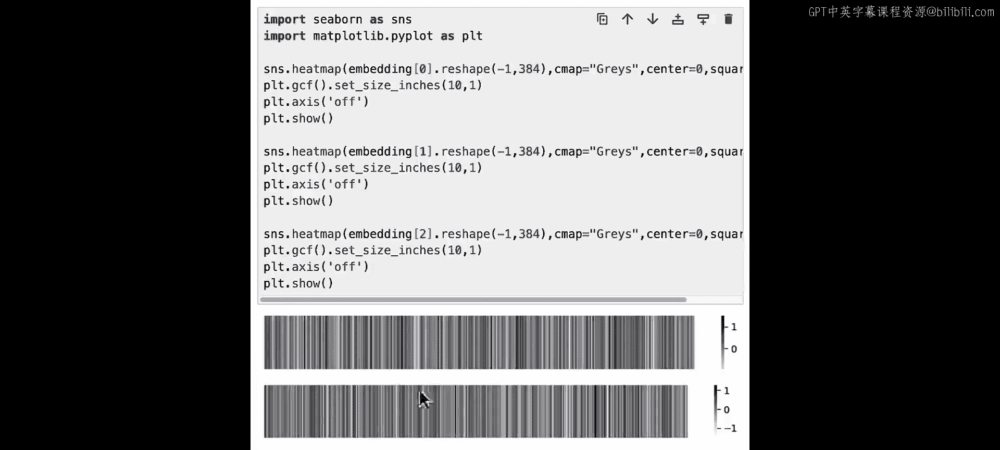

And now we are going to talk about distance metrics and how you can actually calculate the distance between different images or sentences or basically the vector embeddings that represent them。

 and we'll look at four different methods， we'll look at Euclidean distance。

 mononotton distance doc product and cosine distance。So let's start with the Euclidean distance。

 which basically calculates the shortest distance between two points。

 and here's the calculations for the Euclidean distance between 0 a and 0 B， which comes to around 0。

6， there's also built in methods inside Numpy so we can calculate the same distance in this way and if we calculate all of the distances together。

We can see that the two zeros have this small distance between them while 0 a and 0 B is quite far from the digit1。

 and that's how we can actually mathematically prove that the two zeros are very similar。

Now let's have a look at the Manhattan distance， which is basically the distance between two points。

 as if you could only travel across one axis at a time。

 So if we calculate again the distance between 0 and 0 B we'll get this distance。And then again。

 Ny comes to the rescue and gives this a method to calculate in a very short way。

 and if we compare all the distances according to100 distance。

 we can again see that0 A and B are very close， but theyre quite far from a digit one。Next。

 let's have a look at dot product， which basically measures the magnitude of the projection of one vector onto the other and it will straight go for Npy to do the calculation and the distance between a0 a and B is 3。

6 and if we do the same thing across all three vectors you can see that the distance between0 a and B is 3。

6 while the values for zeros compared to ones are negative values unlike the previous examples where lower distance meant better much when it comes to dot product higher values actually mean a better match while negative values usually mean that they are actually quite far away from each other and finally let's have a look at the cosine distance and the idea behind cosine distance that similar vectors will have a very small angle between each other and we can calculate them as follows So in the case of the two0s we can see that the cosine value is actually very close to 0 which basically indicates a very strong match if we divide0a by0b we can see that the magnitude of the。

diivion is actually very close to each other。 That means that the two vectors travel along very similar direction。

 So maybe let's encapsulate our cosine distance function into a function like this。

 And if we grab up all the distances again as before we can see that there is a very small angle between0 and B but there's actually quite a high cosine value from zero to1 which again proves our point。

 So now let's go back to the example with our sentence embeddings。

 and the interesting thing for you to know is that actually of all the distance metrics the dot product and cosine distance are actually quite commonly used in the field of natural language processing。

 So for example， we could try to compare all those vectors to each other using the dot product and we can see that the dot product between the first two sentences is very high。

 And what this shows is that the first two sentences are very similar while the other sentences are actually not that similar。

 And if we do the same calculation with the cosine distance we can again see that the angle。

Indcate between the first sentences is actually fairly close while the other ones are further apart。

But at the same time， the first to sentences are not the perfect match either。

 and this concludes this lesson and will take everything you've learned here to the next lesson where you will learn how to search across multiple vectors。

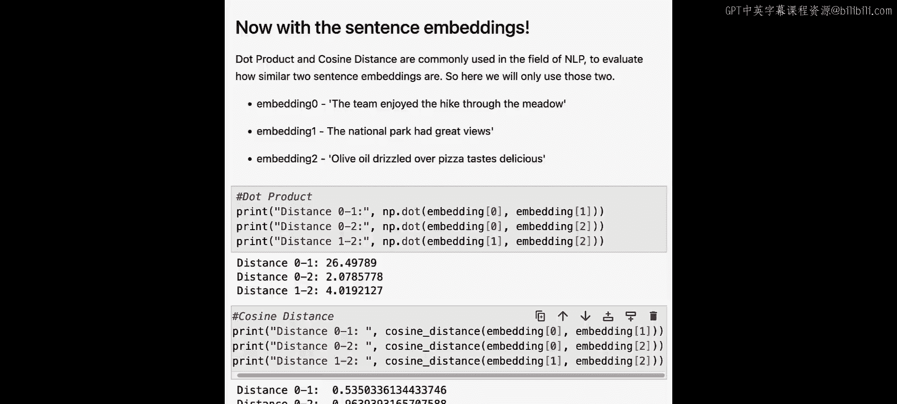