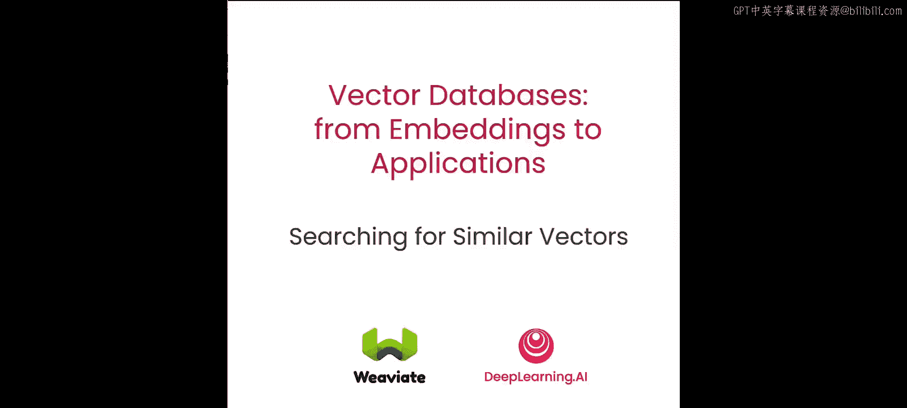
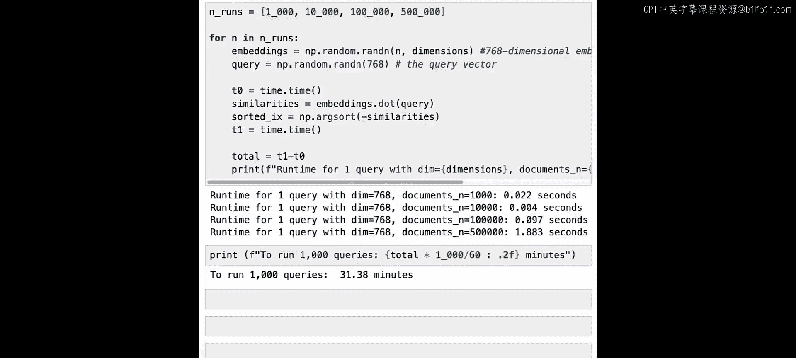

# 吴恩达《向量数据库：从嵌入到应用》Vector Databases： from Embeddings to Applications中英字幕 - P3：L2_kNN.zh - GPT中英字幕课程资源 - BV14u4y1A7fB

In this lesson， you build an intuition of vector or semantic search using the brute force K nearest neighbors algorithm。

 You code up an implementation of brute force K and N and see how it can be used to accurately obtain the nearest vectors in embedding space to a query vector。

 You then explore the issues around the runtime complexity of the brute force K and N algorithms。

 And this leads you to the class of approximate nearest neighbors algorithms that lie at the heart of vector database technology。

 All right， let's dive in。 vectors capture the meaning behind our data and thus in order to find data points similar in meaning to our query。

 We can search and retrieve the closest objects in vector space and return them。

 This is known as semantic or vector search。 And by semantic search。

 I mean search that utilizes the meaning of words or images in question。😊。

One way to find similar vectors is through brute force， which goes in the following steps， step1。

Given a query， find the distances between all the vectors and the query vector。 step 2。

 sort the distances and finally return the top K best matching objects with the best distance。

 This is known in classical machine learning as the K nearest neighbor algorithm。

 The thing is that brutefor searches comes with a large computational cost。

 you can see here that the overall query time grows with the amount of objects that we have in our store。

 And if over time the amount of data doubles or triples， the query time will also double and triple。

 Let's demonstrate this algorithm in code and try to scale it up both with number of data points and dimensions。

😊，So we already have a number of libraries loaded into into our notebook and the one that is worth looking into is the nearest neighbor which we'll use to demonstrate the brute forest algorithm and how it works。

Let's start by generating 20 random points of two dimensions。

And then we can plot it nicely on the graph so that you can see how they are distributed across the screen and across the vector space。

And now let's add all the data points into nearest neighbors index。

 and you can see here that we are using the brute force algorithm。And then if I run this。

 it returns on the internet that is ready to query。

Now this is the query that finds the four nearest vector since our case set to4 and this is the query vector that we are looking for and if we run this we will see that vectors 104。

 19 and15 are the four nearest ones with the following distances。

And even though we only have 20 objects， we could already measure how long this query took。

 so if I run this and grab the time before and after。

 we could see that like searchinging across 20 vectors takes very little time in this case。

And now let's see the time complexity for brute forests for much larger data set than just 20 objects。

 and for this we have this handy function called speed test。

 which takes account of the number of objects that we are tested on。

And it worked in three steps first， we are randomly generating a number of objects based on account。

 and then again we are building the index using the nearest neighbors and then finally we measure the time of the actual query and that's basically what we return back as a result。

So let's test it on 20，000 objects and we can see that we run pretty fast but to really give it a go。

 let's test it down way bigger data sets， so we're going to run it on 200，0002 million。

 20 million 200 million objects and you can already see that like we've asked the number of objects increase the query time takes longer and longer and even between 2 million。

20 million that's already a 10x increase。And a 200 million objects took 12 seconds。

 so you can imagine what would happen if we actually had a billion objects or way more than that。

 this will get very quickly out of hs。The complexity that we just saw was only for two dimensions。

 so what would happen if we increase the dimensionality of our vector embeddings。

 let's say to 768 dimensions and see what happens。So let's start with 1000 documents with 768 dimensions。

 so in here we are generating those vectors over here and then we are normalizing it and then also we have our query that we use to test the performance。

And now let's run a query where at the beginning we start a timer。

 then we use dot product and we calculate the in distances across all thousand vector embeddings and then finally once we have the results we'll sort all of them and then stop the timer and this will give us the time it takes to find the top five nearest results and we can see that searching across 1000 vector embeddings it took us one half millisecond and these are the nearest matches。

So now let's really test out how long it takes to run a vector query across 1000 10。

0000000 and half a million objects with the 768 dimensions and we can see that like up to 100000 that returns pretty fast but half a million takes a bit longer and you can see a single query of just half a million vectors takes almost two seconds and if we were to run 1000 queries across half a million objects that would take in total about half an hour which is not great。

In conclusion we saw how the number of vectors affects the query time， so the more vectors we have。

 the longer it takes for the query to complete and then it got really tricky when we go to the use cases that are closer to real life scenarios where the dimensionality of our vectors was 768 vectors and then in this case。

 as soon as we reach half a million objects brute force was just not cutting it as it was taking almost two seconds per query and in real life scenarios you'd be dealing with tens or hundreds of millions of objects in the next lesson we'll cover different methods on how you can query across many vectors and still return results in a reasonable time。

