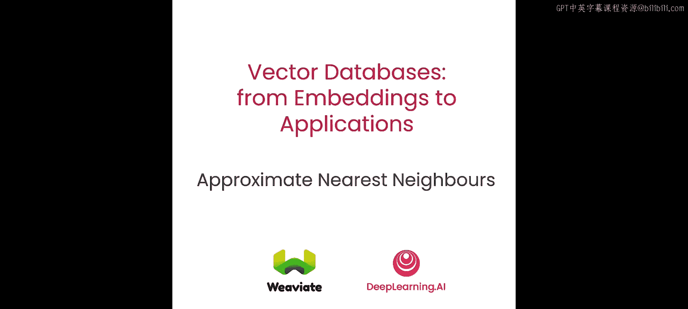
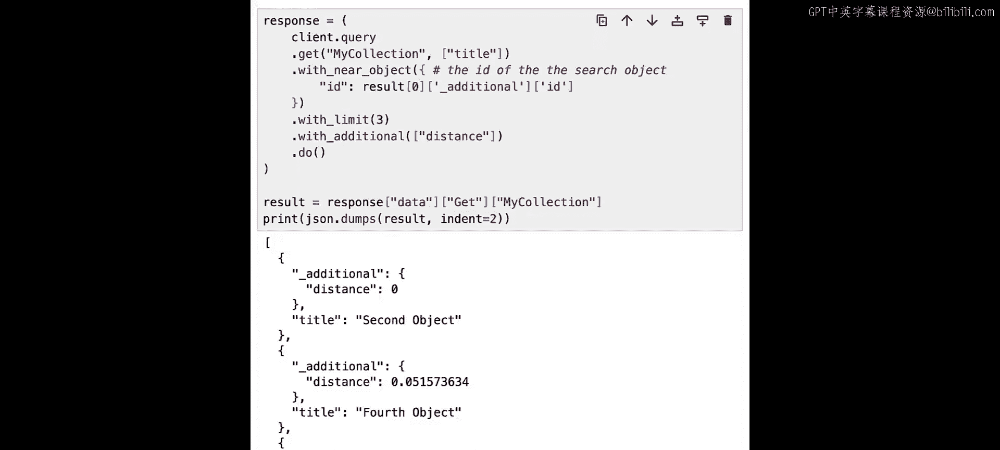

# 吴恩达《向量数据库：从嵌入到应用》Vector Databases： from Embeddings to Applications中英字幕 - P4：L3_approximate_nearest_neighbours.zh - GPT中英字幕课程资源 - BV14u4y1A7fB

In this lesson you will get a theoretical and practical understanding of how approximate nearest neighbors algorithms。

 also known as ANN， trade a little bit of accuracy or recallco for a lot of performance specifically youll explore the hierarchical navigable small world ANN algorithm to understand how this powers the world's most powerful vector databases。

We also demonstrate the scalability of HNSW and how it solves the runtime complexity issues of brute force KNN。

Let's get coding。So if you look at this example with 20 vectors。

 searching for the nearest one is not necessarily a big issue， however。

 as soon as we get to thousands or millions of vectors。

 this is becoming a way bigger problem and are definitely a big nogo。

 there are many algorithms that allow us to actually find the nearest vectors in a more efficient way one of the algorithms that solve this problem is HNSW which is based on small world phenomenon in human social networks and our idea is that on average we are all connected from each other by six degrees of separation。

So it's very possible that you have a friend who has a friend who has a friend， who has a friend。

 who is connected to Andrew Inc。And the whole idea is that you probably know somebody that knows everyone and that person probably also knows somebody that's really well connected and through that you could actually through within six steps find the connection to the person you're looking for and then automatically we could apply the same concepts to vector embeddings if we build those kind of connections。

And now let's have a look at navigable small world。

 which is an algorithm that allows us to construct these connections between different nodes。

 So for example in here we have eight randomly generated vectors and let's have a look how we can connect all of them together to their nearest neighbors so if we start with vector 0 there's nothing to connect just yet then we add vector 1 and the only possible connection is to vector 0。

And now we can add vector2， and we can build two connections between one and0。

Following the same method， we could go to vector 3 and the two nearest connections will be to vectors 2 and0。

 Co next let's go to number four and the two nearest connections probably2 and0。Great。

 now let's go to5，5 is well connected to 2 and 0。Now we can go to6。

6 connects to2 and 4 and then finally7 connects to vectors 5 and3。 And just like that。

 we build a navigo small world。 And just as a note for you in this example。

 we only try to build two connections per vector as we're going。

 but in reality you could have eight connections of 32 or even more depending on the number of vectors you have Now let's see how the search of the navigo small word can be performed in this example。

 we have a query vector， which is on the left。 and we could already kind of guess that number 6 will be the nearest vector and usually how you work with NSsw we start with a random entry node and we try to move across towards the nearest neighbors。

 So starting from node7 which is connected to node 3 and 5。

 we can see that5 is closer than node 7 so we can move there。Great， now from Note5。

 we can see that we are also connected to0 and 2， and2 is definitely a way closer。Great。

 and in from2， we have multiple candidates with the best option being node 6 and in from 6。

 there are no longer better candidates and therefore our query concludes here。

 and that's how we found our best match， which happens to be our nearest neighbor vector that we are looking for。

 So the search with NSW doesn't always result in finding the best match So let's have a look at this from this example。

 If we start from node 0。 In this case， our potential candidates are here。

 and the best possible version from this step is vector number one。 And then from vector number one。

 there are no longer any better candidates and therefore our search concludes here。😊，In this case。

 we didn't find the best possible result， however we found approximately nearest neighbor。

 which is still a pretty good result， but is not necessarily the perfect result。

Now it's time to learn hierarchical Naviggo's small world。

 which puts several layers of Navigo small world on top of each other and the way you can imagine it's a bit like if you were to travel to some place in the world first you probably would take a plane to the nearest airport to where you're trying to get to then maybe you would go to and catch a train that would take you to the town where you want to get to and then finally once you are at the bottom layer you would walk or maybe take a taxi to the destination that you would go into and as we're pointing out that the construction of each layer of HNSW it's very similar to how it's done in NSW so we won't be diving into that and the way the querying works with H andSW is that again were starting with a random node and we only can choose from those available at the highest level and then we move to the nearest one within that layer once we are there we can find the best possible match and that and the next layer。

And eventually， once we are at the bottom layer， we can go to the object which is the closest query vector。

 which will help us do the last mile of the search。

And way nodes are assigned to each different layer is done by randomly generating a number which assigns that node to that layer and all the ones below。

 and it's worth pointing that the chances of landing in a higher layer is logly lower versus the one below and as a result we'll have a lot fewer nodes in the top layer versus the one towards the bottom。

So for example， if the random number is0 then that node would only exists on the bottom layer layer 0 if the random number is 2。

 then that node exists on layer 0，1 and 2， etc， etc。 So here are some characteristics of H andSW。

 So like mentioned before， there's a lot lower likelihood for a node to exist higher levels and query time increases logmically。

 which means that as the number of data points increases the number of comparisons to perform vector search only goes up logarithmically in computer science this is known as o log and runtime complexity which visualizes very nicely that as the number of data points grows。

 the speed doesn't necessarily suffer that much over time and as you can see in this graph if we go from half a million vectors to a million vectors。

 the increase of runtime is minimal。So now let's see how this all works in code。

So in this notebook we'll start with 40 vectors with two dimensions for each and we will set the nearest neighbor connections to two and we can construct those randomly so now let's add a query vector which is located at 0。

50。5 So in here what we do is create a list of node with the query vector which is that one single point then we use the network X library for illustration purposes which we use later on in the next book again finally we print our node and this part creates the position of the query for plotting in the next blocks Next we will run a brute force algorithm to find the best possible vector embedding for our search and then plot it on the graph。

So in this case， we can see our query over here and the best possible match right next to it。

In this step， we construct our HNSW layers， and then in loop。

 we go one by one and then print the layer ID， and then we show all the notes and the connections at each layer。

 so let's have a look。So at the top layer we can see that we have nodes 20， 34。

 28 and 39 already connected with each other。 Then when we get to layer 2。

 we get more nodes with more connections。Then add layer 1。

 we have pretty much most of the nodes already reconnected， and then finally add layer0。

 we have all the nodes present and connected to their nearest neighbors。

And now that we have the whole network built up across all the layers。

 we can run an actual HNSW search query。And the first thing that we will get。😊。

A search path graph array， which contains the graph with the travel paths across all layers。

And then next we have entrygraph array， which gives us the entry point to the graph。

 and then werun across all the layers in a loop to plot all the results layer by layer for the visual purposes。

So you start at the top layer with a node 39。Which from 39， we can move to node 20。

 which gets us closer to the query and once we are on 20。

 there are no longer any node that are neighbors to 20 that will get us closer to the query。

Then we can move to the layer too。From layer to node 20 can take us to node 16。

But Note 16 doesn't have any other candidates that could get us closer a query。

 which then takes us to the next layer。From layer 1， we can move from node 16 to 2， and from two。

 there are no longer any other candidates that could get us closer to the query。

So we can finally move to the bottom layer。And then from node 2。

 we can actually go all the way to node 25， which as it happens is the perfect match to our query and just like that。

 we made HNSW query across all the layers and return the nearestest possible match。

So now let's have a look how we can perform vector search with a vector database which pretty much encompasses all that functionality inside So for this we'll use Wivi an open source vector database and one of the modes that ViI offers is an embedded option which allows us to run the vector database inside the notebook So as a first step we need to create our data schema or what I like to call it a data collection So in this case what we will do is call it my collection or your collection with the vectorizers set to known which basically means that we just want to use pure vector search and the distance metric they want to use is set to cosine。

And once we run that。We'll get a new empty collection in our database。

And just in case if you want to rerun the same example again later on and you need to recreate the collection。

 I'm going to leave you a piece of code that allows you to just delete the collection if it exists and then recreate it。

 but don't necessarily feel like you have to rerun it over and over again。

And now it's time to import some data into the vector database。

 So let's say we have these five random objects with a title and a full value and a vector embedding。

And here's the code that will help us actually get our data objects and load them into the database。

 We kind of set it up。 This is basically a best practice。

 although we only work with five objects usually if you loading like tens of thousands of millions it's actually good to use a batch loading process and then what we do is actually run in a loop to all our data items and construct like let's call it a properties object and then we run this client batch add data object which insert the object into our database So what we need to do is add the collection name So we call it my collection。

Then the data object is properties that we had。And the vector actually exists inside item。Victor。

And that's how we actually pass the vectors into the database。

 And now let's check how many objects we have inside our database so we can run this query on our collection and then we could just ask for the count of the objects inside and we run that we can see that our collection contains five objects。

 So now let's have some fun with actually querying the database the query is as follows。

 So what we say like hey， I want to search from my collection and I want to get the title back and I want to run it with this vector。

 So this is like just a random vector across six dimensions just to match match our original data And by saying this we are telling we to only get two best matches And if I run this it kind of tells us that the second object the fourth object matches our results。

😊，And if you want to see the vector embeddings for all the matched objects。

 we can maybe copy this code over here and add this line。

 which basically tells us to get also the distance。

 the vector and the ID for our data and now we can see that the first object the distance was calculated as 065 and this is the vector that got matched and the same thing for this second matched vector。

And since we are working with a vector database， we can do all additional things like filtered on specific properties。

So in this case， what we can do。Is add an extra bit of code。

Which will tell the database to search onF for values that are greater than 44 and only search on the pre filtertered objects。

Like this and you can see that the only object I got mared are those where the full value indeed is greater than 44。

And one other thing that we can do here with a vector search。

 we can look for other similar objects based on a provided idea of an object。

 so in here we're just grabbing the first result from the previous query and we're looking for three objects that match this object。

And in this case， you will of course， find itself along with the fourth and the first object to。

And that's it for this lesson， in this lesson you'll learn how HNSW works。

 how you can construct HNSW layers and search across all of them。

 but also you learn how to use similar algorithms in a production ready database and the next lesson you will learn how to use the vector database with a machine learning models like open AI。

 how to vectorize the data and how to vectorize the queries。

 but also you will dive into C operations for creating reading， updating and deleting objects。

