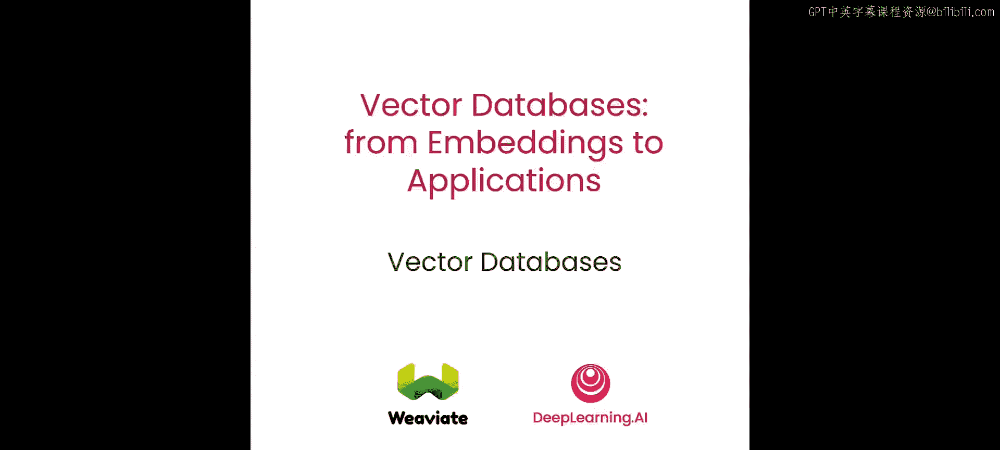
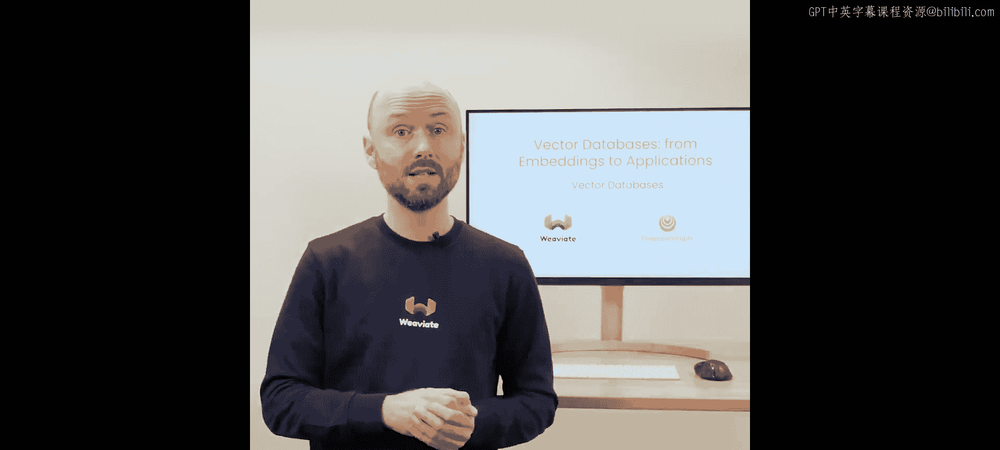
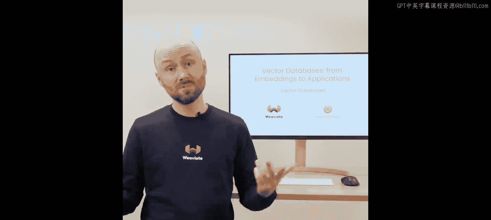
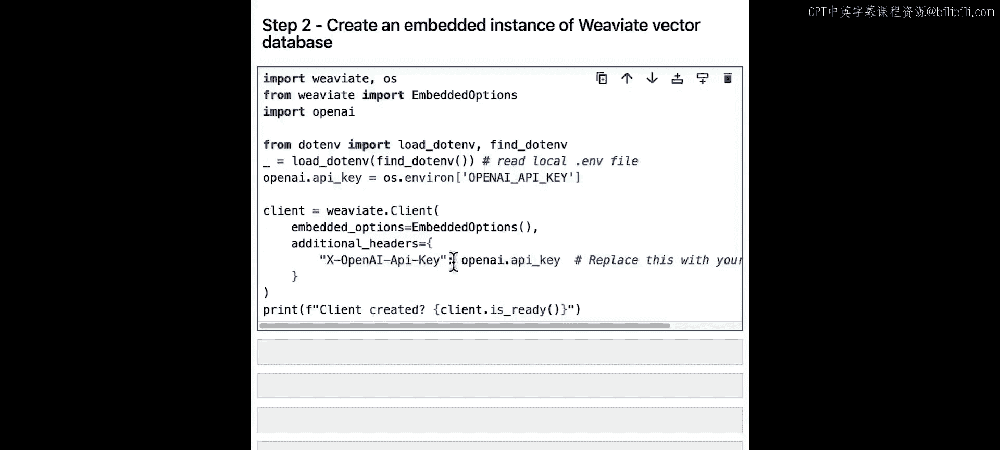
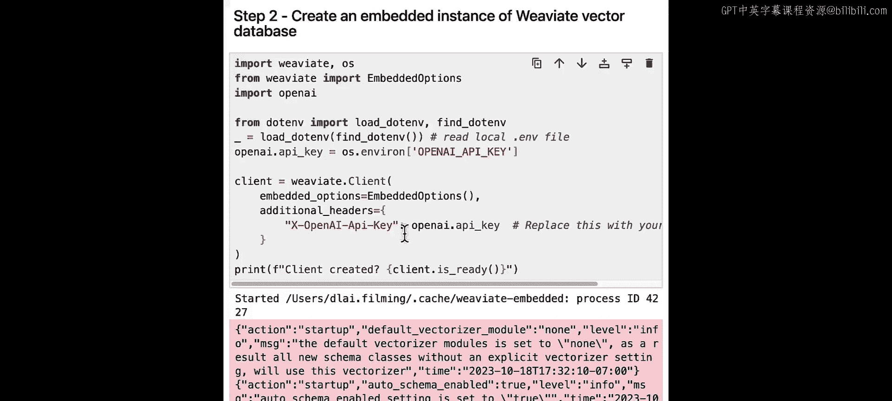
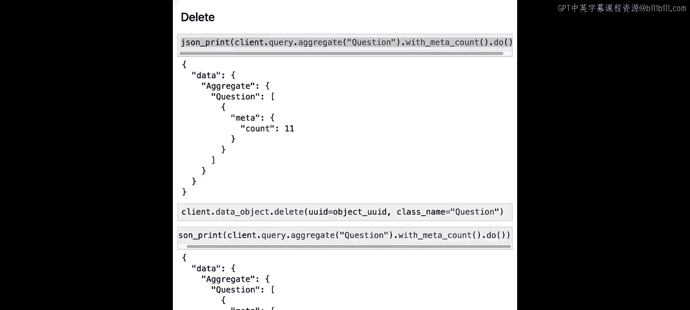

# 吴恩达《向量数据库：从嵌入到应用》Vector Databases： from Embeddings to Applications中英字幕 - P5：L4_Objects_Vectors.zh - GPT中英字幕课程资源 - BV14u4y1A7fB

In this lesson， we'll introduce WiI， an open source vector database and discuss how you can use it to perform semantic search and how it supports crowd operations。

 which stand for， create， read， update， and delete。

You also inspect the objects and vectors that are stored in a database。

 This lesson will provide you with the fundamentals of how to get started with a vector database and even some advanced topics such as performing filter search。

 Let's have some fun。😊。

In this project we'll use this sample dataset which contains a set of jeopardy questions so the idea is that we'll have something like a category question and an answer and we'll load it into a vector database and perform semantic search queries on it so just like in the previous lesson will set up an embedded instance of Viviiate but one difference in here is that we will use openaiI to generate our vector embeddings and for this we need to load an open AI API key if you are running this project at home in your own environment you probably have to replace this with your own API key but for the purposes of this tutorial you can just keep it as it is and don't worry if you see this kind of warnings this is purely informational everything works just fine。

And if you're curious what sort of things are available inside an embedded instance。

 basically Wvi offers this modular system， which allows you to use something like generative search with open AI or you could run text of vectorization with cohere hugging phase or open AI which is kind of like the power behind it because it allows you to skip the manual vectorization and let the database take care of it for you and this is what I want to show you in the next few steps。

So just like in the previous lesson， we need to start with creating a new collection。

 so we'll call it a question。And this time we'll use Tex tove openaiI vectorizer。

 and this is actually a pretty powerful module which allows you to automatically generate vector embeddings as you import the data and at the time of each query。

 the vector database will grab the necessary input and then send it to open AI to vectorize and just as a reminder。

 let's print one of the data objects so that we know the data structure for it。

And then we can take that data object and then import it into our questions collection and this is what we're going to do here。

 we are going to import the data in batchs of five and then basically for each object will say hey。

 we're importing this question， construct our objects with the answer questioning category and then pass it into the database。

Would't the collection name question？You notice here that we are not passing a vector embedding this time because that's basically what the texttuV open AI module is supposed to do and it will generate the vector embedding for every object so if you run this。

The vectorization is complete。And to verify， we could run this quick aggregate query on the question collection and we can see that we do have 10 objects inside。

And now what we can do is actually maybe grab one of the objects from our question collection。

 Let's see what category question and answer has。 But more importantly。

 let's have a look what vector embeddings was generated for that specific object。 So if we run this。

 we can see a whole vector embedding， which is pretty long。 it should be about。

1500 dimensional embedding。And now let's try to run a vector query using semantic search。

Who use wave。Near。Text operator， and we'll pass in our query as concepts。

And the query itself is biology， so that's what we're looking for。And then to add some extra info。

 let's also display。Additional property， which is the distance。And then if we run this query。

 we should get two objects that match the query for biology。

And this is our result and since the other model uses a cosine distance。

 then smaller numbers indicate better matches， so in this case 0。19 and 0。

2 that actually indicates a pretty strong match to our biology query。

We can also run a query to return all the objects that we have in the database and then kind of like look at all the available distances that we get here so you can see that as we go down。

 the distances increase since we're using a cosine distance metric that kind of means that the worst matches are at the bottom and the best ones are at the top。

Now let's try to run the same query again， but the thing is that we don't always know how many objects are the best matches and maybe one thing that we could do is basically say like hey I accept anything within a specific distance so this time I can say my distance is 0。

24 and anything that is above that distance should be rejected and this is a really good method of kind of say like I have certain requirements for the quality of my results and anything that goes beyond that should be ignored。

So like you can see here， the final result was cut up at 0。23。

And since we are working with a vector database， that means that we can also perform various crowd operations like create。

 read， update or delete， so to create a single object all we need to do is call client data object create and then we can pass in the data object inside and then provide the collection name that willll insert it into and again the text to vector open air module we generate the vector embedding for this object so let's add the object。

And now we can print its UU ID。Now let's see a read example to read the object that we just created in the previous block and we are going to grab it by this object ID。

And then if we print it， this is our object and if you are curious to see what is the vector embedding that was generated for it。

 all we have to do is just add this wave vector true and then running that will give us the object with all the information and its vector embedding。

AndNow let's grab that object and maybe update it so previously the answer was said to just Italy。

 but let's set it to Florence in Italy。 So if we run this， the object will get updated。

And then we could grab it again by its ID and we can see the answer indeed got updatedd。

And finally we got to the stage where we just want to delete our sample object so in this case what we want to do first is check how many objects we have before。

 then we can delete the object based on its ID and then finally we will print the aggregate just to verify that we have one object left before we had 11 now back to 10。

And this concludes this lesson in here you learn how to use vector database to automatically vectorize all your data with openaiI and also use the same mechanisms to vectorize your queries and perform various searches including vector search and filtered search and we also went over how to use various crowdD operations so that you could maintain your data as you go throughout the lifecycle of your applications。

 and in the next lesson we'll introduce the concepts of sparse and dense vector。

 but we also look at the hybrid search which allows us to combine both of those methods to provide better results。

