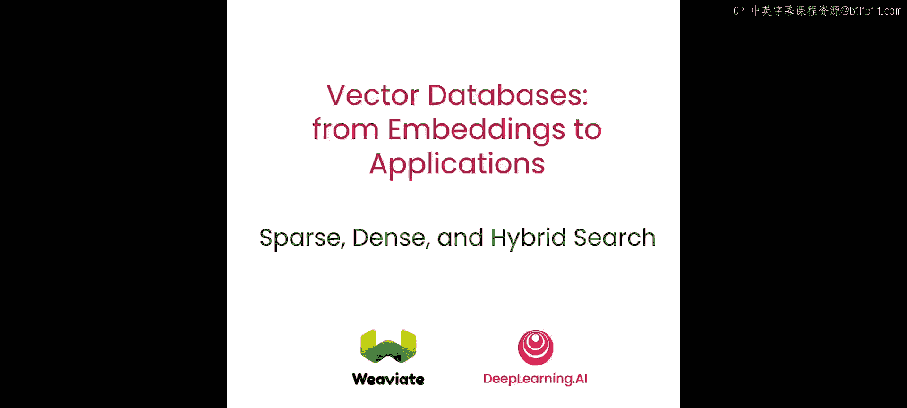
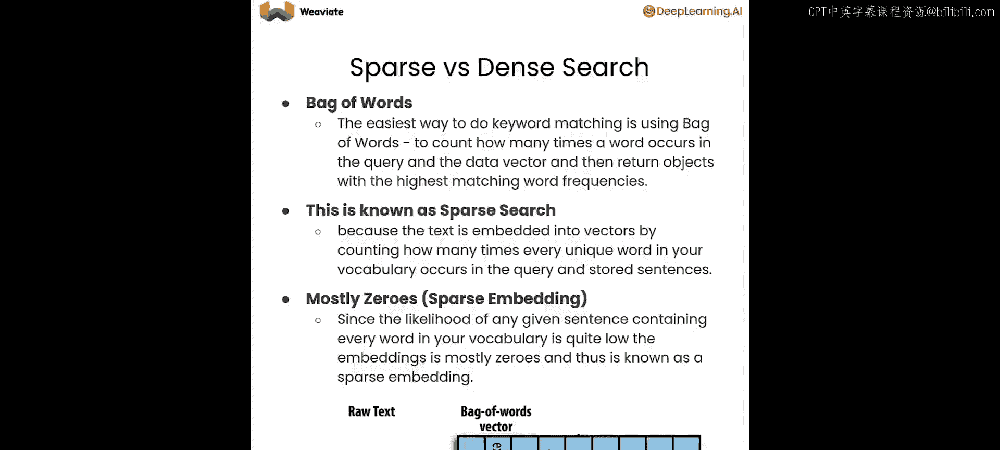
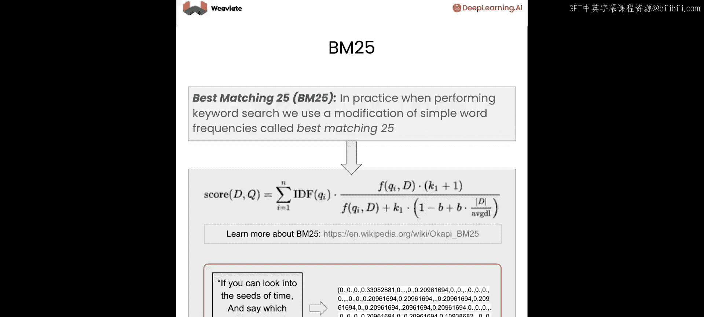
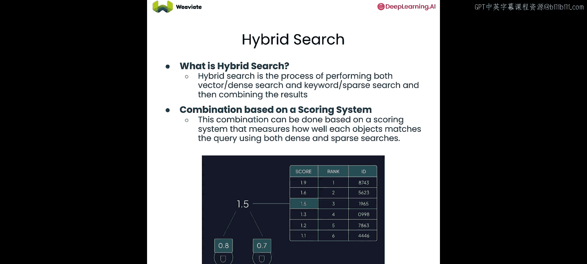
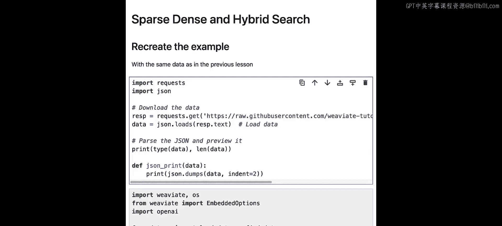
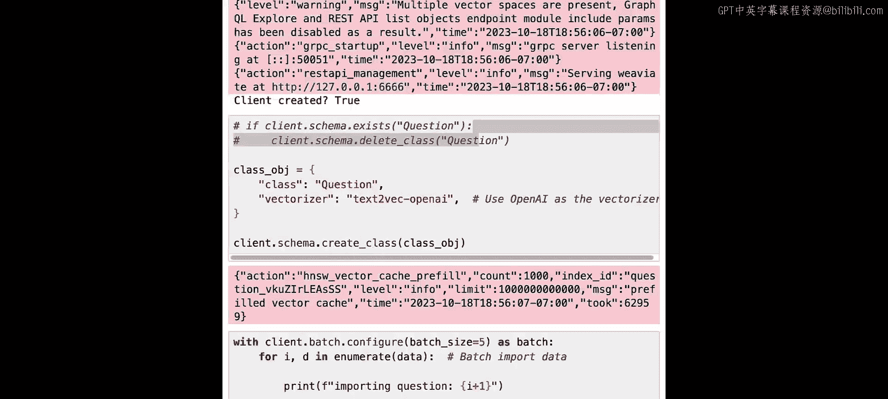
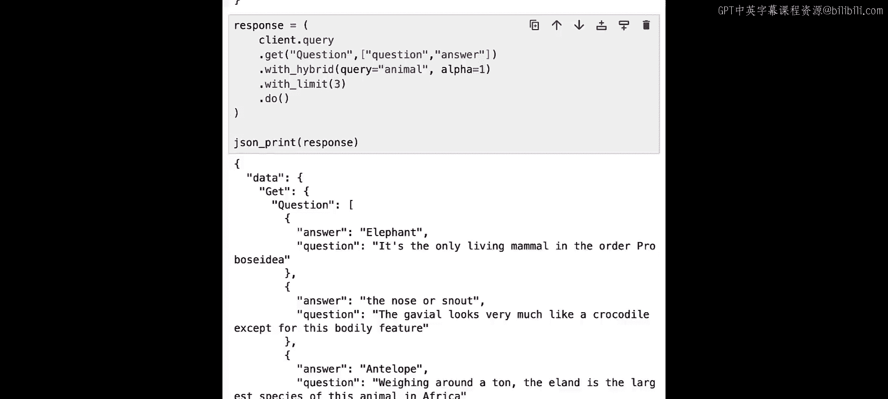

# 吴恩达《向量数据库：从嵌入到应用》Vector Databases： from Embeddings to Applications中英字幕 - P6：L5_HybridSearch.zh - GPT中英字幕课程资源 - BV14u4y1A7fB

In this lesson， we'll introduce the concepts of spars and then search。

 Co techniques for implementing both and discuss the advantages and disadvantages of each will then introduce the practical and popular methodology of combining this using hybrid search。

 hybridbri search allows you to make the most of both search techniques and fusing the return rank results。

Let's roll。So let's see what's the difference between densese and sparse search and why would you want one over the other So denseer use vector embeddings representation of the data to perform the search So it relies on the meaning of the data in order to perform that query So for example we look for baby do maybe we can get back information and content on puppies。

 However， this has its limitations。 For example， if the model that we are using was train on completely different domain。

 the accuracy of our queries would be rather poor it's very much like if you went to a doctor and ask them how to fix the car engine。

 Well， the doctor probably wouldn't have a good answer for you。

 another example is when we're dealing with stuff like serial numbers like seemingly random strings of text and in this case also there isn't a lot of meaning into codes like maybe 43300 like if you ask the semantic engine for finding content with that you would get high quality results back。

why we need to actually go into a different direction for situations like this and try to go for keyword search also known as Sprsse Sprs search is a way that allows you to utilize the keyword matchinging across all of your content one example could be hey we could use bug of words and the idea behind bug of words like for every passage of text that you have in your data what you can do is grab all the words and then keep adding and expanding to your table of available words just like you see below so in this case we can see that like maybe extremely in appeared once in this sentence and then word it appears twice so that's how we can construct that or spars andbedding for this object and as I mentioned this is called spars andbedding because if you have across all of your data so many words actually the vector that would represent that data will have a lot of slots where you could count each individual words but in reality。

You would be catching maybe1% of available words so you would have a lot of zeros in your data。

 A good example of a keywordbased algorithm is best matching 25。

 also known as Bm25 and it actually performs really well when it comes to searching across many。

 many keywords and the idea behind it is that it counts the number of words within the phrase that you are passing in and then those that appear more often are weighted as like less important when the match occurs but words that are rare if we match on that the score is a lot higher and like you see this example here the sentence that we provided at the bottom will result in quite a lot of zeros that's why we call it sparse vector search but we don't have to choose between one or the other This is where hybrid search comes in hybridbri search is basically a way of running both sparse and denses vector in one query and then for each will get a different score a different result and then we can。

Combine those scores into one score and then rerunnk all of our results。

 and then returning it back to the user。So let's see how all of this works in action in our code。

 So we are going to use exactly same data as in the previous lesson。

 so I'm not going to over it too much。 let's just quickly load the data。

 create a new instance of Viiate。

Then we can create our collection and then import our data， and we are good to go。

So let's start with a  query that you're already familiar with and you'll use the width near text and then we search for concepts on animal。

And then we can see that semantically we can match things like mammals and crocodile and well exact much on animal itself。

Now let's try to run the same query， but with a keyword search， so I am going to add with Bm 25。

And our query again， is animal。And let's see what kind of results we get。

 and you see this time we only get one object back which exactly matches on the animal。

And now we're getting to the juicy part where we can actually execute the hybrid search。

 So let's go with。Hygrid。And our query again， is。Animal。

And we have this special parameter called alpha。Which basically tells which one to favor with alpha closer to one means that we are favoring the scores from the vector search from the dense vector search while when alpha is closer to zero。

 then we are favoring keyword search。So let's run this and then now we can see that we're getting very similar results as before。

 but the interesting thing is that the object that has the key animal inside is rankged as a top result which brings it up all the way to the top into our attention and we could return it to our users So now let's grab this again and then try one more time but with different alpha。

So if I set this to zero， then we should get only the responses that are helpful based on a keyword search。

 so none of the vector search were returned。And if we try the same thing with alpha， let's say one。

This will basically be a pure。Dense vector search。 andvoila this is the power between the dense and sparse vector search and also combining both of them through hybrid search。

 And in the next lesson， we dive into multilingual search and also re augmented generation。

