# 吴恩达《向量数据库：从嵌入到应用》Vector Databases： from Embeddings to Applications中英字幕 - P7：L6_Multilingual_RAG_Search.zh - GPT中英字幕课程资源 - BV14u4y1A7fB

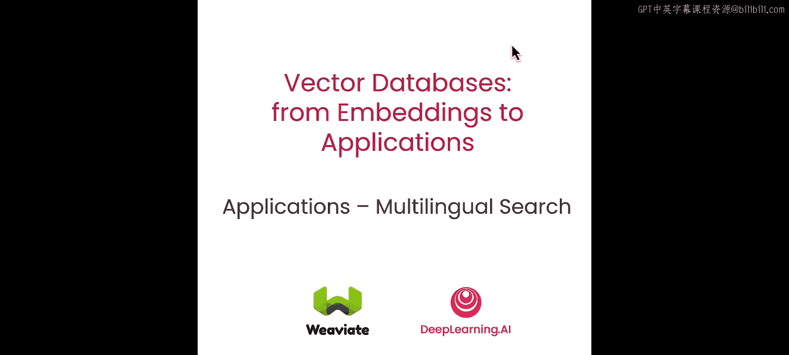

In this lesson you will explore the flexibility of a multilingual model with a vector database。

 which allows you to load and query data in multiple languages。

 will also introduce the concept of retrieval， augmented generation and explore how you can implement this multistep process of retrieval。

 reasoning and generation in one simple query。😊。

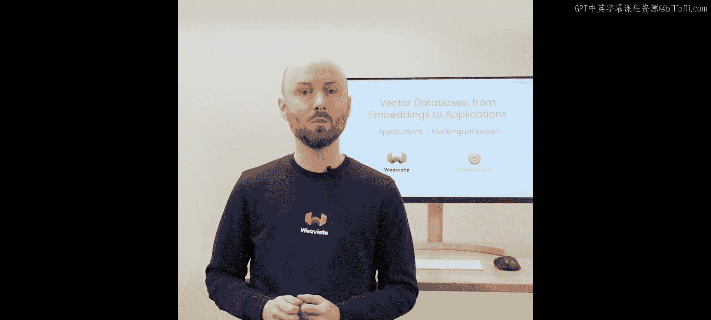

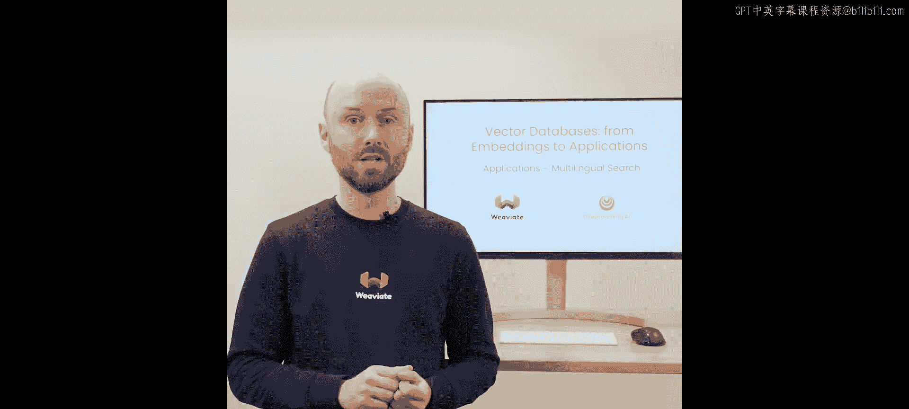

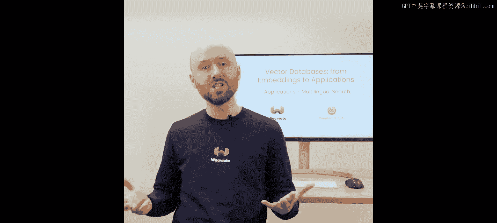

All right， let's build something cool or like we said at home， Bu Fnaga。

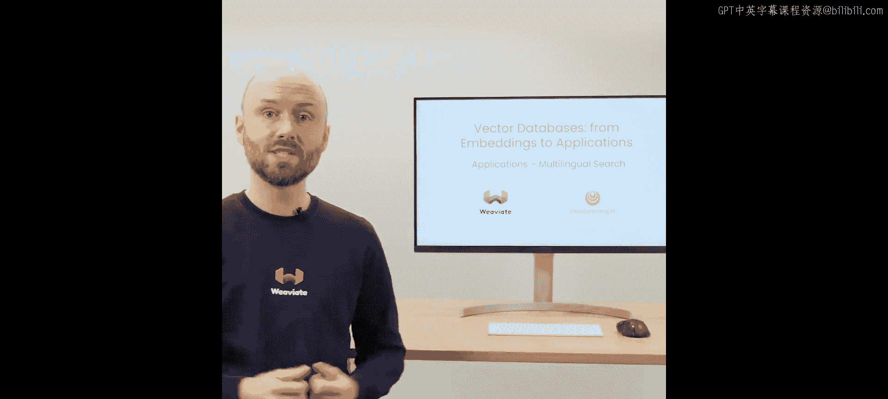

So let's have a quick look at what is multilingual search and then how it works and what's the idea behind it。

 It's very similar to how semantic search works where we can compare like know dogc to a puppy and then still be able to find very similar match。

 but in case of multilingual search you can have the same text but in different languages which will also generate very similar embeddings if not identical and through that we can use the same methods to search across content in any languages we need。

 We explore this in detail in a code So now let's dive very quickly into what rug is and how it works。

 So basic idea that it allows us to use vector database as an external knowledge。

 but also it allows us to retrieve relevant information and provide it back to the LL。

 but also it synergizes with the data that sits within a vector database or another benefit of using rugs that we can use our applications on our data without having to retrain or fine tune our LL。

 and in a way you can think of。Rag is like you going and visiting a library so if somebody asks you a question without any resources。

 you may just make up something， but if you go to a library you can read a book and then provide response and that's basically what RaG does with a vector database。

So some key advantages of RA is it allows you to reduce hallucination。

 you can also enable your LMs to ci sources， but also it can solve knowledge intensive tasks。

 especially for a kind of information that is very rare to find out in the wild。

So here's a very quick illustration of how a full rack query works。

 First we start with a query to a vector database which obtains all the relevant source objects。

 then we can combine these to get over a prompt and then send it to the LLM which then will go and generate the response that we are interested in。

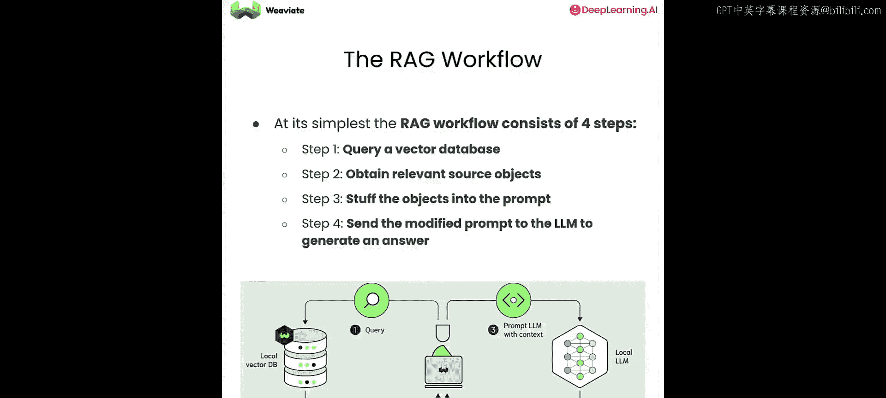

And here's a very quick example of a code to perform rack。

 you can see it's very similar to what we've done in the past with the queries。

 except this time we are adding the part with generaterate。

 but I'm not going spend too much time on it because I'd like to do it in a code。😊。

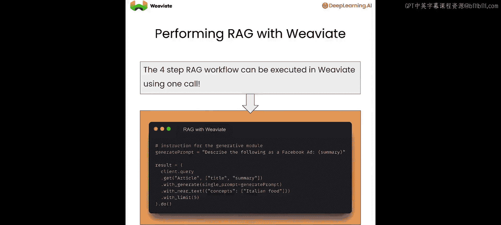

Let's prepare our adjacent print function and this time for our demo we'll be using an already deployed instanceense orwiI in the cloud which utilizes coherence multilingual models And in here you can see that we are providing two types of API keys。

 a cohere API key which we use for multilingual search and then open AI API key which we use for generative search Let's very quickly see how many objects we are dealing with in our database。

 So we have about 4。3 million Wikipedia articles to play with which is great。😊。

So now let's have some fun with this big data set and then run some queries In this case what we want to do is search for vacation spots in California let's run this query and return five objects and you can straight away see that we got few objects that are returned in English there is one result in French one in Spanish and actually two in Spanish and another thing that you may have noticed that we run this query across 4。

3 million objects in a blink of an eye and to make our lives easier at weveware filter so that the next result that we get back they're all in English and also we'll just get three objects back but a query is still mo Tiingo right so what else can we do with this。

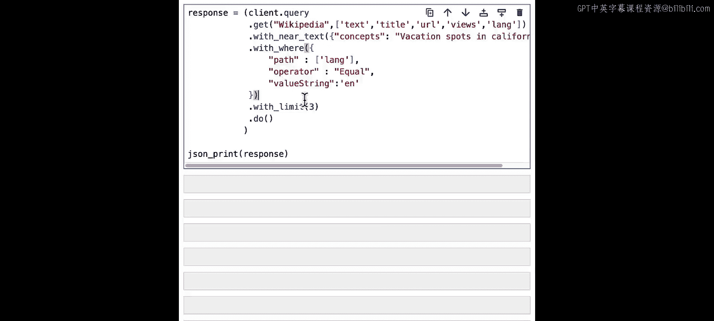

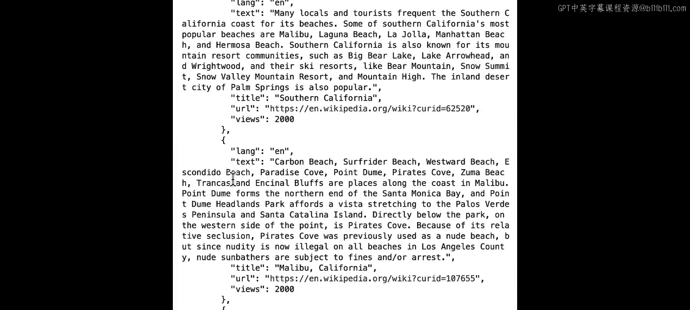

How about we try to send a query in a different language？So in this case。

 we are asking for vacation spots in California， but in Polish。And if I run this query。

 we're still getting the same results as we had before。

And you may think that searching in Po which uses pretty much the same alphabet is not that impressive。

 how about we try something with a completely different alphabet so we can run the same query but in Arabic and that still performs really well and still returns objects that talks about vacation spots in California。

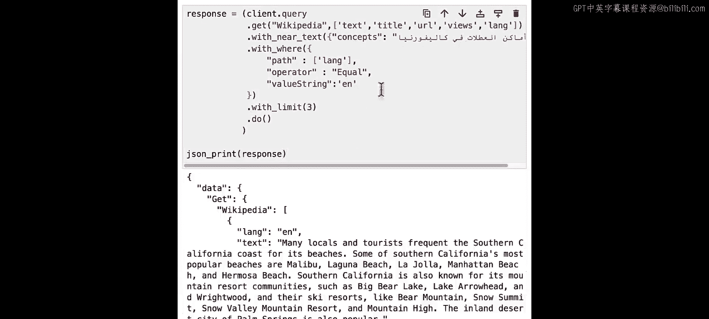

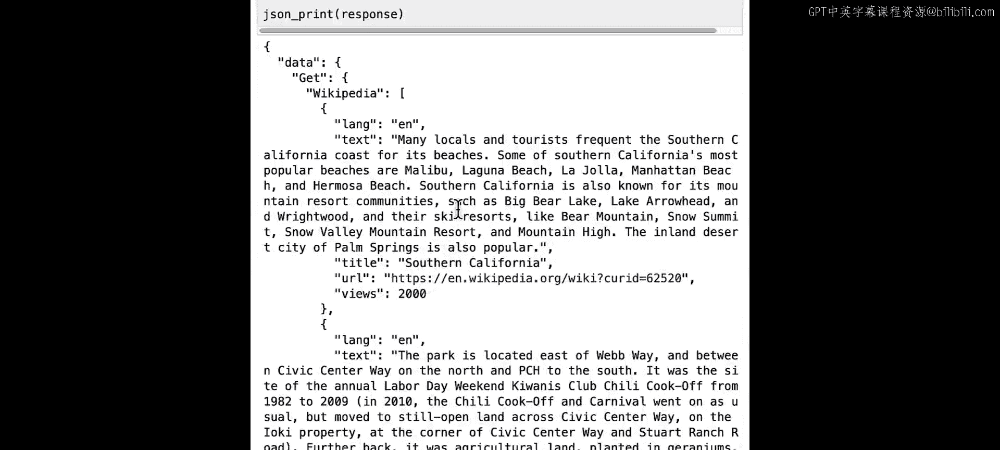

Now let's do some rug example， So the starting point is very similar as we have before。

 it's a straight up semantic query， and now we can add a prompt， so let's call it prompt。

And the text will be something like。Write me a Facebook。Art。

About and I want to grab the title for my query。 and then so we do it with the Kellyly brackets。

 and then we can say using information inside。And then， we can provide text。And by doing that。

 we basically constructed the prompt based on the results we get from the query and to exit the actual query。

 we need to add。Withve generate。And we pass in our a single product。

Would we take our prompt that we construct it。Just both。And by doing this。

 we're basically asking the vector database is to pass in the same prompt for every single object。

 so we should get three different generations as a response。

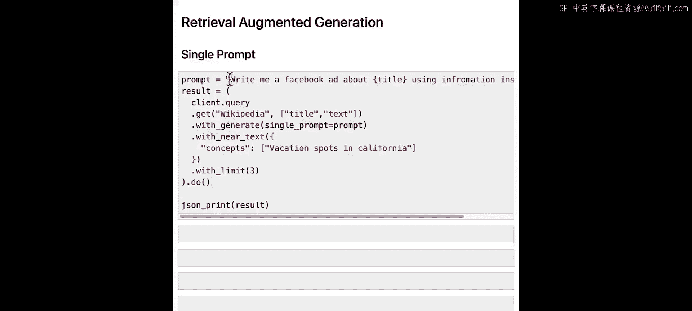

And in here， we can see the results of the generation， so this is brand new content。Generated by GT。

 So in this case， we have， you know， looking for some fun in the sun， then look no further。

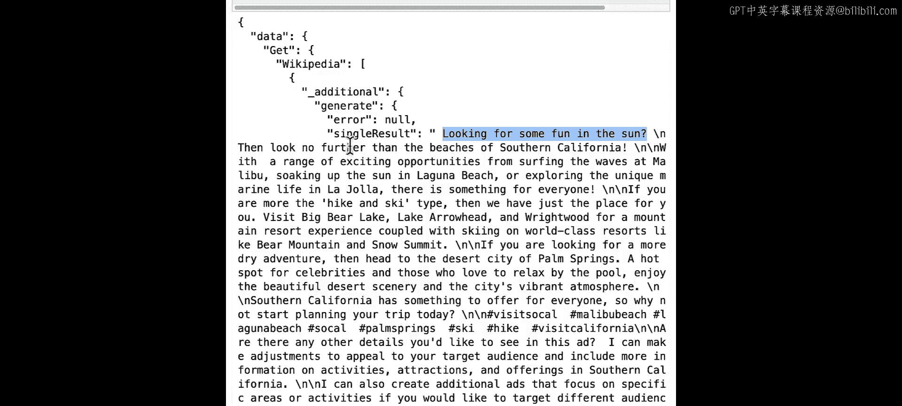

And this is the text what it was constructed on and the same thing happened for the order two responses。

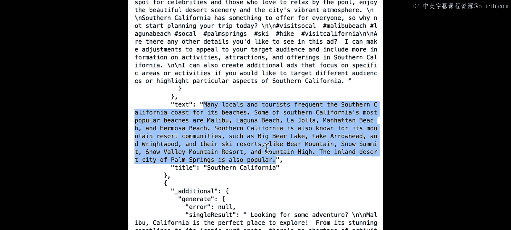

Another type of a rock query is a group task， which basically takes a prompt and then also runs a query and then sends all the results as a single query into GPT。

And then we can run it and expect only one generation， and like in this case。

 we want to summarize what these posts are about in two paragraphs。

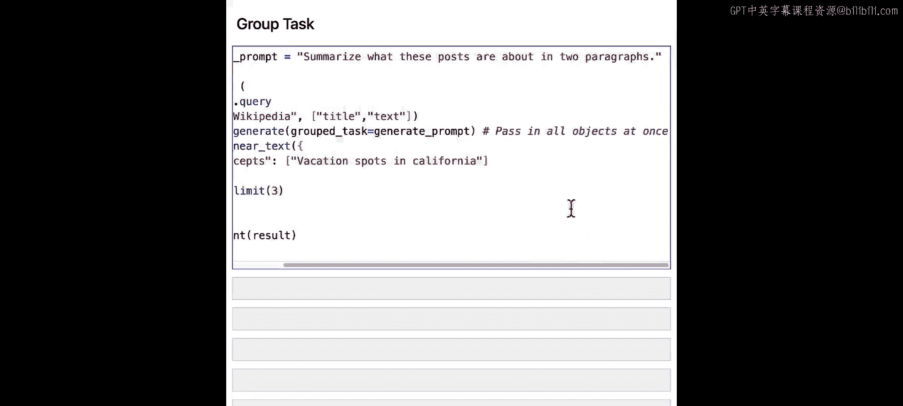

And as a result。We get a summary of all the three posts that were returned from the original query。

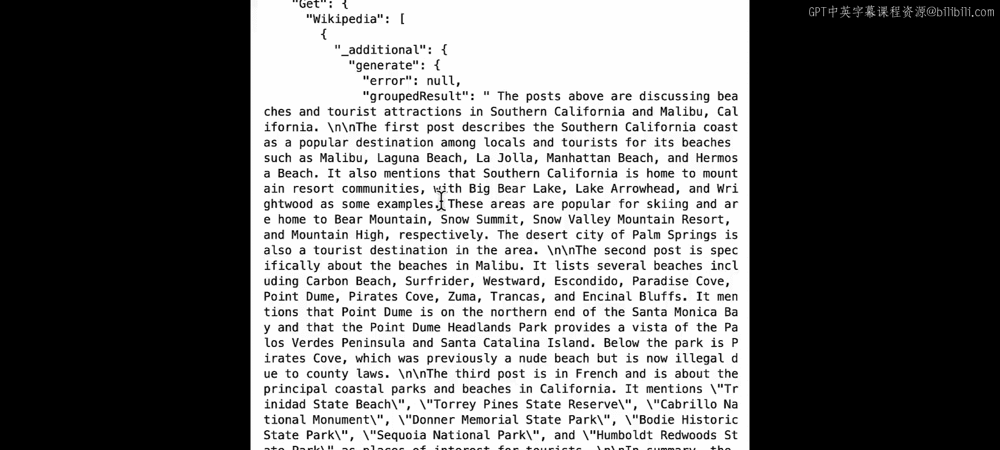

And that concludes this lesson in which you learn how to use multilingual search where you are able to search across content written in any language。

 but also by providing queries in whatever language you needed。

 and we also went over a few examples of Ra query in which we use single pro and group task to be able to generate responses based on individual objects or Pon collective response。

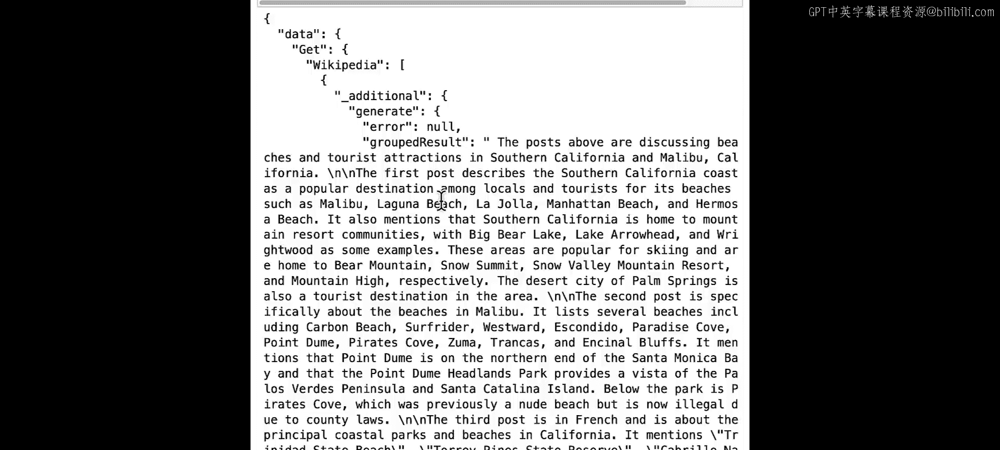