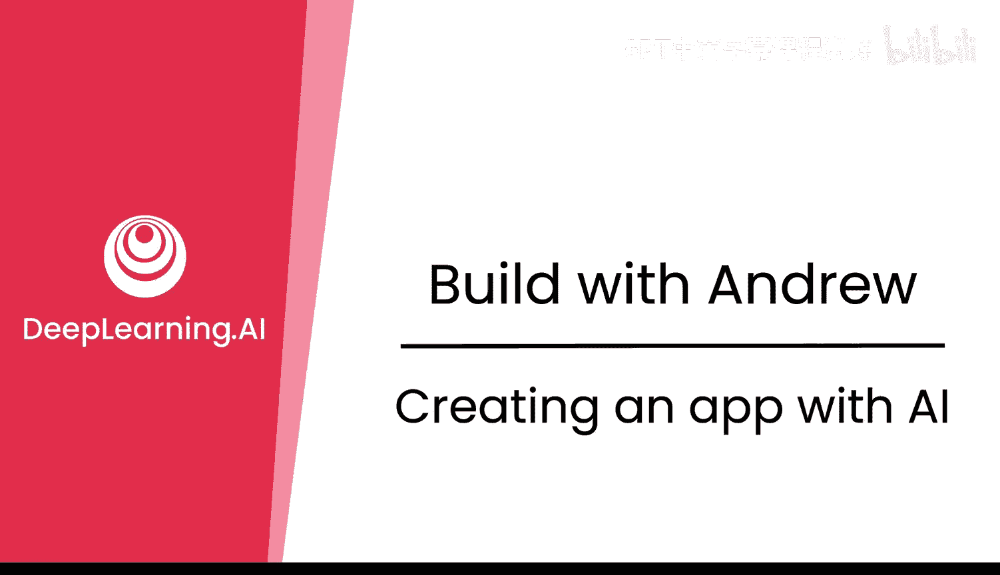
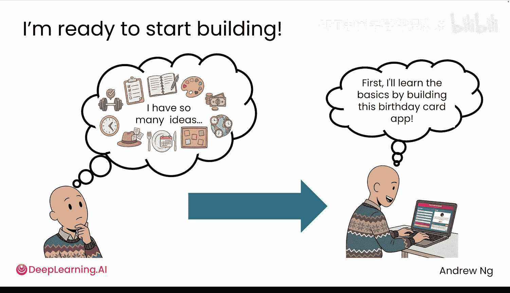

# 吴恩达《和吴恩达一起构建APP｜Build with Andrew中英字幕 - P1：1.creating-an-app-with-ai.zh_en - GPT中英字幕课程资源 - BV1uiraBVEgv

Hi， I'm Andrewtong， I want to show you how to build fun， useful software using AI。

 regardless of your background or training。😊，If you're intrigued about using AI or vibe coding to build cool software。

 but aren't sure where to start， this course is for you。

Let me show you a funny birthday card app that you learn to build in minutes using Cha Juput。

 Gemini or any other similar AI system。 even if you've never written a line of code before。

 this birthday card app is a computer program called a web application。

 which means that it runs right in your web browser。

 the app takes whether you type in and creates a custom card for you on the spot。 In the next lesson。

 you build your own version by describinging what you want the AI to do and the AI will write all the code for you to use the app。

 you enter a name， an age， a hobby penguin fashion design。

 an adjectively fun and a pural now Luc songs。 then hit generate card and it says Karen against all Os。

 youve turned 27 your devotion to penguin fashion design is stuff of legends and your suspicious fun icon Sily speaking。

 most people like you。 I that's pretty funny。 or if I don't feel like fully in all of these words myself。

 I can hit Im feeling lucky and have this。😊，automatically and then generate a different card。

 and there's another birthday card。 and you get a different funny story or a different funny birthday card this time。

 notice the app stores all the cards we've generated。 I click copy on any of them。

 the birthday message goes to my clipboard I can paste the message into an email or text and send it as a birthday card you might be excited to jump right in and start building out your own idea And if so that's great。

 And before doing that， spending a little time building this birthday card app yourself will help a lot doing so will give you a better feel of how to talk to the AI so you actually get the results you want and this practice process will build your intuition for how to shape what the AI actually create and you get a better sense of how even small tweets can lead to very different outcomes。

 once these set of concepts become a more familiar to you building your own ideas become faster and easier because you have a better sense of how to steer the process an app like。

This might seem complicated to build， but in the next video。

 I'll show you how you can build something like this in minutes。 Let's go on to the next video。😊。

