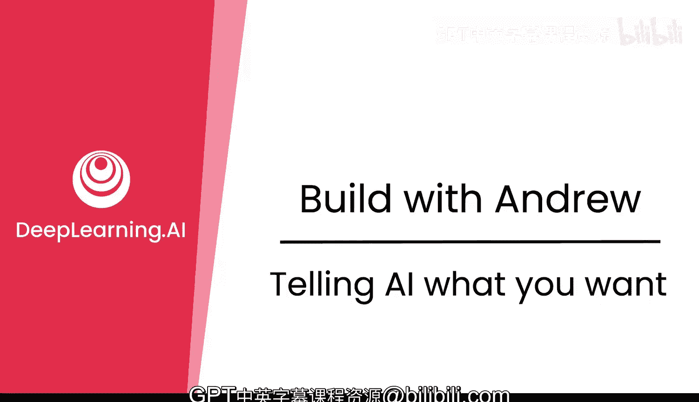
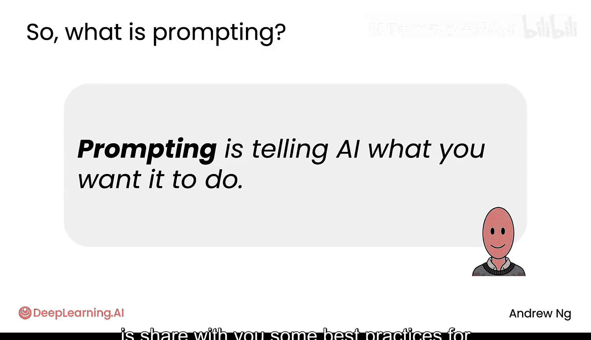
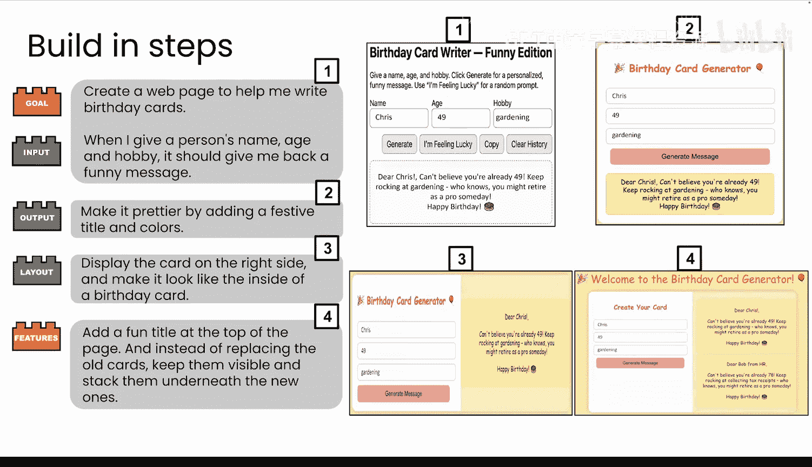
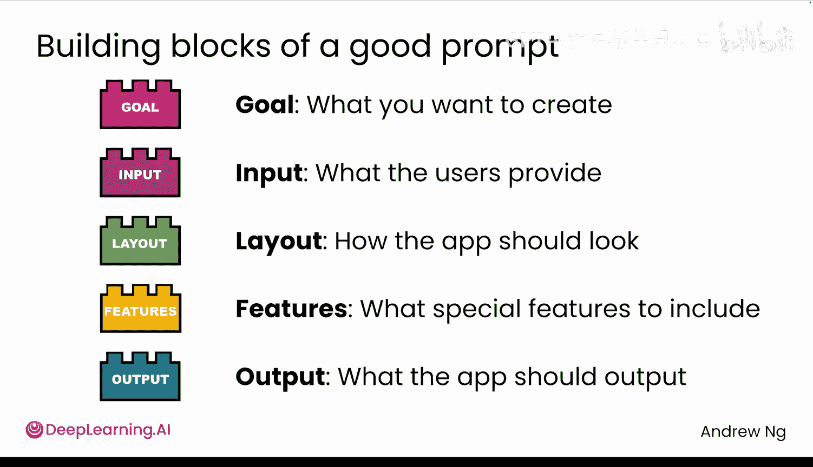
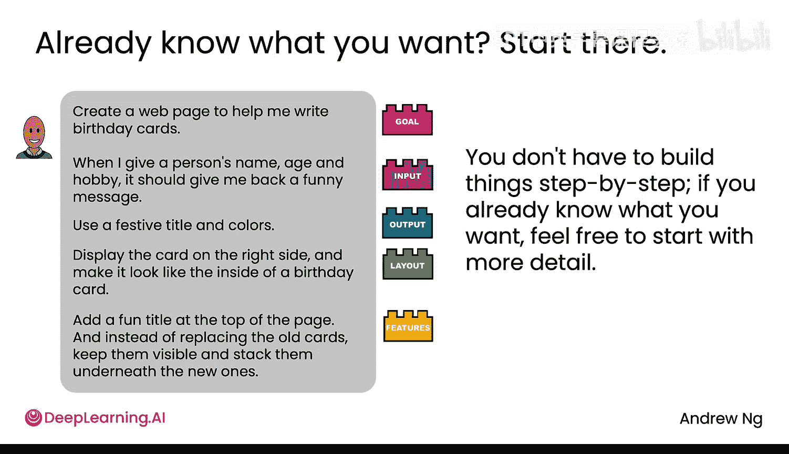
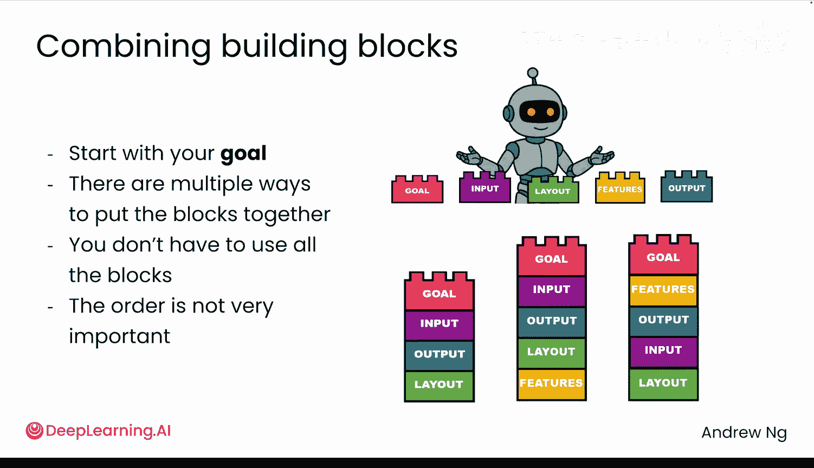
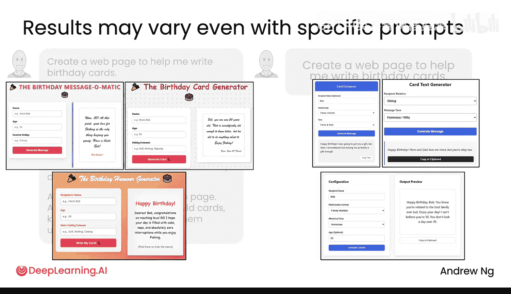
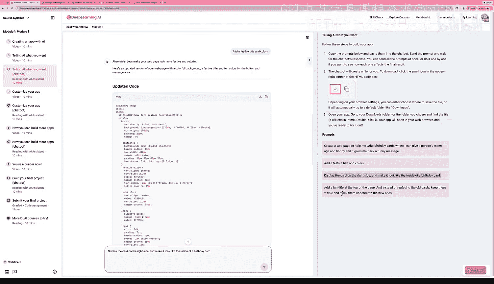
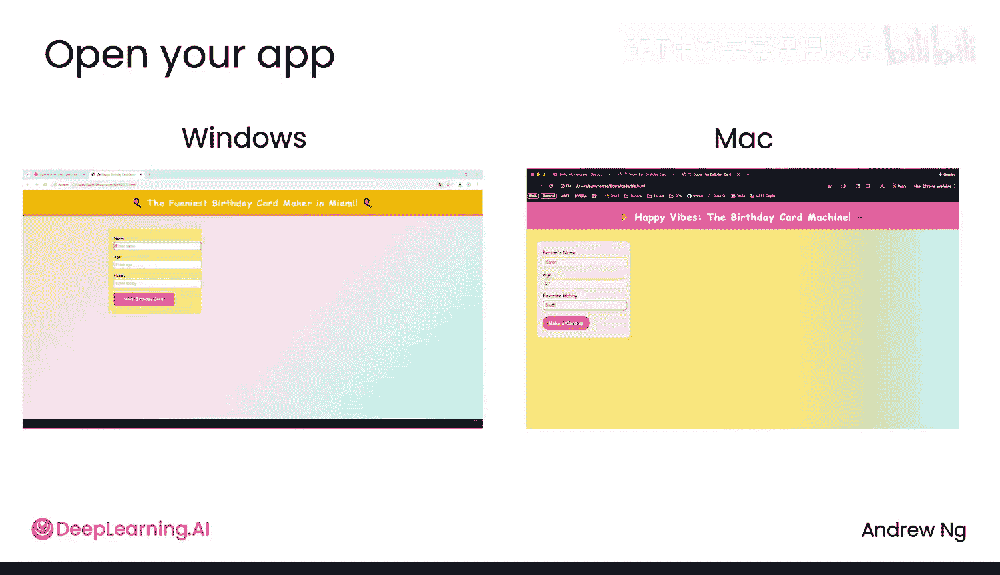
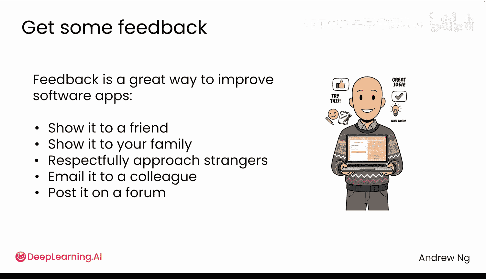

# 吴恩达《和吴恩达一起构建APP｜Build with Andrew中英字幕 - P2：2.telling-ai-what-you-want.zh_en - GPT中英字幕课程资源 - BV1uiraBVEgv

The easiest way to trace software in the AI era is no longer to type out code yourself。

Instead， you should tell AI to do it for you。Telling AI what to do is called prompting。

When given precise instructions， AI can do a lot of things for you。

 What I want to do in this video is share with you some best practices for prompting AI to create software for you first we' walk through an example together then you try yourself using any AI chat system like Cha Gemnai clause or the one built right into this website to use any of these AI systems you give it the prompt or set of instructions like this to tell it to create a webpage to help me write birthday cards and when I give a person's name age and hobby you should give you back a funny message and if you do this it might actually generate an app that looks like this which is a good start you can enter the name age and hobby and it generates an okay message like this but if you are unsati with this you might then continue the conversation with AI and say make a prettier by adding a festive title and colors and this would give you a second version of the app that now looks a bit better and if you saw uns。

You might say display the card on the right side， make a look inside the birthday card and get back a third version。

 and if you have ideas to make it even better， you could give it more instructions like at a fine title at the top and so on This is how I actually work in practice when using AI to write code for me or often start off with a basic set instructions and see what I get and it repeatedly tell the AI how I want to improve it。

 It turns out that when you're building software applications there's a number of basic building blocks。

 you might end up including in the prompt。 one thing I often include is the go So here the goes the create web page help me write birthday cards and another thing you might include is to specify what is the input that is what does the user have to tell the software。

 This is us telling the software what we wanted to output as well as the layout So what's on the left what's on the right how do you arrange the different parts of this app and lastly any special instructions for additional features。

You wanted to include there are many ways to write good pros。

 but as you start your journey of telling AI to build software for you。

 I encourage you to consider these five building blocks as common pieces that you might choose to include in the prompt that is the go namely what you wanted to create what input the user would provide。

 what is the layout of the software app， what special features you wanted to have as was what you want the software to output in a previous slide we went through a back forth process of me incrementally in four adding to the instructions I gave to AI to tell it what I wanted to do but if you already know in advance more or less what you wanted to build。

 you can also specify all of the building blocks in a single prompt For example。

 if already knew the specification I want for the software I could write a single much longer prompt like this to the webage told me write B cause whatever a person's name Asian and hobby you find message。

As ti colors and so on。 and in this example， I've taken all five building blocks and written them all into a single much longer prompt。

 So instead of building things step by step like you saw in the last video。

 you can also give it all the instructions in a single longer prompt and that might give you a better first version of your app which you can then further refine if it's still not quite what you want Now whether you're writing a single long prompt all at once or whether you're giving it one building block incrementally one piece at a time I will often start by telling the AI what is my go and then of the remaining building blocks there are multiple ways to put them together and you don't have to use all the building blocks every time and the order is also not very important start to the go and tell the input output layout and maybe not list any special features or you might put the building blocks together this way and it could work fine or you might list out the building blocks in a different order and the AI is usually pretty good at understanding these different rearrange。

Of the building blocks and if you're feeling like， boy， this is a lot。 I would say。

 don't worry about it。 If you just tell the AI whatevers on your mind。

 even if it's partial and imperfect， you can then work and go back and forth for the AI a few times to hone it to what something that you want together with the AI One of the skills you hone over time is the ability to give AI most specific instructions because it turns out that the results you get may vary even if you give fairly specific prompts。

 So here's a long detailed prompt that you saw just now specifying all of the five building blocks。

 And if you give these same instructions to the same AI system multiple times。

 maybe one time or give an app that looks like this which is pretty nice and maybe a second time will build something like that and the third time will build something like that and all of these look pretty good you can see that thes some variation among them In contrast。

 if someone were to give a much less specific prompt much less clear prompt So it's a very short prompt that just says web page tell me right birthday costs。

This a relatively vague prompt。 the results you get if you run this multiple times through an AI system。

 maybe once you get this， a second time you get this which looks totally different with different fields。

 and a third time you get this， which again looks totally different than the first two times the more specific and the more precise the prompts you write the more predictable will be the results but even then that'll be a little bit of variability。

 So if you get results that are a little bit different than what I show in this video don't worry about it that's a normal cause of how AI systems behave。

 but if it surprises you with something you really don't like that's okay too just give it additional instructions to steer or to move the AI closer to whatever you do want it to do the best way to learn this is to put your hands on your keyboard and to try using AI yourself let me show you what they'll look like。

What I'd like you to do after this video is go to this section on the website and go to this exercise yourself。

 So there are instructions here that you can read later。

 But this is an AI system similar to Chajivi and Gemnai and Claude and so on。 And I'm going to。

Select and then copy and paste the first prompt here where it tells the AI to create a webpage help me write birthday cards and so on。

 and I'm going to hit this to send it to the AI。 So here it think for a little bit and then it will generate HTML page that it can then download and run notice while I still running that this download button here has ded out so I can't actually click on it yet but the AI system will take just a little bit of time to write some we call the HTML page。

 This is what web pages are made of that will be this birthday card generator。

Now that the AI has finished generating all of this H code。

 I can click this download button and here I'm running Chrome on a Mac。

 I'll show you later what to do if you're on a different machine and I can go to this downloaded menu here and open up file H and this has created a little birthday car generator So Karen。

27 and。😔，I can create a simple birthday message， not that and notice that this is actually a piece of code written in HTML。

😊，That is running on your computer right now。 If you were to do this yourself。

 the code is in this file called Fdo Hm and is actually saved to my computer right now。

 And if you do this， it will be safe to your computer。 Now， if you want to improve the code。

 you can then prompt it at a festive title and colors。 And then it updates a code， same as the。

 have to wait until it finish writing the code。 If I can download it。

And now I can download it and say as before， open it。Oh wow， now it looks much more festive。

 And so what I'd like you to do is try it out for yourself。 You can you at this third prompt。

 run it at this fourth prompt or try some other prompt if you feel so inclined。

 It it is also fine to use just these four prompts one at a time and see what birthday the car generator you get out this process。

 Even though I'm showing you this process on a website。

 these same prompts should give you similar results on openized Ch G。

 Google's Gemini andthtros cloud or any other popular AI system。

 What you're learning isn't tied to any one platform and these skills apply to any AI system you choose to use。

 When you click the download button， your web browser will usually download the。😊。

Fo HMO or whatever say file the AI generator with the code to your downloads folder。

 So these videos show you how you can navigate on either Windows or Mac to the downloads folder to find that file。

 And then if you double click on it。It should open up in a web browser and let you see what the code you just generated looks like when it runs in your web browser。

 Please try this out。

After you trial out this process and generate a web app。

 one mindset I hope you have is that getting feedback is often a great step in building software applications。

 whenever I write software I'll often show it to friends。

 show the family or sometimes respectfully approach strangers and ask if they're willing to look at whatever I'm building and see if they can let me know what they think or email it to colleague or post a online forum so you get feedback because I find that when people look at it they often have suggestions for how to make it even better or sometimes if you get a laugh out a friend by showing them something funny。

 I find that really encouraging as well and gives me the energy to keep on going。

 So what I'd like you to do now is go into the next item in this course and try it out yourself。

 get AI to generate some code for you and download the HTML file and see what results you get。😊。

If you feel so moved， I hope you also show it to a friend or show it to someone else to get their feedback。

 After that， please come back to the next video where we'll keep on working on the app and we'll look at how you can add even more features to the Bley Call out to make it even more fun and interesting。

😊。