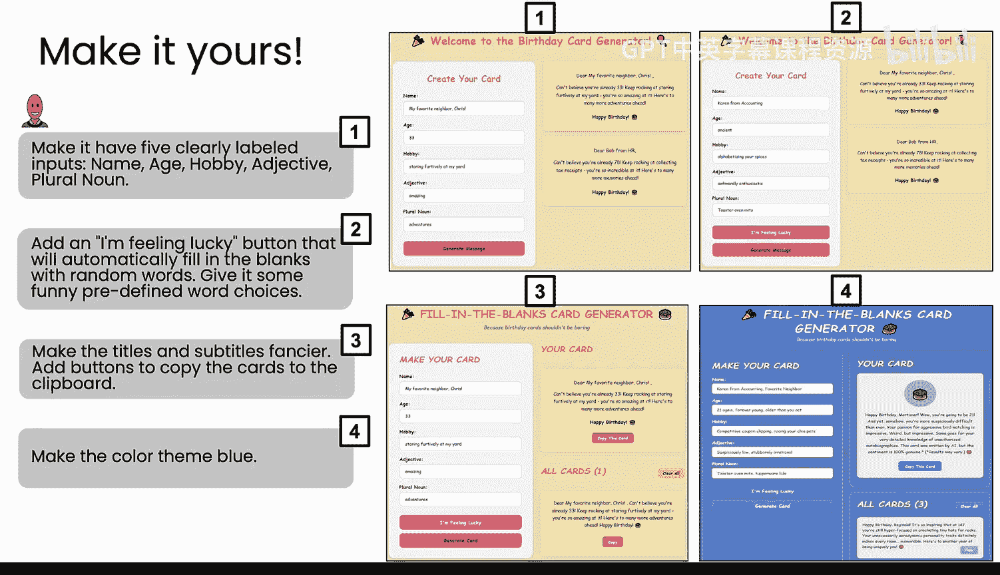
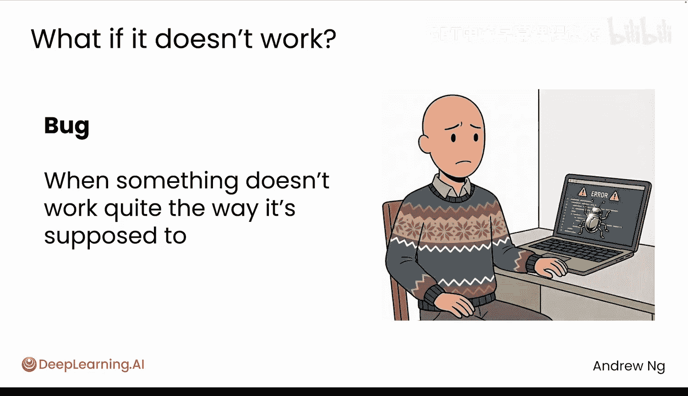
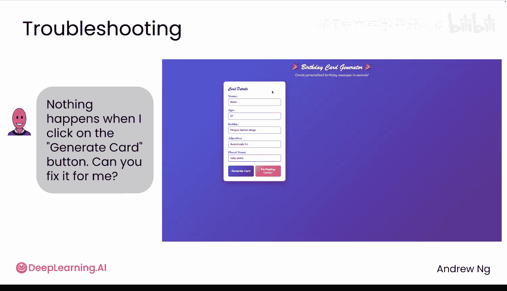
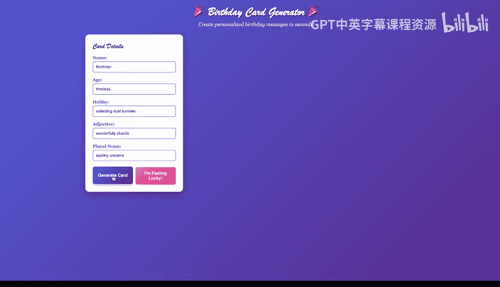
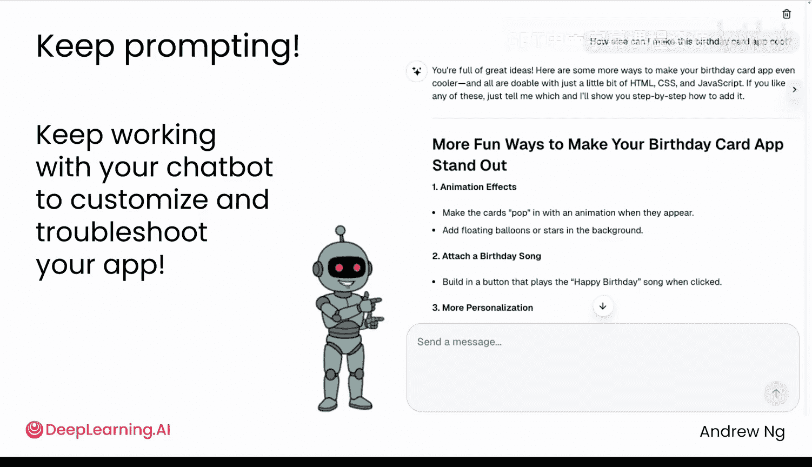

# 吴恩达《和吴恩达一起构建APP｜Build with Andrew中英字幕 - P3：3.customize-your-app.zh_en - GPT中英字幕课程资源 - BV1uiraBVEgv

Now that you've built a basic birthday card app， let's see how you can add additional features to it so it can do additional things or be more fun。

😊。

If you showed your app to anyone else， maybe they'll have ideas to things add too。

And I also want to show you what to do if there's something wrong with whatever the AI had built for you。

 such as if it doesn't work the way you are expecting。As before。

 the primary way we will tell AI what features the ad is by prompting to understand why it's important to be specific and the way you prompt。

 let me make an analogy to ordering food if you go to a food truck and say give me a sandwich。

 Who knows what type of sandwich they will give you if that's all you say but if you say something more specific like I would like a vegetarian sandwich。

 then that narrows down the range of what you may get back。

 or if you say I like a vegetarian sandwich with hummus and cheese or mother drink bread。

 then that specific instruction really means what you get back becomes much more predictable or if you say like such and such vegetarian sandwich and at a drink and make it to go please then it becomes much more predictable what the food truck will give you back at a food truck by being specific with what you ask for。

 you're more likely to get what you want And so too it is with prompting AI by writing more specific prompts you're more likely to get exactly what you want。

Ooh， this is exactly what I wanted。As you gain skills in getting AI to write for you。

 you get better at being more specific with the instructions you give the AI。

 and this will give you better results。 I previously built an app using a prompt like this either on one go or by going back and forth a few times What Id like to do now is add a few new features and modify some existing ones。

 for example， instead of having three input fields like we have so far name age and hobby。

 maybe you want to gather five pieces of information So five input fields that users can input so you can create more personalized messages or maybe you want a unfeeling lucky button that automatically fills out all the fields for you so you don't have to type everything in each time you use the app or you can also update the look and feel so change the title or add a button that copies the message to your clipboard so you can easily email it to friends or even redesigned the entire color scheme to better match your style after having built a basic app。

 you can。Make the app yours by deciding what features you want to add。

 So you might continue the chat conversation by telling the AI to make it have five clearly labeled inputs name age hobby and adjective and plural noun andll update the app to look like this。

 and notice that I'm writing very specific instructions here。

 I'm not just saying make it at five fields I'm telling it what are the five fields I want it to have。

 or if I add an iPhone Feel lucky button。 again， I try to be specific in telling it what I want the unfeeling lucky button to do。

 I want automatically phone blank with random words and I want the predefined word choices to be funny。

 And here I'm actually adding two features at the same time。

 I might update the titles and subtitles and also add a button to copy the cost to clipboard。

 So this is actually two of the bullets from the previous slide I'm adding at the same time。

 and I should like the color blue so let's make the color feel blue。

Feel free to try out these problems yourself or even better pick a different color theme or tell it to implement any other idea that you have。

 if you like pink like my daughter does or green like my son does to use a pink or green color theme instead then or make some other changes depending on what you feel like doing and if you ever change your mind you can do that too So after I've made the color theme blue。

 if I decide that I don't want it blue after all， I actually want it to be purple。

 you can write a prompt like that and AI will obediently change it to purple。

 Now a lot of the time AI is pretty good at giving you exactly what you ask it to do。

 but sometimes there's a chance to generate an HTMLl page that doesn't work in software we call this a bug when there's something that doesn't quite work the way it' supposed to here's actually a broken version of an app that AI generated for me earlier where I've typetan all of these fields but if I create generate card。

T happens。 So that's kind of weird here。 I'm clicking my mouse。

 but it's not actually generating a card。 It turns out I'm feeling lucky it works。 But again。

 generate card doesn't create any card for me。 If that happens。

 what I encourage you to do is to clearly tell the AI what happens。

 So here type nothing happens when I click on the generate card button can you fix it for me And if you do that the AI is usually pretty good at finding at least basic bug and fixing whatever is wrong。

 when you do this， sometimes the AI will write some technical explanations of what went wrong。

 So here it says Java attached button click， that's a lot of technical terminology。

 I was say for now， just about what the AI saying here。

 you don't need to understand these technical details。

 If you're really curious you can ask AI what do these terms mean。

 but you don't have to do that let the AI thinking say what the ones about the technology and then focus on downloading the new HM file to see if that works。

 I hope you will start to。

The basic birthday card app and either try building the features I suggested earlier in this video or some features that maybe your friends have suggested or your own ideas。

 And in fact， if you're not sure what else to do， you can also ask the AI for ideas。

 So if you ask it how can I make this birthday card app cool。

 It may give a few suggestions and then you could pick one or more and you see AI's idea to make your app more cool。

 I actually use AI as a brainstorming to a lot when I'm building software and you should do the same too if you don't already have ideas that you're excited about。

 please go to the next item in this website and have fun adding features or play the color theme or implement whatever you feel like。

When you come back， we'll use the skills you've already learned to build a second app。

 a ping pong game。