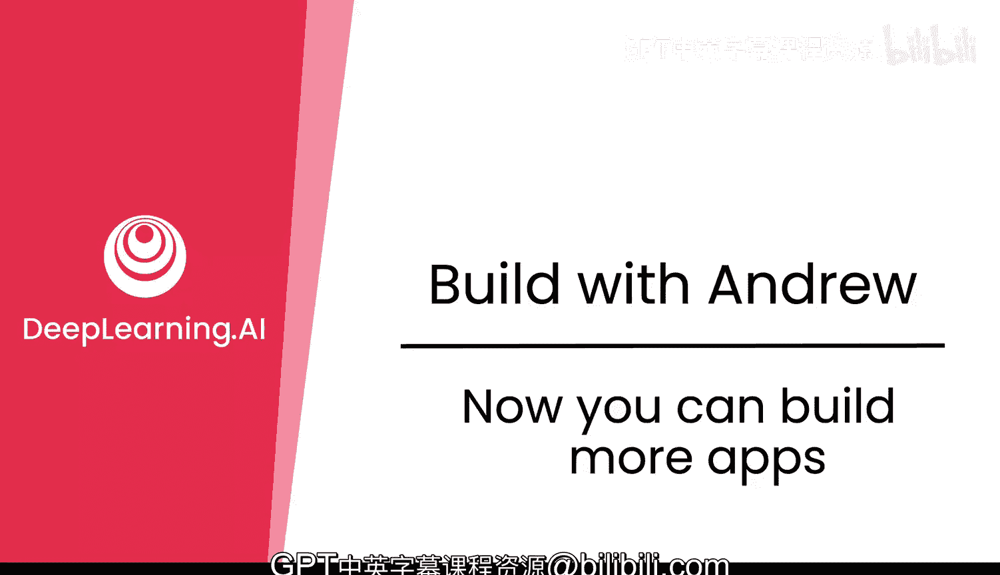
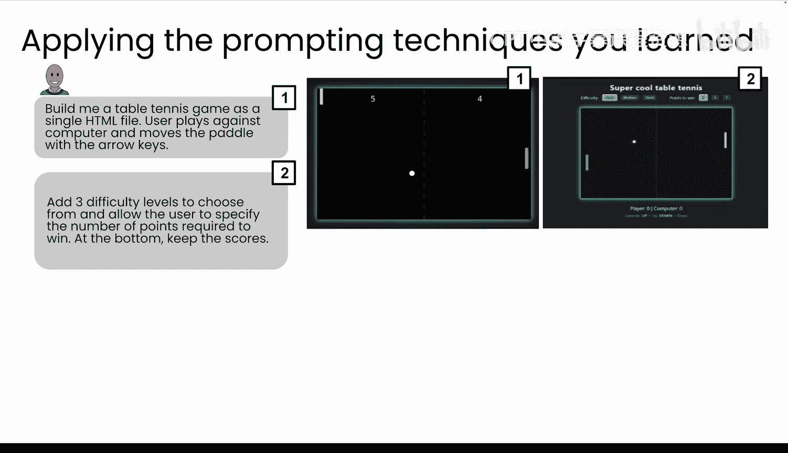
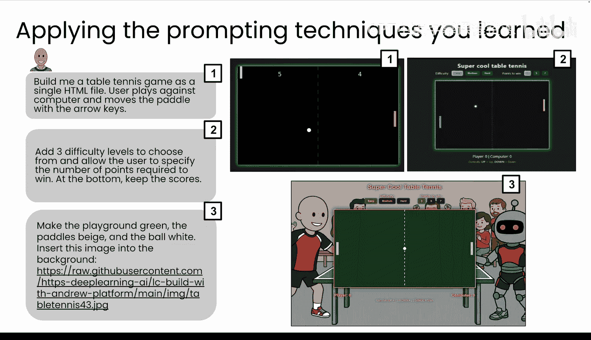
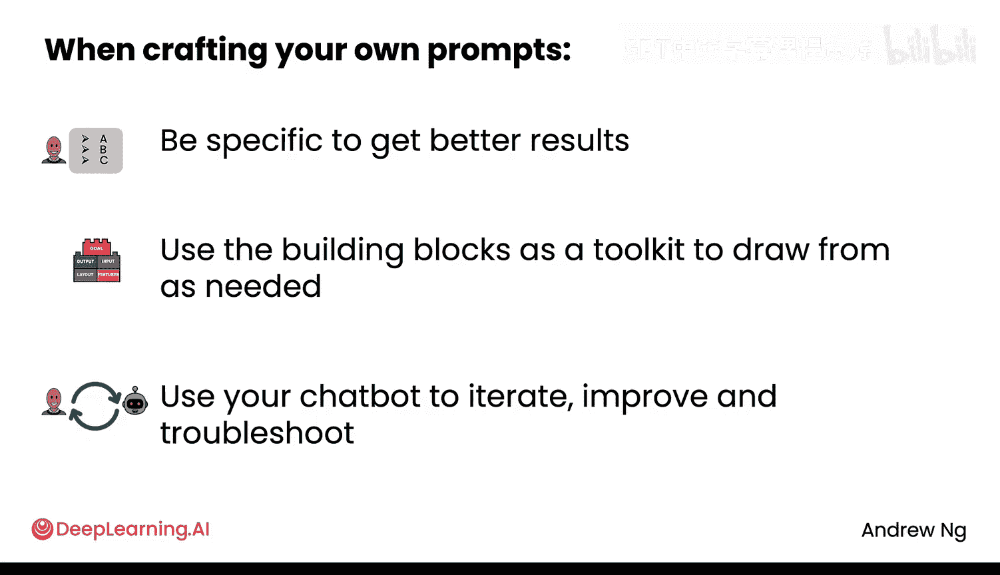

# 吴恩达《和吴恩达一起构建APP｜Build with Andrew中英字幕 - P4：4.now-you-can-build-more-apps.zh_en - GPT中英字幕课程资源 - BV1uiraBVEgv

Using the skills you now have in prompting， let's build another app this time a ping pong game。

Because of AI is now possible to go from an idea to a working app sometimes in minutes。

 One of the earliest video games in computer history was a game called Pong。

 which was sort of a two personson ping pong game。 And that had taken the team weeks to build。

 But now， thanks AI。 You can build something like this in minutes。

 Let's apply the prompting techniques we learned。 I'm gonna start quickly and write a moderately specific prompt and say。

 build me a table tennis game as a single vow user plays against computer moves the pa of the arrow key。

 And if you do that， you might get a first version of the app that looks like this。 I go， okay。

 that's a good start。 but I wanted to add three difficulty levels and let the user specify the number of points required to win and also have it keep score。

 and this builds me。😊，A second version like that。 And this now looks like a fun game。

 but I want the graphics to be fancier。 I would say make the player on green。

 paddles beige ball white。 And I'm going to tell it to insert this image into the background。

 And so I end up with a game that looks like this。 And here is the game。

 That's actually pretty pretty fun。 The ball is bouncing back and forth。

 I could actually play this like quite a long time。

 maybe longer than you'd actually want to watch me playing it。 but I hope you have fun with this。😊。

As a reminder， being specific in how you write your prompt gets you better results。

 And so you can look over the prompt I was using。 and it was fairly specific in a number of details like the color。

 the points and so on。 If you're not sure what to include in the prompt。

 think about the building blocks Do you want to specify the go the output the input the layout the features as a set of things to consider including and last use your chatbot to iterate improving troubleshoot。

 you don't need to get right the first time。 you can tell what you already know what you already have in mind。

 see what you get and then use that to further refine what you tell the AI to do。

 actually enjoy ping following in real life。 And now you can build a game to play it also with your computer。

Please go to the next learning item to give this a shot yourself and in addition。

 beyond building a perfect car generator or ping pong game。

 if you have an idea for something else you want to try to build， give it a shot。

 may or may not work， but this by practicing， exploring our ideas to all of us get better at building things。

😊。