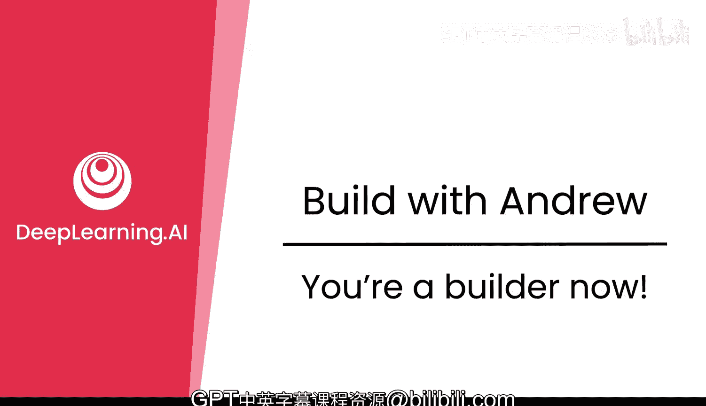
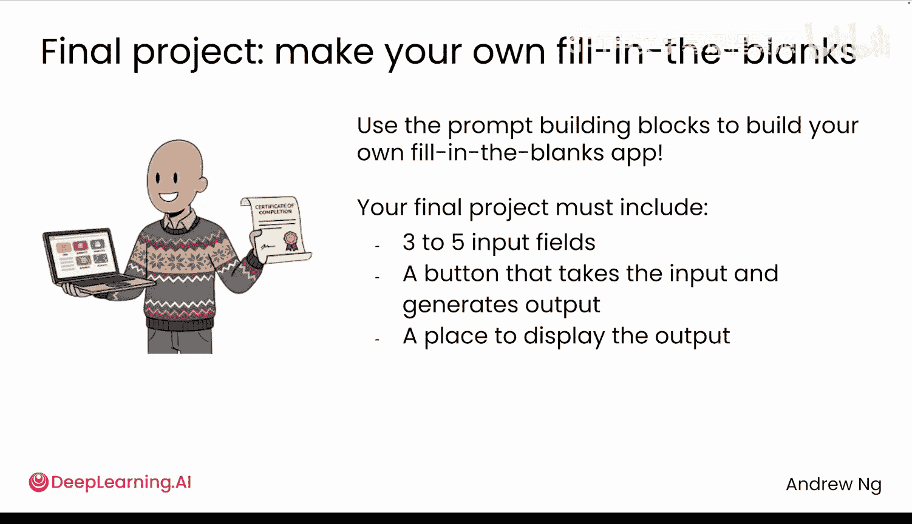
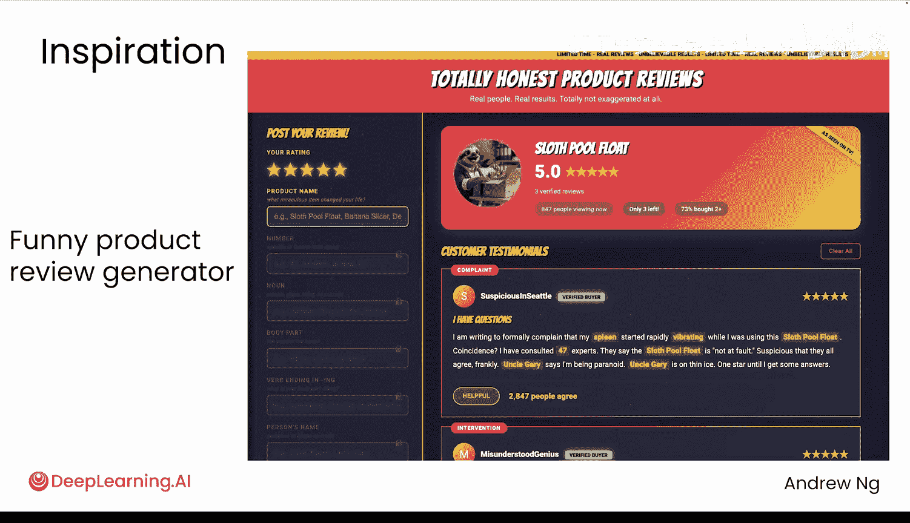
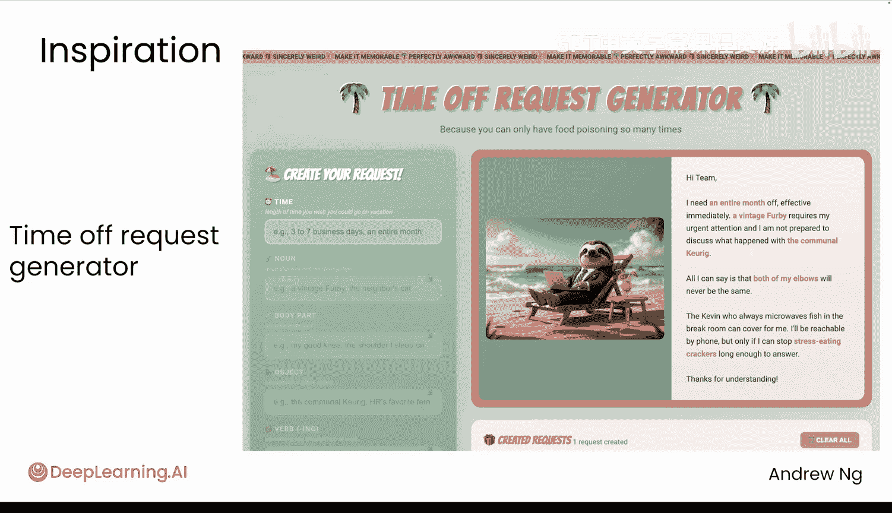
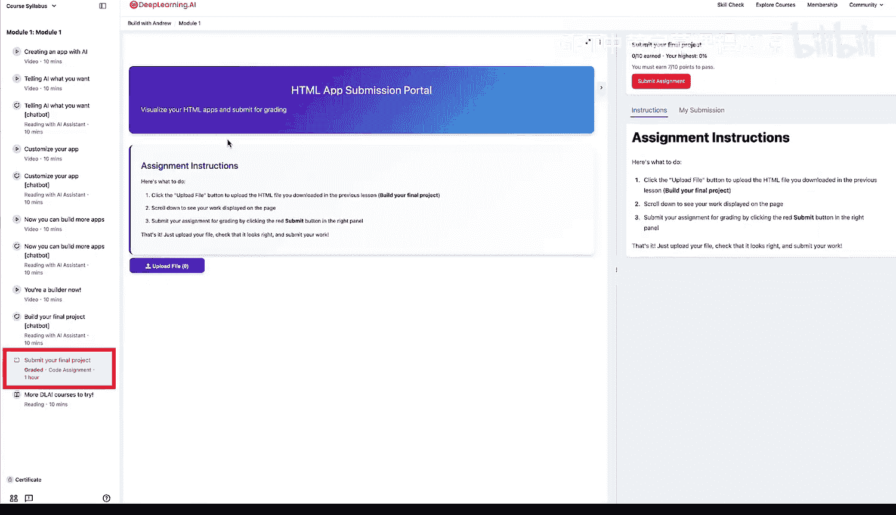
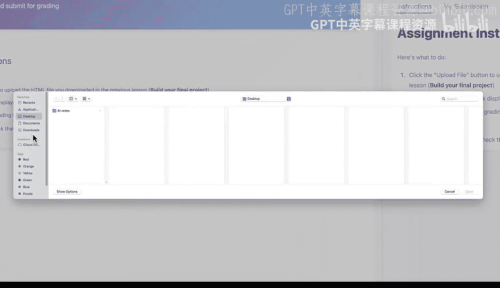
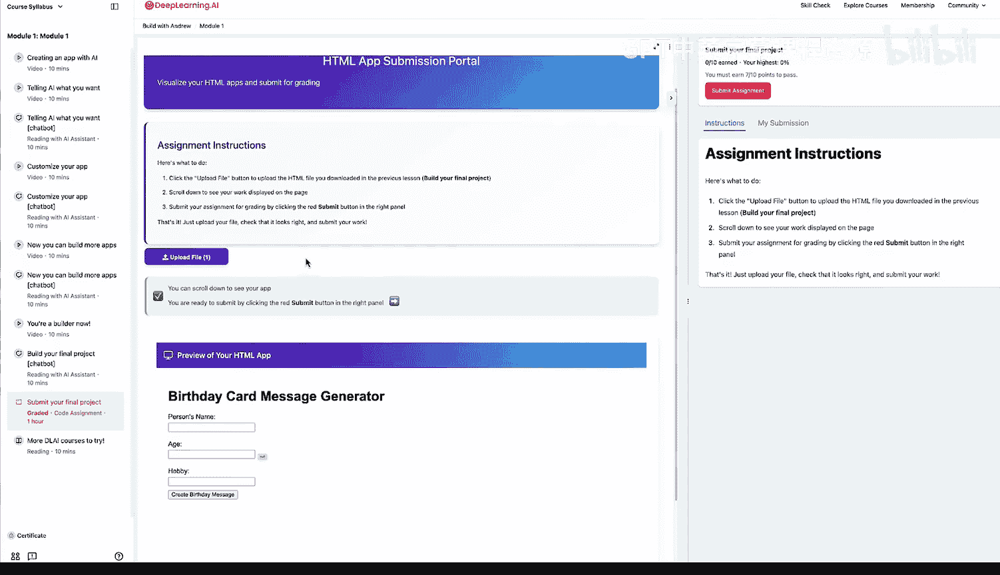

# 吴恩达《和吴恩达一起构建APP｜Build with Andrew中英字幕 - P5：5.youre-a-builder-now-.zh_en - GPT中英字幕课程资源 - BV1uiraBVEgv

If you've made it this law， congratulations。

Youre an AI Belda now。I've met people who've been clearly building software AI。

 maybe even for months that somehow still wonder if they're actually a builder。I'm here to tell you。

 yes， you are。 And it count't you as one of us， a buildilda。

I hope you do one last activity and get a certificate for this course。

The final project is to make your own fill in the blanks story builder。

 I hope you use the pro building blocks to build your own fill in the blanks app。

 You find a project must include three to five input views。

 a button that takes input and then generates the output and a place to display the output。

 You've already seen the birthday card app。 Here are some other ideas for maybe inspiration。

 This is a funny product review generator where the blanks are the product name， some number， a noun。

 a body parts and so on。 and it generates product reviews。

 Not as it says they are totally honest product reviews that look like this。

 feel free to pause the video and read this review you one， but I love this。 or here's another。😊。

Time off request generator where you specify how much time you went off。

 a noun a body part and object。 and then it says I need an entire amount off effective immediately because a vintage review requires urgent attention。

 And so whether a birthday card or a product review or a time off or some other type of story generator。

 please write your own prompts and use it to generate an app like this on the website when you go to the next item you will see the usual chatbot you can use to write your prompts to get an HTMLl file and download it onto your own computer please do that run it。

 see if it was your satisfaction。 and you could either use our website or you're also welcome to use an external website like chatt or Gemini to generate your HTMLl file when you're done building this project。

 please go to this final page it might take a second to load and then click upload file and here I'm going to navigate to the file that had download it。

And here's a preview of the app as you generated when you ready hit seven assignments and our AI will look at your HTMLMl file and see if it seems to work correctly and give you feedback of any。

😊，Assuming it works， this will bring you to the last exercise of the course and will earn you a certificate。

 Most effective builders keep taking courses and also keep building。

 I find that if someone only builds， they often end up unaware of core concepts and can end up spending months reinventing the wheel or worse。

 doing things in very strange ways。

But conversely， if someone only takes causes， then they end up with theoretical knowledge without knowing how to apply it。

 So both building and taking course are important。Please keep building whatever you you like。

 and I'll also suggest some additional courses for you to consider in the next item。

 keep sharing your applications with friends to get the feedback or maybe just get a laugh out of them。

Being a builder is one of the most fun things in the world。

I'm glad you and I have started this journey together。

 and I hope will'll keep building and learning together。😊。

