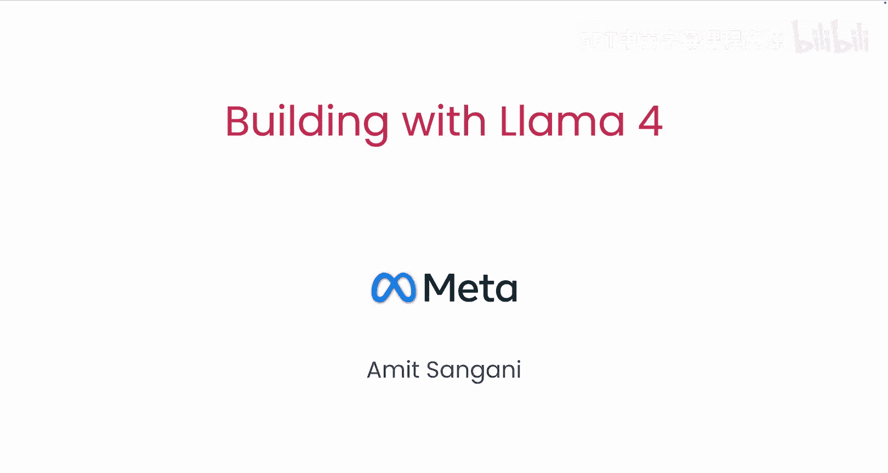
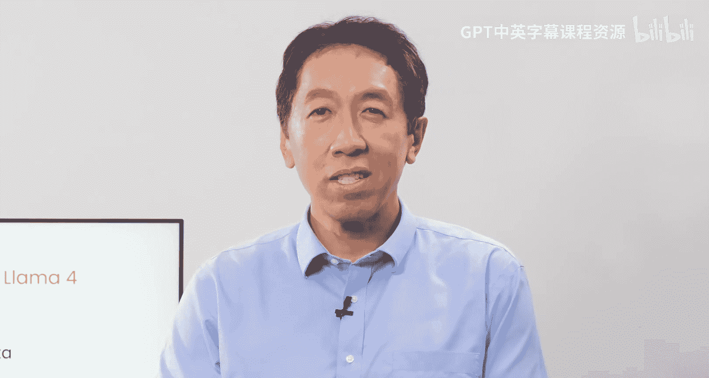
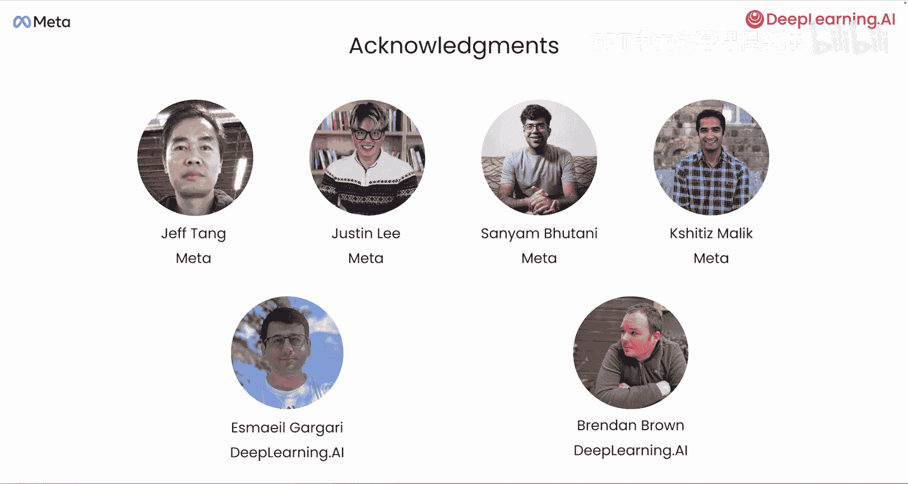

# 吴恩达《基于 Llama 4 的应用构建｜Building with Llama 4》中英字幕 - P1：1.intro.zh_en - GPT中英字幕课程资源 - BV1jmKGzhEne

Welcome toBuilding with Lma4， built in partnership with Meer and Toy by Ammin Sanganni。

 who is director of partner Engineing for Mes AI team。

 the Lama family of Open models has already enabled many developers all around the world to build AI applications。

😊，And now with the Lamafo mixture of expert models， you find deployment easier than before。

 and you can also achieve more advanced multimodel understanding by prompting over multiple images and also even carry out image grounding the new Lamafo models also have a much larger context window size。

 a million tokens for the Maverick model and up to massive 10 million tokens for Sc which is useful。

 for example， for analyzing even fairly large code bases。 Finally。

 you learn about the new software releases that came with Lama4。

 namely tools to optimize your problems and also to generate synthetic data。😊，That's right， Andrew。

 with Lama 4， we now have models that are natively multimodal and support a truly long context of up to 10 million tokens in our scout model。

In this course， you will get hands on experience using Lama 4 through Meta's official API as well as other inference providers。

You will build applications that reason or visual content。

 detect objects and answer image grounding questions with precision。

 Then you will learn how to use long context to process entire books and research papers。

 without needing to chunk the data。 Mes also introduce Lama tools。

 which is a growing collection of open source utilities desire to help developers build much more powerful applications with the Lama models。

 In this course， you also build with two of the newest Lama tools。 First。

 the Lama prompt optimization to which automatically improves your prompts。

 This uses the DSs pi optimizer under the hood。 for。

 you need to specify an evaluation metric on a data sets of questions and desired responses。

 The prompt optimizer will then automatically optimize your prompt based on that evaluation metric。😊。

Second will be the Lama synthetic data kit， which lets you ingest， create。

 curate and save high quality training data in multiple formats。

 in thus release while the otherwise manual work needed to create data sets for fine you name。

 Many people have worked to trade the scores。 I'd like to thank Jeff Tang。

 Justin the Sanen Bhutanni and Sha teach Malik from Meta as was Esmal Gegari and Brandrendan Brown from Deeple AI。

 Next lesson is an overview of Lama4 and Lama API。 Shati Malik from Meta's AI research team will join us in parts of this lesson to explain the architecture of Lama 4。

 The next lesson in particular gives a technical description of the mixture of experts architecture of Lama 4 and explains why only a small subset of ways are active for any input。

 and that's why it is really efficient to serve These will learn about that in the next video。😊。

