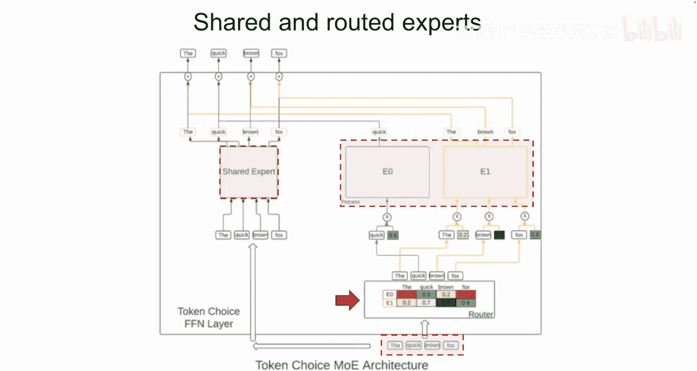
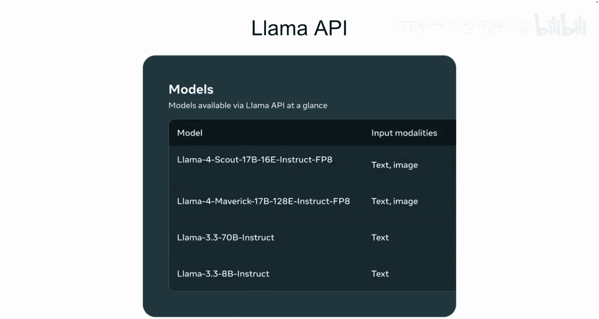
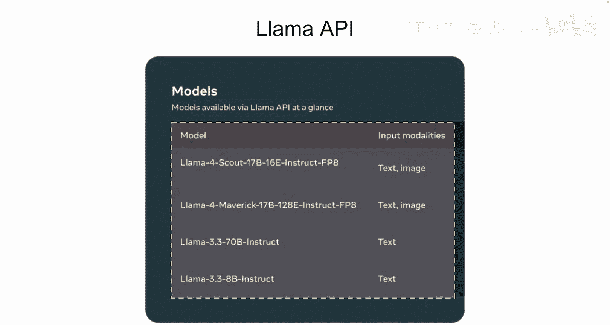
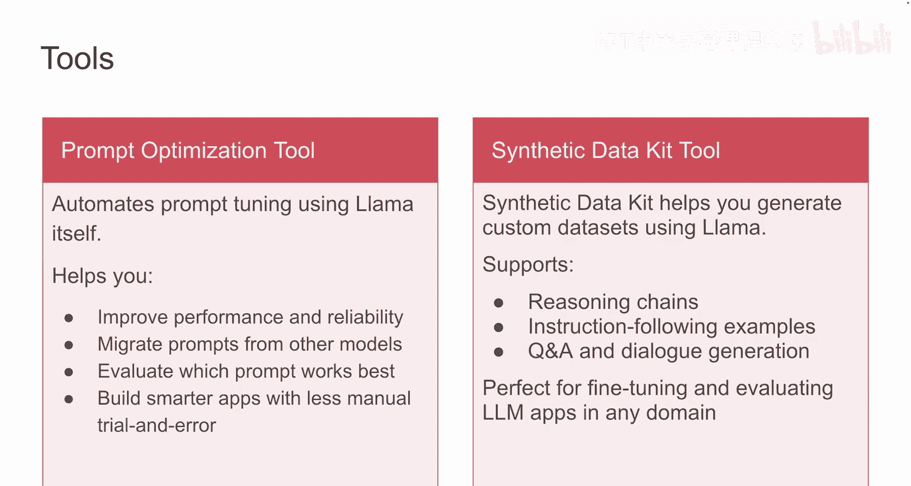

# 吴恩达《基于 Llama 4 的应用构建｜Building with Llama 4》中英字幕 - P2：2.overview-of-llama-4.zh_en - GPT中英字幕课程资源 - BV1jmKGzhEne

In this lesson， you will learn how Lama models evolve from Lama 2 to recently launched Lama 4 models willll also have a member of Meta's AI research team to explain Lama 4 architecture。

 All right， let's go。Lama started as a fast movingov research project at Fair。

 originally focused on formal mathematics， but the team quickly saw the potential of smaller welltrain models。

 and that LED to the release of Lama models， which has since driven significant innovation across research and industry。

 The next generation of Lama models delivers strong performance across industry benchmarks and introduces powerful new capabilities with Lama 3。

2 Meta added multimodal models for image reasoning and lipid models that can run on edge devices。

 These include vision models，11 B and 90 B and smaller texton models 1 B and 3b Lama 3。

3 brought even more efficiency with the 70 B instruct model matching the quality of the much larger 40 5 B model from Lama 3。

1 Now with Lama 4， we enter a new phase。 It includes two powerful mixture of expert models。

 Lama 4 Sc a 17 B model with 16 experts optimized for speed and cost and Lama。For Maverick。

 a 17 B model with 128 experts offering top tier performance Lama 4 models are designed with native multimodality through an early fusion design。

 meaning it can accept text and visual inputs in a single unified model from the start In practice。

 this means that textual tokens and vision derived tokens are combined at the input level and process jointly by the same transformer backbone。

 rather than having separate encoder decoder pathways。 early fusion is a major step forward。

 since it enables us to jointly pretrain the model with large amounts of unlabeled text image and video data。

 We also improve the vision encoder in Lama 4。 This is a one page of comparison of Lama 3 and Lama 4 models。

 The main improvements in Lama 4 include the1 million context length in Lama4 Maverick and 10 million in Lama 4 Sc。

 compared to 128 K in Lama 3。1 and later Lama 3 models the official languages supported have also been extended from 8。

In Lama 3 to 12 in Lama 4 Here you see the Lama 4 model card showing the 12 officially supported languages in Lama 4。

 the 17 billion active parameters。 the number of experts total parameters across active and inactive experts and maximum context left。

 Next， Sha teach is going to go deeper into the Lama 4 architecture。 Thanks Amit。

 Lama 4 is a mixture of experts are M E model。 Me is a common architecture used in large language models。

 as we increase the number of parameters or the capacity of a model。

 We usually see better performance because the model can perform more complex transformations on tokens。

 in dense models。 more parameters also means higher costs during both training and inferencefrs。

 Me models help with this by using conditional computation to improve model quality while keeping computational costs manageable。

 They activate only a small portion of the total parameters for each token， which reduce。

Use the amount of computation needed for a token while still retaining model capacity。

 A key part of any M E model is the gating network， also known as the rowr。

 The rowr decides which experts get activated for a given token。

 The choice of the routing mechanism plays a central role in the model's performance。

 A transformer has two main layer types。 At and the feed forward network also called the FFN。

 Comput course usually dominated by the FFN layer。 As is common。

 the Lama 4 M E architecture uses conditional computation only in the FFN layers。

 The attention layers remain the same as a dense model。

 The M E layer and Lama 4 has a few routed experts and a single shared expert。

 All tokens go through the shared expert。 Each token also goes through exactly one of the routed experts。

 Scout has 16 routed experts。 While Maverick has 128。In scout， all the FF N layers are M O E。

 While Maverick alternates between dense and M E layers to reduce the number of total parameters in the model。

 Let's take an example of how a sequence of tokens would be processed by the M E layer in Lama 4。

 As we have one shared expert and two routed experts。 say the sequence has four tokens。

 The quick brown fox。 In the first step， tokens go to a router to decide which token will be allocated to which routed expert。

 We compute a router affinity score for each token and routed expert combination。

 A token is sent to the routed expert with the highest router score。

 and the activations of the token are also multiplied with the router affinity score。 In the example。

 tokens。 the brown and fox go to routed expert1。 While the token Quick goes to routed expert 0。

 All tokens also go to the shared expert。 At the end。

 the outputs of the shared and routed expert are added together producing the。😊。

Final outputs from the M E layer。 This was a brief overview of the Lama 4 architecture。

 If you are interested in learning more， you can check out our blog。 Back to you now ait。

 Thanks to teach， the Lama API provides a simple and fast way to use and build with Lama models to make integration easier。

 lightweight SDks are available in both Python and typepescript These allow developers to quickly connect the API to their applications using Lama API you can build with the latest Lama models including Lama 4 Ma Sc Lama 3。

38 B and 70 B models and more。 we have also introduced two new Lama tools。

 The first one prompt optimization tool that automatically optimizes prompts for Lama models。

 It transforms prompts that work well with other Lms into prompts that are optimized for Lama models。

 I performance and reliability。 You'll see how this works in lesson 6。

 Another tool you will use in this course is meta synthetic。

Data kit you'll learn how to create your own high quality data using this tool。

 This is especially useful when you are fine tuning or testing your model。

 but don't have the perfect data set on hand。 You'll be able to generate Q and A reasoning steps and data in other formats later in the course in the next lesson you will start building with Lama API See you there。

