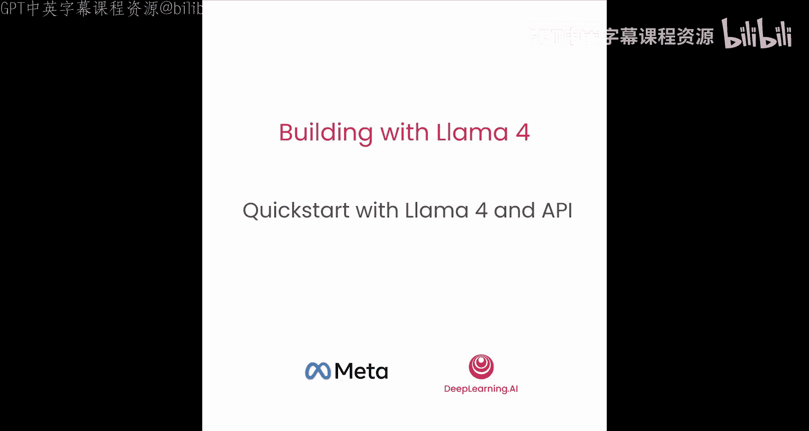
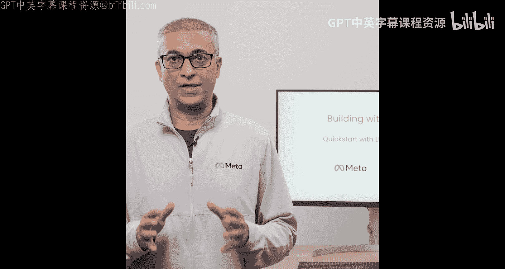
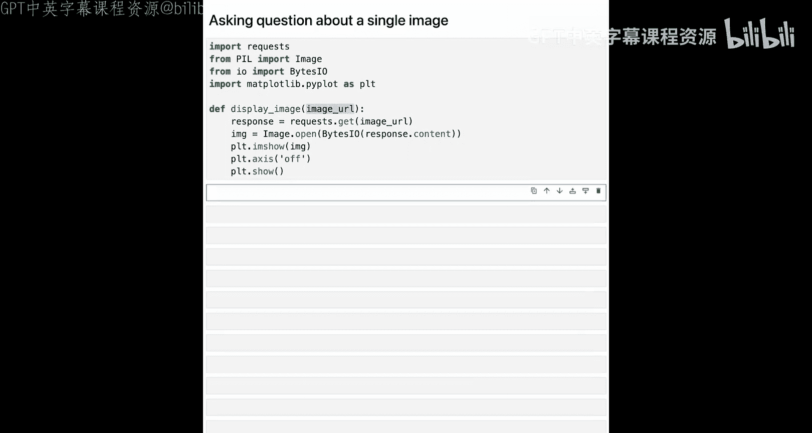
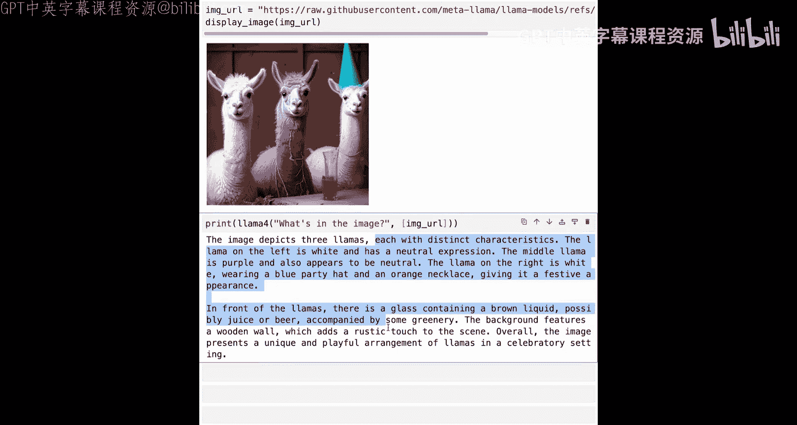
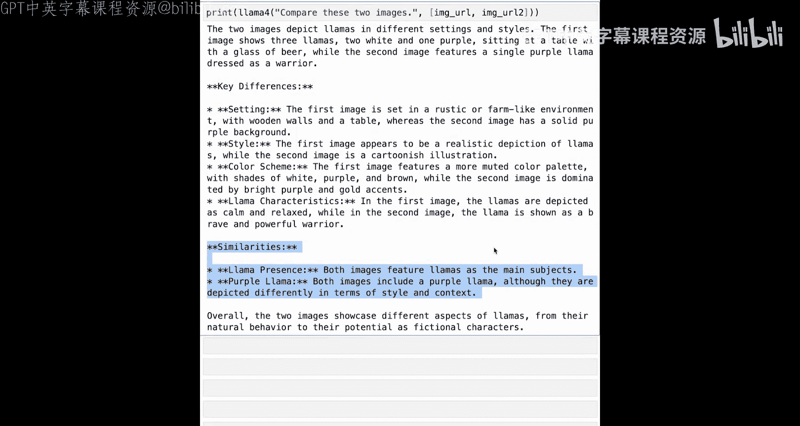
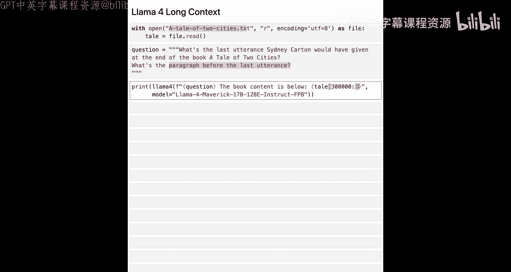
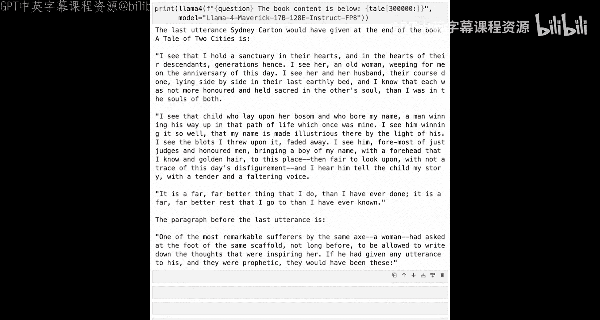
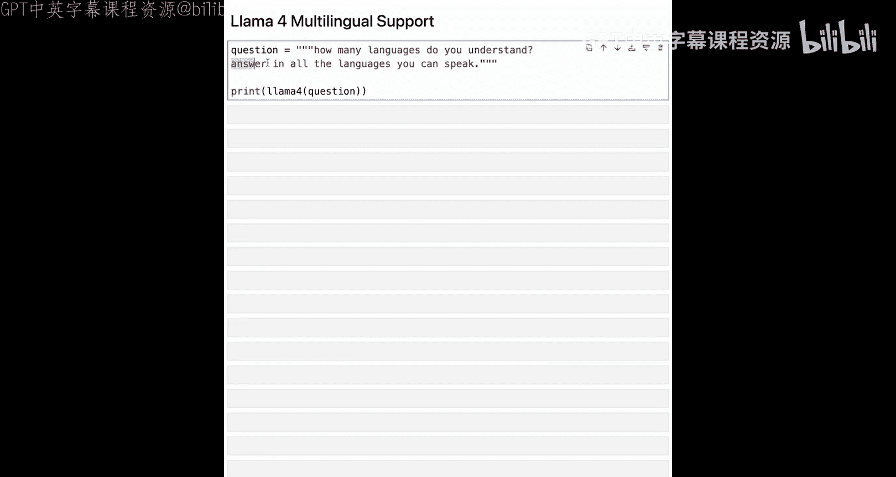
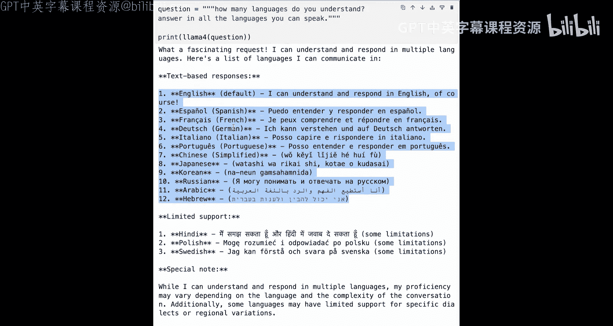
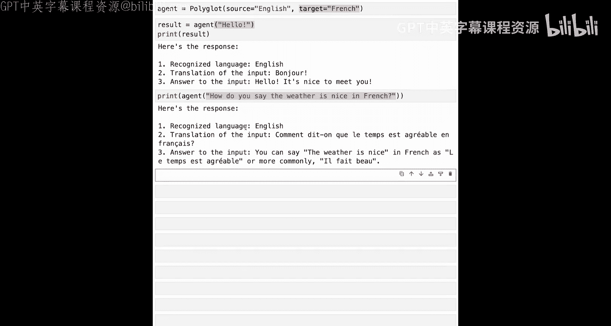

# 吴恩达《基于 Llama 4 的应用构建｜Building with Llama 4》中英字幕 - P3：3.quickstart-with-llama-4-and-api.zh_en - GPT中英字幕课程资源 - BV1jmKGzhEne

In this lesson， you will learn how to quickly get started with Lama 4 using Metas official API。

 let's dive in。

The Lama 4 API is an easy way to use Lama 4 without worrying about running your own infrastructure。

 You can use it either through a rest style API or via Mes Python ply。

 it's also compatible with openaiI client libraries which makes switching between APIs very smooth and of course。

 you can get access to the most up to- date Lama models like Sc and Maverick right away in the notebook。

 you will have your first interaction with Lama API。

 Youll learn how to set up the API client send a prompt and view the results using different text and image prompt examples。

 You'll also build a translator chatbo that can work across all the 12 languages Lama 4 supports。

 Allright， let's get started。 Let's begin by importing our API keys and libraries In this lesson you are going to use Lama API to use Lama API。

 we will need Lama API key and Lama Bay URL on the deep learning A platform All the keys are set for you so you don't need to do anything also。

You need to import the Lama API client in this lesson you will call Lama API several times。

 so it will be helpful to have a Lama helper function so that we can reuse it This Lama 4 function receives your prompt the URLs for the images and also the model that is set to be default on Lama4 Sc then based on the prompt that you have passed and the image URLs。

 the content is formed and then the client using the Lama API client is created and then the message based on the content is formed and is passed to the client and finally the response is received and returned。

Let's now call the function and ask it to give us a brief history of AI in three sentences。

Here is the response。Lma API also offers compatibility with popular libraries such as Open EI library。

 Let's create the same Lama 4 function this time using the Open EI compatible library for this we import Open EI and then this time instead of Lama API client we use Open AI pass the Lama API key and the basees URL。

And the rest is the same。Let's call this function and pass the same prompt。

 And here we get the same response because the temperature is set to 0。

 You can also pass images to the Lama 4 function and ask Lama about the image。

 Let's see this in an example。 First， let's have this display image function that gets the image URL and displays it。

 Let's prompt Lama and ask about this image。 We can pass the image URL and the prompt。

 That is what's in this image to the Lama 4 function and get this response。

 The image des 3 Lamas and some more information about the content of the image。

Unlike Lama 3。2， Lama 4 can natively accept multiple images with good eval results on up to five images。

 let's use this second image and before passing it to Lama， let's display both of the images。

 so we have two different images of Lamas。Now you can ask Lama to compare two images by passing the URL of the images as a list。

Here's the response。Two images depict Lamas。 These are the key differences and some similarities。

 You'll use Lama on more image use cases in the next lesson。

Lama 4 Maverick and the Sc support up to 1 million and 10 million tokens of context length respectively。

 a much bigger increase over the previous Lama models。Let's see this on the tale of two cities。

 free e book， which has about 193000 tokens。 Here is our question。

 What is the last utternce at the end of the book and also the paragraph before that。

 Let's use Lama 4 Maverick for this question by passing the last 300000 characters of the book。

And here' is the response。You will work on more long context use cases in the later lessons。

Another major capability of Lama 4 is its text understanding across2 languages。Let's ask Lama。

 how many languages do you understand and ask it to answer in all the languages it speaks。

Here is the list of 12 languages Lama4 can understand。

 let's build a quick chat bo that acts like a real time translator。

This is our polyglot chatbart that gets the source and the target language and forms this system message here。

We use Open AI clientient Library and pass the Lama API key and the BS URL and get the client。

And then the message that is formed here using the content of the system pronked passed here。

 the response received， and then it is returned。Let's form this translator using English language as a source and the French as a target language。

 Let's start the chat by saying hello。As you can see。

 the language is recognized here to be English and the translation of the Ho to the target language French is done。

And then in the response to the ho from the first person。

 the answer by the second person in English is returned。 Let's call this again。

 with a second question。Again， this is the recognized language， the translation of the question。

To the target language French and the response to this question in the recognized language。

Please feel free to try the translator chatbot using other languages。

 This sums up our quick overview of the Lama API。In the next lesson。

 you will work on several cool image understanding and image grounding use cases。 All right。

 see you there。

