# 吴恩达《基于 Llama 4 的应用构建｜Building with Llama 4》中英字幕 - P4：4.image-grounding.zh_en - GPT中英字幕课程资源 - BV1jmKGzhEne

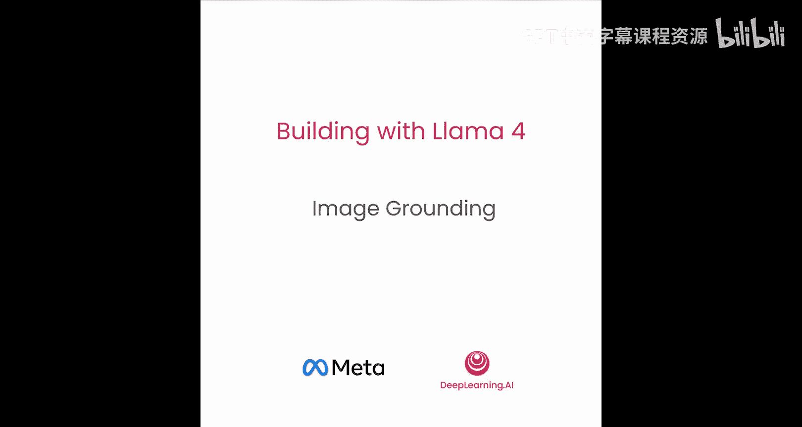

In this lesson， you will use Lama 4 for image understanding and reasoning。

 you will work through several practical examples from identifying objects in the image to coding a user interface based on its screenshot。

Let's get started。

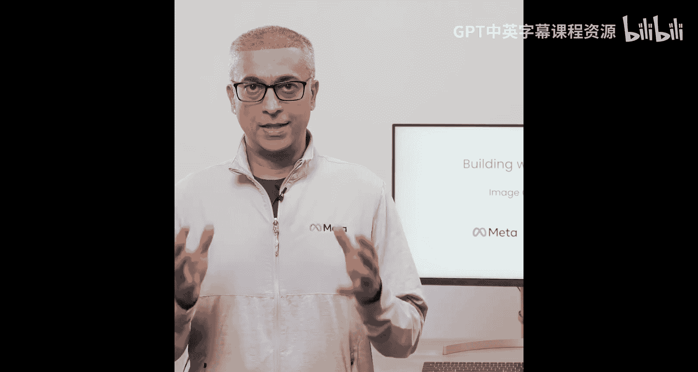

Lama 4， Sc and Maverick are designed to handle both language and visual inputs at the same time。

 This means they can understand and reason about images just as they do with text。

 This unlocks a wide range of applications from answering questions about images to describing scenes or identifying objects。

 Grounding is one of Lama4's stand out features。 It's about linking parts of the prompt to specific areas of the image。

 This allows for more accurate answers， in particular when the question is about something spatial。

 like what's in the top right corner， or where the measuring tools in the pictures of many tools。

 Lama 4 can find the objects and return the coordinates of their bounding boxes in the notebook。

 you will work on several image reasoning use cases。

 You will do image grounding on a picture of many tools。 you'll analyze tables in a P Df file。

 You'll generate code from a screenshot of a user interface。

 You will be solving a math puzzle and also analyze computer。

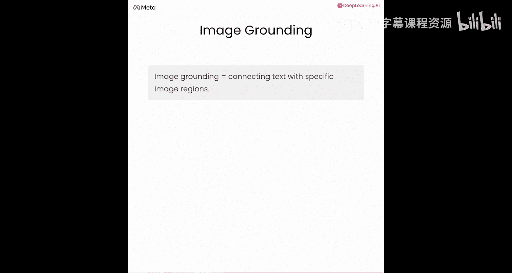

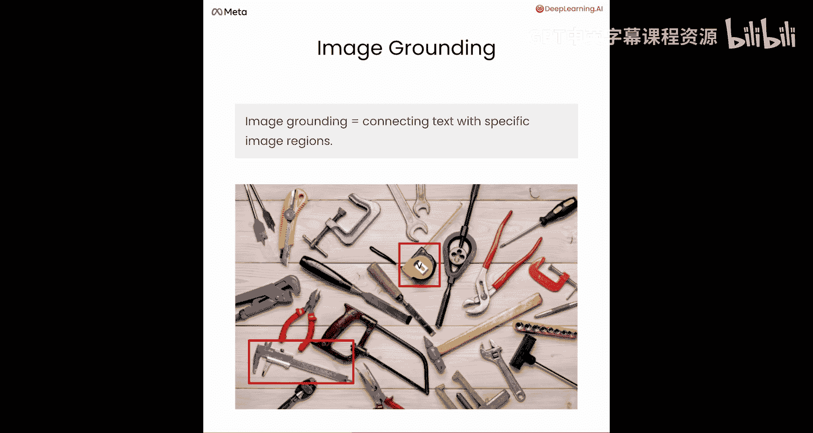

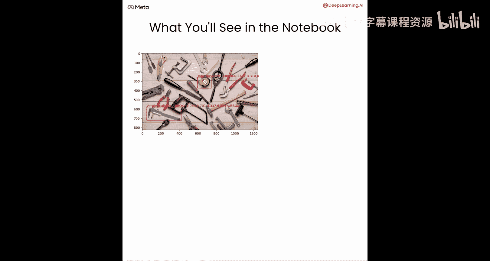

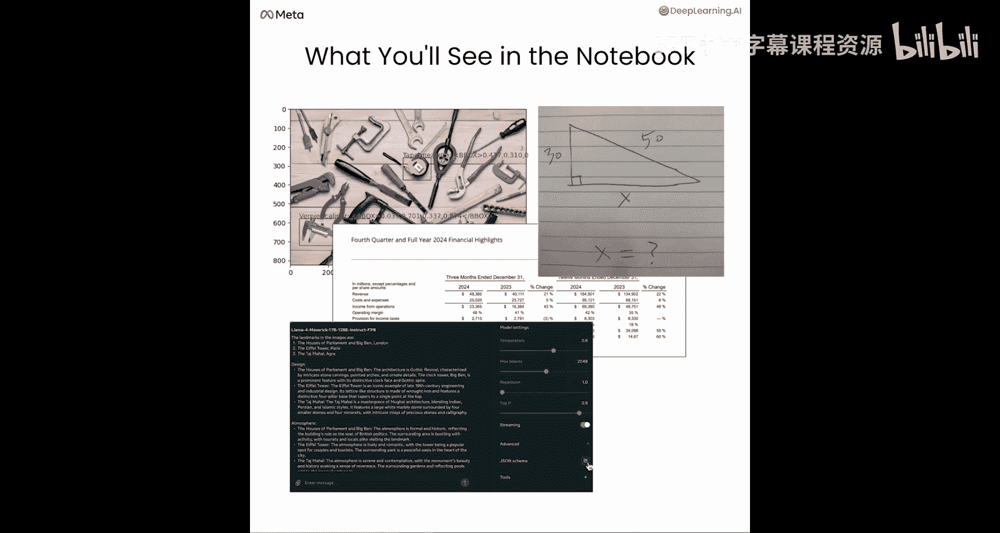

All right， let's get started。 Let's first load our API keys。In this lab， besides the Lama API。

 we will use Lama 4 on Together AI。For this you need to have Lamabase URL and together AI API key。

 all of this is already set up for you on deep learning AI Pla。

 so you don't need to have a key to run these notebooks Now let's load our two U function Lama 4 API and Lama4 together Lama 4 together function is very similar to the Lama 4 function you already implemented in previous lesson。

The difference is that instead of Lama API client， you import together。

 you create together AI client and pass your together AI API key， the rest stays the same。

Most of the inference providers like together AI often expect image data to be embedded as base 64 strings instead of request payload。

 this function will get the image path and will return base 64 encoding of the image imageage grounding is a fundamental task in computer vision and natural language processing that involves identifying the specific objects or regions in an image that correspond to a given text description let's see how La of 4 does image grounding on this picture of many tools。

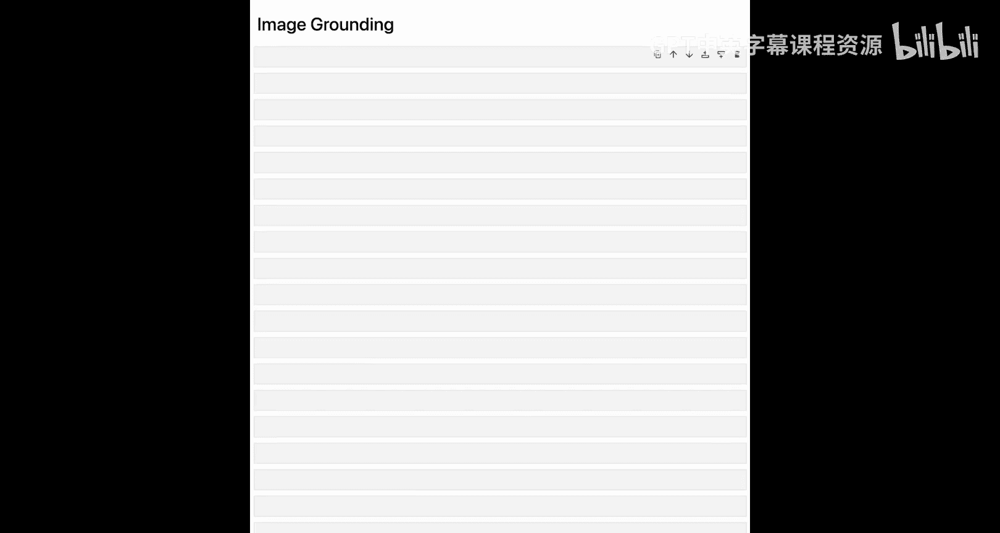

This is our prompt which tools in the image can be used for measuring length。

 provide bounding boxes for every recognized item。

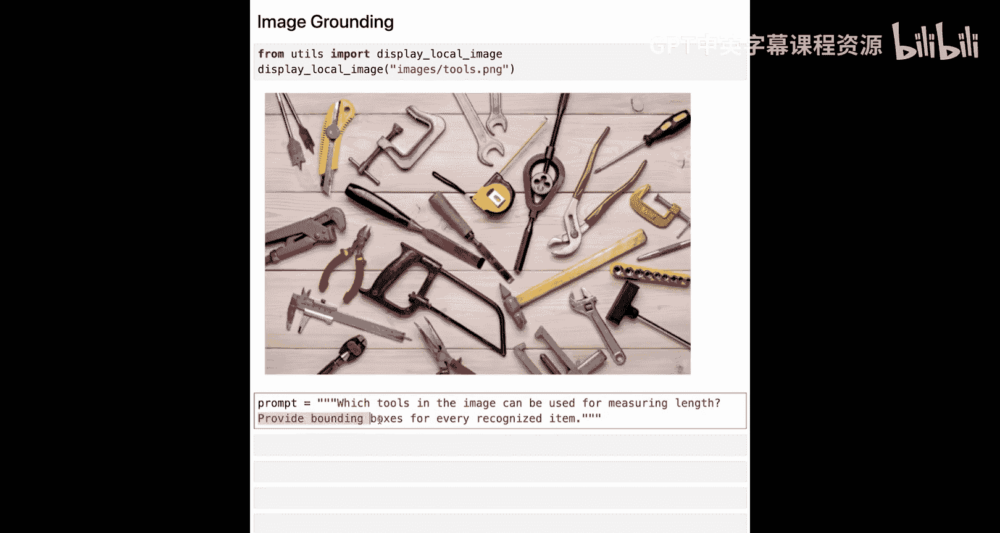

You can convert the tools's PNG image to base 64 and pass it along with the prompt to Lama 4 function。

And here are two items that are used for measuring length。

 and the coordinates for the bounding boxes for each of the items are returned。

 Note that the bounding box values represent the normalized coordinates of a bounding box in an image to get the actual pixel coordinates You'll need to multiply the normalized values by the width and height of the image。

In the Ut file， we have two helper functions， parse output and draw bounding boxes。

 the first one will get the output of the Lama and will parse the coordinates of the bounding boxes。

 and the second function will draw bounding boxes on the image so that you can visualize the result。

Let's pass the image and prompttu Lamar again and save the result and then pass the output。

 which is the result from the model to parse underscore Disc output and get the tools coordinates and your description and then finally pass it along with the original image to draw bounding boxes and to see the result here is our image the bounding boxes around two of the tools that are used for measuring the name of each tool and the coordinates for the bounding box for each of the tools。

Let's work on another use case， this time you will use Lama to analyze a table in a PDF document。

We can do this in two ways， one， convert the table into text and ask Lama questions based on that text and second we can take the image of the table and use it to prompt Lama。

 let's see both and compare them。Here's the PDF file and this is the table we want to ask questions about to convert PDF to text。

 we can use this helper function that gets the file and extracts and returns its text let's pass our PDF file to the PDF to text function and get its text。

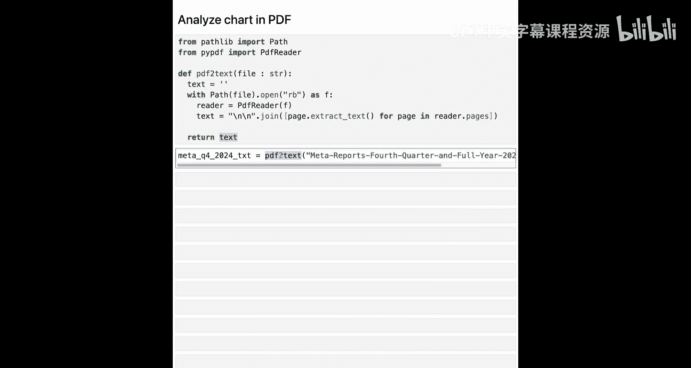

Let's see the converted text for this table in the report。

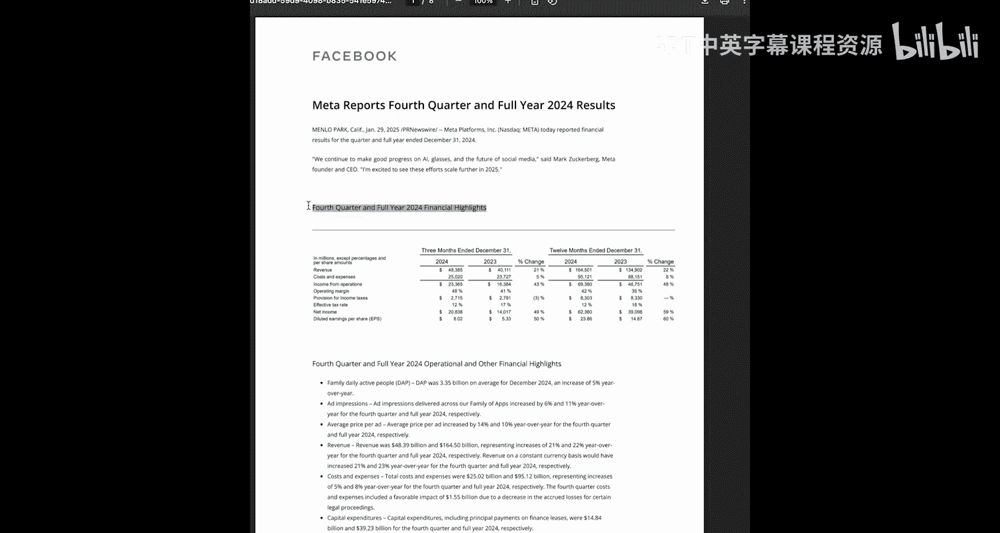

We can search for fourth quarter and full year 2024 financial。

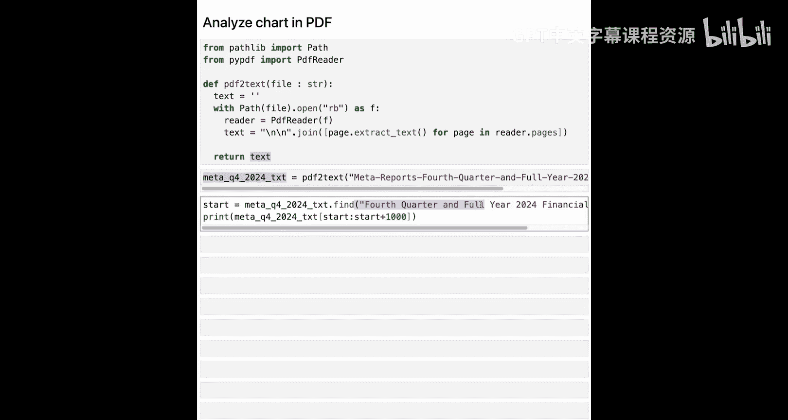

Which is this text。

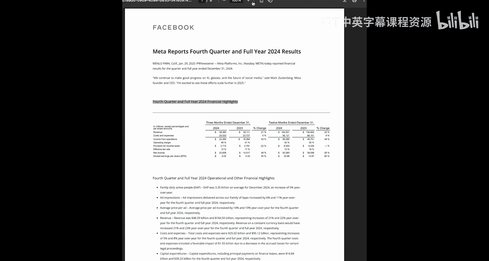

And display part of the report that will have that table。 Here is the extracted text from that table。

 Let's now ask Lama about the 2024 operating margin using the text of the report。 Heres the response。

 operating margin for 2024， was 42%， which is correct。 Now。

 let's repeat this using the table saved as an image。

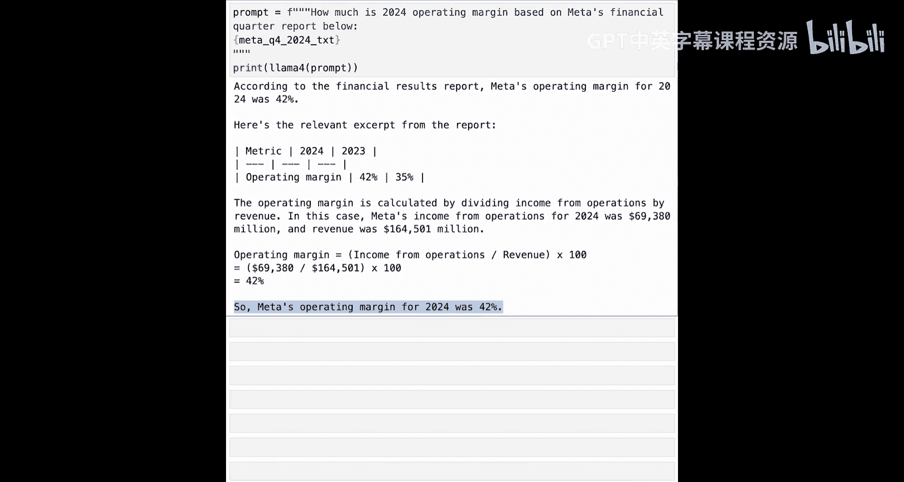

We have saved it in this file。And here' is the image。

We can convert the image to base 64 and pass it along with the prompt to Lama 4。

 and here is the response， which is again the same 42% youve got using the text of the report。

Please note that although the answers in both of these cases were the same。

 The reasoning is different， and in some tricky situations。

 you can get better and more accurate results using the image。

 as the Lama will have a much better understanding of the overall structure of the table compared to its plain text version。

Now let's use Lama to code a user interface using the image of that interface for this。

 we are going to take a screenshot of this frame from a video on Meta's website and we will code it using Lama 4。

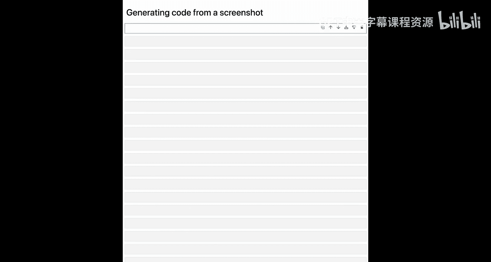

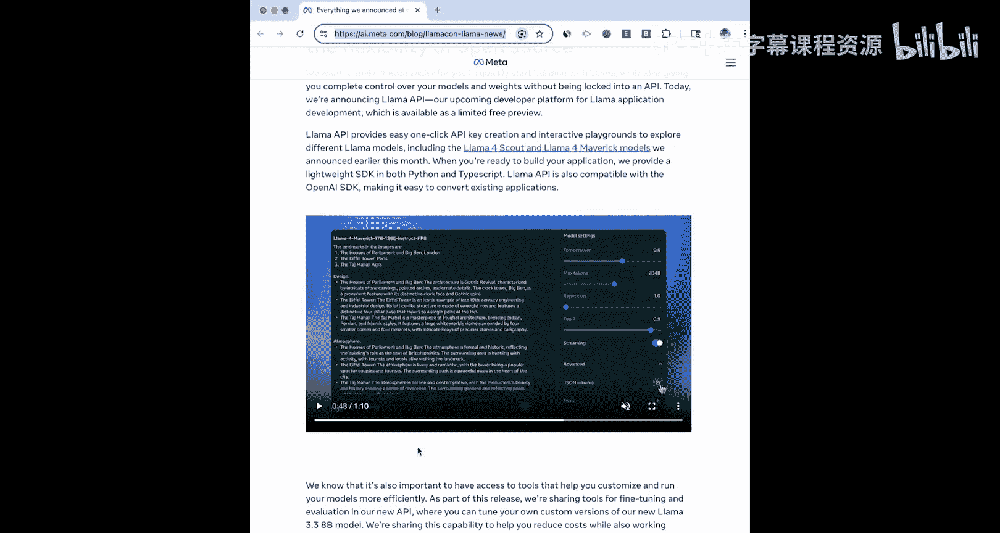

This is the image of that screenshot。 Let's first ask a question to see if Lama understands this image。

If I want to change the temperature on the image， where should I click the temperature is this slider here。

 and it is currently set to 0。6， and here is Lama's response。To change the temperature on the image。

 you should click on the slider next to temperature， and its current value is also given。 Okay。

 let's see if Lamar can code this interface for us。

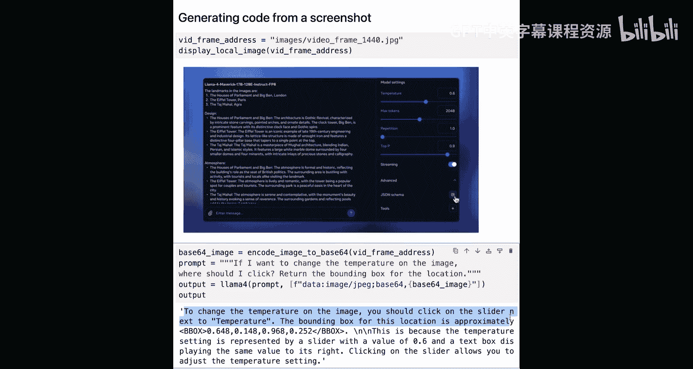

We pronked it， write a Python script that uses radio to implement the chatbot UI in the image。

This is the response with the instruction on what to install and the final Python code。

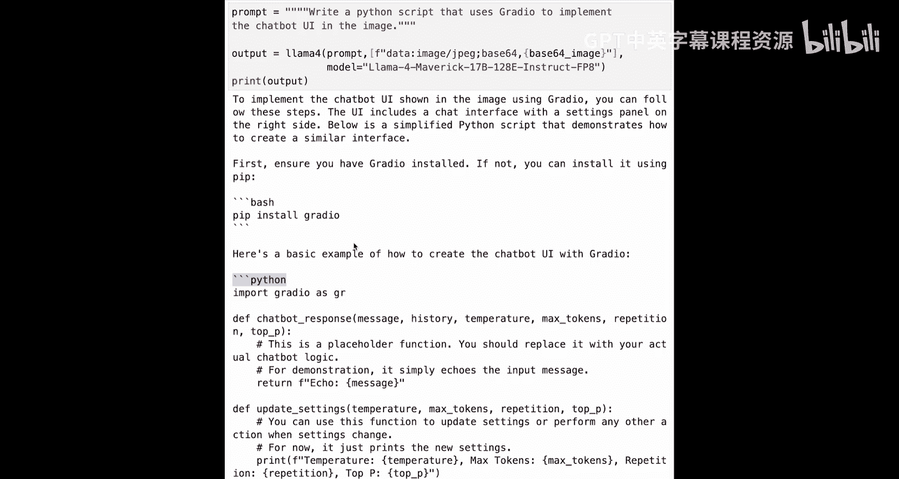

Let's copy and run this code。Here is the code we got from Lava。

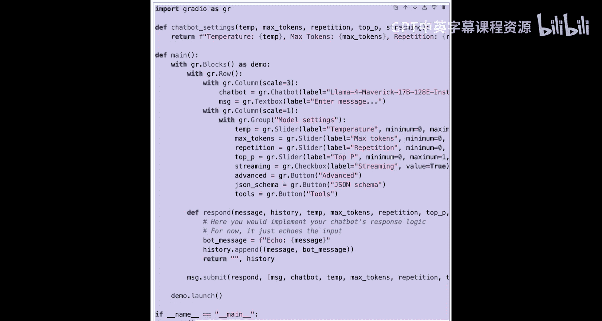

And by running it， we get this interface with the sliders all implemented。

And even the chat box that you can type your message and interact track with the interface note that this is just the interface that we ask Lama to implement。

 and this doesn't include all the functionality that needs to be added later for this to fully work。

Now let's use Lama to solve a math problem。

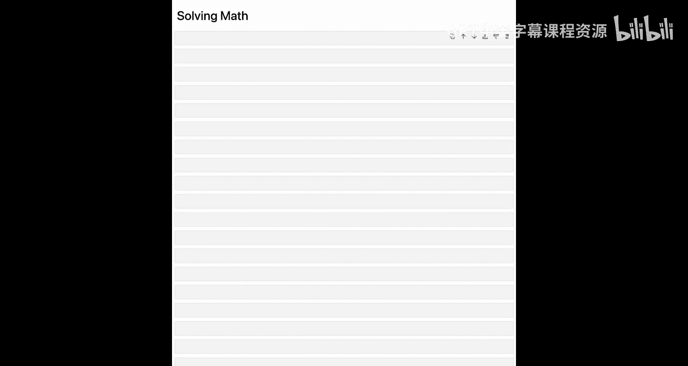

Here is the problem we want to solve。To solve this， Lama should understand the problem。

And how to solve it。 Here is our prompt。

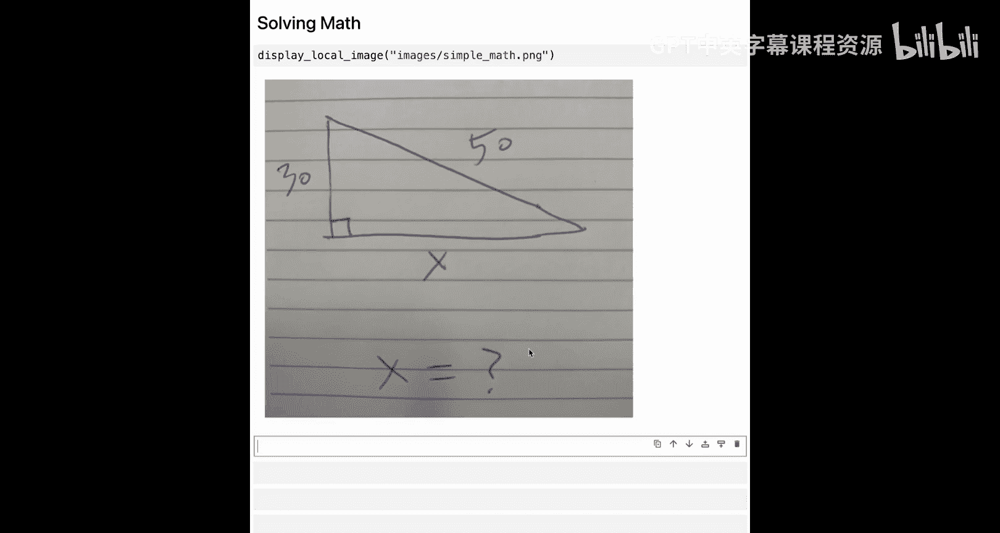

Answer the question in the image。We pass the base 64 underscore math image in addition to the prompt t Lama。

And here's the response。Lma is giving all the steps it takes to solve this problem and the final answer is calculated to be 40。

Which is correct。Let's work on another use case where you use Lama to analyze computer screen here is the image you are going to work with。

This might look familiar as this is an image of our previous course on Lama 3。2 on deep learningning。

AI platform。Let's ask Lama to describe this screenshot in detail， including browser， URL and Ts。

 Here is a detailed analysis of this image， even with the list of all the icons at the bottom of the screen。

Let's say you have a browser agent that wants to automatically go to the next lesson。

 Let's ask Lama this question if I want to go to the next lesson， what should I do？

We display the image again， so we have the result and image together。

And here is the response to proceed to the next lesson。Click on the red button labeled Next lesson。

Which is here located at the bottom right corner of the screen。

 This use case shows how you can use Lama in computer use applications and in building browser AI agents。

In this lesson， you used Lama in several image reasoning and grounding use cases and applications in the next lesson you are going to go deep into pro format of Lama 4。

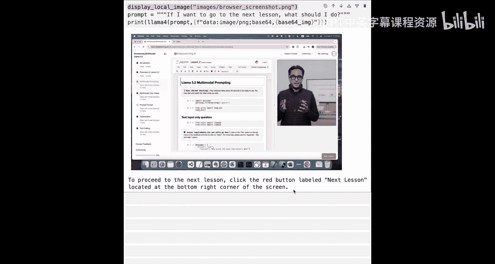

All right， see you there。