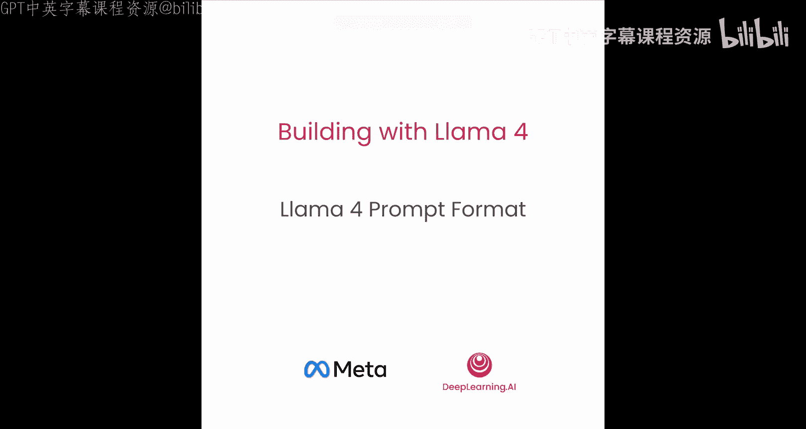
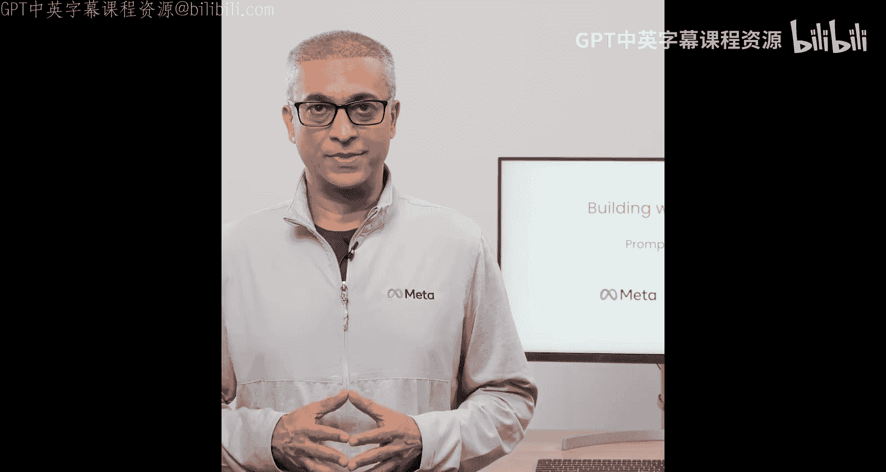
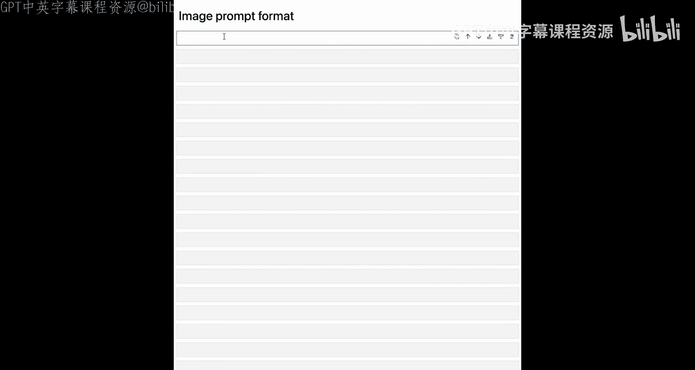
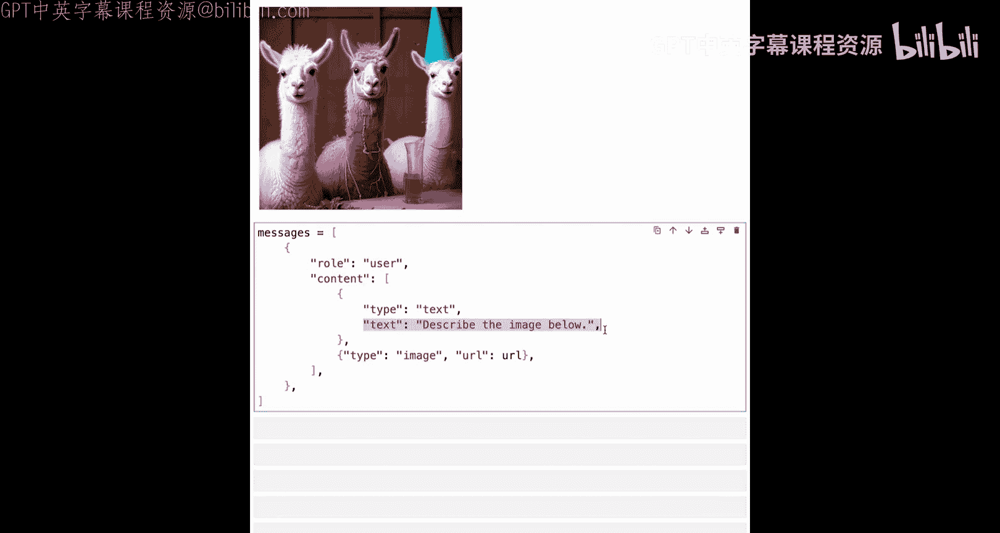
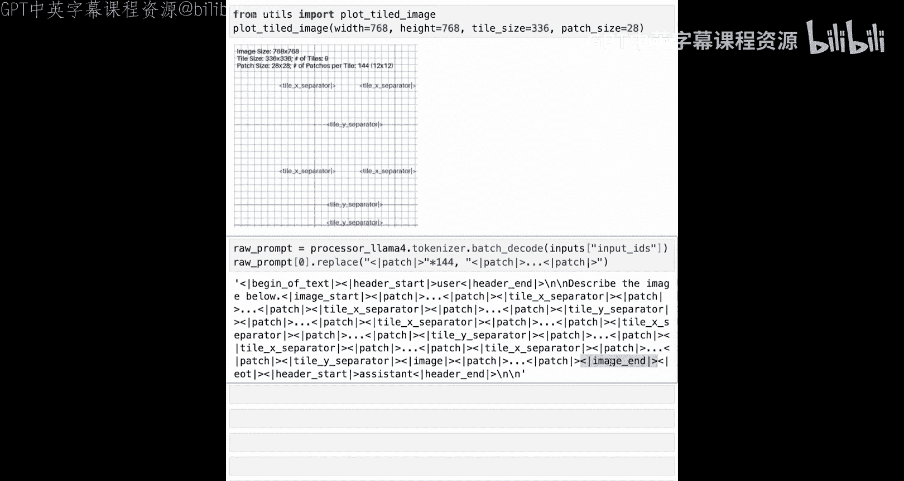

# 吴恩达《基于 Llama 4 的应用构建｜Building with Llama 4》中英字幕 - P5：5.llama-4-prompt-format.zh_en - GPT中英字幕课程资源 - BV1jmKGzhEne

In this lesson， you will learn how Lama4 interprets prompts。

 including the special tokens both in plain text and multimodal prompts。 All right， let's go。 Lama 4。

 Sc and Maverick are multimodal models that offer superior text and image understanding In this lesson will first take a quick look at the Lama4 special tokens and prompt format。

 starting with text only input。 And then we will see how text plus image input works。

 to build Lama4 apps。 You don't have to deal with the Lama4 special tokens and prompt format directly。

 but it's always good to understand how your text and image prompts are processed by Lama Lama4 supports the following list of general special tokens。

 Big and underscore off underscore text specifies the start of the prompt。

 header underscore start is the start of a role for a particular message。

 header underscore and is the end of the role for a particular message。 and Eo T is end of turn。

 which represents when the model has finished interacting。😊。

The user input La 4 also uses the following image tokens image underscoreco start is start of the image data in the prompt。

 image underscoreco n is end of the image data in the prompt patch represents subsets of the input image La images have more patch tokens in the prompt T underscore X underscore separator separates the X styles of an image and tile underscoreco Y underscore separator separates the y tiles of an image。

 The image token separates the regular size image tokens from a downsized version of it that fits in a single tile Lama 4 supports the same four roles。

 system user assistant iython as Lama 3 system sets the context in which to interact with Lama system prompt typically includes rules and guidelines that helps the model respond effectively。

 Use role represents the human interacting with La Use prompt includes the specific user inputs。

 commands or questions。 As role represents Lama。Ring a response to the user。

 an i Python role represents the output of a tool call with sent back to Lama。

Let's see this in code We will begin with loading our API keys In this lesson you need Lama API key and Hugingface access token。

 Both of the keys are already set up for you we will use auto processor from Huging face transformers to find out the raw prompt of an input message to compare the RA prompt in Lama 4 and Lama 3 models。

 we will use Lama 4 Sc and Lama 3。3 and compare their raw prompt formats。

Using these two model Is and auto processor， let's define processor underscore Lama 4 and processor underscore Lama 33。

 Now， let's compare the raw prompt for both models using this sample message。

 using the processor underscore Lama 4 and passing the message to its apply underscore chat underscore template method and by setting the tokenize to be false and add generation prompt to be true。

 we can see the raw prompt format for Lama 4， setting the add generation prompt to true as added this to the raw prompt Now。

 let's see the same this time for the Lama 33 processor。Here is the raw prompt。

 There are two main differences between these two raw prompts。 First， some of the special tokens。

 including start underscore header underscore I D， have changed in Lama 4。

 The same is true for and underscore header underscore I D in Lama 3。

 That has changed to header underscore n。 and end of turn underscore I D has also changed to end of turn or E O T。

 Another difference is that in Lama 3 models。 This system message by default was added to the raw prompt。

 Lama 4's raw prompt doesn't have a default system prompt added to your prompt。 to see this。

 Let's add a system rule to our prompt。 respond in French。

 And let's see the raw prompt for Lama 4 and Lama 3。Now， by including a system prompt。

 that system prompt is added to Lama 4's raw prompt and is also added to the default system prompt of Lama 3。

 Now， let's see the prompt format for the image inputs。

Let's load and display this image that you have already seen in previous lessons。

Let's form this messages with the role user and the content of the text prompt。

 De the image below and passing the URL for the image。

 Let's now use the processor underscore Lama 4 Pass our messages set the add generation prompt and tokenized to true。

 get the result as a dictionary and set the return underscore tensors to Pytorch for the input that is created。

 Let's see the keys。 input Is shows the encoded raw prompt of the messages。

 Let's see the size of the pixel underscore values。 Lama 4 is using  ten0iles of size 3，36 by 3。

36 in three channels of red， green and blue4 our image。

 Let's see how these teniles are formed for our image。

 We have a function plot underscore tile underscore image in u。

If you call this function and pass the width and height of our image， which is 768。

 and the tile size that is 3，36 by 336 in Lama 4， and also specify a patch size of 28 by 28 pixels。

 meaning that in each tile there will be 12 multiplied by 12 or 144 patches。

 you will see this result。 Each small square is a patch of 28 by 28 pixels and bigger squares of 12 by 12 patches or 3。

36 by 3，3，6 pixels form a tile here we have one tile tile number2 and a third tile here。

 Ti number 4 is here。 tile number 5 and 6。 Then we have tile 7，8 and 9。 Besidess these nine tiles。

 Lama will create a global tile by resizing the entire image to 3，3，6 by 3，36 pixels。

 This global tile。Will provide a global view of the input image。 In total。

 will have nine tiles of the image plus one global tile。

 which will be this1 here to separate the tiles。 La 4 has special tokens of tile X separator and tile y separator。

 In the case of our example image we have the first tile。

 Then tile X separator separates it from the second tile。

 and the third tile also has a tilex separator。 When all the tiles are down here。

 Then a tile y separator is added to start tile number 4。

 Another tilex separator separates it from tile number 5， and then tile number 6。 And again。

 we'll have another tile Y separator。 and then tile number 7， another tilex separator tile number 8。

 another tile separator to get finally to tile 9 Lama 4 will use a special token patch to represent each of the patches in the tile。

 Now， let's see the raw。Format for this image， the batch underscore De method will get the input I in our inputs and will return raw underscore prompt。

 Note that since there are 144 patches in each tile This will be a very long string of so many patches to shorten this string we replace every 144 patch special token with patch3 dots and patch。

 and here is the result。 we have the beginning of text with the roll user with the text message describe the image below。

 then image starts with 144 patches for first tile。

 then tile X separator forms the beginning of the second tile。

 and then 144 patches for the second and then tile X separator is added to show the beginning of the third tile。

 Then 144 patches are added and then tile Y separator is shown。

 and this continues until image end in this lesson you learned about La 4s rock wrong format。

For both text and image inputs in the next lesson， you will learn how to use Lama 4 on long context text files and code repositories See you there。

