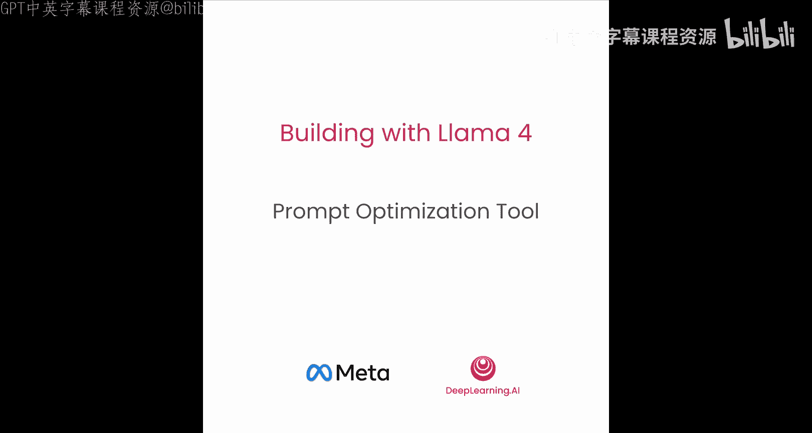
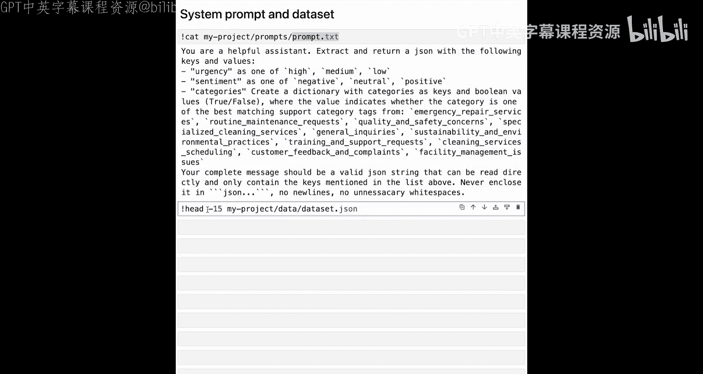
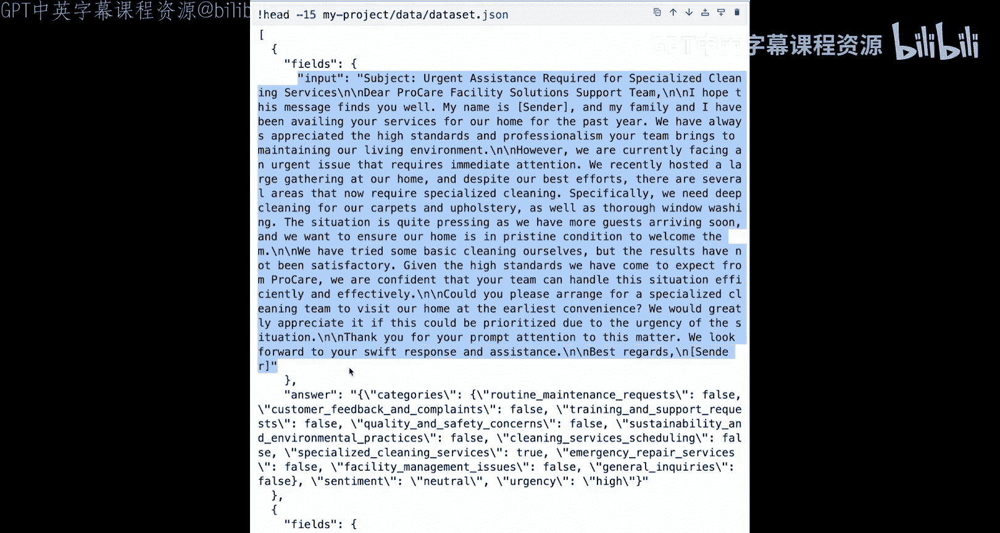
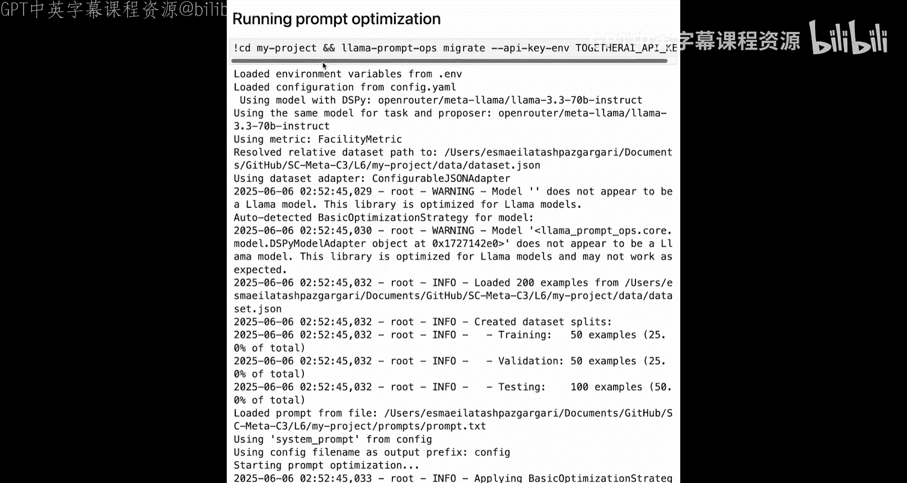
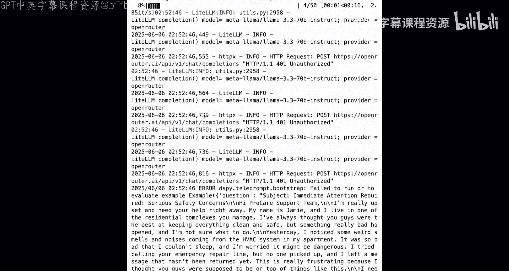
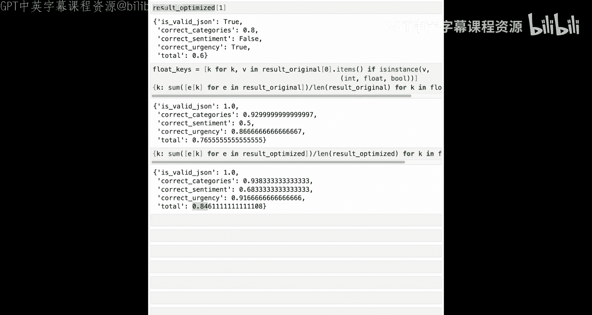

# 吴恩达《基于 Llama 4 的应用构建｜Building with Llama 4》中英字幕 - P6：7.prompt-optimization-tool.zh_en - GPT中英字幕课程资源 - BV1jmKGzhEne

In this lesson， you learn how to automatically improve your prompts using Lama's prompt optimization tool。

 let's go。

Pros have a huge impact on how elementss behave。 Even minor wording changes can completely change the model's output。

 but handcrafting prompts is time consumings and often inconsistent。

 That's where metas open source prompt optimization tool comes in。

 It helps automate the process of refining prompts。

 making your Lama applications more reliable and effective。

 The tool is available as a Python package。 Lama dash prompt dash Rs。

 You feed the tool with your current prompt and a few sample tasks。

 and choose an evaluation metric and set other parameters in the Yal configuration file。

 It uses the Lama model itself to suggest improved versions runs comparisons and gives you a final optimized version。

 This is especially useful when migrating prompts from other models or tuning for edge cases。

 Let's see this in an example of optimizing prompt for customer message classification for a facility management company。

 Let's begin by loading our API keys。You'll also need to pip install Lama prompt ops。

 And since this is already installed on the platform， it is commented here。

 You can create a sample project。 The sample project created by the tool is a facility management classification task which categorizes customer service messages by urgency level。

 customer sentiment and relevant service categories。 All right， the project is now created。

 It has added a config dot Y file。 prompt dot text。 A data set。 and also a readme file。

 The readme and config ya file are in my project。 The data set is inside a data folder and prompt dot text is in prompts directory。

 Let's take a look at the system prompt in prompt dot text file。 here is the system prompt。

 you are a helpful assistant。 extracttract and return a Json with the following keys and values。

 These are the Json keys。 So for each message that is received It urgency。

Sentiment and the category should be extracted and returned。

 This is the prompt that we want to optimize。 Let's also see a few lines of the data set。

For each of the input messages from a customer， the answer is given that shows the urgency that is high here。

 sentiment that is neutral for this message and category that is false for all the options。

 except for specialized cleaning service option that is true。

Let's also take a look at the config file。 There are different parameters in this config file that affect the optimization process。

 This is where the initial system prompt is。 This is the data set and also here is the task model which by default is set to Lama 3。

3 and the proposal model that is set to same Lama 3。

3 model the task model is the model that's using the system prompt in the prompt dot text file will'll do the task on all the input customer messages and will return the urgency of each message sentiment and the category。

The proposal model is the one that will propose new system prompts such that the overall performance of the task model on the dataset set that is given will be enhanced。

 Let's modify this config file and set our task model to be Lama4 Sc and the proposal model to be Lama4 Maverick。

 Here we modify the task model to Lama for Sc and proposal model to Lama4 Maverick and also note that the optimization strategy set to Lama。

 You can change it to basic for quick results and advance for more extensive prompt modification and running through more ebas。

 Lama is our recommended strategy for optimizing prompts for Lama models。 Also。

 the prompt optimization tool supports two built in metrics。

 Ex match metric for simple X matching and a standard Gson metric for a specific field evaluation。

 The metric used for the default example task is a custom metric designed for customer service message category。

That assesses the accuracy of prediction across three key dimensions， urgency level。

 sentiment and service categories。 Now that we have our sample project set up。

 we can run the prompt optimization process by using the migrate command。

 The optimization process involves several steps。 First， to load the system prompt and data set。

 Second， analyze the prompt structure and content。 Third， apply the optimization strategy。4。

 evaluate the optimized prompt against the original prompt。 And last。

 save the optimized prompt to the results directory。 Let's run this。 and wait for it to complete。

 This can take some time。

We'll speed it up in post edits Now that the optimization is completed。

 Let's compare the optimized prompt and the original prompt。

 The optimized prompt is in the prompt field of the Json file that was stored here with these few lines of code。

 We get the optimized prompt。 We can also read prompt dot text file inside the prompt folder and put it in original underscoreco prompt variable to have a better comparison between the original prompt and the optimized prompt We use this block of code to show the original prompt and the optimized prompt side by side。

And here is the result for the original prompt， and the optimized prompt。

Please note that besides the optimized prompt， the optimizer will generate few short examples。

 The combination of the optimized prompt and the generated few short examples will give you better evaluation results。

 The few short examples will be pairs of questions and answers。

 Let's take a look at the question for the first few short examples。 And here is the question。

Let's see the answer for this question， and here is the answer with urgency low sentiment neutral and the category identified as facility management issues。

 training and support requests and sustainability and environmental practices。

Let's see how many few short examples are generated。

 We have five few short examples to use these five examples， along with our optimized prompt。

 Let's put all these examples in a single strain。Let's now use our Eval function and compare the optimized and original prompts。

Let's first load our dataset that was in dataset Json file。

 We have 200 pairs of questions and answers in our initial dataset。

 prompt optimization tool by default uses the first 50% of the dataset for training and the next 20% for validation。

 So the test dataset is the last 30% of the data。 Let's get that last 30% and store it in DS underscore test。

 This will be the 60 pairs of questions and answers。

 Let's first evaluate our original prompt on the test data。

 The same evaluate function that was used during prompt optimization is given in Us file。

 Let's import it。 Now using this evaluate function。 We can run a loop on our test data。

 create messages using the original prompt Pass it to the together AI client get the response and pass the answer from the data and the prediction to the evaluate function and append it to the。

Results underscore original。Let's run this， this can take some time to complete。

 we'll speed it up in the post edits。All right， This is now completed。 Let's repeat this process。

 This time for the optimized prompt and few short examples we got by doing prompt optimization。

 We will pass the message to together AI client will get the prediction will pass that prediction and the answer field from the data set to their evaluate function append it to result under score optimized。

 This can also take some time to finish。Alright， this is now completed for the optimized prompt plus few short examples。

Let's take a look at the first element of result underscore optimized。

 as you see for the first data in our data set， the urgency and sentiment are correctly identified。

 and the score for the correct categories is 0。9 meaning that out of the 10 possible categories。

9 of them are correctly identified to be false or true with one mismatch with the categories of the answer in the first data in the dataset set。

The total is 0。97， which is the average of 0。91 and 1 and1。

 Let's take a look at the second data in our data set For this one， the urgency is true。

 The sentiment is false and 8 out of 10 potential categories are correctly identified to be true or false。

And the total is 06， which is the average of 08，0 and 1。

 Let's now compare the performance of the original prompt and the optimized prompt。

 plus few short examples on all of the 60 pairs of questions and answers in our test dataset set。

First， let's get all the keys that are either integer float or boolean， which for our result case。

 will be basically the list of all the keys。 We can then run a loop on all results original for all the keys in float underscore keys。

 and here are the average scores for the original prompt for categories。

 sentiment and urgency and the total， which is the average of the previous three。

Let's see the same result for result underscore optimized。

 and here is the average Eval using our optimized prompt and the few short examples generated by the prompt optimization tool。

As you see， the score on correct sentiment has gone from 0。5 to 0。6。

 and the correct urgency has increased from 0。86。2。91。

There is also a small increase in the correct categories。

 and the total average score has increased from 0。76 to 0。84。In this lesson。

 you used Lama's prompt optimization tool to optimize the system prompt for a sentiment analysis and categorization use case。

 and compared the optimized prompt plus the few short examples you got from prompt optimizer with the original prompt。

In the next lesson， you are going to use synthetic data kit to digest， create， curate。

 and save synthetic data。 See you there。

