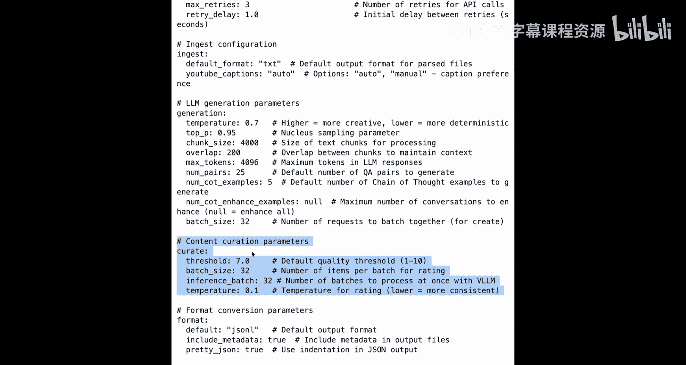

# 吴恩达《基于 Llama 4 的应用构建｜Building with Llama 4》中英字幕 - P7：8.synthetic-data-kit.zh_en - GPT中英字幕课程资源 - BV1jmKGzhEne

In this lesson， you will use Lama synthetic data kit to create high quality data sets for training and fine tuning you learn how to ingest。

 create， curate， and save data in just a few steps。

Let's create some data When building LLM applications， we often run into data problems。

 The real data is messy， unstructured are just not enough。

 syntheticynthe data offers a flexible alternative。

 It lets us generate exactly the examples we want and need synthetic data is very important for model distillation。

 fine tuning or even just stress testing your model on specific edge cases。

 The Lama synthetic data kit is a command line tool that makes it easy to generate high quality training data using the Lama models themselves。

 using the tool。 you can generate different data sets from Q and A pairs to chain of thought and summarization data。

 Let's learn how this works by ingesting a P file， creating data from it。

 curating it by removing low quality data and finally saving it in different formats。

 We will begin by importing our API keys to use the synthetic data kit。

 You need to set an environment variable named API and point key， which should be。

Set to your Lama API key or another Lama cloud providers API key。

 you also need to pi install synthetic data kit， and since this is already installed on the platform。

 it is commented here。Extracting relevant data from real world documents such as Pdfs。

 web pages and videos is complex。 And errorpro synthetic data kit helps you to ingest different files。

 including Pdf files and web pages and extract plain text data from them。 Here。

 we have this paper with 27 pages。And by just this single line and running it。

 synthetic data kit will extract the text and will save it。

 Let's take a look at the last 10 lines of the first 50 lines of the extracted text。

 And here is the text。Synthetic data kit can extract text from web pages to here we have a web page on Me's website。

Let's use Cy data kit to extract text from this web page。

The extraction is done and the result is saved here。

Let's take a look at a few lines of the extracted text。And here is the result。

Let's now create a question and answer data set based on the paper that we ingeestted and extracted its text。

 This will be as easy as this single line， using create command。

Passing the address of the extracted text and for the type of the data we want to create。

 we choose Q&A。There are other data types that you can choose。

 including chain of thought and sumization by changing this QA to COT。

 you can create chain of thought data。Let's run this。

 the process continues until all data is generated。And finally。

 you'll see where your data is saved you。Let's take a look at this JSON file， here's the result。

A summary of the document is given， and Q And A pairs of questions and answers are generated。

 Here is another pair。And one will pair here。In certain use cases。

 you will need to filter your data and remove low quality data from your dataset set。

 You can do this using curate command from the synthetic data kit。 You can pass the created data。

 and also the threshold of quality。 That's the number between 1 and 10。 the higher the threshold。

 the higher will be the quality of the data。 but the rate of retention will be lower。

 Let's try threshold of 8 on our created data。 Now， the cleaning process is being down。

And as you see， the 48 pairs of the created data were evaluated and rated。

 and 45 of them that were above or equal to threshold 8 were retained。 The clean data is saved here。

 Let's take a look。For each of the query pairs， now a rating is calculated。

And only pairs with a rating higher than or equal to 8 are kept。You also have the conversation。

With system， user and assistant messages for each pair of questions。And in the end， you have matrix。

 including the total number of questions。The number that passed， the given rating threshold。

 retention rate， and the average score of the retained questions。

The saves command converts the curated dataset set to different file formats。

 It supports four popular output formats， Json， Apicca， F T and chat and and two storage formats。

 Json and H F4 hugging face。 Let's take our clean Q& A pairs from previous step and save them in JSson format using the JSson storage format。

Let's run this。 The file with JSO format and with the JSson St is saved here。

 Let's see the first 10 questions in this file。And。

Here's the content of the JSO file by changing the format to other options， including FT。

 you can save your data in different formats。 After running。

 the FT format of the data is saved in this JSO file。

 Let's take a look at a few lines from this file。And here's the FT format of our Q&A dataset。

I encourage you to change the format to Alpaca and chat Ml and compare the results。

There is a default config file for the synthetic data kit。Let's take a quick look into this file。

 This configuration file for synthetic data has all the configurations you need for synthetic data generation。

 for example。When the data was generated using the create command。

 it was automatically stored in data slash generated path。

You can control the paths throughout all the stages， from passing to the final saving。

There are many more settings here。I would encourage you to review this convey file and change any of the settings to enhance your synthetic data creation process。

 For example， these are the parameters that control the creation step。

And these are the parameters that control the curation process。 In this lesson。

 you learned how to generate synthetic data using synthetic data。

 I encourage you to try other data types like chain of thought and try saving into different formats。

