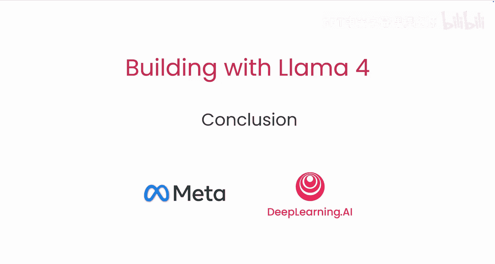

# 吴恩达《基于 Llama 4 的应用构建｜Building with Llama 4》中英字幕 - P8：9.conclusion.zh_en - GPT中英字幕课程资源 - BV1jmKGzhEne

In this course， you have learned how to build with the latest Lama 4 models using MeAs API。

 how to do image reasoning。And how to prompt over long context text files and code repos。

You also explored new tools from error for prompt optimization and synthetic data generation。

We hope this course has helped you take your next steps in developing with Lama 4。

Looking forward to seeing what you built。