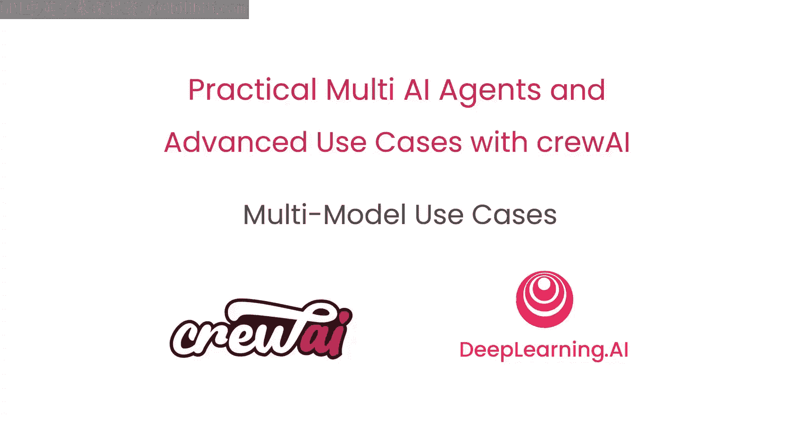
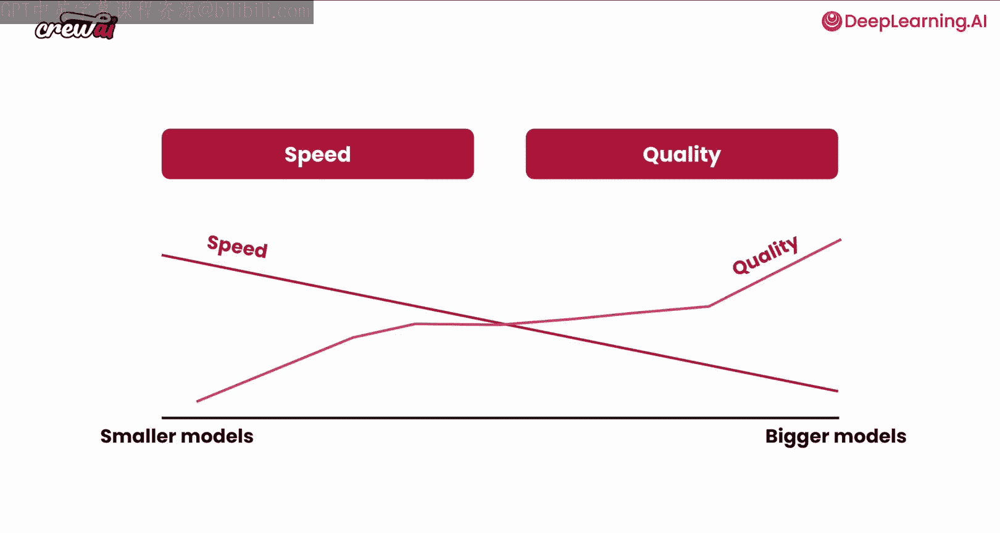
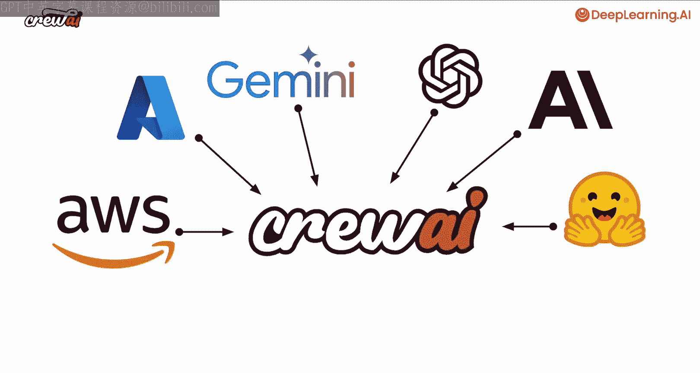
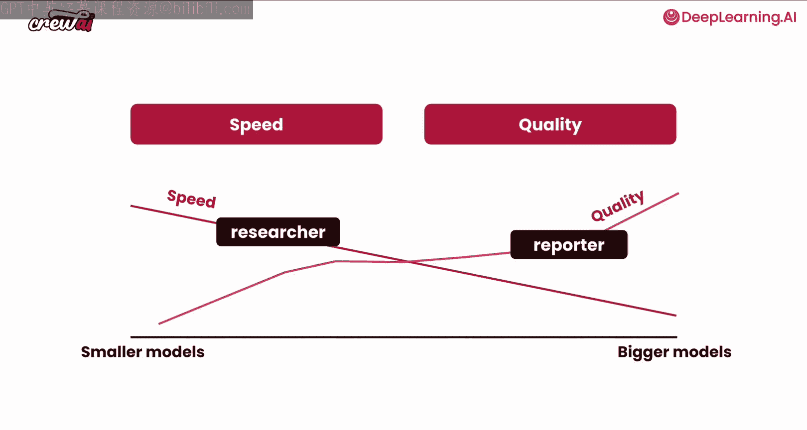
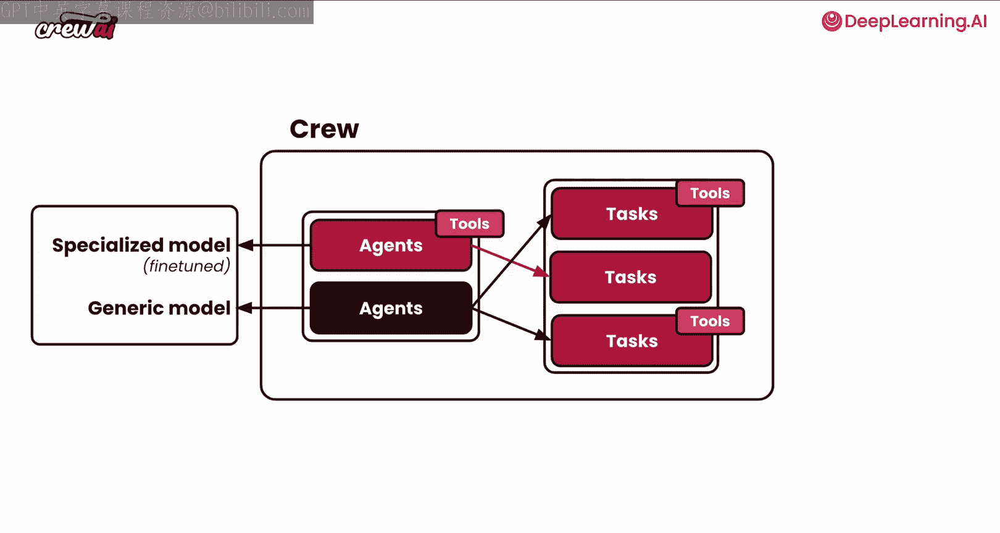
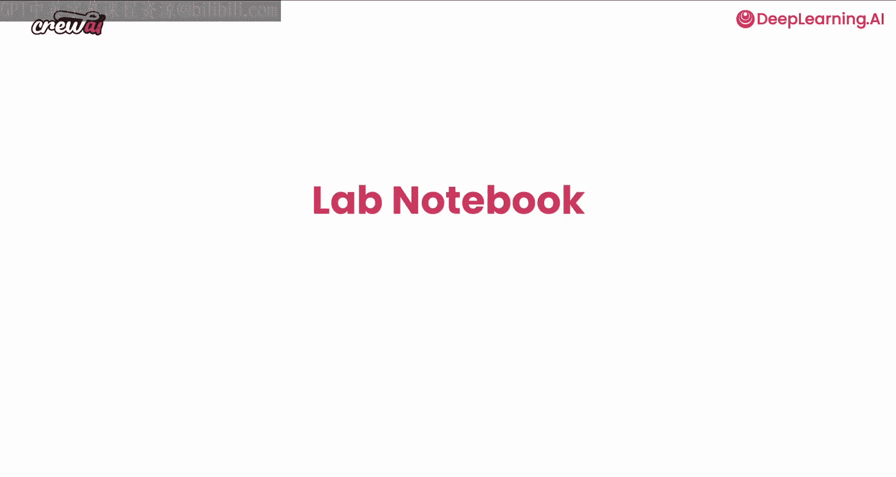

# 吴恩达《多AI智能体实践与高级应用课程Practical Multi AI Agents and Advanced Use Cases with crewAI》 - P10：10.use cases.zh_en - GPT中英字幕课程资源 - BV1fgySYsE5y

I'm so excited for this lesson This lesson is about Mucipo models working together。

 What I mean by that is that you can have a few agents that are going to be powered by let's say smaller models and other agents that can be powered by bigger ones and you can even have different providers if you choose to you can also explore this to have specific finet models so that you can have crews that are completely mochi model you can optimize for different things and this unlocks so many different use cases you can get very specific agents that would not be possible before so let's check out how to use mochi model in an agent system come on。

😊，So let's talk about how this Mujimod implementation works on query AI and the benefits that you can get from it。

 So we already learned about how smaller models and bigger models optimize for different things and how you might choose to optimize for speed in a few use cases or quality in others the thing is with query AI you can use any of the major providers out there so you can use AWS badrock and entroic models you can use any models from Azure you can use Gemini。

 you can use open AI andtroic or anything from Hu andF in any other vendors out there meaning then you have a huge array of models to choose from and the beauty of this is that then you can pick and choose models for individual agents so you can have an agent number one。

 for example， that is using a smaller model in an agent number two that is using a bigger one。

Optimizing for different things。 This is very helpful。

 You can say that agent number one is a researcher and agent number two is a reporter。

 so together theyre able to produce a big and greater outcome then they would be able to individually The good thing is that beyond optimizing agents per model size。

 you can also opt it for different providers So you can have an agent number one using， for example。

 an Azure model in agent number two， using an entroic one。

 And this allows you to have more flexibility and work around things like great limits and specific providers that you might have access to or not。

 Even beyond that， you can also customize our agents to use fine tune models so you can have an agent using a more generic one that you can use from any provider out there。

 but another one that is going to use a fine tune model。 This can be a model that is fine tune。😊。

To write like your company or write like someone or have a very specific knowledge about a specific business case in your company。

 The thing is with this ability to choose individual models to individual agents you'll get a lot of control on how you want your agents to behave on a very individual level that gives you a lot of power on what use cases you want to build in how you want agents to behave This is very interesting but let's build something。

 let's diving into this and learn how we can use those models to our favor using a few providers out there。

 So let's dump into Jter notebook and build something yourself。 I see in a second。

