# 吴恩达《多AI智能体实践与高级应用课程Practical Multi AI Agents and Advanced Use Cases with crewAI》 - P11：11.L5 Content Creation at Scale.zh_en - GPT中英字幕课程资源 - BV1fgySYsE5y

This is another incredible use case For this， we're going be building a crew that is able to create content creation at a scale。

 You will learn how to build crews that can not only monitor the web but also try to understand what they should be searching about and even using Ra in order to create amazing blog posts on the fly。

 This is one of the use cases that we're seeing a few customers deploy out there。

 What they do is monitor news around specific topics and make sure that they create timely great content that can actually deliver resultss by doing content marketing for this use case we're going to start by making sure that our crew is able to talk with the internet and that it's able to search the internet for content and relevant news from that point on。

 we're going to have a few agents and tasks。😊。

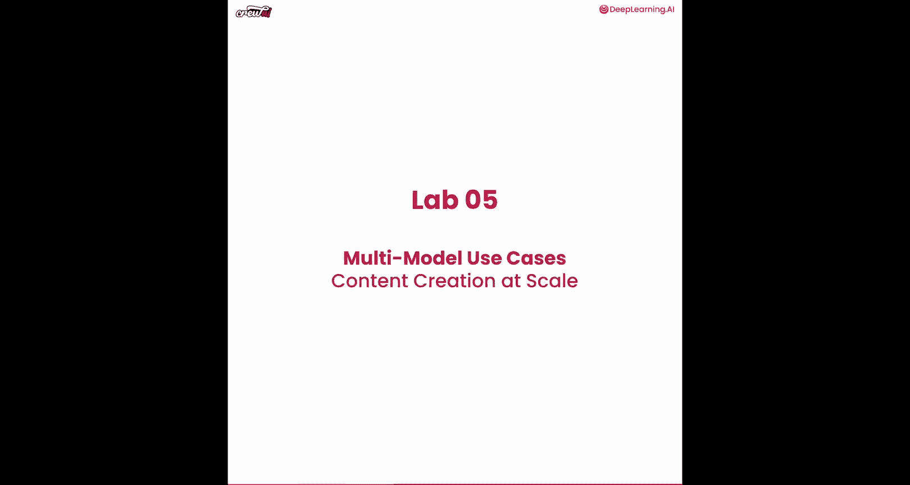

To actually be able to parse this information， we're going to start with a market analyst agent。

 and then we're going to go through a data analyst agent。

 a content creator in a cheap content officer these four agents are going to do four different tasks they're going to parse latest news they're going to search for market trends they're going to write blogs and content for social media and then review all this content to make sure that it is checks out。

 So these agents are going to be making sure that by doing all data sequentially they can build amazing blog posts and social media content for us about trending topics that people are talking about right now。

😊，An interesting thing about this is that we can probably optimize some of these agents and tasks to be a little faster than what they would be in order to do this。

 we're going to be using a major provider to power this agents we're going to be using G and here we're going to be actually optimizing for speed Goc is one of the fastest inference providers out there their models run so fast that this agents can go through a bunch of news and market trends in a blank so we're going to make sure that we have these agents running through using GO and for this crew we're using a combination of tools that we have not used before and it is super interesting we're using Surer that it's going to allow us to search the internet but then we're using ragg as a tool so instead of only being able to scrape entire web pages we're going to be using a search。

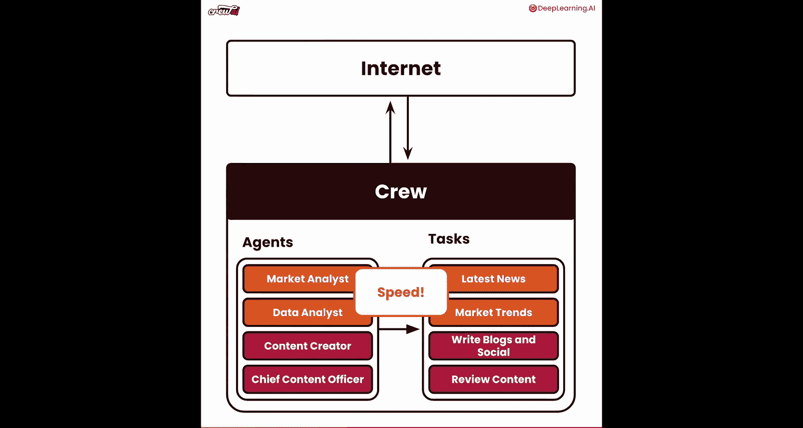

Website too that is going to allow our agents to automatically download the content andbed this content in the fly and push that into a vector database and then run search against it so your agents are going to be able to do these databases and search it and use it alone by themselves these unlock so many potential use cases。

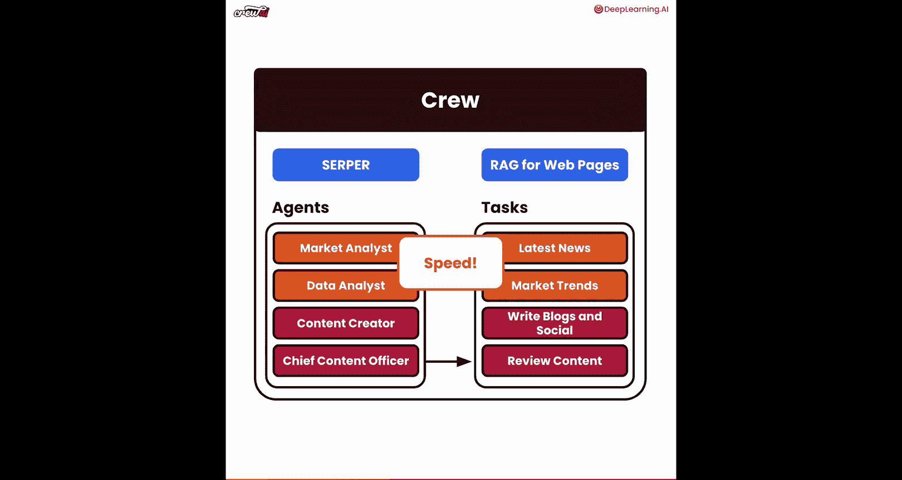

In the end of the day， what we're going to have is a content creation crew that's going to do a few different things。

 It's going to search for the latest news around a financial topic。

 It's going to then search and analyze any market data around it。

 It's going to create content for social media based on that。

 and create a food blog post based on the same topic in everything that learned about it and then to wrap it up。

 it's going make sure to review the blogs so that it sounds good。😊。

And this contents can be pretty great， especially if we use training and testing as we learn in another lessons Now let's jump into the code and build this crew yourself。

😊，So we're going to start by importing our classes in modules that we're gonna to need for this one。

 just making sure that we set all the environment variables and importing the main classes from Cr AI as we have done in other types Now we're gonna to create a structured output to make sure that whatever data we get out of our crew we can use it and push into other systems。

 This structure output is going to be pretty straightforward。

 we're going to have a content output model that has the article itself in social media posts social media posts is a list of a social media post model that basically has a platform and the content So during this crew execution。

 it's going to be writing not only the article but also social media posts to accompany this so that we can post is in LinkedIn。

 Twitter and everything else。Now let's load our agents and tasks the MO files。

Loading our agents and task the M files iss pretty straightforward is the same way that we have been doing so far。

 So let's take a look at our agents and tasks。 So in here we have four agents。

 We have the lead market analyst， the chief data strategist， the creative content directorctor。😊。

And the chief Con officer。Again， feel free to play around with this agent's road goals and backstories as you want to tune things up and see if you can get a different result。

 Now， let's check out the tasks。We also have four tasks。

 the first task is about monitoring and analyzing the latest news。

 the second one analyze the market data and trends about a given subject。In this。

 you can see that we are again interpolating a variable on our tasks as we have done in other lessons。

 that means that when we kick off the screw， we need to make sure that we are passing this as an input。

You can see that we also have a content creation task that based on insights now tries to actually write not only the blog posts。

 but also social media updates to go along with that and then we have the Q assuranceance task that basically will reviews and refine all the content regarding this subject。

 making sure that both the blog articles and the social media posts check out now let's go back into the code and keep on beauty。

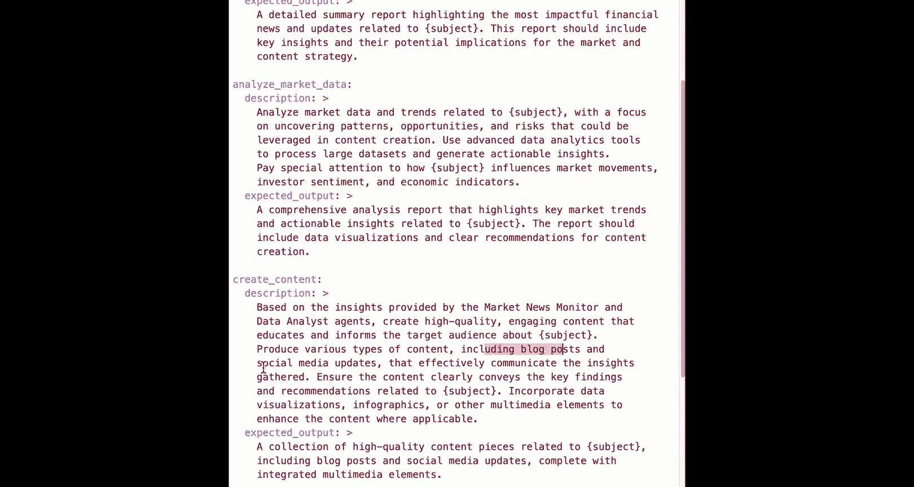

Now let's import our C AI tools that we're going to be using for this。The tools are pretty simple。

 We're using our usual Surper devft tool that allows us to do Google searches and also our scrape website to that allow us to scrape entire website's content but we're bringing a new tool into this and that is the websites search tool This is a rag as a tool。

 What it does is as our agents search the Internet and find websites that have interesting information it will automatically download those websites。

 break that into a smaller chunks and bat them and save them into a local emddings database so that you can do vector search in real time。

 your agents will do all that on their own you don't have to worry about any of that。

 They will generate embeddings and they will choose what to search and when to search it。

Now that we know one of the tools we're going to use。

 let's import and setup or LLMs that we're going to be using for this lesson。

 keep in mind that we're using multiple models on this one to showcase the power and how you can optimize for certain things on certain tasks。

So let's start by setting up or open theI model and to do it we're going to set this open theI model name environment variable and we're going to set the value to be GPT40 minii that's ready to default for C AI。

 but we are setting it up anyway， just to be more verbo and direct。

We're also going to use a GC model， specifically Lemma 3。

170b and we can do that by setting up this variable that we're going to reference later when creating our agent to be the string that represents that model。

 so it's a GC model and the model name is Lemma 3。170b versatile。Now let's create our agents。

 our tasks and our crew， let's start by creating our agents。For our agents。

 we're going to be using the agent's Config YaO file。

 and you can see that the Market news Mon agent has a different set of tools from the data analyst and the content creator。

The market news has access to the Surer dev2 that allows us to search the internet and also has access to the scrape website tool that allows you to pull information from entire websites and this is good for this agent because it's trying to basically go broad and find as much information about the topic that we care as it can and then our data analyst agents in our content creator connstrue to Google searches。

 but now they also will do rag searches on whatever content they find that way they're not parsing the entire website and all the information on it but they're searching about specific topics that they care about and in the end of it our quality assurance agent doesn't have no tools and is responsible to making sure that the content looks and sounds great。

Now that we created our agents， Lab creates our tasks。We will also have four different tasks。

 one for each agent， the first one just monitoring the news， the second one just analyze the market。

 the third one create the content。 and if you see it。

 you can see that we are passing a context attribute where we're bringing the results from both the monitor financial news and the analyze market tasks into this one so by the time that it writes the content and the social media posts。

 it has all the information that it needs in order to get this job done。 In our final agent。

 the quality assurance agent is going to do this quality assurance task and it's going to make sure that whatever output we get it's going to use that model that we declared above so that we have not only the actual article but we also have the social posts for all the different social networks。

Now that we have our tasks created， let's put it all together on our crew。For our crew。

 we just need to bring our agents and tasks together in this one single object and this crew is good to go。

 let's kick it off and see how this aco looks like。Now。

 we're gonna kick off this screw and this is gonna to be a lot of fun because think about everything that is happening here。

 We have agents that are researching the web。 They' are scraping web pages。

 Then we have agents that are downloading the content breaking into chunks gradient bettings and startingring into a vector database and automatically searching to find every piece of information that it needs to write the most amazing articleco it can。

 This is such a nice setup and allow for you to create so many different thanks。

 So let's kick off this screw。 And don't forget that you need to pass inputs on this one。

 because we need to tell what is the subject that we want this content to be about。 And in this case。

 we're going extra harm。 We wanted to find specific information on the inflation the US and the impact in the stock market for 2024。

 So you can see this is a very hard task but this agents can take care of it。 So let's run them。😊。

See， what do we get？Let's start by monitoring our first agent， the lead market analyst。

 It first task is very straightforward，'s basically monitoring and analyze the latest news and updates regarding financial markets。

 and in this case it goes ahead and search for the latest news on inflation in the US and its impact on this stock market in 2024 and we can see that it found good sources of information you can see Deloitte in here。

 Wall Street Journal， USA Today so it founds a bunch of information that it can now use。

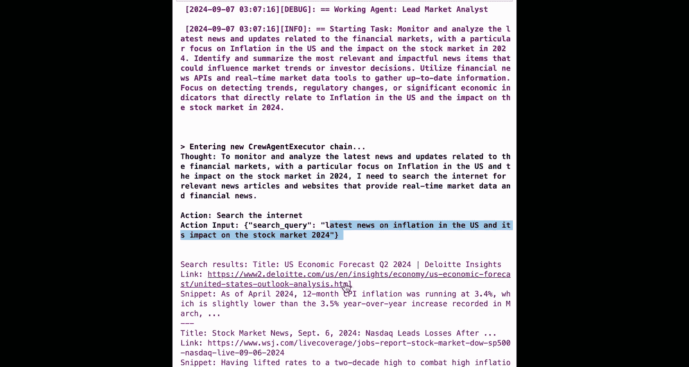

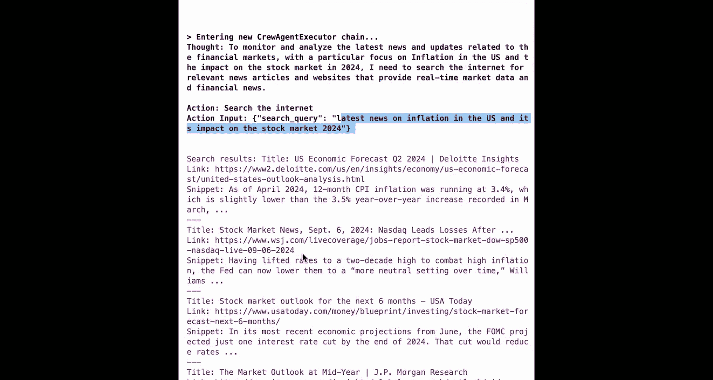

From this point on， you can see that this helps to scrape a website content by looking at everything that is in there and making sure that we find all the information that is necessary to learn about this matter。

Now that our lead market analysts wrap up its work and gave us a full report and summary on everything that learned about potential implications for the stock market with the inflation rates in the US。

 including consumer price index and so much more。

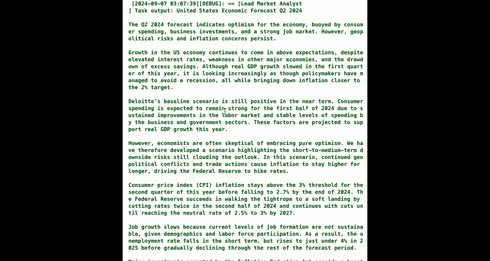

Now that this first agent's done with the work， let's see how things are going to happen from here。

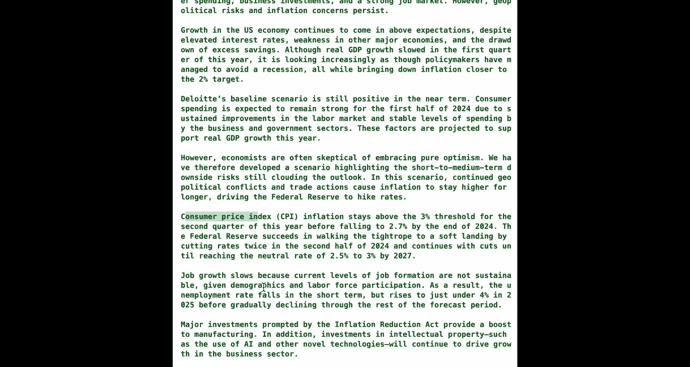

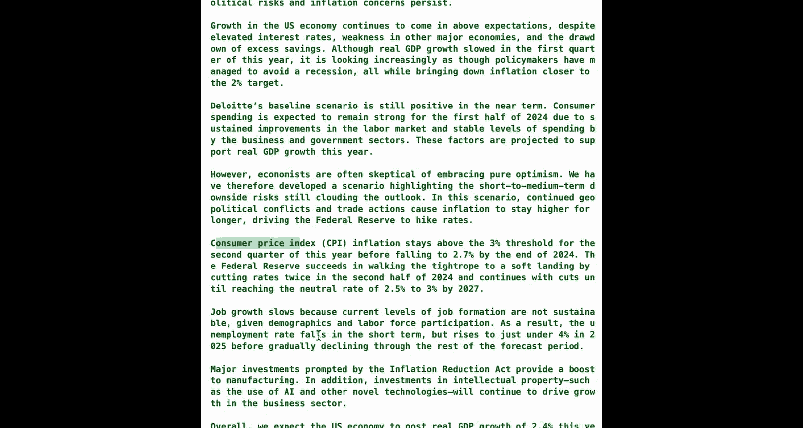

here we can see our second agent， the chief data strategist。

 is starting by analyzing market data and just to understand better the impacts of the US inflation into the actual stock market。

 and you can see that it starts by just doing simple searchs。

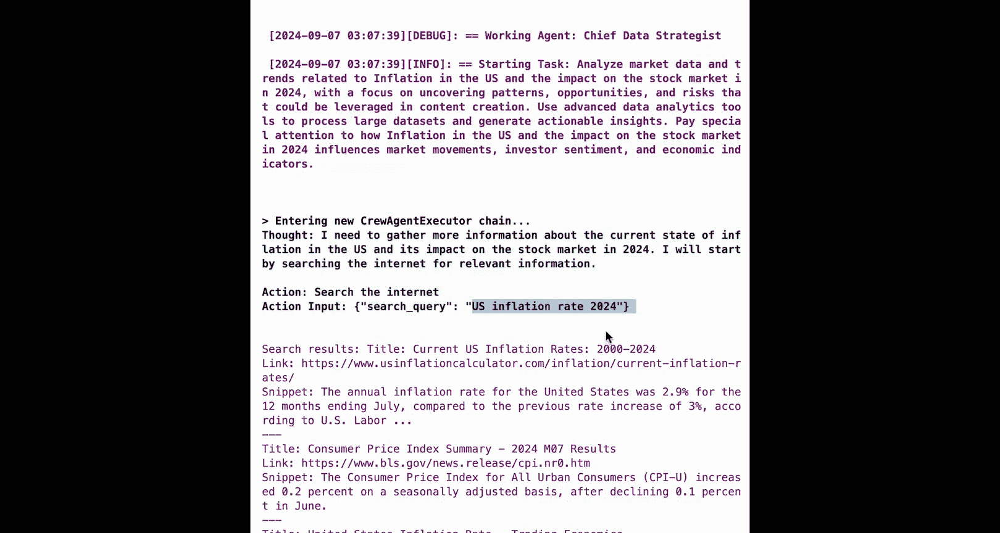

Now that our chief data strategist wrapped up its work。

 you can see that it gave a pretty long summary including what is the current state。

 the inflation rate， the stock market impact， and even key trends and opportunities and even risks Now we're going to have our content creators start to ride the blog materials and the social media posts around us。

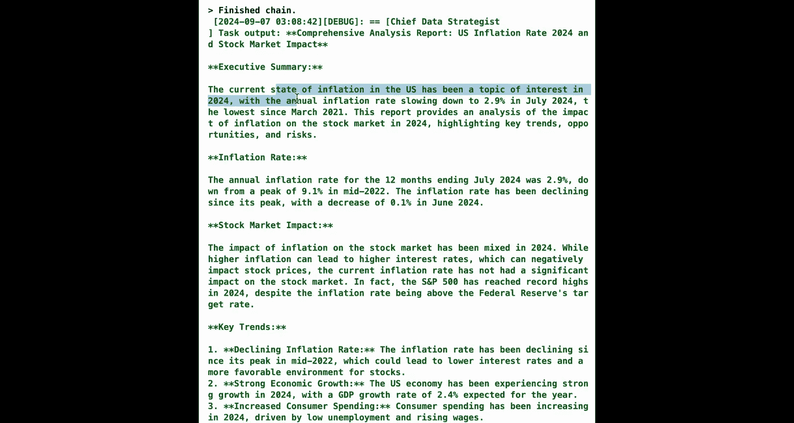

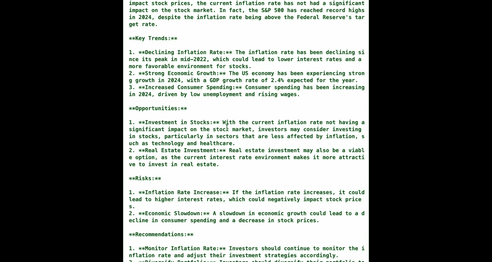

In here you can see our creative con director can like kick things off and based on the insights it's going to write the initial version of this blog post let's see how that turns out in here you can see that our agent does a search about the US inflation trends in 2024 and impact in the market analysis and it finds a lot of data throughout the web。

😊。

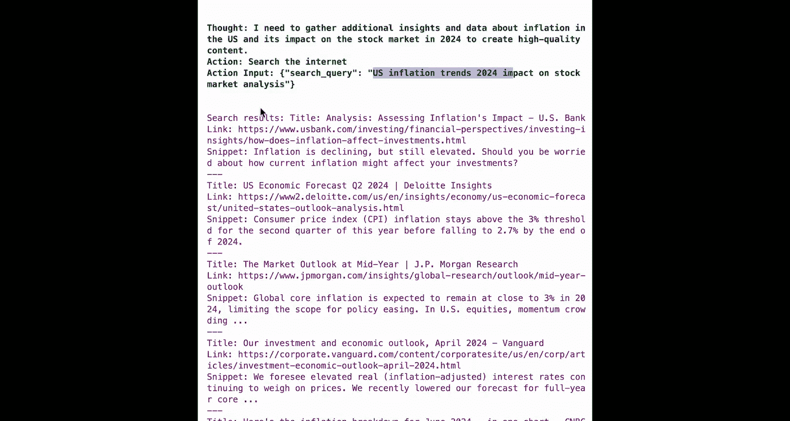

But then it doesn't stop there and decides to basically look into specific web page from theloitte in order understand the impacts of inflation in the United States and this is not only scraping the website this is using rag as a tool it's automatically download the content of this web page and then in banning it on the fly and pushing this into a Chromea Db so that you can actually search this so here you can actually see the content coming back only for the specific things that this agent actually cares about this is so interesting because your agent is basically doing RaG and building a V database on the fly。

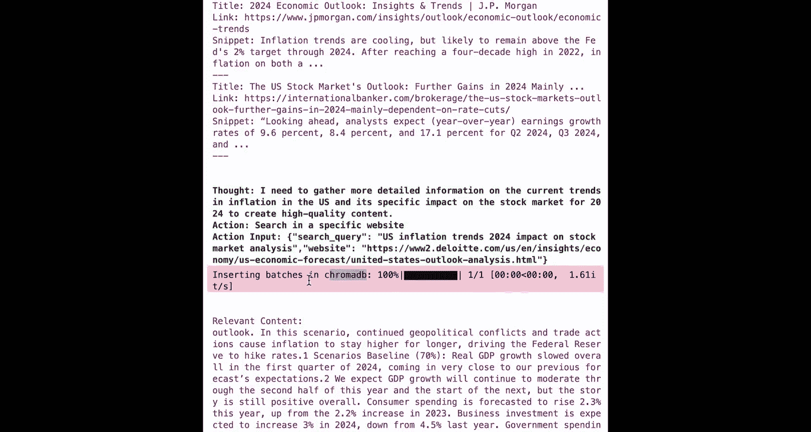

Let's keep going and see how this agent does。

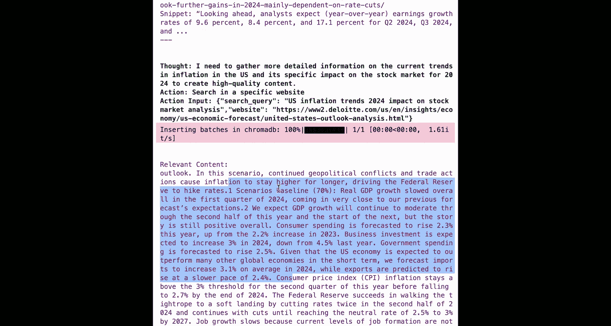

So here we can see that our final agent， the chief content officer。

 finalized reviewing the content and now gave us back an object that follows that content object that we created early in this lesson Now let's inspect it further so that we can see better what this article actually looks like。

Let's start by inspecting the social media content that this agent created for us。

In here you can see that it created what posts for Twitter， LinkedIn and Instagram。

 and you can see that it has emojis for Twitter and Instagram but no emojis for LinkedIn so this is a very interesting concept that these models can actually capture the understanding that LinkedIn is probably not as receptive for emojis as other social networks Now let's actually look at the blog post。

Another thing that's worth highlighting it here is that you can see that on the LinkedIn post there is very much a more professional tone than what you would see on the Instagram one and even on the Instagram1 you can see it mentioning to swipe up to read expert analysis so this is very much understanding that on Instagram we have certain dynamics on how people use this product compared to something like LinkedIn Now let's look at the actual content of the blog post。

All right， so I'm going to start by plotting this blog post as a markdown so that we can really read it and understand some of the impact in there。

And this is it， this is the inflation in the US and its impact on the stock market in 2024 blog post。

 it has initial introduction， it has a current state of inflation。

 it talks about the drivers for inflation， the project inflation moving forward implications and the impact on the stock market。

 even going into the shortterm and longterm considerations and doing some recommendations for investors out there so this is it this is where final blog post written by these agents for us and starting from one single very complex subject and then going around and researching the web to acquire betting understanding about the topic then doing RaG as a tool on specific web pages in order to gather the most important and relevant information out of them and then making sure that they write an amazing content and getting to review this content to make sure that it's rock solid。

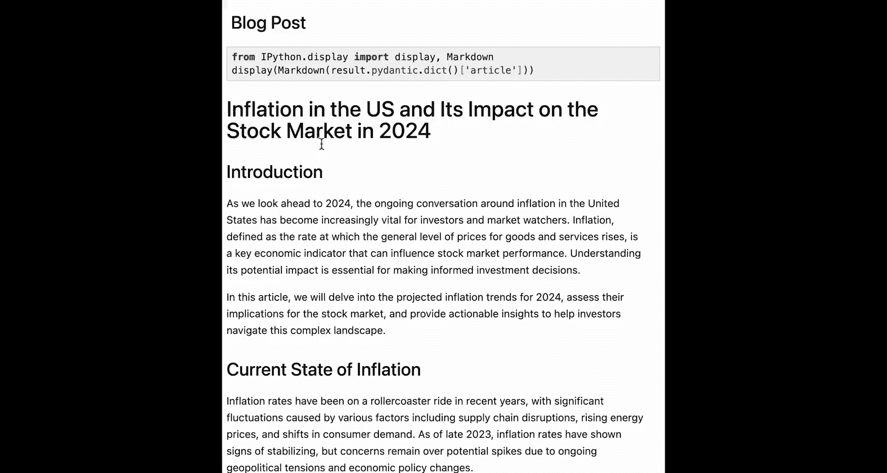

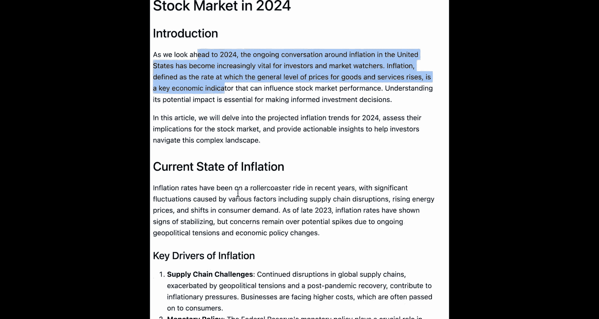

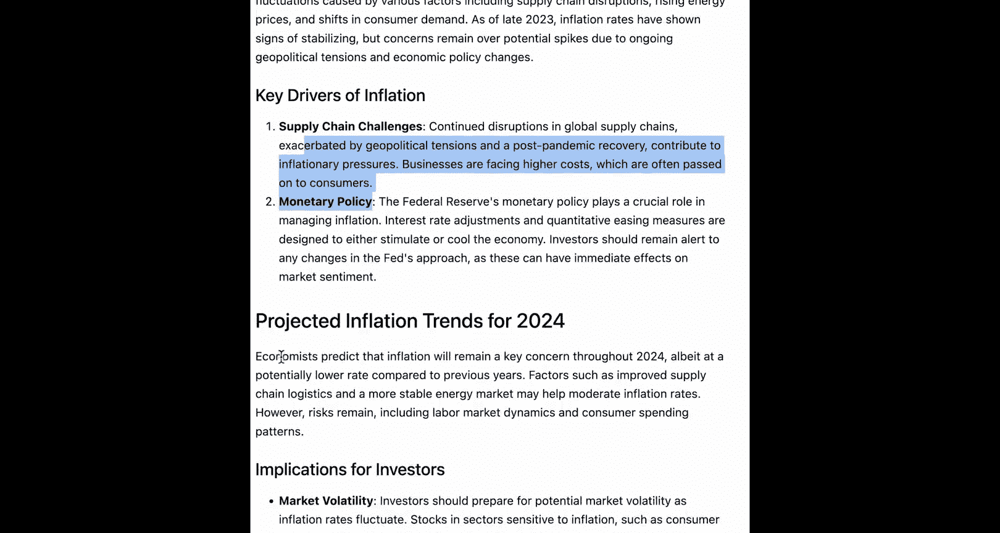

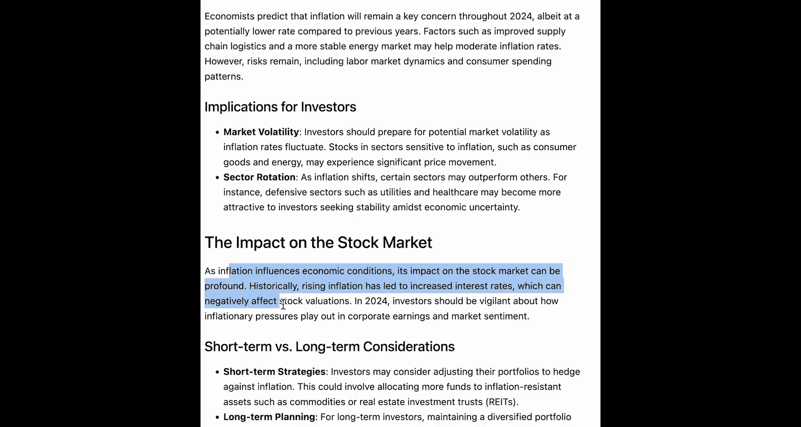

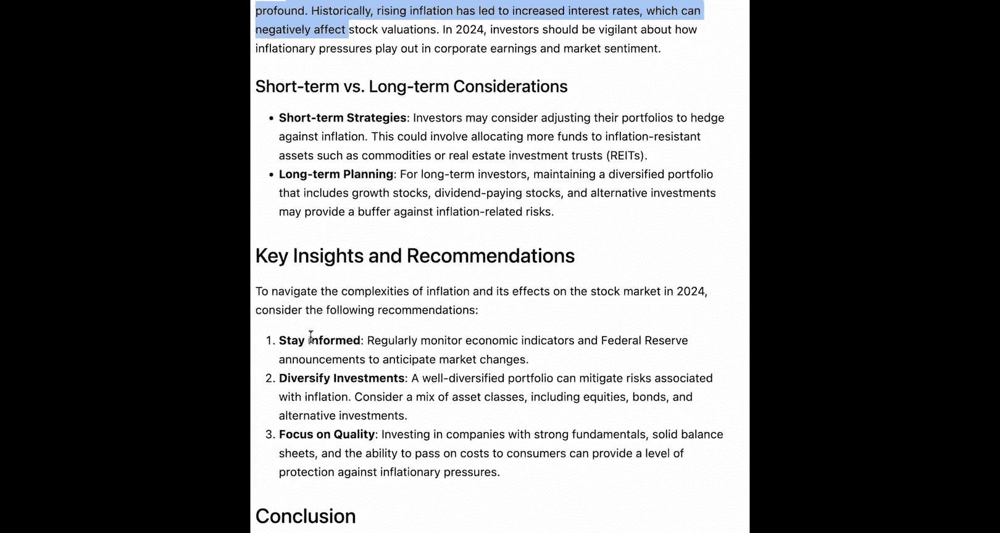

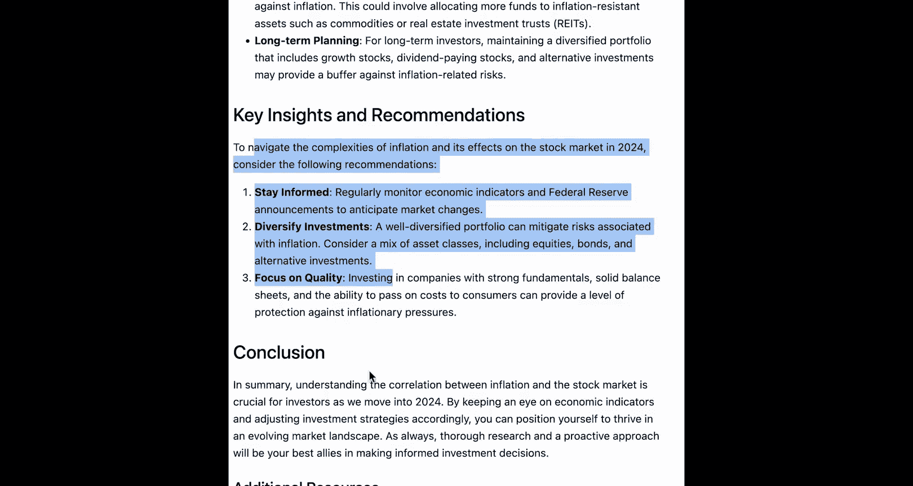

In here you can have a great use case and we have been seeing some customers and user of crew AI actually deploying these use cases for doing content marketing at a scale。

 So this unlock has a lot of use cases on how you could use this not only to produce content but using this different tools and this different models in order to boot interesting things yourself。

 remember that two of these four agents were running Yama 7 Tb using Rock and that's super fast。

 So you can have a few agents that are going be optimizeized for speed they' are going to be using models like this and providers like Rock and other agents are going be using bigger models like in the case offer content writer agents that were using chat GT This was a very interesting lesson I hope you're having a lot of fun at least as much fun as I am Now let's jump in the next one and start talk about more use cases。

 I'm gonna see you that in a few seconds。😊。

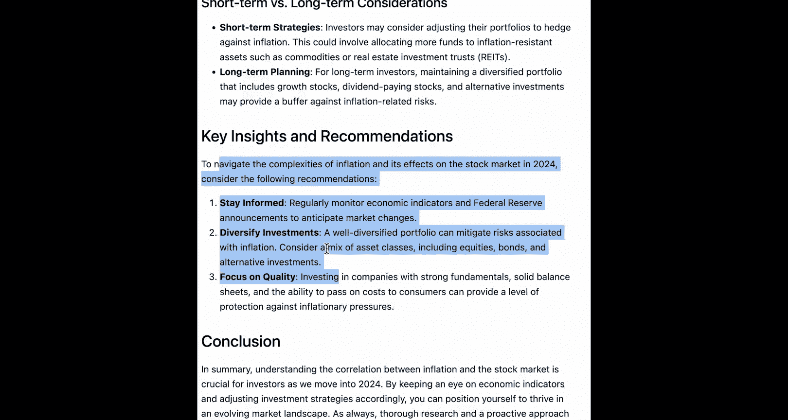