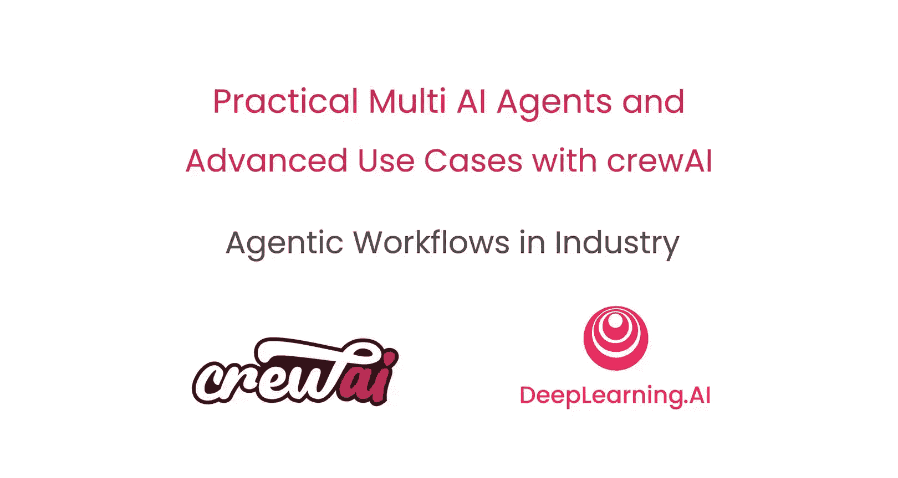

# 吴恩达《多AI智能体实践与高级应用课程Practical Multi AI Agents and Advanced Use Cases with crewAI》 - P12：12.workflow.zh_en - GPT中英字幕课程资源 - BV1fgySYsE5y

This has been so much fun。 We learned so much already。 But now let's talk about how you deploy。

 how you monitor and what is the value， What are the return of executing the screws in a production environment。

 I'm so excited because in this lesson， we're gonna have a special guest。

 an industry expert working from a bigger enterprise。

 It's going to come in and answer a bunch of questions on how they are using crew AI and how they are building moy agent systems and what is the value that that is unlocking for them。

 So let's look into that。😊，So here I have Jacob to share with you all details about taking Gentech workflows into real industry use cases。

 Jacob is the commercial GenAI CTTO at PwC and I'm blown away with a lot of you folks have been doing PwCs kind of like lean the industry and doing so much with AI and AI agents I'm looking forward to chatting with you today Yeah super excited to be here and really look forward to all the fun conversations around agents so Jacob what were the main challenges that land PwC to explore AI agents as a solution like how did this problems shape your approach to adopting this technology Yeah you know when we started our Gen AI transformation two years ago obviously there weren't a lot of agent frameworks just kind of laying around and the technology was still pretty nascent So at that time we started with our own proprietary plug development framework and that kind of got us going down a path but obviously the technology evolves the complexity of the use cases evolve we kind of need to take a step back and see。

You know what else we can be doing to kind of optimize the accuracy and kind of the overall user experience of our solutions？

Got it that makes a lot of sense Well after that， one were the key factors that kind of convinced you that AI agents were the right approach for your needs Yeah。

 I think like I was mentioned it all comes down to accuracy and user experiences。

 I think you know when we started with our initial solutions around kind of the software development lifecycle transformation and you know generating long complex documents for functional specifications。

 technical specifications， these are really longrun processes and you know the feedback from our consultants was you know we need to provide more realtime feedback and at that point。

 you know that's where we're like， okay this is like time for agents we need to have kind of more realtime feedback and getting the feedback incorporate into the solutions and going through numerous rounds of validation to get to the right outcomes。

That makes a lot of sense。 Yes， I think like it' honestly there's so much options nowadays that you really want to think this true and like how you want to build this agents and make sure that you're bringing a good experience as a follow web。

 how did crew AI specifically helping addresscing this problems and what a role did the platform play in your strategy Yeah great question you know I think for us obviously not everyone who's working on Genenana was born and agent expert and so there's a lot of barriers to entry I would say in terms of using an agent framework to help with more complex use cases I think the nice thing about career AI is very low barrier to entry and helping anyone kind of really jump in and get handson and starting to create an agents but also for the more sophisticated developers or data scientists you also have the flexibility to kind of get into the lower level APIs and really customize it the way that you need it So I think that's been the power of career AI is really the low barrier to entry and。

So the flexibility to kind of customize as much as you need nice those are great points and yeah。

 I can tell from the team in the career I that really try to make it things like simple for people to pick it up on so it's great to hear that that is coming through。

😊，And in your experience， what have been the most significant indirect benefits of deploying AI agents at PwC compared to kind of like the direct outcomes that you initially were aiming for Yeah I think what's kind of come indirectly was transparency into the process if you look at what we're trying to do in broader kind of transformation across our businesses。

 it's a lot of different things that we're trying to analyze and monitor in terms of how we're driving efficiency gains and return on investment you know are we getting the outcomes you know from the investment dollars were putting in so with crew AI and the native integration with the agent monitoring tools。

 you really get that kind of direct visibility and you can see you know how long it's taking the agents to complete the task what tools they're selecting as part of that process and we can really analyze at a detail level in the data you know how much time is taking agents versus our consultants to complete a process which helps us。

I'll explain the ROI That's so good I think you mentioned the key word that ROI。

 I think in the end of the day， when you think about this AI kind of revolution and trend。

 it's funny to see how this can have direct impact to the bottom line from sometimes day zero。

So what early resultss or impacts have you seen from deploying these AI agents in your operations have the resultss met or exceeded your expectations in some way Yeah。

 great question I think one of the main use cases around code generation if you look at a lot of the large systems that we implement for clients there's a lot of proprietary development languages that we're dealing with whether it's OO apex go through like you name it like all these derivatives from Java So when when we started kind of pre-agent workflow I would say you know were getting hit or missed results know in some cases we were as low as 10% on the overall accuracy of the code generation but as we started to involve agents。

 we got more realtime validation of code with agents。

 also agent execution of code and real runtime environments and analyzing log output and feedback to generate better code and better outcomes so in those cases we jumped from like a 10% accuracy。

to a 70% plus accuracy on cogeneration with agents and leveraging crew AI that's a lot。

70% is a big number I like that what have been the main obstacles and challenges that PWC faced implementing this AI agents that scale because I know there are some challenges that come with that too Yeah I think obviously there's all the technology scale problems that you deal with and Gen AI solutions and technology solutions overall but I think as you look at agents specifically it's one of the benefits with career AI is you can anybody can create agents and it's very easy to jump in the harder part is how do I drive standards around the agents I'm creating。

 how do I get reuse out of the agents I'm creating across like for example。

 the cogeneration use cases， how do I create a consistent foundation and pipeline for cogeneration but then yet only kind of tweak the things that are needed to go from one proprietary language to another so I think it's really been。

More about those development patterns the standardization to really kind of optimize you know how were creating these agents and getting the reuse out of agents across multiple use cases Yeah。

 I think like in the end of the day， like any technology it bo us down to experimentation。

 get your hands dirty a little bit。AndAnd how did the transition from kind of like testing this agents to actually running them in the production environment differ like were there any unexpected hurdles or lessons that you learn doing this transition or any specific features that help do with that Yeah you know obviously like you still whether it's traditional AI or now Gen AI you still have some of the core infrastructure problems that you stay up to deal with technically right and then obviously with Gen AI you have all the token limits。

 the rate throtling all that stuff as you have agents working together you need to monitor that stuff more closely So that's kind of one thing but then would say honestly the harder part is the change management。

 the human workforce element and once you get these technology solutions developed how do you actually drive the change and adoption and get people used to working you know with agents in that day-to-day workflow and business process that's we've been spending a lot of our time lately and just really the change management aspects around this that it makes a lot of sense Yeah it's a different mentality and framework。

That people need to kind of like embrace kind of like getting promoted to manage agents in a way。

And looking back on the PWC's journey with AI agents。

 what do you see was the most like critical factor for success Yeah I think like I said earlier。

 all about accuracy and user experience if we're not driving the right accuracy we're not driving the right user experience。

 trust is lost pretty quickly and if we lose that trust upfront in the process it's a lot harder to gain it back so that's where we're really focusing on you know in terms of just using the agents to drive better accuracy。

 better experience with our overall Gen AI solutions 100% can agree more and based on your experience。

 what a advice would offer to developers that other companies or enterprises they're considering adopting AI agents and this technology Yeah great question I think with all things technology start simple and then increased complexity as you go so kind of the old adage of crawl walk。

 run right。sure you kind of start off simple， you know some of the kind of the basic prompt engineering use of RA pipelines。

 things like that and trying to see what gaps you need to solve from there。

 and then with those larger gaps and kind of more complexities。

 that's where the agent frameworks and tools like Korea can definitely come in and help close those gaps and make sure you're driving that higher accuracy and better user experience。

I love that Jacob thank you so much it was great to have you here and it's great to partner with PWC on all this Ab thank you。

Thank you， thank you。