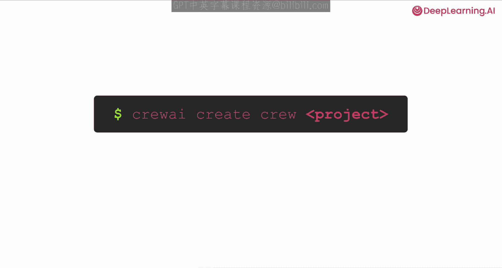
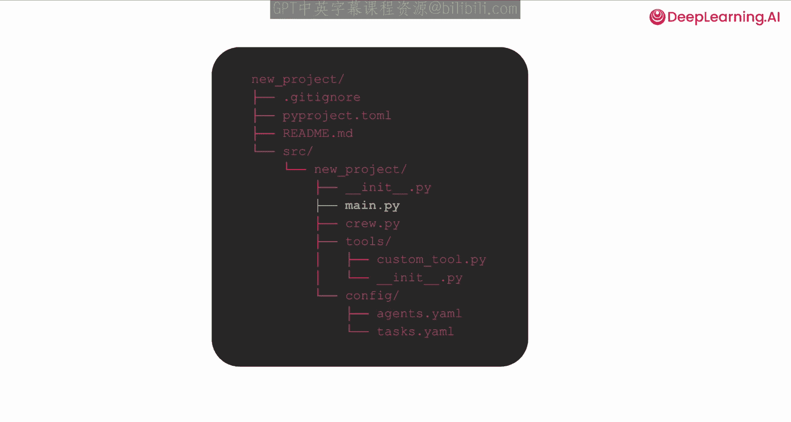
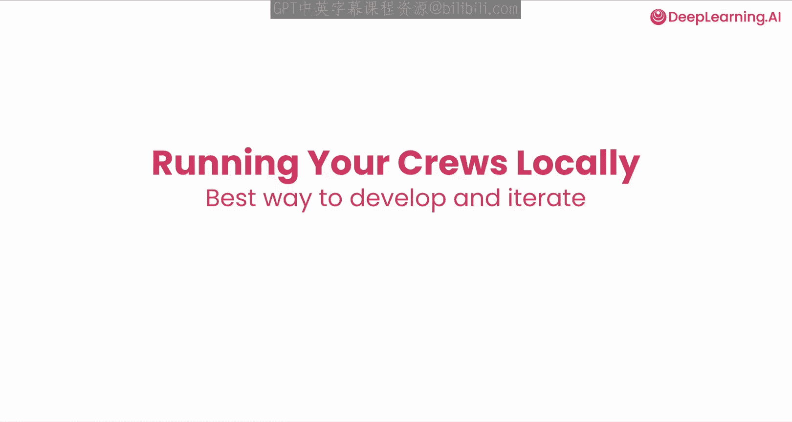
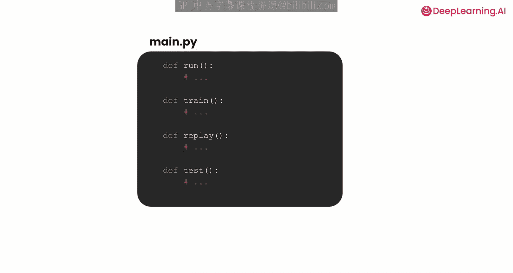
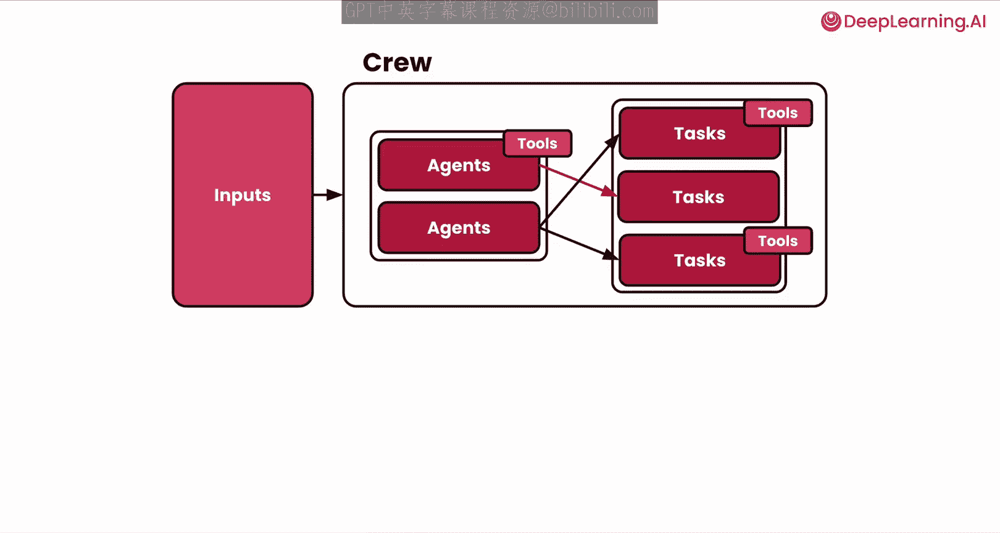
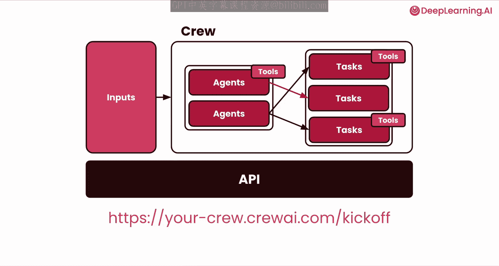
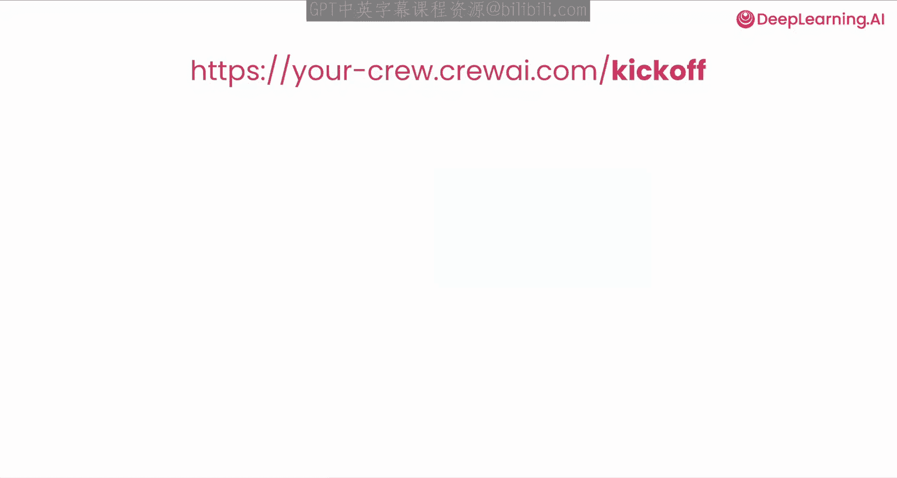
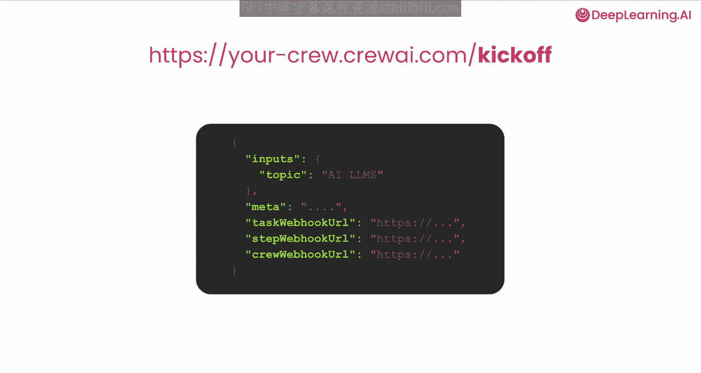
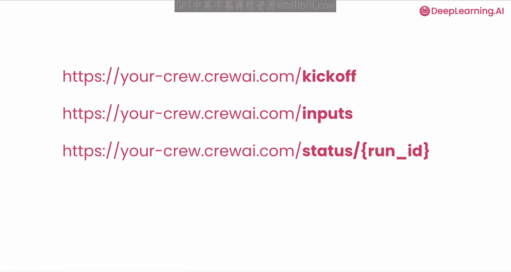

# 吴恩达《多AI智能体实践与高级应用课程Practical Multi AI Agents and Advanced Use Cases with crewAI》 - P13：13.deploy.zh_en - GPT中英字幕课程资源 - BV1fgySYsE5y

I'm so happy we learned so much so far， but let's talk about how you deploy this crew。

 how you monitor this crew， what is the value that it can bring for you。

 for your team and for your company Once that you're actually deploying those things in a production environment。

 So in this lesson， you will learn everything about how you actually bring the systems into production。

 let's look into that。😊，This lesson is super exciting because in this lesson you're going to learn how to generate。

 deploy and integrate crews， we're going to dive on how you can actually start a crew from the scratch。

Up to this point， we are talking about reading these cruise and how to run them into a Jupyter notebook。

 but now you're going to dive and build a crew from the G go。So so far。

 all you had to do is basically execute these different cells in the Gter Note。

 but you'll probably wonder how do we come from this and to actually start a brand new crew？Well。

 we offer a very simple CLI that allows you to start a new project with one single line。

 and that is crew A I create C。You just give it a project name and that will automatically create all the folder structures for your project。

Let's talk about some of these files。You're going to have a readme file with all the instructions。

 so feel free to check that up and find information about how you can install your dependencies。

 how you can run your code， where your environment variables will leave and everything there is to know about your project。

We will also have your classic agents and tasks YaO files。

 the same way that we have been buildinging them on all the Jupyter notebooks so far。

Feel free to inspect them and change them in order to create specific agents and tasks。

You also have a folder for custom tools， you know any integration similar to the ones that we have done in other lessons。

 so if you have an internal integration or external integration。

 this is where you can build and put your code in order to call this APIs or connect the databases or any other systems out there and then we have your crew file where all your agents and tasks are brought together and you can basically create your agents by loading the agents file and the tasks file it's very similar to the way that we have been doing on our Jupyter notebook so far this is where you can import specific tools custom or not and give these tools to your agents。

And then we have the main dot Pi file， this a file that is used only to run your crew locally。

 is through this file that you can actually execute this crew。

 train it and test it in all the other features that we have seen so far。

Now， the first thing that you want to do is make sure that you're installing your dependencies and by that you're going to need to run C AI install that will automatically download any dependencies that your project has and make sure that it creates a virtual environment for you。

So make sure to execute this before you start actually running and modifying EarthR。

Once that year have your dependencies installed， you're probably wondering how do I run my crew locally。

 What is the best way for me to develop and integrateerate over my tasks and agents and making sure that every fingers working like a charm。

 Well， remember that main file that we just talked about。

 This main pifi is' going to have a few functions that you really want to look into you're going to have a run function。

 So whenever you run crew a I run， this is the function that is going be executed。

 this is usually very barer plate and you don't need to change much other than maybe modify the inputs for your crew。

😊。

You also have similar functions for training， replay， and task。

 and you can use all the different functions using your CLI by when queryI train。

 queryI Re or Cr AI task。The main command that you're going to be using is C A I read。

 that is the command that actually executes your crew for you。😊。

But now that you can run this crew locally and you can modify your agents and your tasks。

 creating the custom tube to integrate with this other internal and external systems。

 how you go about bringing this into production so that you can actually talk with other services and things that you can use。

And that's where we need to talk about deploying your crews and how you bring them into a production environment。

Well， we already know that you have everything executing on your environment。

 so in order for you to bring this crew into production。

 Cr AI also gives you crew AI plus and you can use this for free All you got to do is when crew AI deploy that'll allow you to deploy your agents into the cloud What happens is pretty magical。

 If you think about your crew You already know that you have your agents your tasks and tools and you already know that you have a series of inputs that will be interpolated into this agents and tasks in order for them to get work done。

 with crew AI deploy it automatically turns your crew into an API。

 So now you can actually call an actual endpoint and you can pass your inputs sending a post request to that endpoint。

😊。

This will allow you to integrate your crews with anything that you want out there。

 so let's talk about integrating crews and how you can share it with others。😊。

Now that you have a production crew that is actually an API that you can call。

 you can integrate it with any systems out there。 so you can call it from Slack。

 you can call it from Hubpot， you can call it from Zaper or you can call it from any other system that you might have and then the funniest part is that this crew can actually call all your systems back。

 either by using a pooling feature or web hooks that can call back any URL or applications that you want。

 This is the endpoint that you're gonna call when you have your API。

 It's basically a kickoff endpoint where you can send so much detail to it。 you can send the inputs。

 the inputs that your crew actually expect So whatever it is in this case where just passing one single input and that is topic and this topic is gonna be interpolated throughout the agents and tasks because that was our crew use case you can also pass metadata in case you want。

😊。

Add any information back and then you can set specific web hooks for whenever a task is completed for whenever a step is completed or for whenever a crew is completed that gives you a lot of granularity on how often you're gonna have your crew called any other system that you have allowing you to do things kind of like a timeline or any other kind of UI that you might require in order to show progress off our crew and integrate this with any system out there and we don't stop here。

 you have so many other endpoints you also have an inputs endpoint and a status endpoint that you can use in order to pull information on how your crew is performing in what your agents is doing This unlock so many opportunities and it's so exciting because now you're not only running this crews locally you can actually integrate that with any other system that you have out there you can share with your peers you can integrate that with your existing company you can。

Great data with another softer， you can hook it up with messaging systems， whatever you want。

 This allows you to bring your agents where they're gonna be the most valuable and we're seeing companies do this through while the internet Now let's dip into the injectter notebook where you're going create your first crew from the scratch we're going create the crew install the depends and execute it ourselves and you're gonna to be able to play around with it and change the agents and the tasks in any way that you would like I you see there in a second。

