# 吴恩达《多AI智能体实践与高级应用课程Practical Multi AI Agents and Advanced Use Cases with crewAI》 - P14：14.L6 Building Your Crew for Production.zh_en - GPT中英字幕课程资源 - BV1fgySYsE5y

Before you go into the Jupyter Note and rebuild build our blog post crew in production。

 let's talk about what we will do there because this is slightly different from what you have done in other Jupyter notebooks。

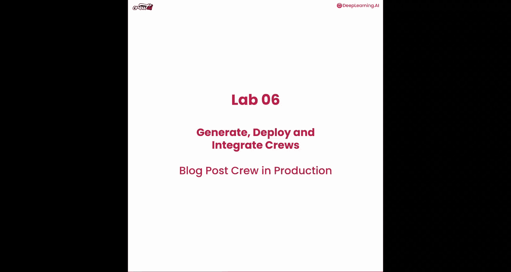

This one you're going to create your first crew from the scratch。

 This means that you're going to start by using the CI to create a new crew。

 Then you're going to understand the file structure that we're going to have there。

 You then install all the required depends that we have and then we're going to be able to execute our crew。

 Now let's jump into the Jupyter notebook and see how we're going to build our crew from the get go Let's do it right now。

😊。

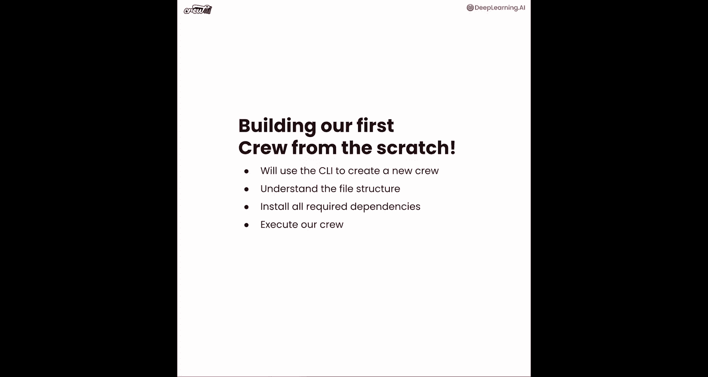

So let's start by importing or initial classes for this one。

 you're going to notice that we are not importloring the Creite classes because we are going to create a crew from the scratch using the CLI。

 we are still loading our environment variables though to make sure that we have everything that we need in order to execute this group。

Now let's start by creating our project creating our project is as simple as running one single CLI command called C AI createreate C and then we pass a name for our project for this one we can call it new project so let's execute this。

So you can see that we already got our initial folder created and all the different files that we need are ready within it。

 We have a Ryme file。 We have a Gikinor， we have a pro project file that holds all of our dependencies references。

 We also can see our main files or crew files and even accustomed to example。

 including the agents and task yal。 So our project is ready to go。 Now。

 let's install our dependencies to make sure that our environments ready to execute this crew。😊。

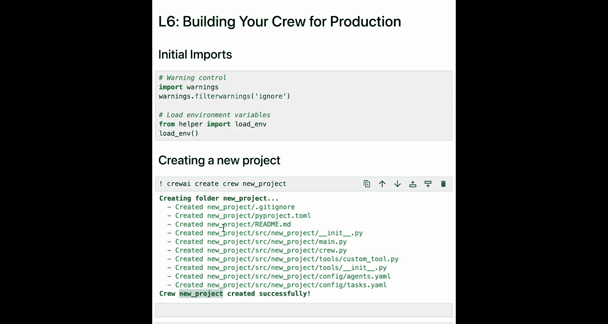

Installing your dependencies is very straightforward All you got to do is run Cr AI install in your terminal or come in line。

 so let's go ahead and do that。

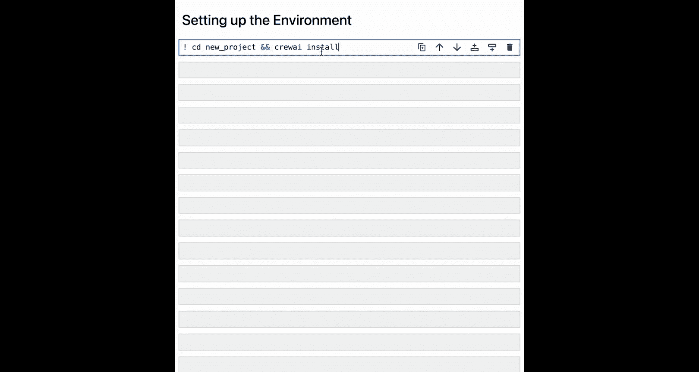

Now that we run crew AI install， you can see that it installed all of our dependencies。

 everything is already installed and set up and this crew should be ready to go。

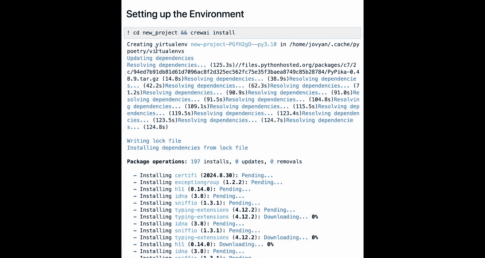

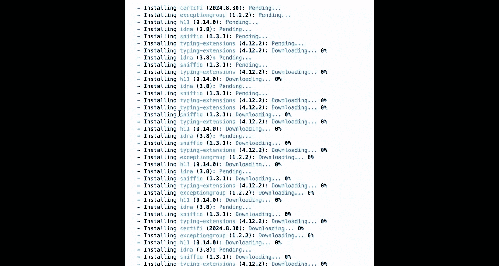

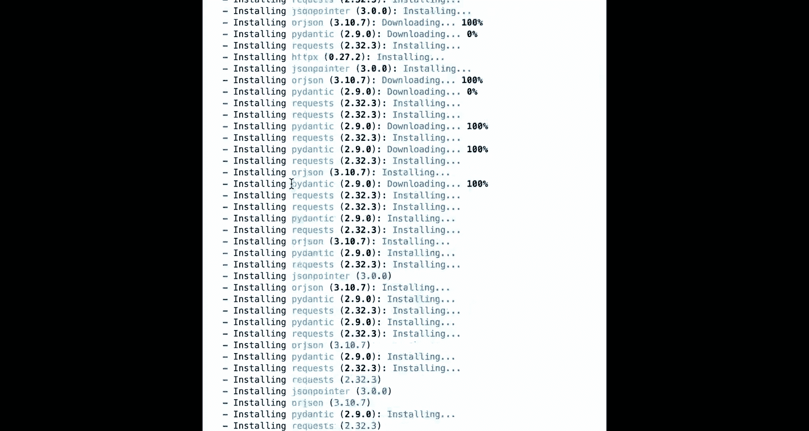

So this might take some time， but now all our dependencies are already installed and we are ready to execute this crew。

 Usually we need to be mindful of adding our environment variables。

 remember that we can be using a lot of different providers here， different models。

 and you want to make sure that we set the right keys for this。

 there is a dot in file within our project or we can put any keys that we would look like for executing this in the Jupyter notebook。

 you don't have to worry about it because all dependencies are already being injected for you but this would be very interesting in case you're building it on your own terminal or your own computer。

 So now let's execute our crew。😊，For us to run our crew。

 all we got to do is execute crew AI R and once that we do it。

 we're going to see the logs of our agents working as usual， so let's do it。

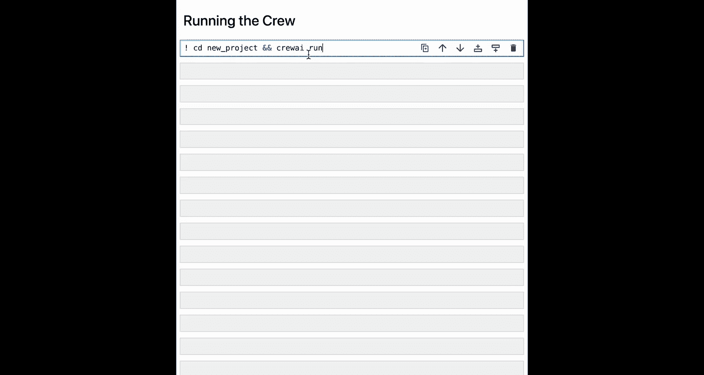

Executing our crew for the first time might take a while because this is running now on a virtual environment。

 but you can see our agents working task by tasks。From the Gto when you're creating a crew from the scratch。

 it already come with a couple agents and a couple tasks just for you to get a fill on how to build some yourself。

 and this is a simple blog creation crew where you start with a senior data researcher that is going to research content and then you pass it on for a blog content writer that will actually write the content as you can see right in here with the reporting analyst。

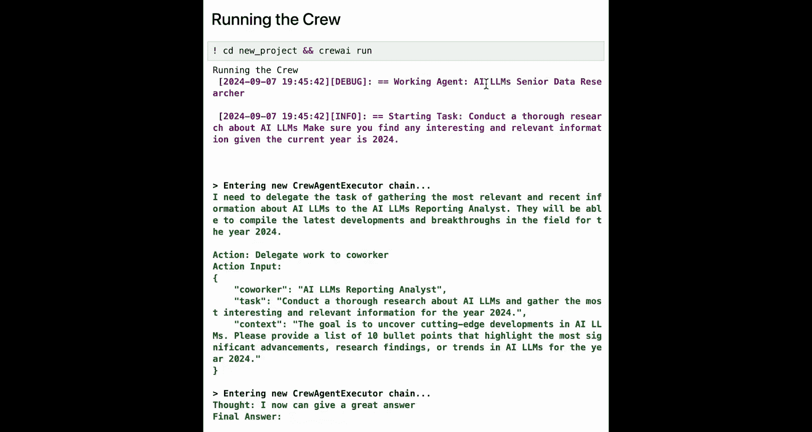

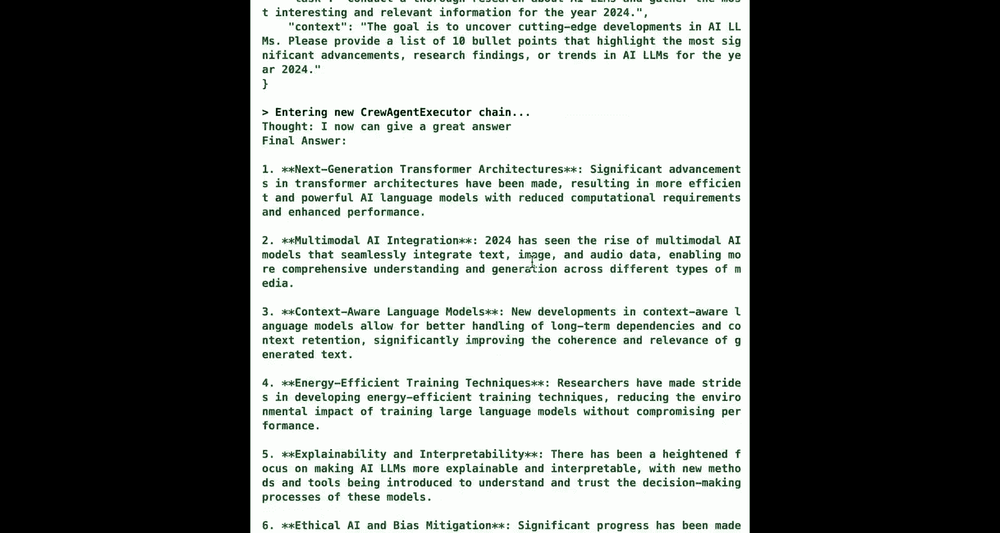

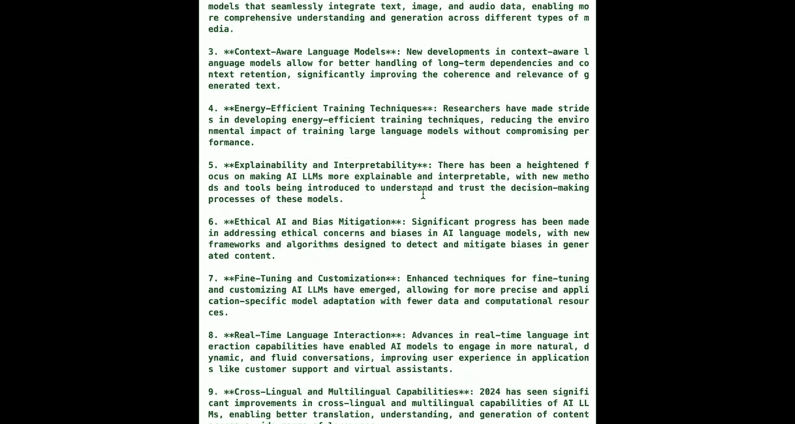

So this is a very simple crew that basically do the research and then after that writes some content in our report about it now that we learned about this。

 you got a sense on how do we start your crew yourself you can go in your terminal and just start building crews and you're going to be able to have your dependencies you're going to be able to push them to GitHub you're going to be able to share them with your friends and you're going to be able to execute them yourself and this is very powerful because you don't need to be building crews in the context of a Jupyter notebook and this makes so much easier for you to get started with them。

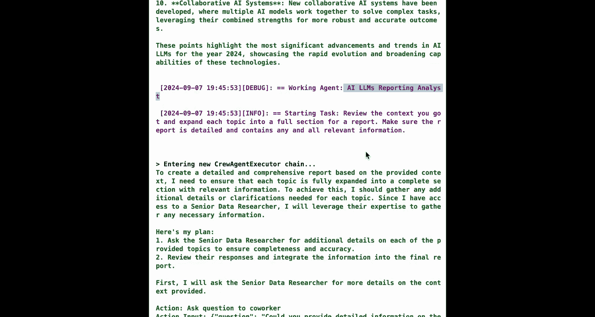

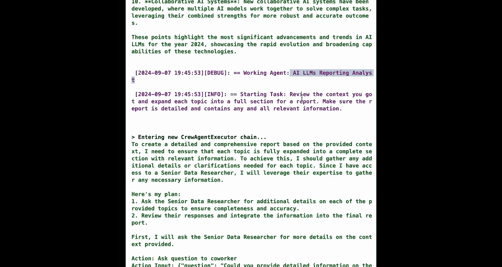

And the coolest part is that you can also use a command line interface to create flows as well。

 If you want to create a flow。 it's very similar to the crew。

 all youve gotta do is type crewing I create flow in the name of your flow。

 and that will set up the initial architecture after your flow for you。

 creating a folder in everything that you need。 Now。

 let's take a look at the files that got created for us。

 You can see that the initial structure is very simple and very similar to the crew But if you look into the actual flow folder。

 you now have a cruise folder that allows you to have as many crews as you want to have in there and then use them in your main dot pi。

 that is your actual flow code。 You also have a tools folder where you can put any custom tools that you want。

 This is very interesting and show how you can also use the same strategy to create flows if you want to。

😊，You can see how powerful this is you now cannot only build a crew from scratch and understand everything that is going on with it。

 you can create your agent， you can create your tasks and you can also deploy this and now that you have this as an API you can use its endpoints and web hooks to actually connect this with any existing applications that you have you can kick things off from slacklack you can kick things off from your other systems and you can get this information back and push it anywhere that you need。

 this is how you can now bring the power of mootyag systems into a production setting where you can actually integrate this with any of the applications that you have out there and this is so much valuable I hope that you had a lot of fun in this class because I know that I did you can build so much Now let's jump into the conclusion。

😊。

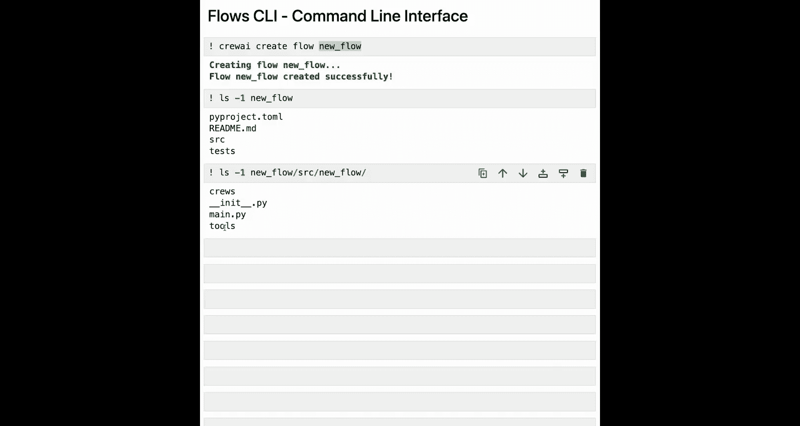