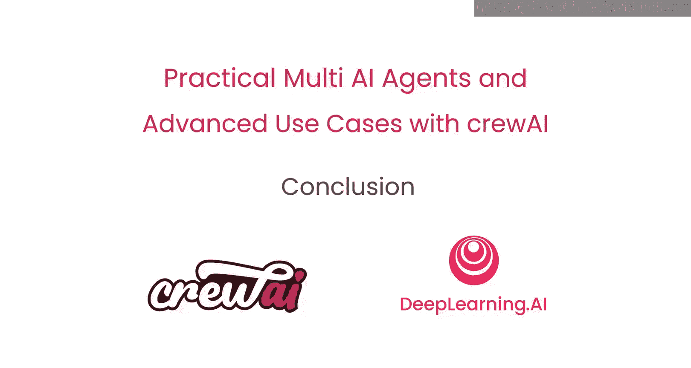

# 吴恩达《多AI智能体实践与高级应用课程Practical Multi AI Agents and Advanced Use Cases with crewAI》 - P15：15.conclusion.zh_en - GPT中英字幕课程资源 - BV1fgySYsE5y

Congratulations on completing this course you learn so many different things。

 You learn what are the building blocks of AI agent systems， how you create agents。

 how you create tasks， how you create crews you learned about how to integrate them with internal and external systems。

 you also learned how to make them run in conjunction。

 how you get multiple crews to work together and we talk about how you deploy this。

 how you monitor how you train and how you test in it was a lot of fun and we covered so much I'm looking forward to see what you are going to be able to build on your own now so make sure to go out there and spread the word on how you can build AI agents。

😊。