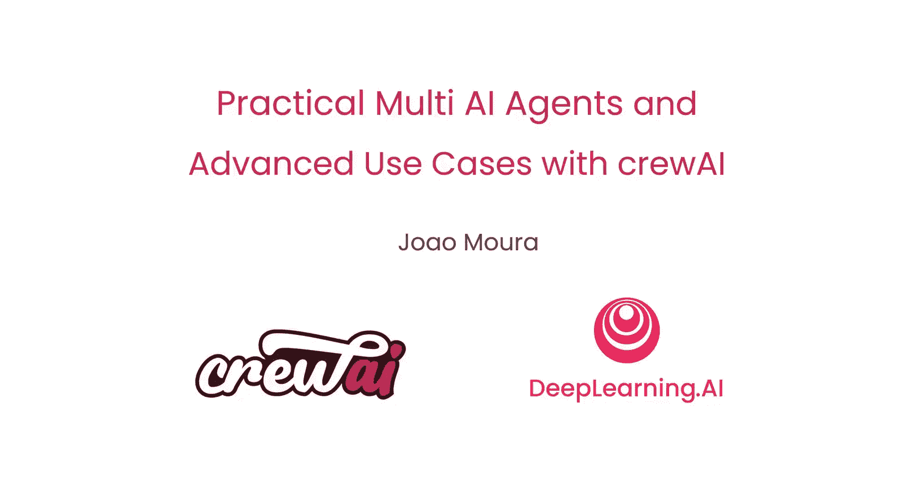
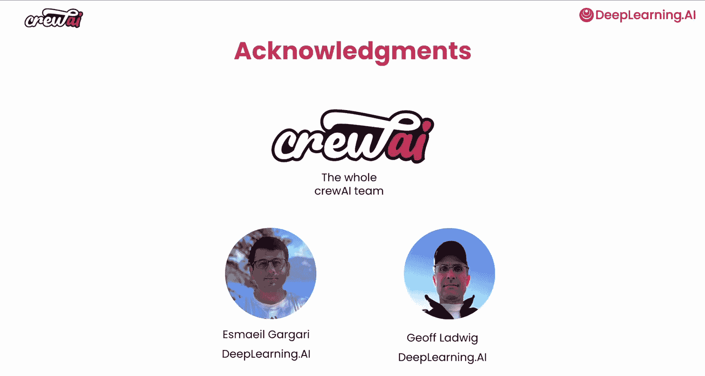

# 吴恩达《多AI智能体实践与高级应用课程Practical Multi AI Agents and Advanced Use Cases with crewAI》 - P1：1.intro.zh_en - GPT中英字幕课程资源 - BV1fgySYsE5y

Welcome to practical multi AI agents and Adv use cases with C AI。This is a very practical course。

 meaning you hear about and learn how to build yourself agent systems that aren't just shiny technology。

 but they can be deployed and create real value in application settings right now。

 multiaiI agents systems involve multiple AI agents working together to achieve complex tasks by collaborating。

 delegating and sharing information。If you took the previous multiaiI agent systems course。

 you learned that multipleag can be created each with specific tasks or roles。

 and these agents can collaborate to perform complex workflows In this course。

 you learn how to build agentbased apps for even more advanced use cases and you see numerous real use cases based on what people are actually doing in practice when you're building multi-agent applications a key challenge is balancing the speed and quality of results while also maintaining consistency different model choices and sizes can impact these factors In this course。

 you learn to rigorously test your application by measuring key metrics that you can then use to keep on driving further improvements。

 you also learn to train your agents using human feedback to keep on improving your application over time。

 It's my pleasure to be here with Joe Moura with founder of QAI and Joe will be your instructor for this course。

Jod also taught the previous course on multiaiI agent systems。 Welcome back。 Thank you so much。

 It's so good to be back here with you。 And with this new practical course on multiag systems we're seeing so many companies building multiag AI applications running and aggregate tens of millions of agents using query AI and creating more complex agent workflows that involve multiple agents working parallel multiple crews as well and doing so much rigorous performance testing and training apps C in the previous course you had explained and demonstrated the basic building blocks of multiagent systems。

 things like how agents can work together on the tasks how they can use tools how you can build some really cool applications with relatively few lines code。

 maybe you can say a bit about what learners can look forward to in this course Sure we will start with a quick review of agenda systems。

 you will then learn how to。😊，G your moT agent automation with internal and external systems This enables your app to perform actions like query internal data。

 calling existing systems， sending emails and so much more。Next。

 you will learn how to create a variety of crew setups from sequential to parallel and anything in between。

 including a few hybrid setups。 you will learn how to run tasks and parallel and also how to connect multiple crews in the pipeline then we will look at how you can optimize the performance of your moyag systems using task and training methods。

 After that， you will learn how to create crews that employ multiple different LLM models to complete a task。

 For example， you could have a researcher agent using a smaller and faster model for a relatively simple task in a writer agent using a large model that has been fine tuned to reflect your company's brand voice I will be referring to this as a moymod approach that lets you mix and match multiple LLM models based on the task at hand which can help you build a more efficient and customize AI system。

😊，Many people have worked to create this course I'd like to thank the whole true AI team and from Deep Bile AI Eb Gagari and Jeff Ladwig have also contributed to this course This course is going to be a lot of fun you will build several Pra Coabs like an automated project planning lead scoring and engagement automation support data analysis and content creation at scale I've really enjoyed using true AI myself and I'm confident that you will too Let's go into the next video to get started。

