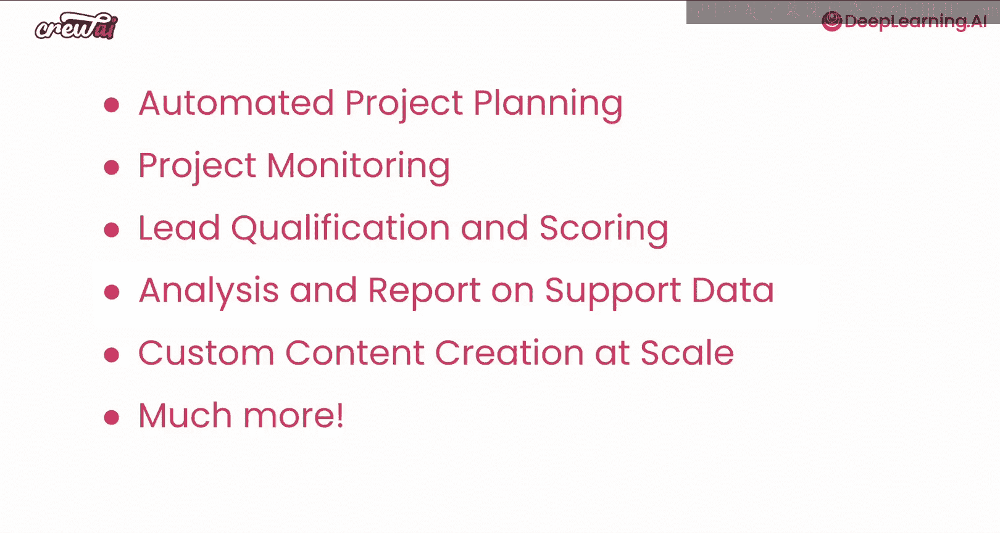
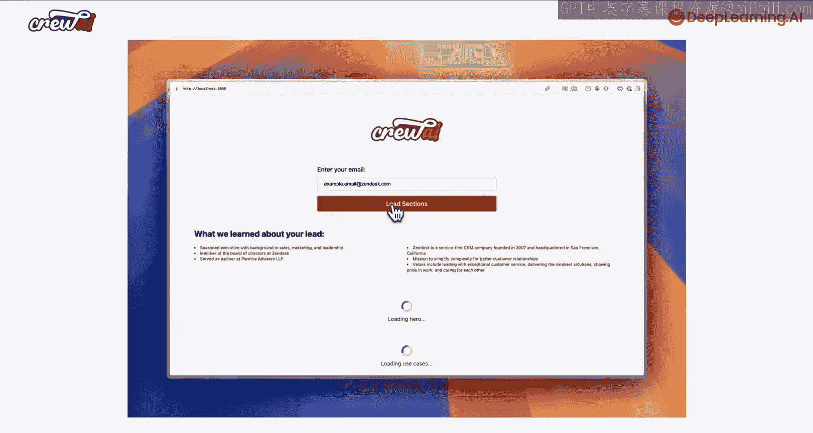
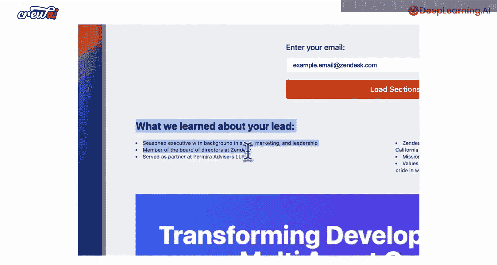
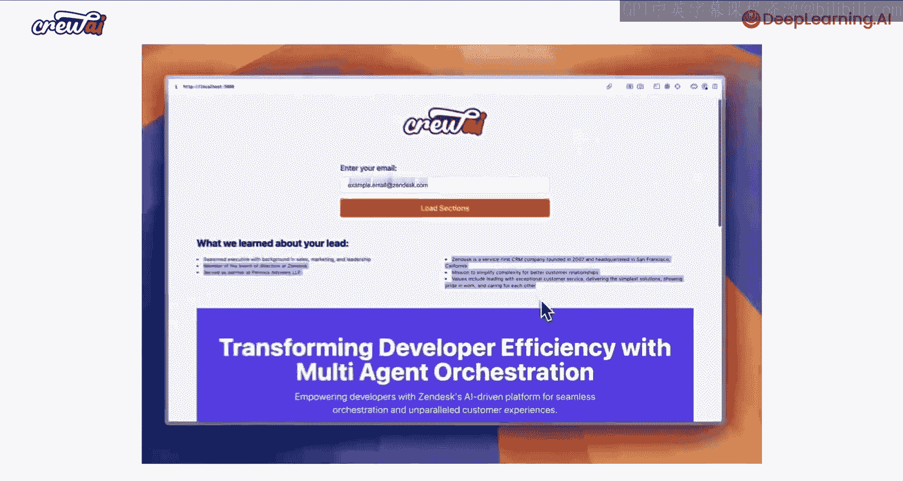
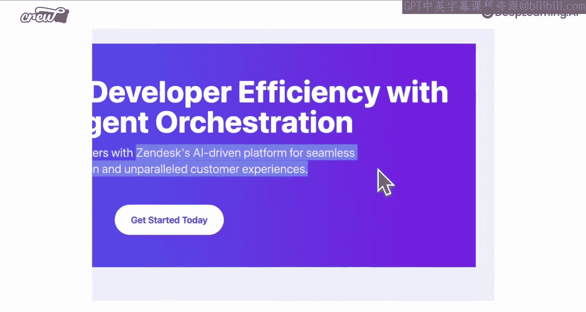
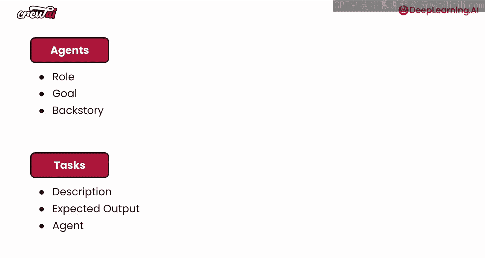
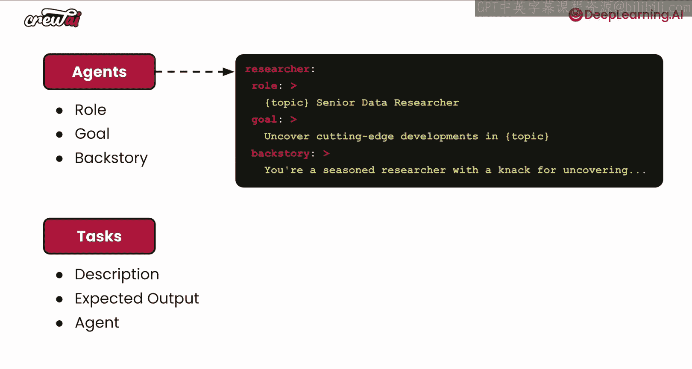
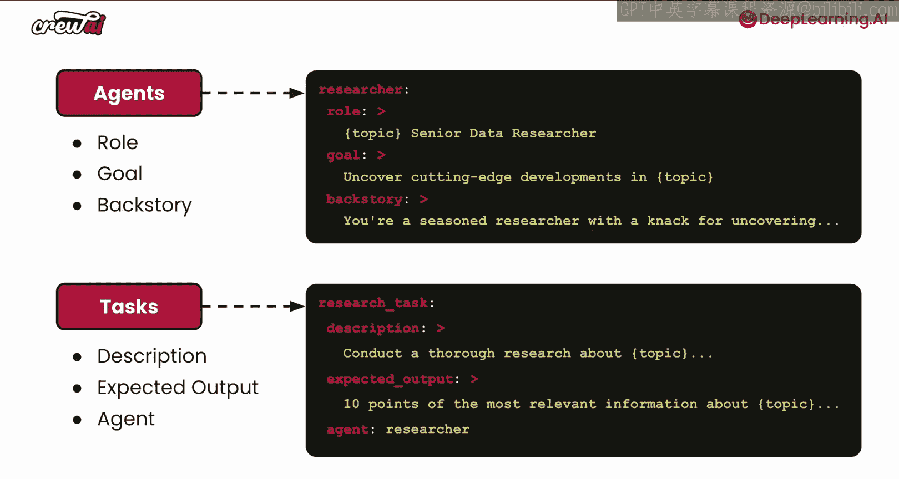
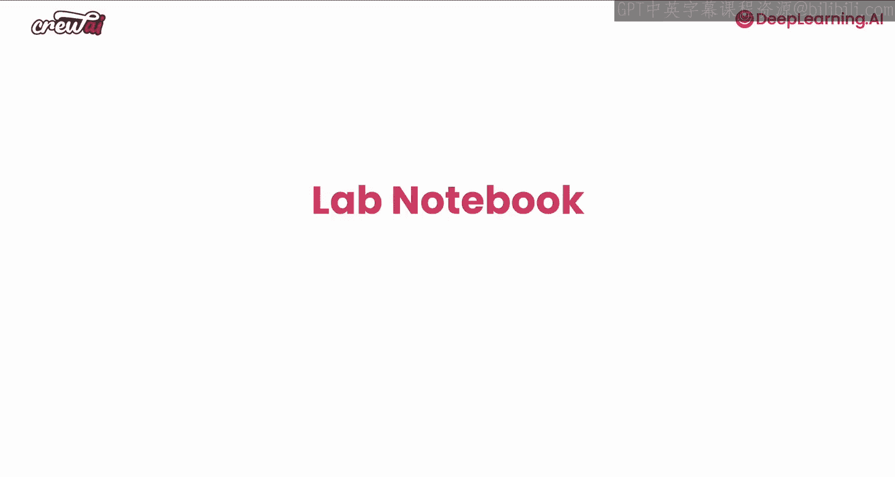

# 吴恩达《多AI智能体实践与高级应用课程Practical Multi AI Agents and Advanced Use Cases with crewAI》 - P2：2.overview.zh_en - GPT中英字幕课程资源 - BV1fgySYsE5y

In this lesson we're going to do an overview of MuT AI agent systems we're going to talk about how the beating blocks that goes into building these AI agents we're going to talk about agents themselves but also tasks and crews and now the different things that makes this agents work things like caching memory guardrails and everything in between this is going to be great to catch you up what everything that you need to know to start your journey with AI agents systems so let's dive into the lesson。

What you will learn in this course。 You learn so much。

 We will talk about moagetic automation in the real world。

 What that means is that you're gonna to get your hints dirty and you're going to build so many different projects that are going allow you to understand how to build these automations out there for any different use case you might have。

 You're going to build an automated project planning using crews and moy agents。

 You're going to also build a project monitoring use case and the qualification and scoring and there's so much more。

 we're going to talk about analysis and report on support data about custom content creation and scale and many other use cases。

 So stick around because it is going to be a lot of fun。 So before we start talking about this。

 let's check a quick example on how powerful those systems can be。

 And what kind of automations you can actually get out from them。

 So let's start by watching this quick example。😊。

In here you can see that I'm about to jump into a call with the CEO of Zendesk so I want to have some sales materials。

 I just put his email in there and we start by doing research on Tom we learned that he has a background of sales and marketing and leadership and we also learn a lot about Zendesk we know that Zenddak is founded in 2007 and all this data was research done by agents and now this agent put together this lending page Pdf that we can export and actually send to Tom and this Pf is going over crew AI but from Zenddak's perspective is's talking all about Zenddak Co and how they're trying to make complexity simpler it's a very cool use case where you can see this agents not only doing research but actually producing a full report that it can assist us on coming out of a call for example and there are so many other use cases out there can。

You see a lot of operation automations and there is many sales use cases in there as well We also see a lot of marketing use cases。

 code development， research， education， support， there is a lot of different use cases going over so many different verticals and the thing is independently of what a vertical you're building use cases for we definitely see a common pattern there's going to like a long tail distribution of what these agents and this automation are trying to do。

Its usually starts with you pulling data out of existing systems Sometimes those systems are going to be ERPs or CRMs or a database or whatever it might be once that you extract this data from there there's usually a stepoff research and research here can be researching a documents or internet or other systems that you might have but after that you go to a process of analysis in analysis can be comparing this data or extracting specific data or even inferring new data that you didn't have before after some analysis。

 most of use cases go to a process of summarization or you want to extract learnings and plot charts or be like specific executive summaries and then by the end of it you can go for reporting and sometimes you want this report as a PDF or as a JN so that you can push that into another system or as a markdown The thing is。

By the end of this you probably will want to push this into an existing system so independently of what is the vertical。

 if it's sales， if it's marketing， if it's HR， whatever it might be。

 most of the use cases usually go around some of this process of research analysis summarization and reporting not necessarily all of them and not necessarily always in this series of steps but this is the book of the use cases that we see out there there's of course companies that are pushing this to the cutting edge and trying to do very innovative things by using video models and image models and so much more and we're going to talk about some of that as well so quick recap if this is your first time getting to know mo agent systems and crew AI I want to talk about what are them and how to build them。

So there is a difference between regular apps that we have building as engineers throughout years in this new kind of AI apps。

 If you think about regular apps， it usually is very strong type What I mean by that is that you have a very good understanding of what is the data that is coming into your application and you also have a great understanding of what are the transformations that this data is going to go through in order to give you your expected output So a good example of this would be a system where you're getting inputs from a leads form and you understand that you have a series of conditions that depending on this answers you're going to have a series of automations or output。

But then if you look at these new apps， what I'm calling here AI apps。

 they're extremely different because now they're way more fuzzy。

 That means that you don't have a good understanding on what are the data that is coming into this for example。

 if you think about JackGPT you don't know if the text that the user is putting there is a recipe or a PhD teases whatever it might be。

 it's fuzzy and then this data goes through a model that is a black box and that then goes into a fuzzy output because you don't know what the output will be。

 it's going to depend heavily on the input and the model So you can think about moy AI agents as a kind of AI app that is way more fuzzy but because of that it allows you to build automations that were just not possible before because now you don't need to treat for every single edge case out there。

You can basically let your agents decide on real time how they're going to react to specific data and decide on what tools to use in order to achieve the task that you wanted to do。

And when you look at these agents， what are their anatomy Well， it starts pretty simple。

 you have an LLM in the center and this LLM can have access to some tools and once that you give this LLM a task it's going to find a way to use those tools in order to provide you a final answer and once that you go one step higher。

 what do you see is actually this mooty agent systems where now you just don't have one agent。

 but you have a two tree or many more and now these agents can only use tools themselves。

 but they can delegate work to each other and they can ask questions to each other。

 in order to accomplish whatever is the final outcome that you want to and it starts usually pretty simple。

 but once that you start to bring this automations into a production setting。

 what you realize is there are so many needs you're going to learn that you're gonna need a caching layer So whatever tools your agents are using。

 they are not consuming a necessary。Credits and using these tools over and over and over again。

 you also want to make sure that they have a memory layer so they remember what they have done in the past and they share their memory with other。

 So if they ever have come across this same data point again。

 they will remember on how they handle it in the last time there's also training data。

 something that we are going to talk in a specific lesson and I'm so excited about that there's also guardrails and how you're going to protect this agents from going into crazy hallucinations and so much more。

😊，And not only all features， but once that you have these agents working together。

 you really need to think through how you want to orchestrate them sometimes you just want them to do their work sequentially other times you want to have a manager agent that is going delegate work and review the output but you can go a crazy on this you can have a hybrid approach where some tasks are going to be performed in parallel and other tasks are going to wait for multiple tasks to finish before moving on and you're going to create an example like this as well others are going to be completing parallel and others might be completely asynchronous so there are so many different use cases and also you can get even more complex if you want to by doing mo crews and you're going to use a feature that we call flows where you're able to hook one crew result with another。

Alright， so you just learn about AI agents， how they work。

 what are the anatomy and how you can put them to work together Well。

 what are the main building blocks for building these mo AI agent systems？Well。

 everything starts with agents， but then you also need to make sure that you have the tasks。

In this use case you can see that we have more tasks than agents and that is not a problem because one agent could be doing multiple tasks and we're going to see some examples of that in order for this agent to be able to accomplish this task。

 we're going to need to give them tools so you can either give your agent' tools so they can use that when performing any tasks or you can give your tasks tools so your agent know what tools to use in order to accomplish that task once that you have that you basically have aru。

A crew is a combination of mochi agents and their tasks。

Once that you have all these agents and tasks， crew AI comes and tag and gives you all the features that you need to run these things in production by adding guardraos to avoid your agents to a loosena but also task so that you can measure the quality of your agents and tasks also allows delegations where your agents can automatically delegate and as questions to each other and then training data so you can train these agents even further in the memory so these agents get it better over time There's so much that we're going to talk about。

 make sure to stick around So let's look at this agents and tasks every agent and crew AI needs to have a role a go in a backstory and every task needs to have a description and expected output in an agent So now these agents are actually defined as YaO files and we're going to go over it on our lessons where you can easily see。

How these agents have their role， their goals and their backsties set in their tasks as well with their descriptions and their expected outputs。

 This makes extra easy for known technical people to be able to contribute to this agents and tasks by just having to update YaO files instead of having to update any code Allright so now that we know that we can create agents and tasks using YaO files Why don't we get our hands 30 and we build our first crew This is gonna to be so exciting let's go to our next tab where we're going dive into a Jupyter notebook and we're going to put together our first crew together I see you there in a second。

