# 吴恩达《多AI智能体实践与高级应用课程Practical Multi AI Agents and Advanced Use Cases with crewAI》 - P3：3.L1 Automated Project Planning, Estimation, and Allocation.zh_en - GPT中英字幕课程资源 - BV1fgySYsE5y

Let's dive into an automated project planning。 The goal here is to use a crew to help us break a project into tasks。

 estimate them and do some allocation This is a common use case for constituencies out there and web agencies they're trying to put out as many offers as they can so as people reached out them to build projects they can pretty quickly estimate this project and plan around it。

 For this crew， we're going to be working with three agents we're going to be using a project planner an estimation analyst in an allocation strategists。

😊。

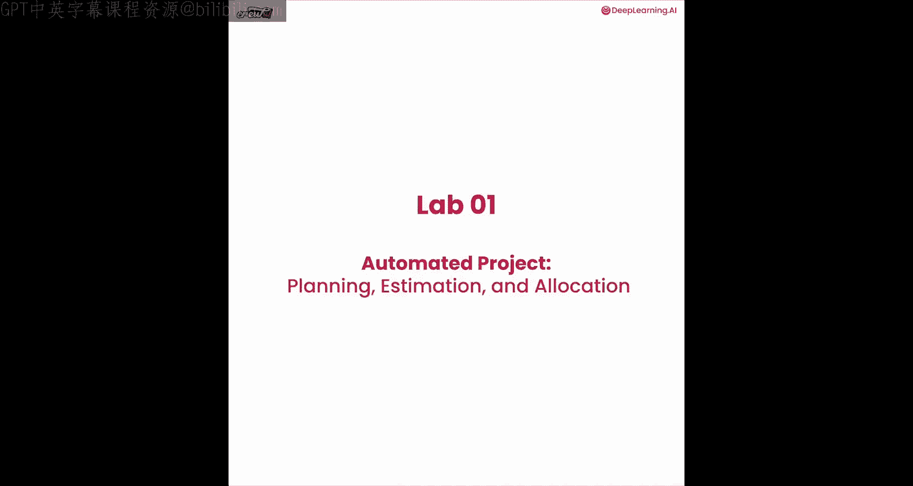

And for each of the agents， we're going to have one task。

We're going to have the task breakdown the time estimation and the research allocation this is a fairly simple crew setup where we only have three agents entry three tasks and every agent doing one single task The idea here is that giving initial inputs around what we're trying to achieve what is this project。

 what is the certain criteria for the project and who are the people that we have available to work on this we can very quickly create a project plan and this project plan should have tasks and their allocations and also measure milestones of how you're going to track the progress of this project。

The idea here is that we use this agents to output a structured format where we're going to have a Json that we can push into whatever or project tool might be。

 So if we're using Jra or Trello or whatever it could be。

 we would be able to push this tasks and their allocations into them Let's look at the code。

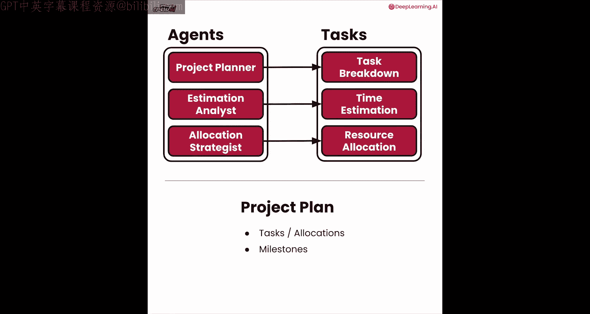

Alright， so the first thing we will do is actually do our initial imports We're going to make sure that we load the environment variables and all the other libraries we will need in this case we're going to use the OS library。

 the YaMO library for loading our agents and tasks YaO files and then from Cr AI we're bringing our three main classes。

 the agent class， the task class and the crew class。

 and that should be all that we need to start this crew。

Now let's go ahead and set up what is the model that we are going to be using for this？

Creer AI by the tool will use open AI models， but remember you can use any models of your choosing。

 you can use any of the providers out there， including Huging F。

 Azure and Tropic and anything in between。For this case。

 we're going to be actually setting up the Openai model to be G40 mini in that way we can keep our costs slow and have a good execution so now let's load our agents and tasks YaL's file This should be pretty straightforward。

 but let's take a look at this code real quick you can see here that this code is nippet is basically loading both or agent Yal and tasks YaL and then dynamically loading that file and assign in that app to two variables the agents config and Task config。

Before we keep going， let's take a brief look on what these agents and tasks files look like。

So on the agency MO file， you can see that we have three agents， the project planning agent。

 the activation agent， and a research allocation agent。If we look through this。

 you're going to see that every agent has a role， a goal， and a backstory。

In a few extra configurations， in this case， we are not allowing our agents to delegate work to each other to make sure that we keep the execution as streamlined as possible。

 and we also have enabled verbose mode to be true， meaning that we are going to be able to see how these agents behave what tools that use in everything on how they go about performing their task。

You can spend some time in playing around with the role they go and the backstory if you want to。

 but the interesting piece is that you can see that some variables are being interpolated here in our agent' descriptions。

 so you can see that we're interpolating a project type， a project objectives an industry。

Throughout the entire definition of the agents。Now let's take a look at our taskMl definition。

On our tasks YamO you can see that we have tree tasks， the task breakdown。

 the time research allocation and the research allocation tasks。

 and then again you're going to find the same variables be interpolated here in the tasks where you can also see project type but a new variables like project requirements and team members feel free to play around with the tasks and agents' descriptions once that you execute the Jupyter Note just in case you want to see what different resultss might look like Now let's go back into our code。

Now that we have where agents canfig and taskconfig loaded what we can do is create a pentic model for our structured output keep in mind that in this case what we're trying to do is have a full project planning by the end of the screw execution and that means that we want to be able to push this into an external systems if necessary and for that we need a structured output so in here you can see that we are creating three classes。

 a task estimate a Mit and a project plan。The project plan is going to basically have a list of tasks in milestones and the milestone will have a name in a list of tasks this task estimate is the simplest model that we have it has a task name。

 the estimated required hours to do it in a required resources that will include a name of the people that are going to be required to do this task。

By the end of our crew we should have this project plan object ready for us so we can turn this into JSOM if you want to or into a dictionary and you can push this into external systems or do whatever you want to do with it it's a very reasonable and nice way to have an output pushed into any external systems that you might have。

Now， in order for us to create our crew， agent and tasks。

 we're going to need to refer back to those YaO config files， let's check that out。

In here you can see that as we create each of agents。

 we're actually referring back to the agent's config variable from the YaML file。

 and we are saying what is the key in the YaML file that provides the configuration for this agent。

 so this is very straightforward。😊，For the tasks， you can see that we're actually loading the tasks config file that comes with all those YaO settings and we're again passing what is the YaO key that holds the configuration for each task We're also being very verbose here because we're being clear around what is the agent that we want to own this task we could do this in the YaO file if we want to。

 but we are trying to be very explicit here for the sake of just making it easier for understand。

In this final research allocation task， you can see that we have an output pedantic attribute What that means is that whatever the output of this final task is。

 we want it to be a pedantic object and this is the object that we created earlier the project plan and this is the structure output that we want to do something with it to push into an external system if necessary or even an internal one in the future。

And for wrapping things up， you can see that we are starting a crew and this crew has our three agents and our three tasks gives is a very straightforward setup now let's talk about the inputs that we send to this crew and how that information gets in there。

Yeah。Remember that we had a set of variables that we interpolate in our agents and tasks。

If you look at them in here， we are setting up every single of those variables here。

 so you can see a project， you can see the industry， you can see the project objectives。

 the team members and the project requirements， so let's dive into them。

This is a website project for a company that works on the technology sector and the objective is pretty simple is create a website for a small business。

 we're going to have five people that are going to be working in this， including a project manager。

 a software engineer， a designer and a couple of QA engineers。

 and then we have a series of project requirements。

You can think of this as like after you do initial call with a customer you can bring all this information into a crew in order for the crew to actually break down the test and estimated for you。

 You can see how this could be super valuable， especially if it is mal business or a constituancy。

 and you're trying to get offers and codes out there as fast as you can。

 Let's take a look on what this actually looks like。

 The project requirements are pretty straightforward。

 We want to make sure this is a responsive design。 We want to make sure this is modern and visually appealing。

 We also want to make sure that it's user friendly。 It must have a few pages like an about us。

 services and contact us。 It should have a blog section and ensure that it's super fast social media links and also testimonials。

 So these are the inputs that we're going to be sending to our crew。😊。

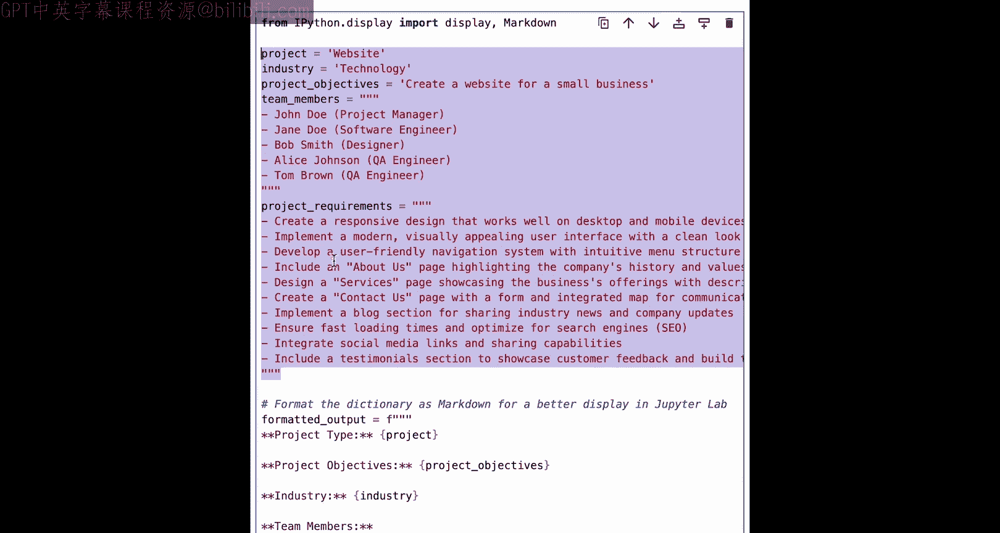

If you remember our agents and task gamls had all these variables to be interpolated on it and this is the information that will be interpolated throughout those agents and tasks in order for them to get their work done and you could easily dynamically get this information in order to kick off this screw if you want to so now let's run the screw and see what that's going to look like it's going to be pretty fun。

Okay， now for us to kick off this crew， we basically create a dictionary with all our inputs in that。

 and we can pass this dictionary as inputs for our crew。 kickoff function。If we call this。

 we're going to see our agencies start to do their work。 let's tag along for a second。

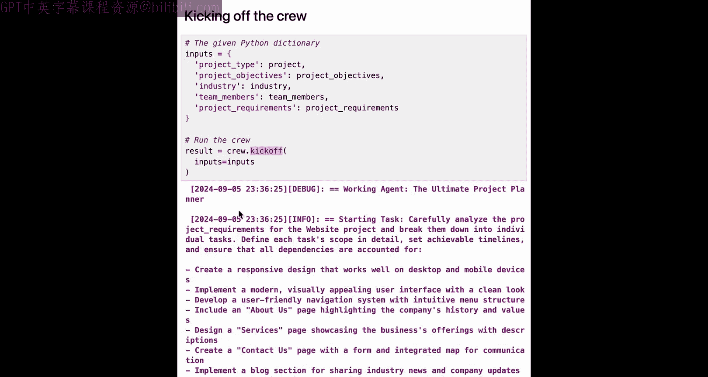

You can see here our project planner agent is starting by analyzing the project requirements for the website project in here you can already see one of the interpolations happening and this is what is the project type。

In here you can see all the difference requirements and below you can see all the different team members。

 so let's see how this agent does that work。

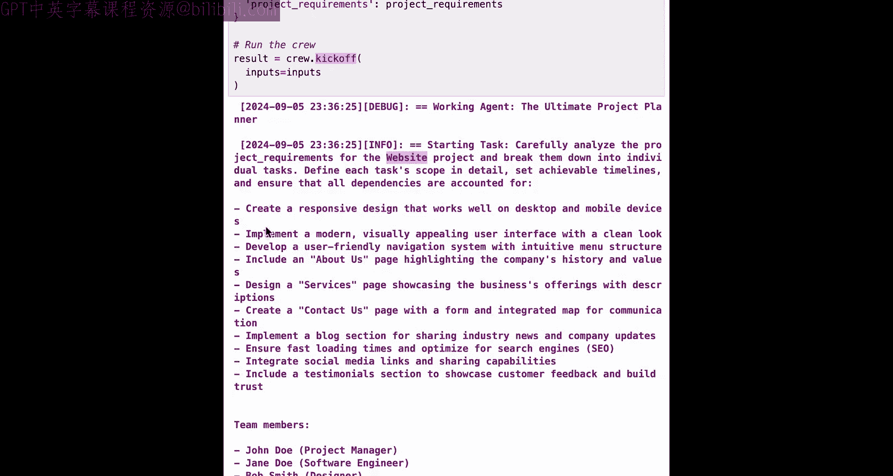

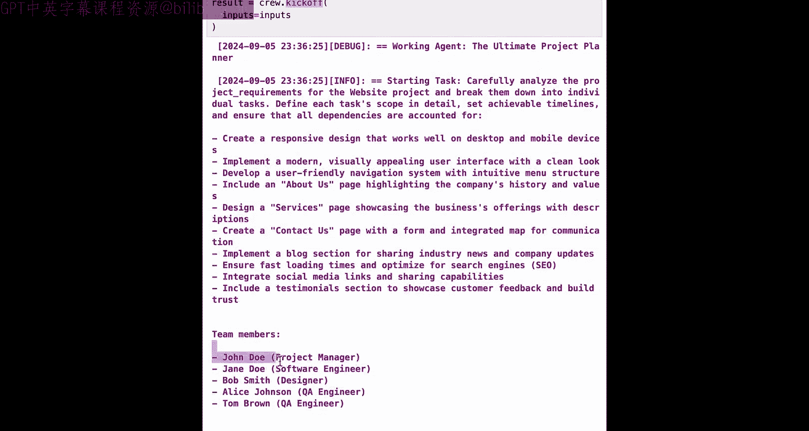

You can see that the agent's final answer includes a whole project breakdown in a set of tasks lists and this goes pretty deeply on what is the description of the task。

 what is the timeline， any depends， deliverables and who will be assigned to this so this was pretty fast。

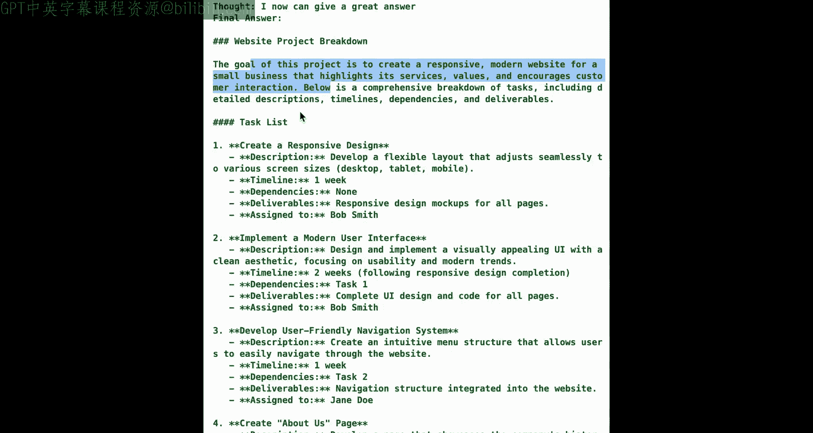

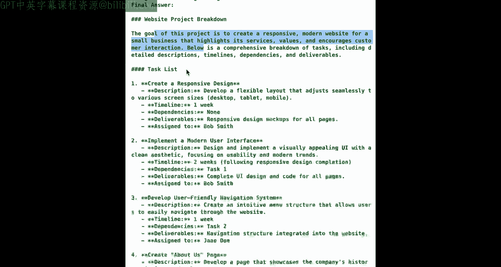

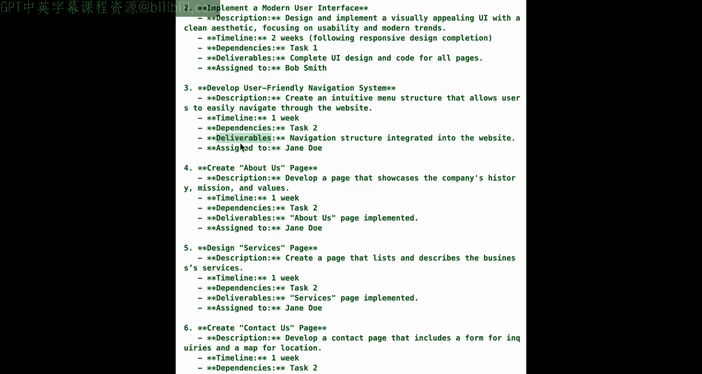

You can also see that during this crew execution， we also got a N chart where you can see all the different tasks their durations and dependencies and even a conclusion detailing how the breakdown of the tasks Now this agent is done and we have our new agent takes in and this is the expert estimation analyst this agent is going to estimate every single one of those tasks。

 let's see what' is going to be the final output。

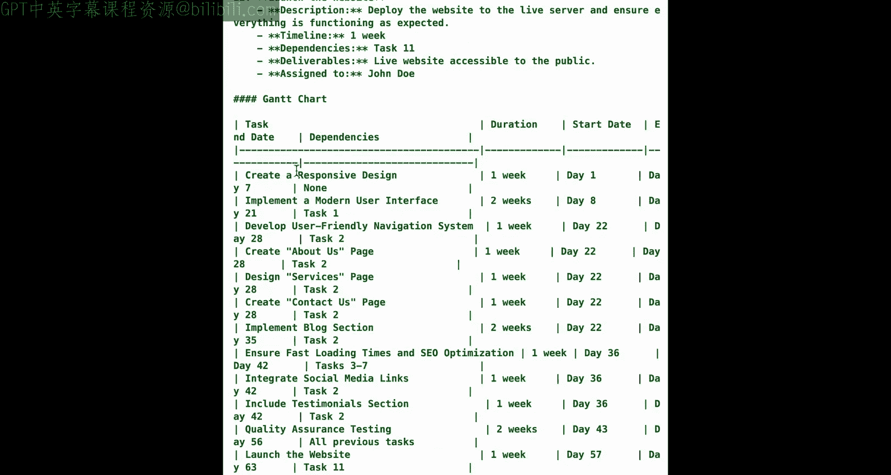

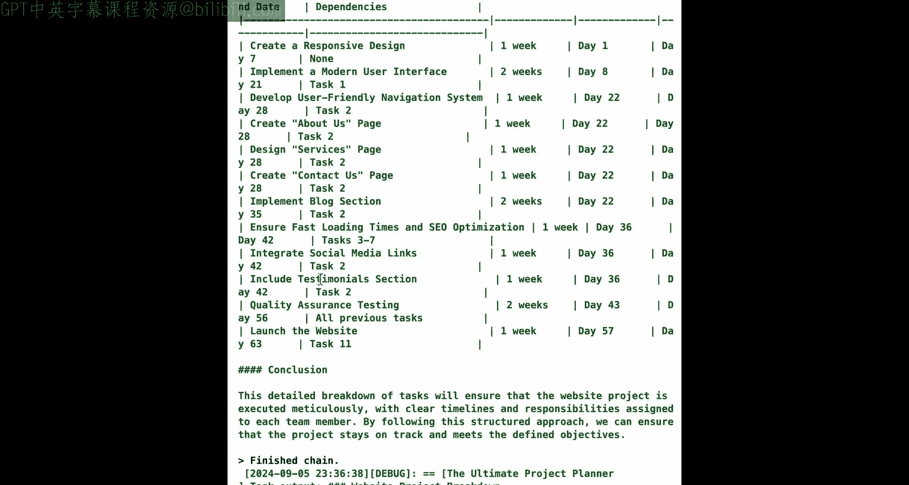

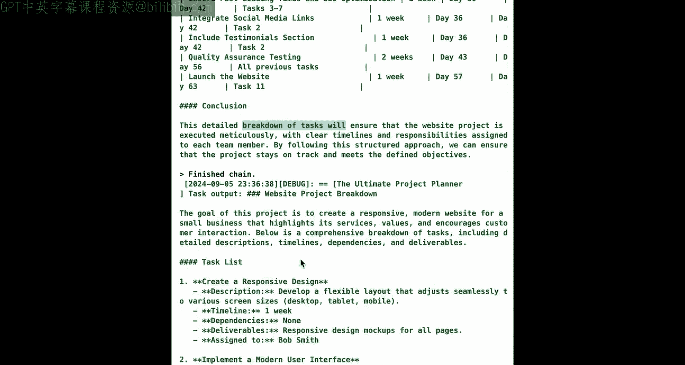

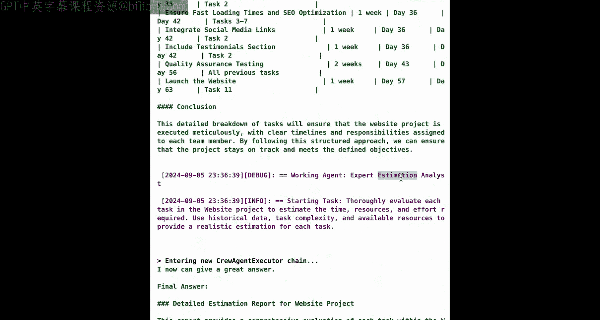

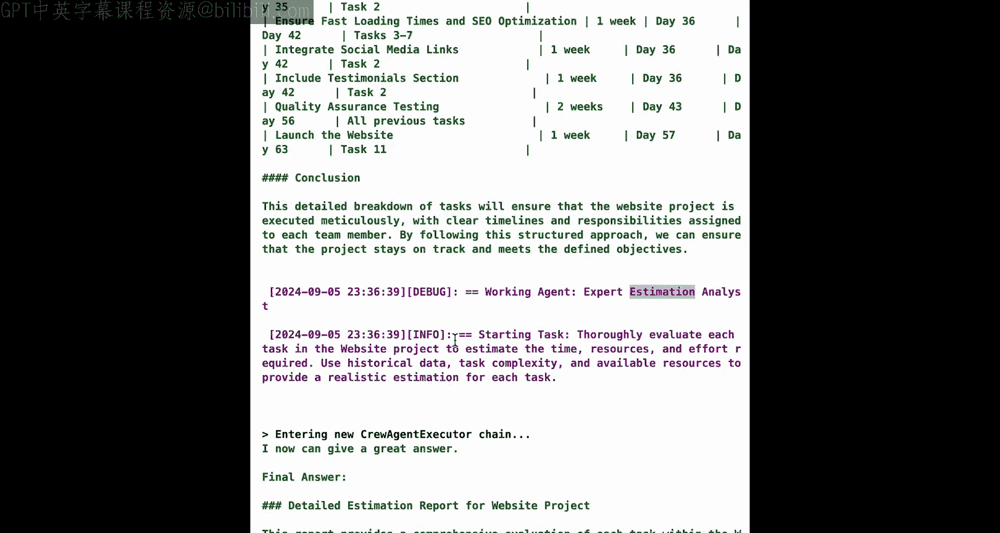

Before we digging into the final output， an element of running these cases in production is knowing how much it costs if you want to render this at scale to generate project estimates and planning how much would that actually cost you so let's start by looking into this because we're using GT 40 mini we know that this costs 15 cents per medium tokens in crew already gives you usage metrics including prompt tokens and also completion tokens so let's do some simple math to understand how much would this actually cost you。

You can see this is pretty cheap， it's around 0。001 cents to actually running it。And we use around 7。

000 tokens， now let's see what was the actual result。First， let's see the row output of this crew。

If we print this， we can see that we got a dictionary back。

 so it is as structured output as we wanted， where you have a list of tasks and every task has a name and estimated in a required research list。

 but you also got a milestone and every milestone has a milestone name in the list of tasks on it。

Now， let's inspect this a little further。

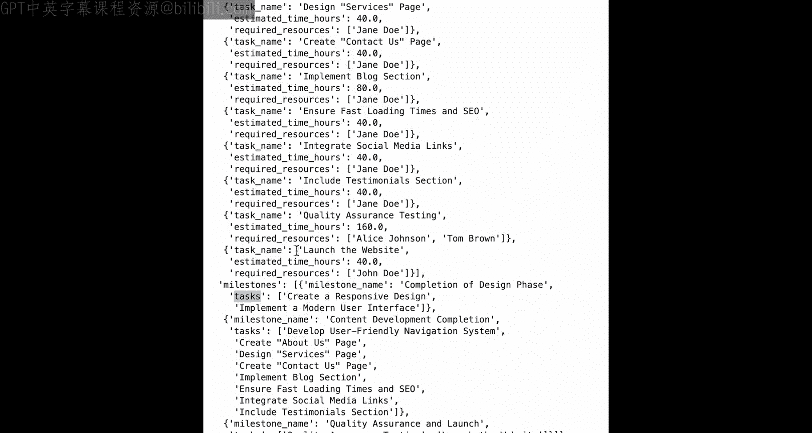

Let's start by first looking into the tasks and in here I'm going to plot it as app pans data frame just so it's easy for us to visualize you can see that every task has a name now in an estimated number of hours and also the required resources so we have a clear understanding of who's going to be doing what from creating a design all the way to creating each one of those pages to actually testing the whole thing and making sure that it works。

Now， for the milestones， I'm going to be plotting it as a pandas data frame as well。

 And here you can see the three different milestones。

 and each milestones has a list of tasks that needs to be concluded in order for us to check it off。

 So this is pretty good。 This is a very fictional example。

 but it highlights the power of how you can automate a few process that could take a lot of hours to to be done in a few minutes and you don't have to think about it。

 It just works。 This is actually a use case that we are seeing being deployed out there and can definitely benefit you or your company。

 This is just the beginning。 There is so much more that we're going to be able to build as we go to the next lessons We're gonna learn a lot all the different ways that you can build the crews together and how you can put them together and you're going to build even more complex and interesting use cases。

 That is sad。 let's jump into the next lesson where we're gonna learn even more and build a brand new use case。

 So I see you there in a second。😊。

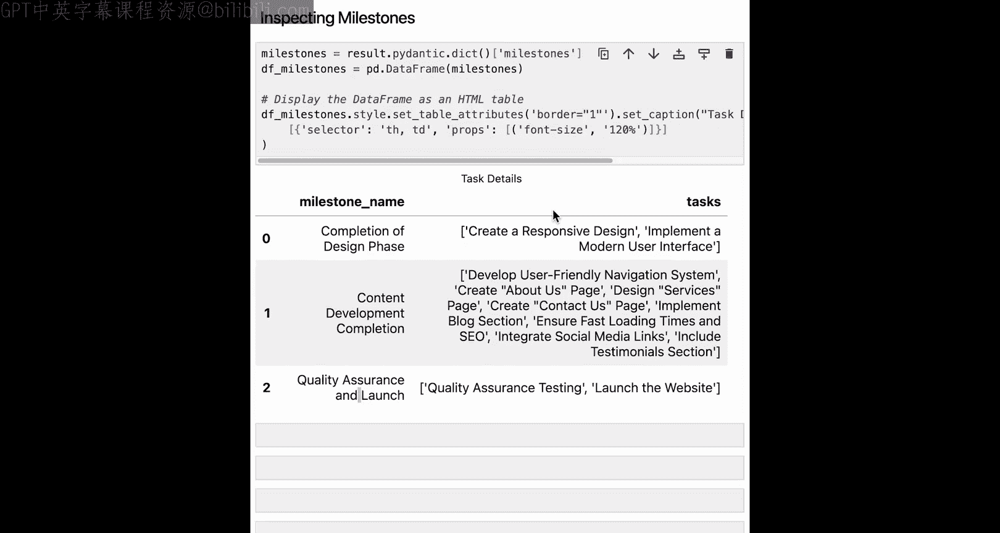