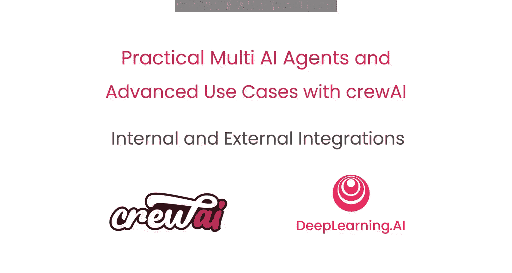
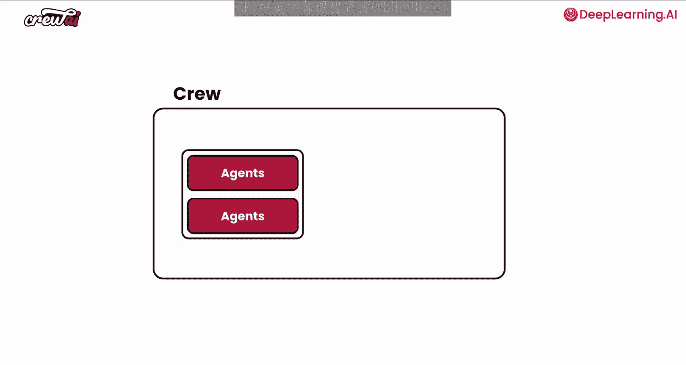
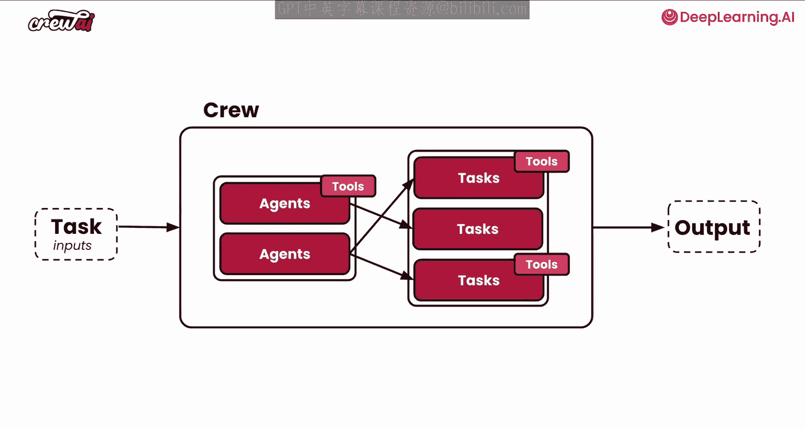
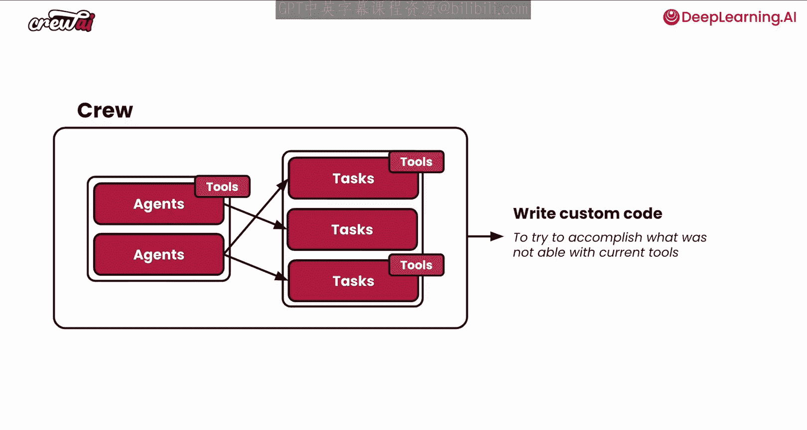
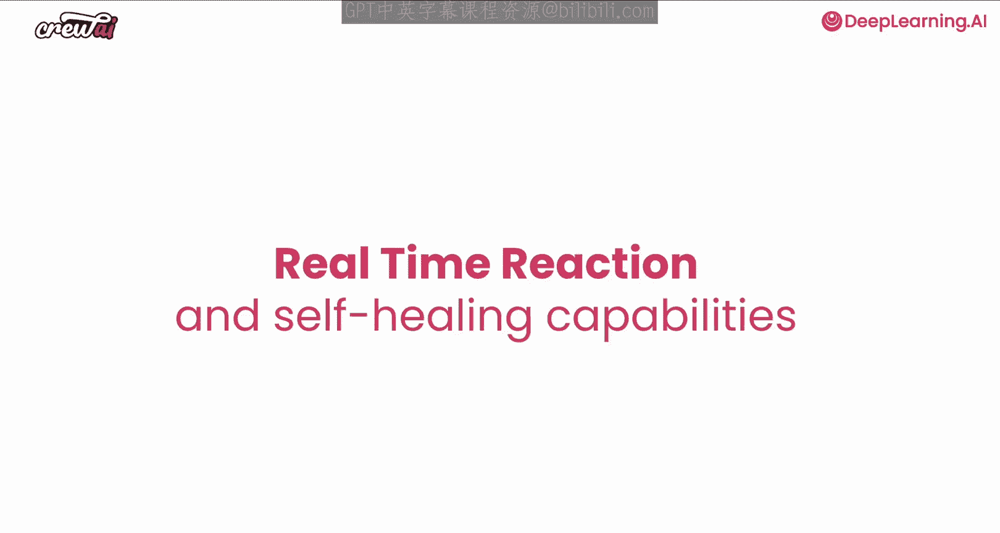
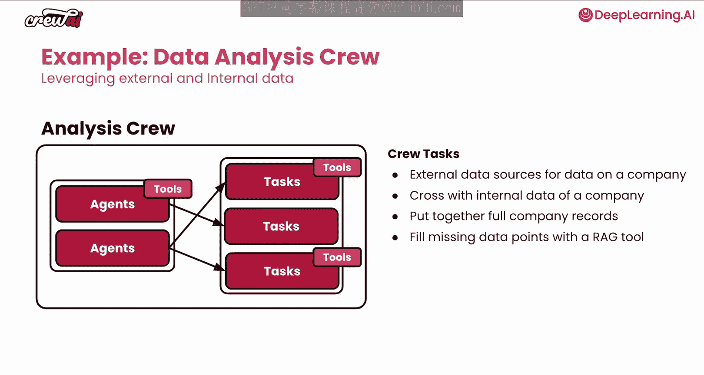
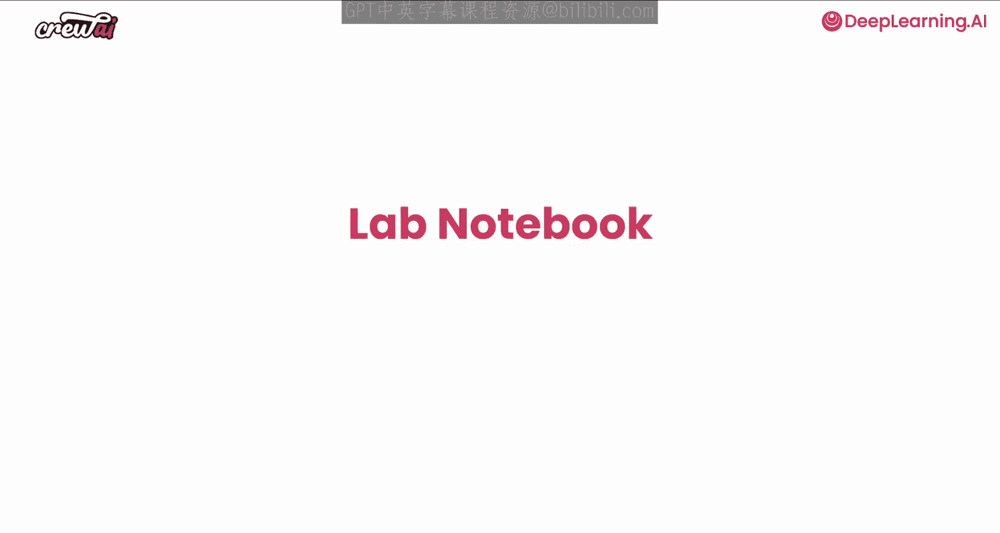

# 吴恩达《多AI智能体实践与高级应用课程Practical Multi AI Agents and Advanced Use Cases with crewAI》 - P4：4.integration.zh_en - GPT中英字幕课程资源 - BV1fgySYsE5y

In this lesson， you're going to learn about integrations。

 and this is super important for all of your AI agent automations and apps。

 you're going to need to pull or push information from either internal or external systems。

And in this lesson， you are going to learn everything there is to know about how to build those integrations and how to make your agents to be able to call with these systems。

Let's dive into the lesson。You're ready learn that your crew is your agents。

 your tasks and your tool。 And there is a few different moments during a crew execution where you might want to talk with either internal or external systems。

 Sometimes you might want to talk with the systems prior to the crew starting so that we can have data that you can pass on to this crew。

 Other times you might want to call it was that a crew is done processing。

 Those to you are less of a problem because by them is just regular code。 But the problem is。

 sometimes you want your tools to be able to call external or internal systems。😊。

So these toolss can call other applications or cloud services。

 sometimes they can call databases or internal apps that you might have。

Some examples might be a tool that search the internet or check a calendar or reply an email。

 or if they're doing something internally， they might be doing a rank search on an existing and Battings database or doing a SQL query or even triggering a side effect。

The thing is you want to be mindful about allowing your agents to be able to use these systems。

 and sometimes you might want your agents to be able to do some custom things like writing code。

 and you're going to learn on how to allow your agents to do so and what that will look like in one of our lessons。

Now let's talk about one of the great things for internal and external systems and that is the real time reaction and the ability for these agents to self heal what I mean by that is that your agents are calling these tools if those tools fail for whatever reason maybe it's a change in the system either externally or internally your agents will be able to pick up on their change and try to do it again but differently so let's talk about an example。

 let's say that we have a crew that is doing analysis and it's trying to leverage external and internal data to do it。

So we start with an initial task where an agent's trying to extract data sources from data on a company。

 So it's doing research around the company， its industry and everything about it。

 then it's going to cross that with internal data off that company。

 So whatever existing reports that you might already have on that same company。

 then it's going to try to pull together full company records's based on everything that it learn about a given company。

 Sometimes that might be missing information。 So if it does find that information is missing。

 It's going try to find missing data points by doing an embedding searching， using a rag tool。

 Here you can see how these agents can go so beyond a regular simple rag search or enrichment pipeline。

 by being able to tap into so many different sources of data externally。

 internally using embeddings and so much more。 This unlocks a lot。

Potential in news cases and we're going to build one ourselves right now。

 So now let's jump into the Jupyter notebook and build this crew ourselves。

 let's get our hints  dirty0 and integrate with external tools This is gonna to be a lot of fun so stick around and I see you with the next step in a second。

😊。

