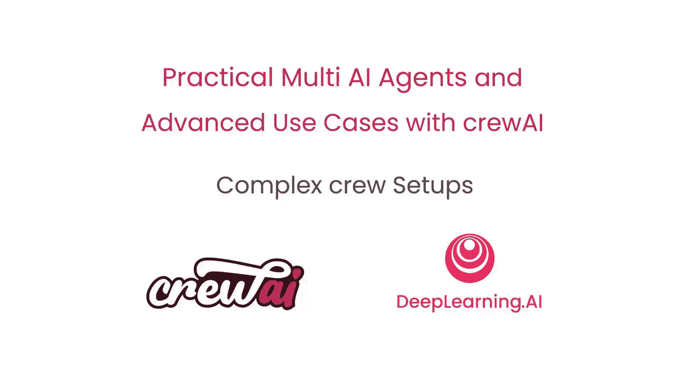
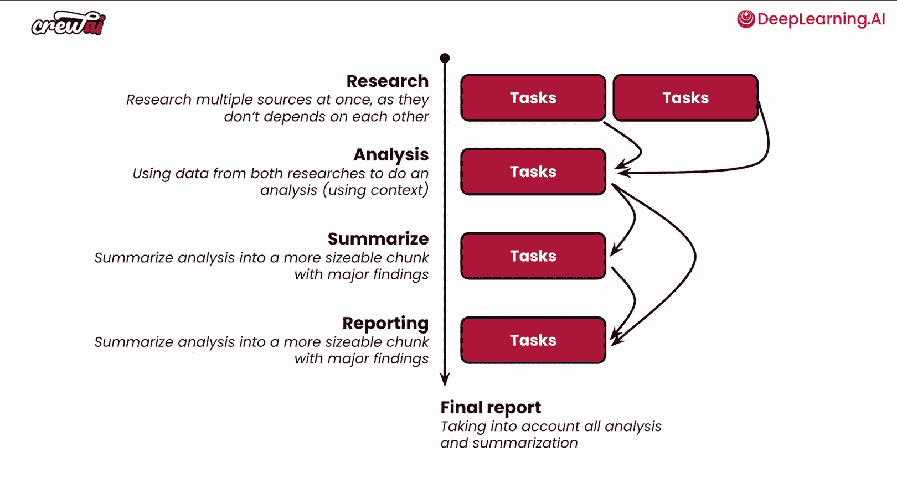
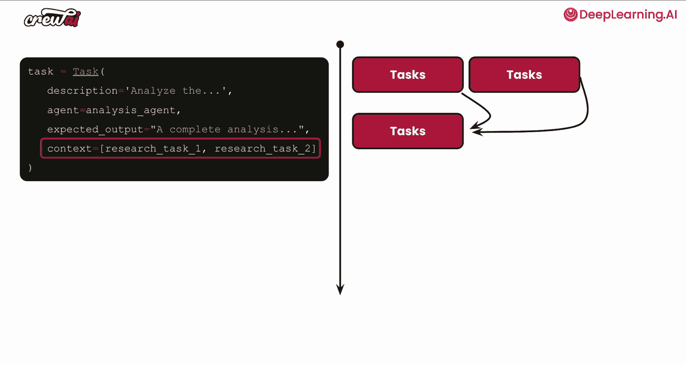
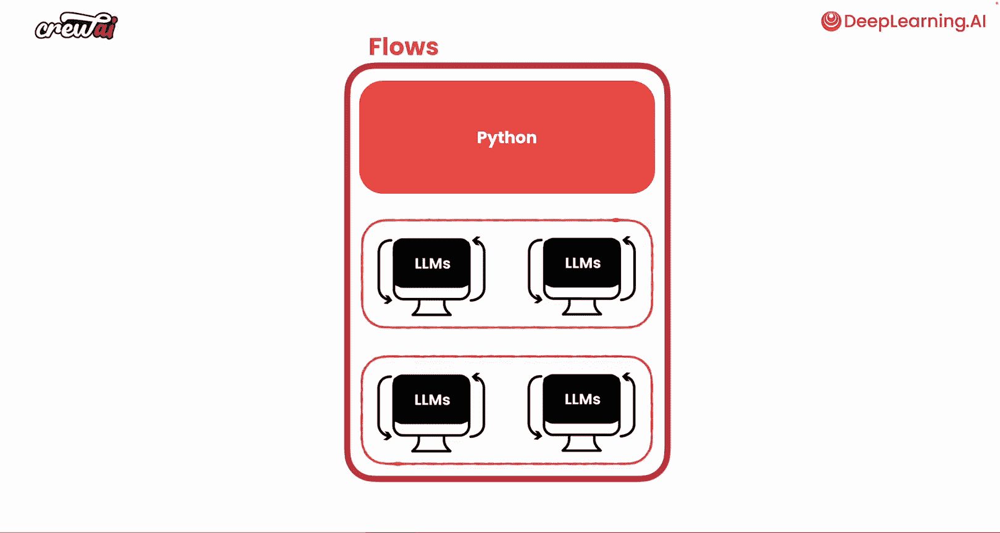
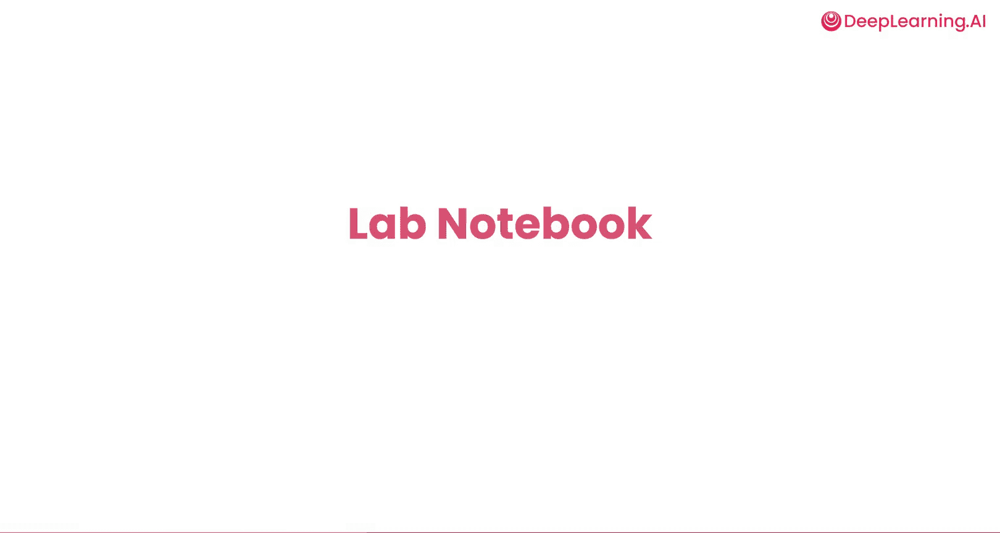

# 吴恩达《多AI智能体实践与高级应用课程Practical Multi AI Agents and Advanced Use Cases with crewAI》 - P6：6.setup.zh_en - GPT中英字幕课程资源 - BV1fgySYsE5y

I'm so excited for this lesson in this lesson we're going to talk about complex crew setups we're going to talk about how you can not only build a crew with agents but how you can connect multiple crews together and how you can use condition logic to when to execute one and when to pass information into another this is going to be super interesting because unb a lot of different news cases。

 news cases that were just not possible before so buckle up because it's going to be pretty fine let's dive into the lesson。

We are already chatted about all these different ways that you can get your agents to do work for you。

 you can get them to do work sequentially， hypercrically， or in a hybrid manner。

 even in parallel or asynchronously。The thing is between all those different options is you can also mix and match。

 and you can have a very fine control over how you want the work to get done。

 So let's look an example real quick。 Let's say that you can have yourcc starting to do two tasks in parallel。

 Let's say that those are research tasks。 So you can have initial tasks that doing research on a company in another one that might be doing research on an industry or a person。

 Those tasks don't depend on each other。 And that means that you can have all of them starting at the same time。

😊，But then after that， let's say that you want to do some analysis。

 but you want to grab the results from all those different tasks before you actually do it。

So in here， we can actually use an attribute that is called context that we're going to see in a bit on how you can get the output of those two tasks into this third one。

 Now we want to do a summarization and this is a more straightforward task So we can get whatever was the output from the analysis into this task to make sure that we write a nice summary。

 But then for a final task， we want to do a full blown report And for that。

 we want to take the analysis and a summary to make sure that we can view this final full report before we actually push this into an external system as a final report。

 So how would you go about it if you have to build this with C AI。 But let me show you。😊。

For having your tasksasks running in parallel， you can set the attribute async execution to true。

 and that means that your tasks are going to be performed in parallel。And for our T task。

 you can actually set another attribute called contextext that will allow you to name one of the other tasks that you wantt wait to be done before you start this new one。

So with that you can have a lot of control on how these tests are going to be executed and if you think about all the different tests that we talking about。

 they're all using different combinations of this， but then you can get even more complex by using flowsF is a brand new feature for QI and I'm so excited to show you this because flows unlock so many use cases and we're seeing people using this out there in production use cases already。

😊。

What makes flows so special is that allows you to not only have your crews but also execute regular Python code and you can execute this code before your crew during your crew or after your crew execution so you can mix a match but having not only multiple crews connected together but also using regular Python between them in case you need to grab files or grab data or send data and you don't want to leave data for the agents to do this is very powerful and we are so excited about what some of the people are already building with flows so now let's jump into code and talk a little bit on how you can build flows yourself。

😊。

