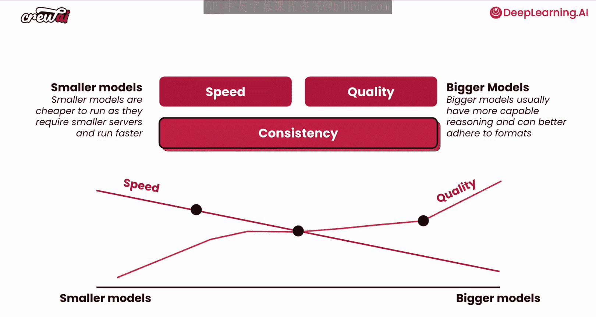
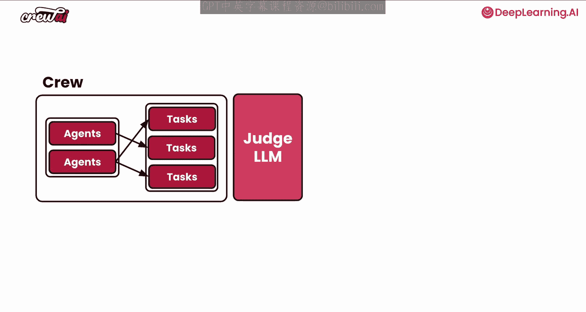
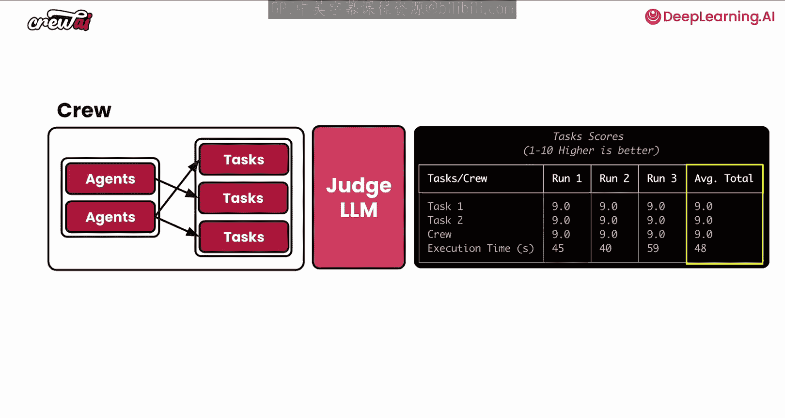
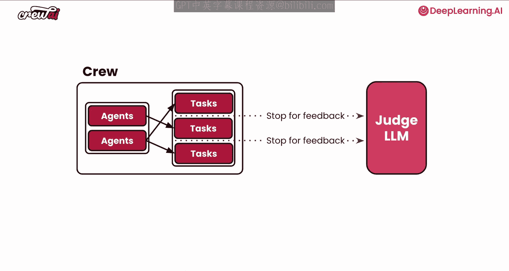
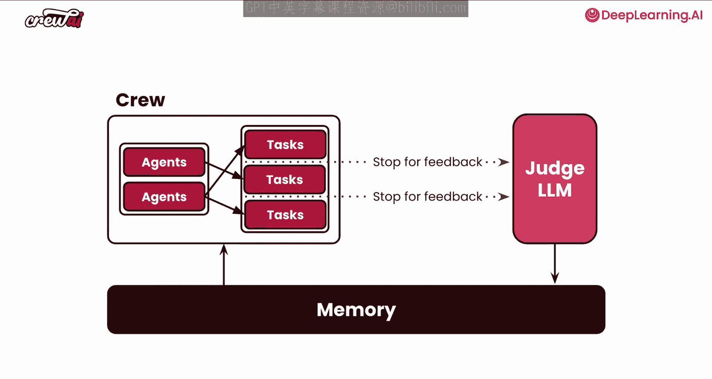
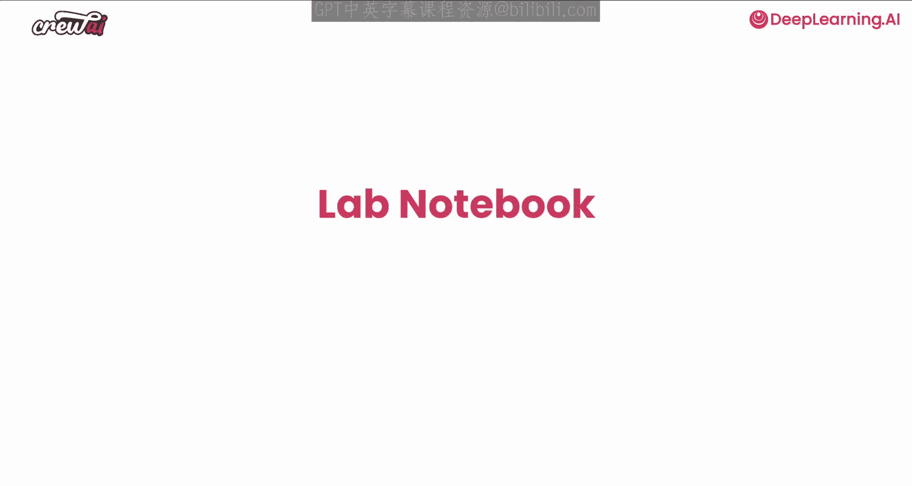

# 吴恩达《多AI智能体实践与高级应用课程Practical Multi AI Agents and Advanced Use Cases with crewAI》 - P8：8.optimization.zh_en - GPT中英字幕课程资源 - BV1fgySYsE5y

I'm very excited about this lesson because you are going to learn about performance optimization As an engineer when you deploy the systems in production you know that you need to think about performance sometimes that will mean that you need to favor speed at your times that will mean that you need to favor quality whatever it is you know that youve got to keep consistency So in this lesson we're going to dive into how do you optimize performance for your agents and your crew and this is going to lock a lot of potential because it's going to allow you to have consistent results from your crews Let's dive into that。

😊，The two main componentsents when you're thinking about this AI automations is speed and quality。

And usually speed comes from smaller models， smaller LLMs that you can run on smaller devices。

 or even if you run them on the clone， they're still pretty fast。 And for quality。

 you're usually thinking about bigger models。 things like Jack TptT 40 and other models out there。

 They are very good at providing complex resultss， but they take a little longer to get there。

 doesn't matter for what you're optimizing a few tasks might require speed in order tasks might require quality。

 but the one thing that you want to make sure that you get is consistency。😊。

Consistency is key here because you want to make sure that even though this is a fuzzy automation。

 you're always getting the same speed or the same quality as you go。

 So when you think about the distribution of these models between smaller and bigger ones。

 when you see it's a close to linear relationship regarding speed。

 meaning that as the modelss get bigger and bigger gets lower and lower。

 But when you're thinking about quality that is not necessarily as linear as speed。

 because the quality depends a lot on what kind of the tasks that you're trying to accomplish。

 if task that an agent's trying to accomplish is not that complex。

 then smaller models might actually have a great quality that it might be good enough with smaller models。

 So the beauty of this is that when you're thinking about production use cases and complex use cases。

 you can actually choose different points in。😊，This distribution to be and you can have your agents to be performing from one model in one task and from another model in another task the key thing is that you want to keep consistency no matter what so whatever you are optimizing for individually for every task you want to make sure that you keep that the same。

All right， so we know that the speed and quality are the tub variables and that we want to keep consistent here。

 but how do we measure this？

That's where testing or agent's performance comes in and we're going to talk about a specific feature in CI that is C AI task。

 so let's dive into that When you think about the task you basically have a description an expected output in an agent。

And the interesting thing here is that the comparison between the description and the expected output actually allows you to compare if the result is close to what it expected it to be。

 So that allows us to actually rank your task and how good the output of it was。

 So this was a design choice and crew AI from the G go to allow you to test your tasks at a scale。😊。

And you can actually render this by using the crew AI task command on your terminal and was that you do that。

 what happens is you have your crew basically do all the tasks that you wanted to do and then that information passed to a judge LLM that you can set to be whatever LLM you want and by the end of it。

 you get a final report where you can see your tasks in your crew and you can see what was the output for each task during each run And here you can see that we got L9s。

 but this is not always the case。 but this is an easy way to allow you to measure how consistent your agents are your tasks outputs are and how good they are so that you can act on it。

 Now we can basically render this for our entire crew and learn that let's say task number one。

 it's actually giving an output of quality7。

え？How do we bring this to a night。 How do we change and improve this task in this agent and this screw so that it can improve its output on a consistent manner。

 Well， usually it's smaller things。 It's usually a specific format that it's not following or a specific style that it should apply to or maybe there is some missing information。

 like original search from where the information was taken from。

 So if you can help your agents understand that they are missing those small pieces。

 they can actually follow that up to the letter to the point that your outputs going to be higher。

 and you're going to have better resultss for your crew。

 So how do you do that without having to spend long periods of time improving your description and expected output。

 And that's where a C AI train feature comes in。😊，This feature is so powerful that it can actually have a major impact on your cruise's performance。

And you can easily execute it by going your terminalil and running the C AI Tren command。

Was that you execute this， a few things will happen， let's dive into that。

Your crew is going to run as usual， but now whenever it finishes a single task。

 it's going to stop and ask you for feedback for every task in your crew。

And you're gonna to be able to tell it what it's missing。 Maybe for task number one。

 it's missing the original search of the research for task number  two， it might be missing a format。

 a very specific format you wanted to comply with。The thing is now you can give this very specific feedback on every single task。

 once that you finish with the feedback that is automatically pushed into a new judge LLM and this judge LLM is going to extract every single learning for that specific task and it's going to push that into your crew memory。

😊。

And the way that it works is that from now one， whenever your crew is gonna run again for every single task。

 it's going to remember the feedback that you gave it to it。

 and you're gonna make sure to comply with it。 This is so powerful because it allows you to build very complex use cases and get a pretty consistent resultss across many runss。

 So I definitely recommend you check it out。 So let's actually build one or。

 Let's dive into it and learn how we can use the training and the task features。

 There's going to be a lot of fun。 So come along and I see you in a second。😊。

