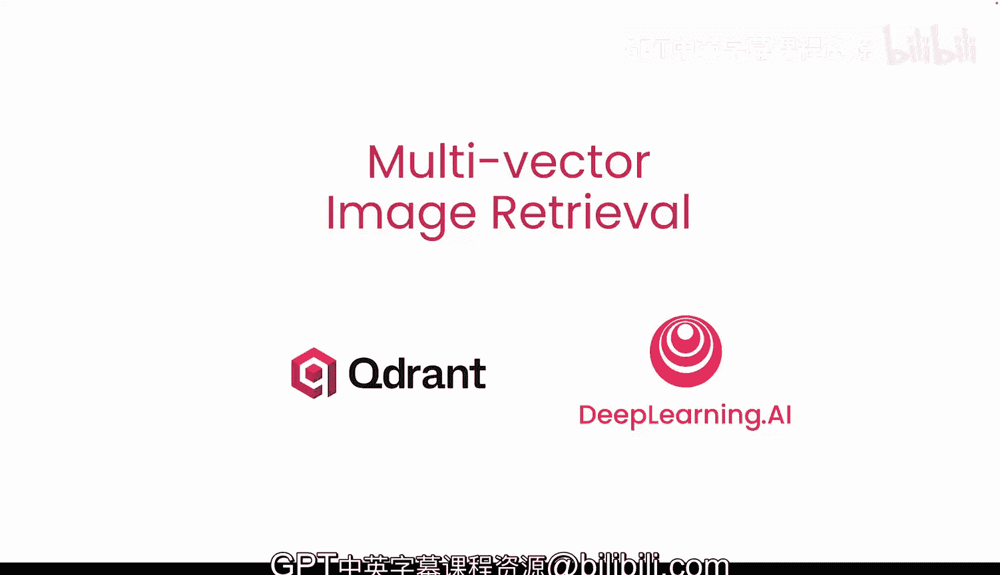
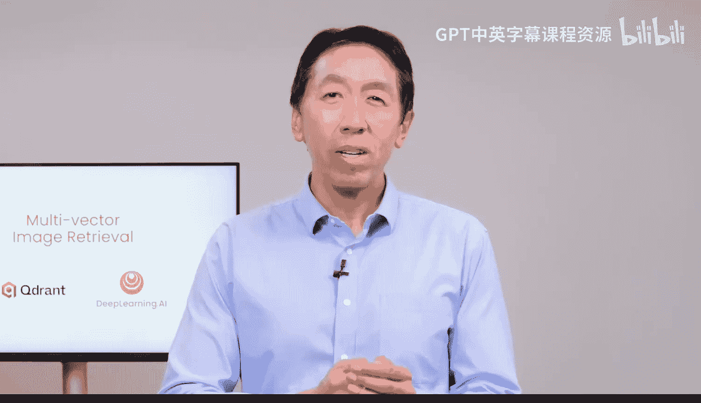
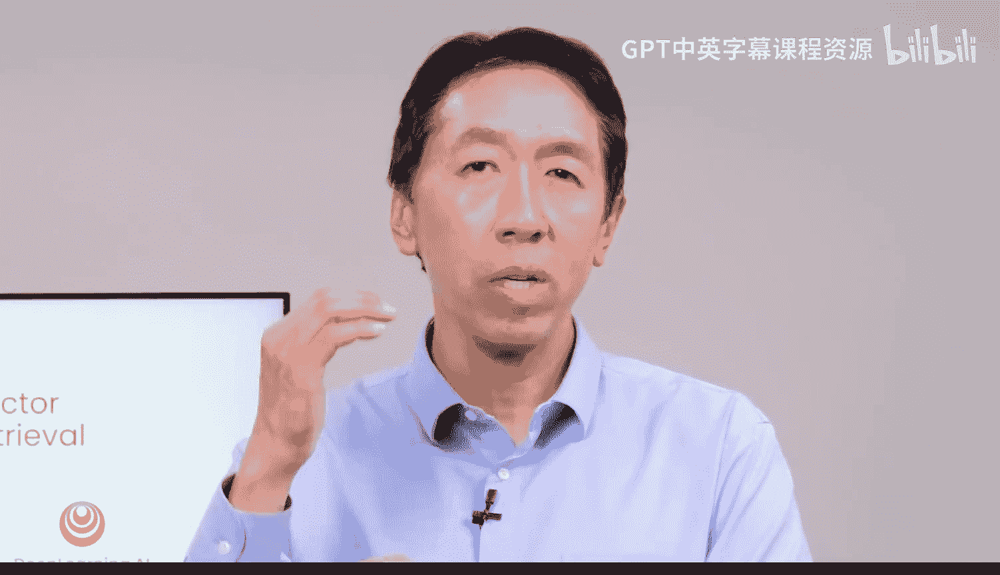
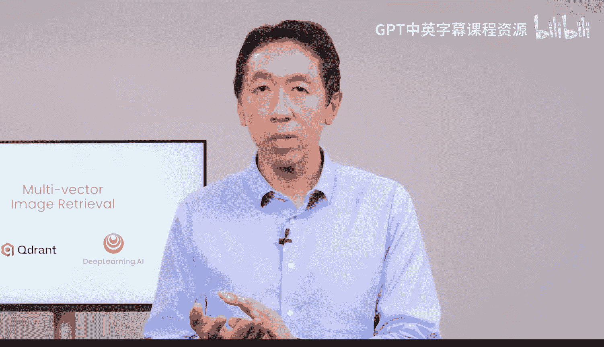
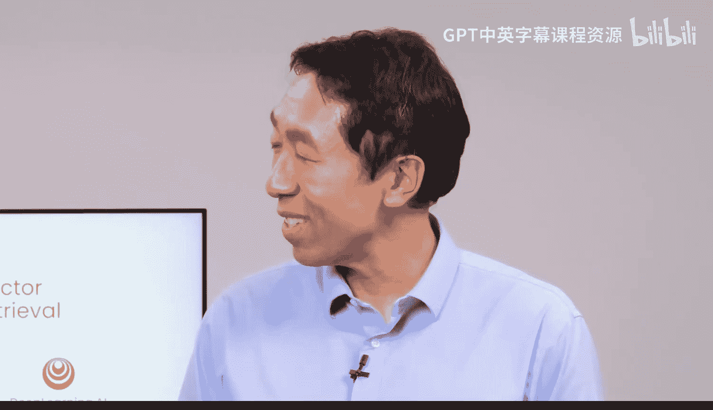
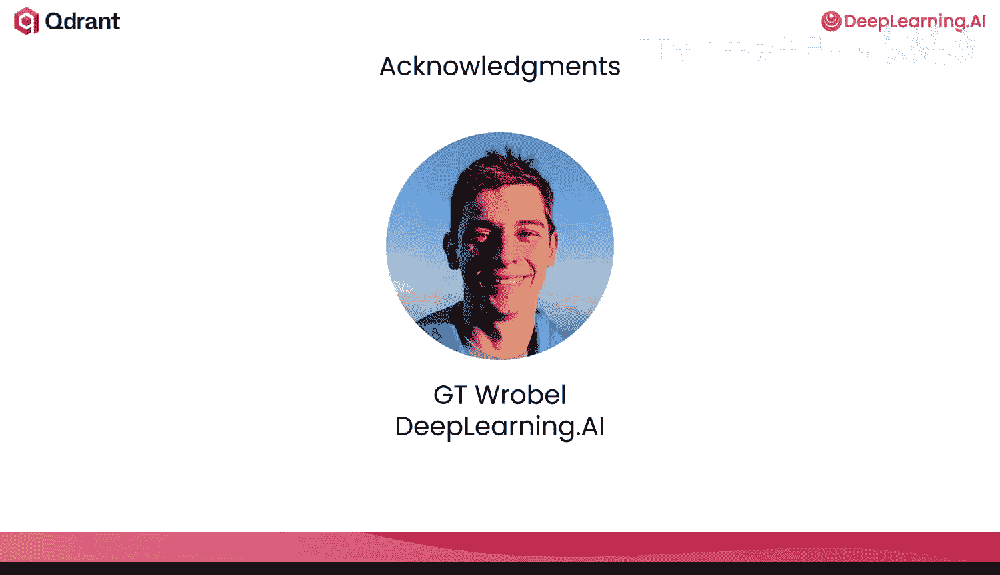
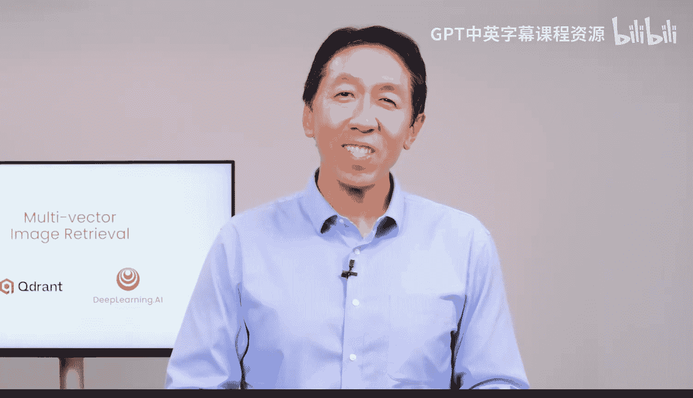

# 吴恩达《多向量图像检索｜Multi-Vector Image Retrieval》中英字幕 - P1：1.introduction.zh_en - GPT中英字幕课程资源 - BV1HjmrBzE2L

Welcome to multive image retrieval built in Poef with of quaant。😊。

In this course， you learn how multi vector image retrier works and best practices for using it in your AI applications。

 For a long time， it was easier to give ElMS access to only text data。

 but that leaves a lot of useful information inaccessible because it's stored in images and other forms of multimod data。

😊，This course focuses on a collection of image retrieval techniques called multi vector。 In contrast。

 standard vector retrieval works by representing each document or image with a single large vector。

Images retrieve if their vector is a good match for a query。

 multi vector techniques use many smaller vectors to represent the meaning of say smaller patches of an image。

😊，Storing this detail vector information then allows for fine grain matching between the tokens in a text query and the image patches that make up your image or document。

 This approach can provide high quality image search that works well even on complex documents as they combine text images slides and storing of vector data does lead to challenges with memory usage and search。

 but some new techniques address these problems and you explore these solutions as well in this course。

 Tell you to understand these multi vector image retrieval techniques I'm delighted to introduce your instructor for this course。

 Kaasper Huali who then experienced AI engineer and a developer advocate for the vector database company coordinate。

 Thanks Andrew。😊。

You will first learn the fundamentals of multi vector retrieval by seeing how it works ver text。

 Then you will see how this approach is adapted for image retrieval by a model called Col polyli and some techniques for optimizing its performance。

Finally， you will explore how an approach called Movea aims to combine the best qualities of multive and single vector image retrieval。

 You will learn the foundational concepts underlying each method and then we' implement them inside of a functioning multimodal rock system。

 You can expect a nice blend of conceptual and practical topics throughout this course。

 There's been a lot of excitement around the industry about image retr broadly。

 and specifically multive techniques。 Most of the LLMs that people are using today are actually VLMs or vision language models。

They are just as capable of processing images as text。

 The challenge has been building system that can accurately and efficiently retrieve image data to take advantage of that capability。

 The techniques in this course like Copili or Movea， are finally doing that。

 I really think this is the future of this field。 and that will see powering many exciting applications in the coming years。

 Many people have worked to trade this course from Dblal AI G T Robpo contributed to its development。

 In the first lesson， you get familiar with multi vector retrieval by getting hands on with Cot。

 which is a widely used multi vector approach for tax retrieval。 Jo Casper， in the next video。

 and let's get started。😊。

