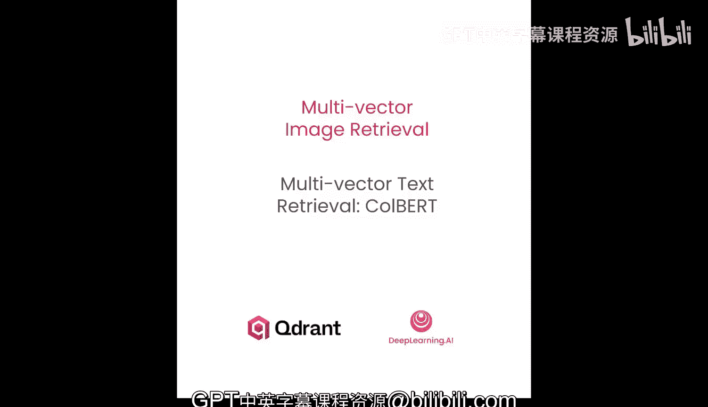
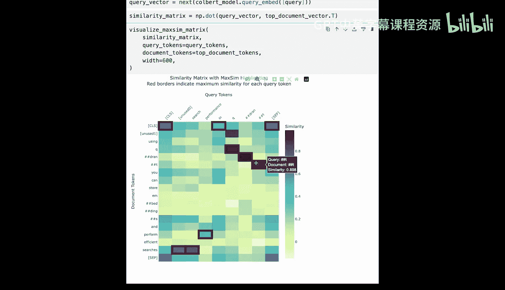

# 吴恩达《多向量图像检索｜Multi-Vector Image Retrieval》中英字幕 - P2：2.multi-vector-text-retrieval-colbert.zh_en - GPT中英字幕课程资源 - BV1HjmrBzE2L

Let's get started by first looking at the concepts underlying multi vector retrieval to help you get oriented。

 Let's start by seeing how it works vertex。 Let's dive in。 I assume if you are taking this course。

 you are already somewhat familiar with the fundamentals of vector retrieval and concepts like dense and body vectors。

 vector similarity， App nearest neighbors awards and the H and W indexes that power them。 If not。

 I highly recommend you take quadrants first course here with deep learning。

 which introduces you to all those concepts。 Either way。

 let's do a quick review of what retrieval is and how it works。

 Retrieval is important because LLms can possibly be trained on all information relevant to the prompt they will receive。

 retrieval augmented generation or rack Per and LLM with a database of relevant information。

 When the system receives a prompt， it will quickly search the database and retrieve the most relevant documents。

 The original prompt is then。😊。

Quified to include their retrieve documents， allowing the LLM to consider that information to oil generated tickets response RaC can significantly improve the quality of LLM responses and is one of the most widely implemented types of generative AI systems。

 For example， a customer service chatbot would be much more helpful if it can access your company's product and policy information Comp achieve that by pairing an LLM with data sources from which relevant information can be retrieved。

The most common type of vectortrieval is called a by encoder。

 Every document in the knowledge base is assigned a vector representation by an ametic model。

 When a query is received， it is also embedded to a vector。

 The system will then search the database to find the documents whose vectors are located closest to the query vector。

 The primary benefit of by encoders is that they are very fast。

 One reason for this is that the document vectors can be precomputed ahead of time。

 Even if you have a billion documents your database。

 you only need to generate their vectors once at search time。

 you are only generated a single vector for the query。

 The search process itself is also extremely fast。 thanks to the use of approximate nearest neighbors algorithms。

 They easily scale to billions of documents。 The main issue with the by encoder is that they essentially compress the meaning of each document and prompt down to a single vector。

 This kind of a very discount the meaning of the documents and prompts。

And can miss nuance connections between them。 cross encoders take a approach。

 The full text of the query and document are fed to the crossencor neural network at the same time。

 This lets the cross encoder， detect newance relationships or interactions in unique between the query and document。

 The cross encoder will then directly output a relevant score， which can be used to rank documents。

 cross encoders tend to produce very high quality results。 but they scale horribly。

 since they require the full document and query text to generate scores。

 No precomputation is possible， and every document your score requires a computationally expensive forward pass through the neural network。

 As a result， cross encoders are only feasible to use when searching small numbers of documents。

 usually 10s or fewer。 the best use of a cross encoder is to rewrnk the results retrieved by other techniques。

 Let's say you had 1 million documents to search through。 You can use a by encoder to。

Quickly find the 50 best matching documents and then rewr those results with a cross encoder to find the five absolute best matches。

 Ideally， you'd have a technique that enables pre computationutation like a by encoder and deep token level interactions between the queryarian documents like with a cross encoder。

 multive techniques were introduced to do just that。 So let's have a look at how they work。

 The most common multive technique for text is called convertt。

 Let's see how it works with a simple example。 Let's say this is the text of your document。

 First of all， the text is split into tokens。 Next。

 these tokens are each assigned their own embedding vector。

 This vectors not only reflect the meaning of that particular token。

 but also its meaning in the context of the whole document。 If this where a by encoder。

 the next step would be to reduce all these vectors down to a single vector through a process called pulling The most common pulling approaches is to just average all these vectors。

😊，Given a single vector representation of the whole document in Colber， however。

 you keep all of these vectors。 the process of representing a query works identically。

 The query text is converted to tokens， and each token is assigned a dense semantic vector。 Now。

 let's score this query document pair。 The approach is called maxim similarity or simply max Sim。

 The idea is that each query token finds the most similar document token。

 This is what it look like for a token pupppy。 The vector for ppy is compared to the vectors of each document token using a typical vector distance measure like the dot product or cosine distance。

 Here you would expect to match most closely with the token do。

 This process is then repeated for every token in a query。

 The maximum score of this query document pair is then just sum of the maximum similarities over all the query tokens。

 Maxim is different from other distance measures in that it is。

Asymmetrical the distance between A and B is not the same as the distance between B and A to convince yourself of that。

 imagine you just flip the text used for the document and the query in the last example as shown here。

 Orin， the maxim was the sum of3 dot products。 but now it is a sum of5。 As a result。

 you can take advantage of the highly optimized approximate nearest neighbors algorithms that typically power vector search。

 The issue arises when you try to build the H ands W index that the algorithm uses for search。

 This graph relies of knowing the distances between each document and a few of its nearest neighbors。

 Since maxim is asymmetric a might be a nearest neighbor of B。

 but B isn't necessarily a nearest neighbor of a This inconsistency prevents building the graph at all。

 and so when youre using multive search， the H ands W index is usually disabled。 Cober。

 you ultimately delivers on its。GoesIt allows precomputation of vectors like a by encoder while the interactions between the query and document tokens emulate crossenrs。

 Since HsW cannot be used effectively for multi vector retrieval。

 you rarely use them alone for search over bigger datasets If you did then you would need to perform a brute force fool can search over all the documents which is too slow to use at scale。

 a more common way of using late direction models is as a reraner of the results of faster techniques like a byenr。

 typicallyp a faster retriever is used with oversublink。

 meaning you retrieve more documents than you eventually want to return。

 you then use the multives as a reranking step So the maxim is only calculated on a limited set of candidates。

 The biggest downside of cbert is the amount of memory it requires with one vector sort pet token。

 you can easily have hundreds or thousands of vectors stored for every document。

numbersumb add up quickly， especially if you have a million scale setup。

 which isn't that unamped nowadays。 Imagine your document has10 tokens。

 Each of them gets 1 hundred28 dimensional embedding。

 and each number is represented by a4 byte float that's half a megabyte just for the vectors a by encodecor only stores a single vector per document。

 Even if your vectors are very high dimensional， you usually won' exceed even 10 kiloby per document。

 which makes that scale easier to manage late interaction models are middle ground between single vector embedding models and crossenrs。

 they need more memory and are more expensive to run than any other embedding models。

 yet they still allow to precompute their representations of the document and do not require to pass them through the neural network for each query More recently we started to see much value in applying similar methods to other modalities than text and they also seem to be working better than their predecessors Before we discuss different modities。

Let's explore how late interaction models are used in practice。

We'll start by loading Colbert V2 a late interaction model developed at Staford。

 Colbert encodes text into 120 dimensional vectors for each token。

 enabling finegra thematic matching。 Let's load the model into memory and see its embedding dimensionality。

 It's 128。 Before we create embeddings。 Let's understand how Colber processes text。

 tokenization is a process of breaking text into smaller pieces that the model can process。

 Colbert uses word best tokenization and add special tokens like Cs at the start and used one for document encoding and Sep at the end。

 regular words are either represented as separate tokens or sometimes a word might be split into multiple tokens to Let's define our document。

 We have a simple helper method to handle the tokenization process。

 If you are interested in the technical details， feel free to check the function definition in the helper do pi file。

 Let's see how our sample document。It's token nice。

Majority of words are represented as single tokens， However。

 decibels is split into three separate tokens， which are on a subward level。

 Let's simply check how many tokens our document was divided into。

 Our document consists of 55 tokens。Now that you understand tokenization。

 let's create embeddings for your document and traditional dense models that produce a single vector。

 Colbert generates one embedding vector for each token， and as you saw our document has 55 tokens。

 so Colbert should also create 55 separate 128 dimensional vectors。

 one for each token in the tokenized sequence。Notice the shape。

 This confirms we have 55 token embeddings， each represented by 128 dimensional vector In practice。

 when working with longer documents or data trunks， you can expect hundreds of tokens per embedding。

 but the principle remains the same。 One vector per token。Now， let's define and en your query。

 which is wayway shorter than the document。 Colber encodes queries differently than documents。

 It paths queries to a fixed length or 32 tokens to ensure consistent comparison across different queries。

 but it also assumes a query cannot be any longer。 While your query has only a few words。

 Colber will generate 32 token embeddings with extrapadding tokens to reach this length。

 If you make it longer， it may get cut off。 As expected。

 We got 3228 dimensional embedding7 query was relatively short。

 Let's see how the tokenization of the query looks like using the same helper method like we use for the document。

 It has an additional parameter to control whether we create tokenization for the document or a query。

 As you can see， majority of the tokens are just some padding tokens。

 which are automatically added to the query。 Nevertheless， each of the words。

Of the original query was just converted into a single token。 Now。

 let's see late interaction in action。Will compute the similarity matrix by taking a dot product between every query token embedding and every document token embedding。

 This creates a 32 by 55 matrix where each cell represents a similarity between a specific query token and a specific document token。

 In the next step， you will only select the maximum similarity for each of the query tokens and sum them up across all of them。

 The maximum score of our document for the query is around 17。

 Let's visualize the similarity matrix as a hit map。

 We have another help of function that does exactly this。

 Each cell shows how similar specific query token is to a specific document token。

 Like the colors indicate lower similarity and the red border is used to highlight the highest score。

 You can see which query terms like advantages or cars much most strongly with。😊。

Each document terms like benefits and fleets。 This visualization helps you to understand why Colber finds certain token purse relevant For clarity。

 All the mask tokens are removed from the query， but they also contribute to the final score。

To appreciate the benefits of Lake interaction， let's compare Colbet with a traditional lens embedding model。

 you load one of the popular embedding models from Fast embed and use it alongside Colbert to see how the search results is differ in practice。

Now， you will create a quadrant collection that can store both dense and multi vector embeddings。

 You will keep the collection name and vector names as variables。

 so you can easily refer to them later on。 Now， the real collection setup up。

 notice the special configuration for Col。 You enable multi vector cong with the max comparator。

 which tells quadrant to use the max scoring that we discussed earlier。

 you also disable H andsw graph creation by setting the m parameter to 0。

 Since this data structure cannot be effectively used for multi vector search。

 Let's create some example documents about quadrant and SQl databases to test the search conality。

 Now you will insert this documents into the collection you created earlier。

 You will create both dense embedding and multi vector representation using the cber model。Now。

 let's search using bothuff approaches。 We'll create a helper function that will query the collection using Colbra embeddings。

 We pass a query， and the vector is generated using the model you defined earlier。

 Please mind that you are calling query embed not passage embed anymore。

 because certain models may process queries differently than the documents。

 You can also specify the number of results you want to retrieve。

 Another helper function will perform the same process， but using the regular than embe model。

 You have both methods defined。 So let's create a query。

 feel free to play with different queries to see different outputs。

 You might be wondering why we specifically selected this particular query。

 proper names such as the names of companies are quite often divided into multiple tokens consisting of even single letters。

 Such a token cannot effectively represent what that particular company does。

 and it's more like a fallback。 Even though we all know query run is a vector search engine at this point。

For our culber model， it's nothing more than a sequence of letters to confirm that our query is divided into that many tokens。

 let's use the same helper function like we used before。

 Indeed quadrant was divided into three separate tokens what proves that culber was not exposed to the name of the company in this strain data。

 In dense andman models， this kind of tokens will contribute to the final pulled vector。

 but they will be most likely just some kind of a noise with tokenle interactions。

 you can expect such multi token sequences to be better matched between the documents and the queries。

 It's time to run search using both approaches to retrieve the results here you can see how long it took to generate culber dense vector and also how long it takes to return the results。

 We have another helper function with a simple visual comparing the search results of both methods。

One key advantage of Colbert's token level matching is its ability to capture specific terms like proper names。

 In this case， quadrant better than pull dense vectors。

 Since individual tokens retain their semantic identity throughout the matching process。

 Notice there are differences between Colber and dense embadding results， but it's hard to say。

 what was the winner。 There is an overlap， but eyeballing is usually not enough。 In real word cases。

 we build reference gr of data sets to ensure the returned results are of a high quality。

 What I'm noticing from this simple example is that all of the Colber results mentioned quadrant。

 which is not true for the dense results。 which is kind of expected because our query has mentioned quadrant。

 Let's check how each of the query tokens contributed to the score for the best result as retrieve by Colbert。

 We can use the same heat map， like you used before。 for that。

 we need the tokenization of both the document and query as well as their Colbert representation。

A similarity matrix is the last missing piece。 As all the components are ready。

 let's finally display the hit map。 It's not surprising that perform and performance were the closest neighbors。

 however， Q。Tram and T were also contributing to the final maxim scores quite significantly。

 So even though Colber does not understand what Qron means。

 the token level interactions helps to implement keyword matching。

 That was just a very quick introduction to how multi vector techniques were for text。

 Let's join in the next lesson to see what those techniques looks like for images。

