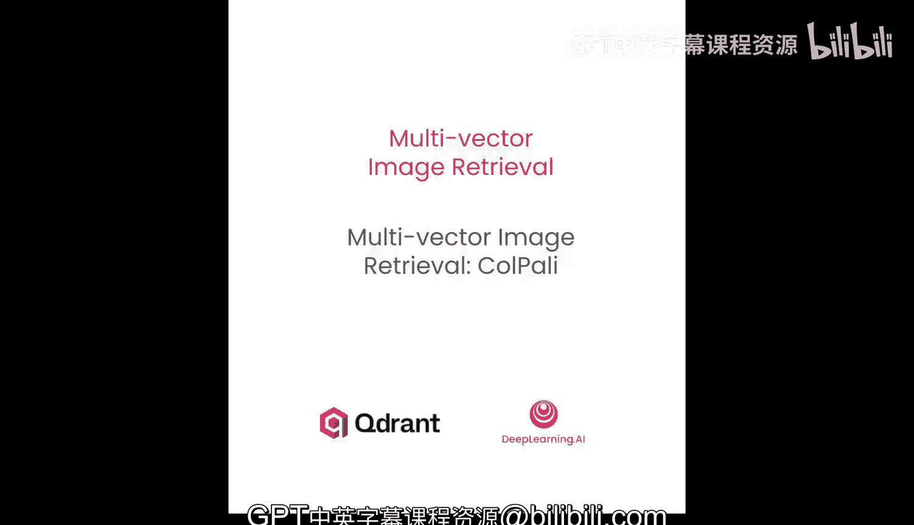
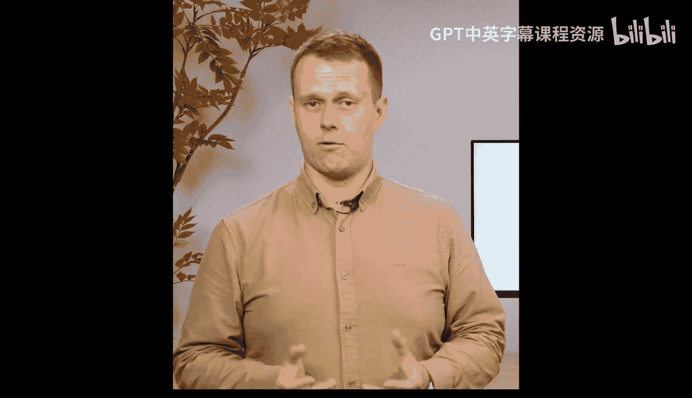
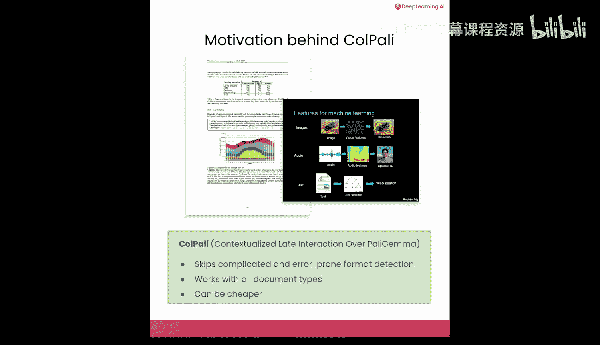
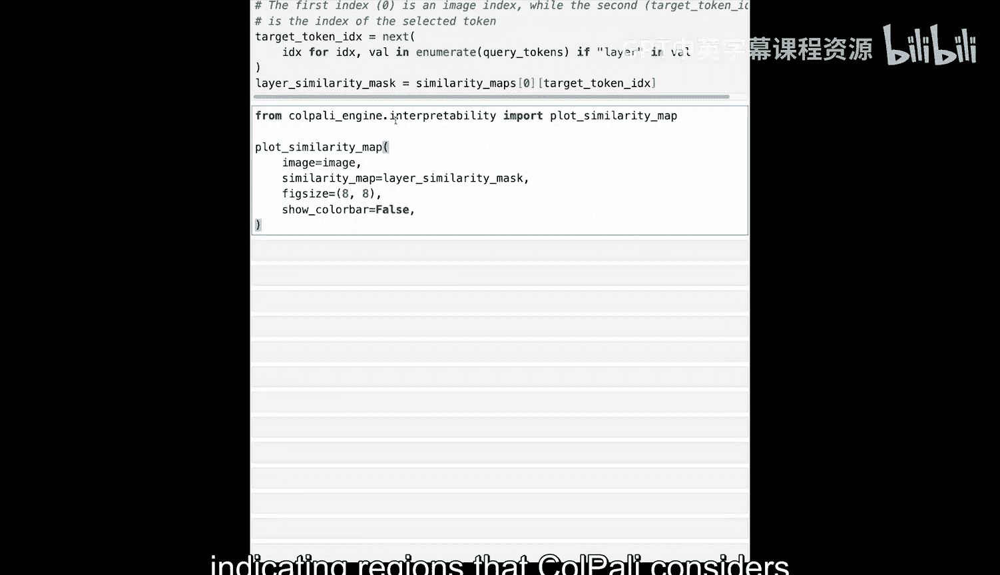
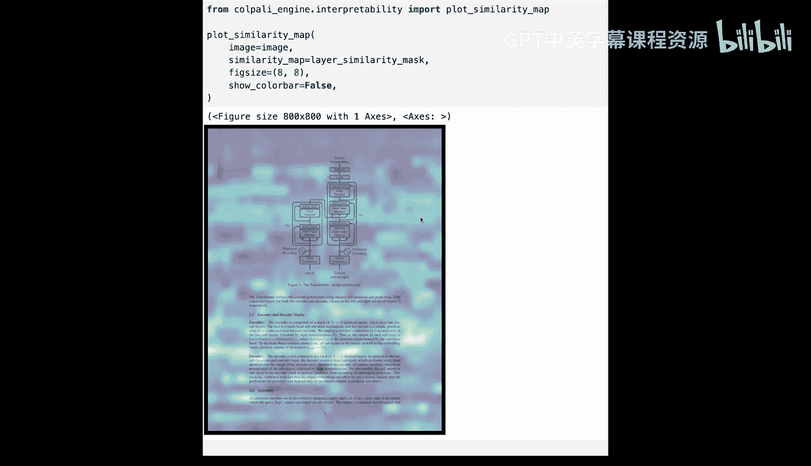
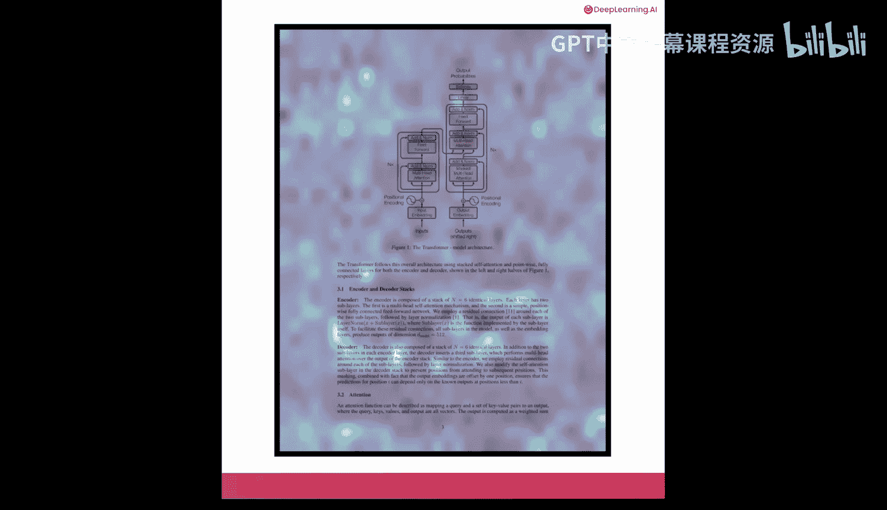
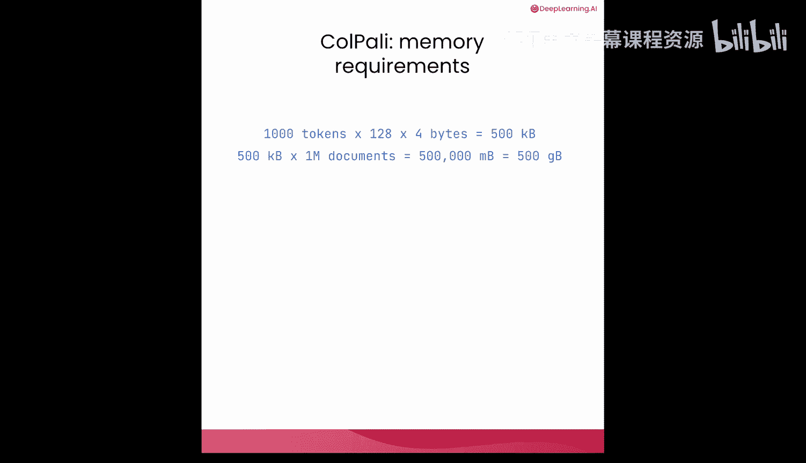

# 吴恩达《多向量图像检索｜Multi-Vector Image Retrieval》中英字幕 - P3：3.multi-vector-image-retrieval-colpali.zh_en - GPT中英字幕课程资源 - BV1HjmrBzE2L

You just saw how multi vector approaches can be used in text retrieval。 Now。

 let's build on what you learned and look at how a similar approach can be used in image retrieval。

 All right， let's go。 imagem retrieval is important because a lot of useful information is not stored as text。

 It stored in image files。 Sometimes this means actual images， but scan documents。

 P files or slide deck are also essentially images。

 A new generation of vision language models are able to accept both text and images as input。

 So if you retrieve the right documents， you can build capable multimodal rack systems。

 The challenge is completing that retrieval step。 documentsments are the most common type of image。

 Comp want to retrieve。 but they present a lot of challenges for retrieval。

 Slides or document pages can be a complex mix of text， I， charts and tables。

 The traditional approach for par this kind of document is to first use special models to detect the layout of the document。

 and then parse each。😊。

And type separately。 This approach requires you to build a complicated custom system that often is still fallible。

 What's worse， a retal pipeline for one kind of document often won't work on another。Copali。

 a multi vector image retrieval approach addresses many of those issues。

 Copali stands for contextualized linear direction over polylijama。

 Palijama is the name of a visual language model created by Google。 However。

 the name Copali is also quite often used to describe the whole family of models built on the same principles。

 Multi vector emmb models built on top of vision language models。

 which can take both images and text as input。 This is similar to Colber， which is a specific model。

 but also is often used to refer to a whole family of multive text retrieval techniques。

 Copali has many great features， It skips the complicated and error prone format detection step。

 and it works flexibly across all document types。 While it can be somewhat costly to run。

 It can also end up being cheaper in the long run because your system is relying on a single model instead of many models that traditional approach relied on。

 Let's see how vision language models are adapted for retrieval and then。

Apply them in practice。 A typical workflow over La language model goes as follows。

 Your input text is passed to a tokenizer。 The role of the tokenizer is to split it into smaller units called tokens。

 and to create a sequence of token ids， which is then passed to a model。 In reality。

 the model translates this Is into the corresponding token embeddings it learned during the training。

 Those vectors are static and specific to each of the tokens。 For the time being。

 let's assume that the input of the language model is a sequence of token embeddings。

 D language model passes the sequence through this own layers and produces a contextualized embedding of the current token that takes the whole sequence into consideration。

 This vector is typically used to generate logicits and then probabilities of each of the tokens in a vocabulary to be a continuation of the sequence。

 and vision language models are not different here。 If we use them for text generation。 However。

 adding another modality requires some extensions of that。

Architecture vision is an entirely different modality， so it cannot be converted into text directly。

 Thus， it has its own preprocessing pipeline， which obviously starts with an entire image。

The overall goal is to process the image in such a way that you input it as a sequence of embeddings into the language model like you do with text。

 So the image is being processed through an additional transformer。

 which actually convertverses it into image patches of a specific size as a first step。

 A single image becomes a sequence of patches。 not a single input。 similar to text。

 which is processed as a sequence of tokens。 not as an entire document。

 image input is passed through a neural network that is a vision transformer。

 and it again produces a sequence of contextualized vector embeddings。 One for each input patch。

 typically highly dimensional。 The output has to be then projected onto a smaller dimensional space and then passed to the language model。

 The reason for the last step is to make the image vectors have the same number of dimensions as the text vectors。

 All in all， this additional process enables a different modality to be passed to the same network。

 No matter the input modality， the language model will produce an embedding。😊。

That will be used to generate logics and probabilities of each of the tokens later on in the generation process。

 So ultimately， a typical vision language model adds some extra processing to the images。

 while keeping the text processing intact compared to pure language model。

 A VLM still predicts the next token， given the input So you are not done yet with the embedding generation。

 You don't want a generative system， but something that will represent an input for the retrieval in a form of vector embeddings。

 in order to produce vector embeddings。 you need to slightly extend the logic of the VlM and add another projection layer just right after the language model generates the hidden states from its final layer。

 This projection layer reduces embeddings for efficient storage for Gema。

 it goes from 2048 to 128 dimensions， but it may differ between the models。

 There is no pulling at the variant。 So ultimately， the entire input sequence。

 no matter the modality。Is transformed through that network。

 and you get a sequence of the same length that represents your input。 In general。

 It's not enough to just start using Vlms for vector interval。

 There is some additional training required for both the final projection layer and language model parameters。

 Many papers suggest using lower rank adapters to the language model attention weights。

 Low rank adaptation adds lower rank mattresses to the fros and base model。

 The term lower rank refers to the dimensional complexity。

 where a lower rank means the mattress can be represented as the product of two smaller mattresses。

For example， instead of training a full 2048 by 2048 weight matrix。

 requiring over four million parameters， Lora uses two mattressrices of size 2048 by 32 and 32 by 2048 requiring only around 131000 parameters which is a 97% reduction the training process adjusts the whole model for effective retrieval。

 but due to this optimizations it's easier and faster than full p tunic practically you don't need to know all these details to start using Copili you will start by loading the appropriate model based on available hardwareware while Co polyli is a more powerful one。

 it requires a lot of memory to run or even better a GPU for that reason you can also use cosmo which is a smaller variant with 256 million parameters that you are able to use here on the Dlu platform feel free to run it on a different environment with a full call poly。

Model， so you can see the difference。 no matter which model you end up using。

 you need a processor that works with raw data and converts it into a presentation that the model can handle。

 Let's load a page from a famous attention is all you paper to see how call poly processes visual documents。

 This Pf page contains diagrams equations and a lot of text You will also use pillow to load the image and check its dimensions This high resolution screenshot preserves all visual details from the original Pdf Copy processes images by dividing them into a grid of patches。

 similar to how a vision transformer works。 for co poly v1。3。

 This is always a fixed 32 by 32 grid for Colmo， the grid dimensions adapt to the image aspect ratio。

 Let's visualize how this particular image is divided into patches by adding some spacing between them。

 You have a helper method。To do exactly this Now you will process the image through Copi processor。

 This processor converts the image into a batch of tensors containing input Is。

 attention masks and pixel values that the model can understand the processed batch contains input Is that vary by model。

 It's a031 for co poly or 1 thousand39 for cosmo。 Let's decode this to see how Copi represents the image internally。

Notice the sequence contains024 special image tokens representing the different patches of the image。

 followed by instruction tokens。 Co poly processes the image as a grid of patches。

 creating embeddings for each patch for Co poly， it's always a fixed 32 by 32 grid。

 while for cosmo the grid dimensions vary based on image size。

 Let's generate embeddings for the image。You end up with 128 dimensional vector for each token you just。

For search and search， we may prefer the embeddings corresponding to the image tokens。

 not the instruction tokens， using a helper function to extract the image mask。

 We isolate this thousand24 image patch embeddings。

 This number is fixed for call poly and might be different for cosmo but but by a random chance。

 it's exactly the same number of patches created。 One powerful feature of callpi is its interpretplayability。

 We can visualize exactly which parts of an image are most relevant to specific query tokens。

 Unlike traditional dense embeddings that produce a single pack similarity score。

 Copi's token level embeddings allow us to see how each word in our query relates to different regions of an image。

 This makes the models's reasoning transparent and helps us understand why certain documents are retrieved。

 Let's explore this capability by creating a query and visualizing how it matches different parts of our document。

 We'll create a query asking about the transformer architecture。

This page from the attention is all need paper contains the famous transformer diagram。

 so we expect Co polyly to highlight those specific regions when processing our query。

 you will process the query through the model to get query embeddings Each query token is also represented by 128 dimensional vector。

 but there are just 21 tokens created out of the query。

Let's clean it up a little bit by removing padding and argumentation tokens and then retokenize so we can see the individual query tokens to analyze them further。

To create our similarity visualizations， we first need to calculate how many patches the image was divided into。

 You will also extract the image mask to isolate just the image token embes。

 excluding the extraction tokens。 Now， you will generate the similarity maps using coulpi interpretability tools。

 This computes the similarity between each query token and each image patch。

 creating a heat map for every token in our query。Let's visualize the similarity map for a specific query token。

 you will select the layer token from the query to see which parts of the image it attends to most strongly。

 this visualization will overlay a heat map on the original image where formerer colors indicating regions that Col poly considers most relevant to this specific word。

This interpretability feature is valuable for debugging and understanding your retrieval system。

 You can identify whether the model is focusing on the right content。

 Disc unexpected matching patterns and build trust in the systems decisions。

 in production applications， This transparency can also help explain retrieval results to end users。

 However， since we are using the smaller call small model here。

 you can see that the model seems to be paying attention to some background patches。

 which is slightly unexpected。 Let's see how it looks like for the full call polyli model。

 This is how the same singularity map would look like for the bigger call poly model。

 Call model performs some pixel shuffling。 So the model was focusing on some random locations。

 But for call poly， you can see the model mostly pays attention to the word layer。

 O multiple times on that page， which is expected， as that's the token， you are visualizing。

 Let's build a practical multimodel search system using quadrant。 will set up a collection with。

the vector support using Mac Sm comparator to handle call poly's multiple embeddings per document。

 You will also disable H andSW graph creation as Quaant can't use it effectively either way。

 Now we will index all pages from the attentionist of you paper。

The load precomputed flag is set to true， which will load precomputed vector data for each page rather than computing it live。

 Each page's vectors are then uploaded to quadrant a log with the image file path as metadata Let's create a helper search function that processes text queries and create called polyiumbeddings for them。

 the same function will also query the collection you have just created to get the closest matches。

Since we are working with visual data， we have another helper method that displays the search results on the screen。

 Let's search for model architecture to see which pages of the paper the model considers to be the best hit。

 We ask for the model architecture。 So it's not surprising that this most famous diagram is coming up first。

 but there is also a certain section of the paper， which is called model architecture。

 So it's also selected as one of the best pages to answer that particular question。Next。

 let's search for scaled dot product attention。Again。

 the diagrams in the first results returned are presenting exactly this。

 but there is also a part of the document， which is called scale dot product attention that also got captured by the co retrieval。

 Finally， let's search for experiment results。 The goal here is to retrieve pages containing tables and performance metrics that we would expect the paper to contain。

 Copi seems to understand both textual content and visual elements like tables and charts。

Surprisingly， the first page of the whole paper is returned as a top match。

 even though it doesn't seem to contain any kind of a table summarizing some experiments。

 Nevertheless， the experiment results could have been mentioned in the abstract or maybe in the footnotes of the article。

 So it nothing that surprising。 Nevertheless， the second and the third match。

 They both contain some table summarizing the efficiency of that particular method versus the other methods。

 that this is actually something we would expect from this kind of system to return。 The sumit app。

 Col poly enables powerful multimodel search over visual documents without requiring an O C R step or complex document processing。

By processing documents directly as images， it captures both textual and visual semantics naturally。

Multivector representations come with certain limitations。

 assuming each of the documents needs half a mete， and you have a million documents。

 You may end up with 500 gig of memory needed just to keep all the co poly embeddings for search。

 That might be fine for lowscale projects with thousands of documents but in practice。

 You often deal with billions of them and it would require a significant amount of memory to run。

 Having a million documents in the retrieval system is quite likely if your company has a lot of data to search over。

 Typically， this vectors will contain a lot of redundant information。

 and some interest in optimization techniques can help you reduce their Ram consumption。

 Let's discuss this methods in the next lesson。

