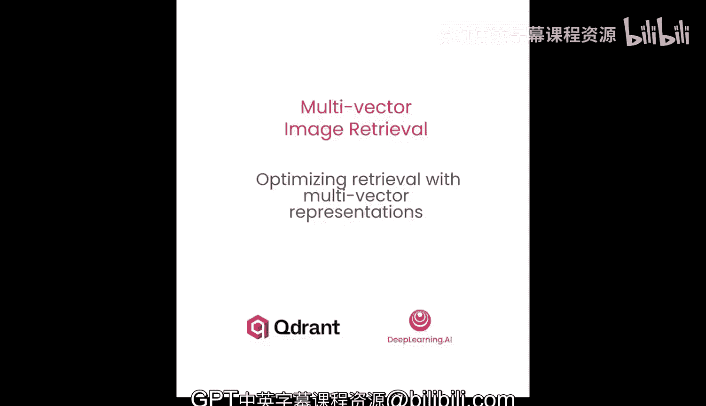
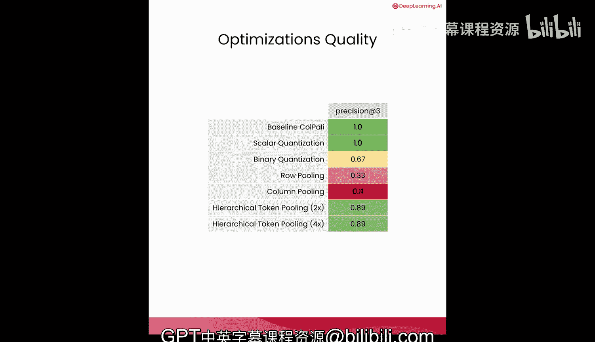

# 吴恩达《多向量图像检索｜Multi-Vector Image Retrieval》中英字幕 - P4：4.optimizing-retrieval-with-multi-vector-representations.zh_en - GPT中英字幕课程资源 - BV1HjmrBzE2L

One major shortcoming of Copili is that it requires significantly more memory than other techniques in order to store all the vectors for each document。

As a result， optimization techniques are used to reduce goldpi's memory footprint。

Let's see what those approaches look like。 The first is color or binary quantization。

 which converts the floating point numbers in each vector to a condensed format。

 like a four bit integer or even one bit。 The second approach is row or column pulling。

 patches are grouped together by rows or columns and the vectors in each group are pooled usually by a veraging to create a single vector。

 The final approach is hierarchctica pullinging， which is essentially more intelligent row or column pulling。

 patches are grouped with other patches that have similar emmbic vectors。

You will start by loading the document embeddings in the previous lesson。

 you've learned how call poly converts Pdf pages to screenshots and generates multi vector embeddings Here you will use a helper function that handles all of these steps internally。

 Pf conversion， image loading and embedding generation Since these details were covered in the previous lesson。

 you can focus on what matters for this one optimization techniques。

 You will use precomputed embeddings to keep this lesson moving smoothly。

 but you can also set load precomped to false to see the entire process。

 You will load the call poly processor to demonstrate how call poly structure document images as patch grids。

 This will help you understand the spatial poly techniques will explore later on。

 Another helper function handles all the complexity。

 Either loading precomputed embeddings from parque files or generating them fresh by converting Pdfs loading the call poly model and processing images in batches。

Load or Comp image embeddings function returns a data frame with image paths and embeddings already converted to Hai。

 Here is how some of the entries look like。 Obviously， since you are working with images。

 we can also display them on the screen。These slides are coming from different deep learning AI courses。

 so if you have ever took any of them after completing this one。

 you will be ready to just ask question directly to the slides。

 Each page generates around thousand0 token embeddings that's a lot of vectors to stir and search over。

 but let's see how the individual shapes of the embes look like。

It's consistently 1031 vectors per image。 You can now implement different optimization techniques。

 one by one and eventually compare them on the same dataset set。

 Let's start with sc and binary quantization。 When we calculate the amount of memory needed to store the vectors。

 A common factor is the size of each individual dimension。

 Standard embeddings use 4 byte flow 32 values per dimension。

 but if you could reduce that size without sacrificing search quality。

 you would have an easy way to save significant Ram。

 Sc and binary quantization techniques aimed to represent vectors using either one by inger。

 or even just one beat per dimension， and they are widely used for regular dense embeddings from by encodes。

 Scar quantization compresses flow 32 values， which are four bys down to8 values。

 which are just one by。 achieving four times compression。

Scalar quantization works by mapping the continuous float rangerench to discrete integer buckets For each dimension。

 the quantizer learns the minimum and maximum values across the entire dataset set and then linearly maps this rangerench to the 0 to 255 integer space。

 For example， if dimension 5 ranges from negative 0。8 to 1。2 across all vectors a value O of0。

2 would map to approximately a1 28。 This makes scal quantization data set aware。

 It requires analyzing all vectors or at least a representative sample to de the optimal ranges。

 Fortunately， vector search engines like quadrant handle this process eternally。

 We simply configure quantization at the collection level sent our original float embeddings and the engine handles the compression and rangeren calibration automatically。

 binary quantization takes compression even further。 reducing each float30。

2 dimension just4 B down to just 1 beat， achieving a dramatic 32 times compression ratio。

 The process is simple。 Po values become1， While negative or0 values become 0。

 This extreme compression transform similarity calculations into efficient Pwise operations。

 binary quantization works particularly well when embeddings are centered around 0 with relatively symmetric distributions。

 which is common for normalized neural network outputs。 However。

 this aggressive compression does come with tradeoffs， like scalle quantization。

 quadron handles binary quantization internally， we configure it at the collection level。

 and sent original float embeddings， letting the engine perform the binary conversion。

A pulling approach can take advantage of call pi spatial structure。

 Remember from the previous lesson that call party processes document images are 22 by 32 grid of patches。

 row pulling averagevaris embeddings along each row of the grid。

 While column pulling averages along each column。 This preserves spatial relationships while dramatically reducing the number of vectors to just 32。

 Let's extract the image patch embeddings。 The processor creates a sequence of 1024 image patch tokens from a 32 by 32 grid plus a few spatial tokens for the models architecture。

😊，For the pulling methods， we don't need these additional tokens。

 so we can use the image mask from the processor to extract only the image related token positions。

By filtering to just the image patch sts using this mask。

 we can reshape the flat sequence of 1024 embeddings into a 32 by 32 by 128 grid。

 Let's create a helper function that does exactly this。

 Each position in this 32 by 32 grid corresponds to a patch location in the original image and each patch has a28 dimensional embedding。

 Let's test your reshaping function on the first documents embedding。

 You've just applied the embeddings grid function to verify it correctly transforms the mask embeddings into the expected 32 by 32 by 128 dimensional structure。

Once our embeddings are in a grid form， you can implement row and column pulling as simple9 powers。

 row pullinging averages each of the 32 rows of the grid。

 resulting in 32 representative vectors that capture horizontal patterns across the document and similarly。

 column pulling averages each of the 32 columns， capturing vertical patterns。

 Both methods reduce the total number of vectors from 1024 to just 32。

It's not that easy to tell anything just by looking at these numbers。

 but just to confirm the shape is correct。 you will run row min pulling on the created grid。

 and it's truly 32 by 1 hundred28 dimensions。 The same goes for column mill pulling。

 After calling the method。 We can see that the shape matches the expected size。 Nevertheless。

 these do not spend much time looking at the numbers we can interpret。

 Hierarchical token pulling uses clustering to intelligently group similar embeddings。

 The algorithm performs hierarchical clustering on the token embeddings。

 Then averages each cluster into a single representative vector。

 clusters are created from similar patches。 So if we have a lot of background patches of the same color。

 they should be grouped together。 The co poly engine library has an implementation of that technique available。

 let me show you a simple example of how it works。😊。

Assume you run hierarchical token pulling o image of 9 patches。 Each patch gets its own embedding。

 So our multi vector representation is a sequence of9 vectors。 If the pull factor is set to two。

 you create full clusters as 9 divided by 2 is 4。5， which runs down to 4。 I'm making this up。

 but probably both patches containing ears would end up in the same cluster。  Similarlyly。

 the patches with just four are also quite similar to each other。

 So it's quite likely they would also be grouped together。 A tile with eyes is quite unique。

 So it's likely to be a single patch cluster。 and so on and so forth。

 patches don't have to be contiguous to form a cluster。 Actually。

 the pulling technique gets a sequence of embeddings with no information about spatial relationships。

 So there is not even a way to do it。 The co poly engine library that you use has an implementation of this technique available。

 So you will just create a helper function。callled hierarchical token pullinging to have a simpler way of using it on our original embeddings。

 Let's run it on one of the examples that you have in the data set to see how much memory we are able to save by using this method with a pull factor of two you've reduced a031 vectors down to 515 cuttingtting memory usage nearly in a half while preserving the semantic information through clustering。

Now comes the crucial experiment， comparing all our optimization strategies in a real vector database。

 we'll create a single quadrant collection with multiple named vectors。

 each representing a different optimization approach。

 This allows you to directly compare retrieval quality and memory usage across all strategies。

 Orig embeddings， binary quantization， hierarchical pulling at different factors and spatial pulling。

 You will answer the key question。 How much memory can we save without sacrificing retrieval quality。

 First of all， let's make sure the collection does not exist。😊。

You will set up multiple named vectors in a single collection Each vector will use multi vector configuration with maxim comparison。

 but the number of vectors for pulling will vary depending on the strategy for quantization methods will enable them on the corresponding name vector to compare against the original。

Now， let's insert all our embeddings into the collection。

Each document will have seven different vector representations。

 allowing us to compare the retrieval performance side by side。

 the helper method loads pre computed vector data and also limits which slide deck are used to a subset of the entire list。

To avoid loading all the vectors into memory， the helper function yields the examples one by one。

You run the same queries across all the optimization techniques you implemented to compare retrieval quality。

The helper function handles all the complexity。 it will load precomp query embeddings or compute them fresh depending on the load precomp fly。

 the queries， the model and the processor are just created internally in the huber function。Now。

 let's search with each vector configuration and compare the results side by side。

 You will retrieve that top three documents for each query and optimization strategy。

 So let's define the order of the optimization so we can refer to them easily。

 You won't apply toque and pulling on queries， as they are already limited in terms of the sequence length。

 row and column pulling for queries do not make sense as there are no spatial relationships in text。

 Moreover， quadrant handles quantization internally。 So in all the cases。

 the called quadrant API uses the query embedding directly。 Thus。

 we have a helper method that runs the same query on all the vectors and presents them as a metrics。

 Let's visualize the results with actual document images side by side。

 This comparison shows precision metrics with color coding to quickly identify which optimizations maintain retrieval quality。

Precision here measures what percentage of the retrieve documents match those returned by the baseline。

 which is original embeddings。That shows how well each optimization preserves retrieval accuracy。

 Our first query， coffeeoff Mac returnss this set of documents as the top three matches。

 Scle quantization， binary quantization and hierarchical token pulling were all able to return the same set of results。

 Sometimes the order was slightly different。 Still。

 the precision does not measure the order of the documents。

 It focuses only on the fact of being relevant or not。 However， for column pulling and row pulling。

 we are getting slightly different set of results。 And we can clearly say that at least column pulling didn't do this job really well。

 Since you only have three queries， you can run them one by one。😊，It's time for the second one。Again。

 scalar quantization was able to return the same set of documents。

 but all the other methods struggled with that， especially column pullinging was not even able to pick one of the documents that were marked as relevant by the original call body embeddings。

Last but not least， let's check the last query， which is one learning algorithm。

Scallar quantization still provides exactly the same set of results like the original col poly embeddings。

 Similarlyly， hierarchical token pulling was able to return the same set of results like the original baseline vectors。

 Unfortunately， row and column pulling both do not seem to be working that fine。

 at least not for our data set。 However， in practice。

 we don't look at the quality of retrieval for specific cases。

 but calculate the metrics for all the test examples globally。

The average precision at 5 for all the tested methods look like this。

 column and row pullinging didn't perform well， as they were rarely able to select the most relevant document。

 As you saw in the examples in our notebook。 hierarchical token pulling work significantly better。

 and the pool factor does not even seem to impact it to much。

 So it could possibly increase it even more。 Surprily。

 a simple scala quantization method was able to consistently return the same documents as the baseline。

 making it a promising approach that does not require any preprocessing as it can be configure at the collection level only。

 binary quantization wasn't the greatest method out there。

 but given its huge possible impact on the memory usage and processing speed。

 it might be considered in some cases。 It's worth mentioning that you can combine multiple memory optimizations of a different kind。

 Scal quantization might be also enabled for the embeddings after applying hierarchical token pulling。

 If you see the。ity is still acceptable。 Nevertheless。

 a real benchmark should not focus on three handpicked examples， but be broader。 Still。

 evaluation is key and dependent on the data sets you are working on。

 experimentment with different techniques to see which combinations word best in your data。

