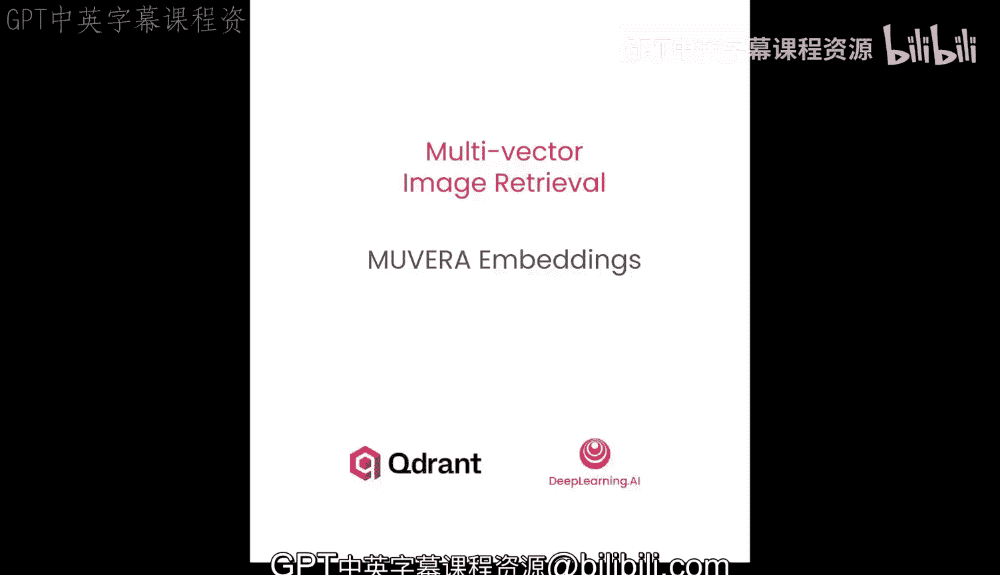
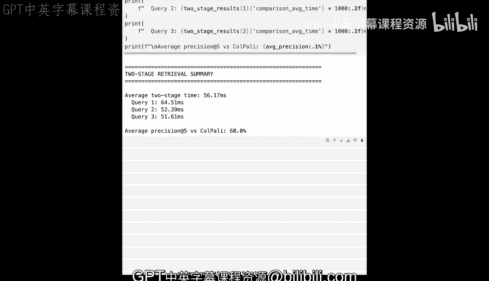

# 吴恩达《多向量图像检索｜Multi-Vector Image Retrieval》中英字幕 - P5：5.muvera-embeddings.zh_en - GPT中英字幕课程资源 - BV1HjmrBzE2L

Call poly's significant memory footprint can be addressed with optimization techniques。

 but it still doesn't scale well， since you can use it with H and SW search。😊。

Now， let's look at an approach called Movea， which unlocks HNSW search for multives and addresses ColPli's final major flow。

Let's go。

The idea behind Movera is to convert variable length sequences of vectors into fixed dimensional embeddings。

 making it possible to use the same approximate methods like we use for regular dense vector search Co poly can be used with H andW search because there is no way to build the H andsW index that powers approximate nearest table search for asymmetric similarity measure like maxim。

 As a result， C poly requires a brute force search technique that takes linear time。

 If you want to search a million documents with co polyli。

 you need to calculate1 million maxims Movera approaches that differently by converting sequences of vectors into highly dimensional single vector embeddings。

That enables the use of HSSW HSW instead scales in logar atmic time。

 scaling easily to millions or billions of documents。

It makes it more practical than original multi vector representations。

Lets review the steps required to implement that technique。

 The Movera algorithm is based on a few steps。 First of all。

 it aims to perform a clustering algorithm on the multi vector em bes。

 and the Mora paper suggests using locality sensitive hashing method， namely Simhash。

 As each of our tokens is mapped to a vector space in our case two dimensional Simhaush will then generate some random hyperplanes。

 splitting that space into two parts。 Each vector will end up on one of the sides as defined by the hyperplane。

 However， while hyperplane is just not enough。 Simhash will generate K hyperplanes。

 dividing the space to2 to the power of K buckets。 We can assign binary strings to each of these buckets by using either001 to indicate the fact of being on either side of the corresponding hyperplane。

 the length of the bucket I D will be exactly K。 In terms of the beats used。 In our case。

 it just two。There are exactly four different buckets。

 as that's how many value you can represent using two bits。

 After assigning buckets to each of the input token embeddings。

 we grouped the terms belonging to the same cluster together。

 S hasush aims to reduce the variable length of the sequences by finding some representative vectors for each of the buckets。

Document and query processing is slightly different In the case of documents。

 Sim hassh will take an average of all the token vectors belonging to a particular cluster。

 since some of the buckets might be empty， it will also fill them with the value assigned to the closest nonemp cluster in terms of the haming distance just to give you an intuition。

 the ham distance will be equal to one between the cluster Is that differ by just one bit。

 at the very end of that process， Each of the clusters will have a single vector represented it。

 That means no matter how many input vectors you had。

 you will always end up with  two to the power of k representative vectors。

Qury processing is slightly different。 Instead of taking an average。

 you sum all the vectors in the same cluster。This means that the resulting vectors will have larger magnitudes for clusters with more vectors aside。

The idea is that it preserves the natural distribution of query terms。

 which can be beneficial for retrieval。Unlike with documents。

 you do not feel empty clusters for queries。Querries are typically shortened the documents。

 so it's more likely that some clusters will be empty。

Feding them could to introduce noise and distort the presentation。

 as each term would contribute to the dot product multiple times。

 So if there were no tokens in a particular cluster， it will be represented as a zero vector。

 No matter if process documents or queries， you now have a single  hundred28 dimensional vector for each cluster created by the synus procedure。

128 dimensional， as it the most typical length of a single vector in multi vector representations。

Quite often， the number of hyperplanes in the Sch procedure is set to at least 5。

 giving us 32 plasters。 That's 4096 dimensions in total。 Quite a lot。

 The distances between the vectors are the most important thing for sematic search。

When you work with data in a very high dimensional space， it becomes hard to process。

 but you can shrink the data down without losing much information。

 Randdom projection is a clever trick that projects high dimensional data into a lower dimensional space using a matrix filled with random values。

 typically just positive or negative form， Surpris the simple method keeps the distances between points nearly the same thanks to the Johnson leader struss lemma。

Thislemma guarantees that if you choose enough dimensions， you can reduce the data safely。

 so with just a bit of random math， you preserve the shape of the data while making it much easier to handle。

So when you have a matrix with the vectors after applying the same hush。😊。

You multiply it by another matrix of positive negative ones。

Which has a shape of original dimension times target dimension。As a result。

 you reduce the dimensionality of each of the cluster vectors to a target dimensionality you want to have per cluster。

 As simple as that。 random projection can keep the mean similarity error really low。

 Even if you reduce the number of dimensions quite significantly。

 The chart presents what it looks like for 10000 randomly generated vectors of 8096 dimensions each。

 It's an interesting method， which might be useful not only for Movea。

 but also just to reduce the dimensionality of any vectors。

 as the chart shows the error remains the same at 4000 dimensions，1000。

 and it doesn't meaningfully increase until you are close to 100。

This means you can significantly reduce the dimensionality of the data while only introducing minimal errors in terms of relative distances。

You still have multi vector representation。 yet at this point。

 it's always a sequence of the same length。 Each cluster vector has a dimensionality equal to the target dimensionality of the random projection。

 However， H and SW search needs just one vector， so we simply concatenate them all in an order defined by cluster I。

At the very end， you get a long single vector representation。

 but you can control how long it is by modifying the parameters of random projection。At this point。

 you've probably realized that Mvera heavily re on random procedures。 If you are not lucky enough。

 this hemhaush hyperplane may divide the space in a way。

 So two tokens will be on different sides of it。 even though they have much in common。

 Doc is the only animal that can bark。 But by a random chance。

 This tokens may end up in different packets。 That's why Movera assumes multiple repetitions of the whole process。

 That applies to both similarity hhing， as well as random projections。

The number of repetitions is another parameter of the process you can control。 Qui often。

 you set it to at least 10。Once you repeat the process。

 you concatenate all the embeddings and that's your final vector。Typically。

 there is no need to implement that process from scratch。

 but you can rely on an existing implementation， so let's see how it works in action。

Let's configure Movera for calledpa embeddings in production。

 You will use casing equal to 6 to create 64 clusters。

 and random projection will compress each cluster vector from 128 dimensional one to just 16 dimensions。

 The entire process will be repeated 20 times。 Each repetition uses different random hyperplanes for a same hash and different random mattresses for the random projection。

 creating diverse representations that are concatenated together。

 This gives us 64 clusters times 6 dimensions， times 20 repetitions。

 which is 20480 dimensions per document。 It's larger than a typical dense vector。

 but it enables wayfa retrieval compared to full moive vector search while theultaneing high precision。

 Please notice you explicitly set the value of the random seat。Since Povera is based on randomness。

 you do it to ensure reproducibility。All the documents and queries have to be processed through the same sea hasush hyperplans and random projection mattresses。

 otherwise they won't be compatible with each other。

You can again make a decision whether you want to create the mes or just use the precomped ones。

Now let's apply Movea to real document real。You will use the same Pf screenshot data set。

 like in the previous lesson。Those are pages of lecture notes each encoded with Cpi's multi vector embeddings。

The same helper function will handle loading this precomp embeddings or computing them fresh if needed。

 These embeddings contain over 1000 token vectors per page。

 making the perfect candidates for over compression。

Time to compress these multi vector embeddings into fixed dimensional encodings。

Will process each document through our Movera instance。

 The process document method handles this complete pipeline。

 Sim hassh clustering a very in w clusters， concatetnating all cluster vectors after applying random projections。

 This transform each pages。Thousand31 variable length factors into a single 20480 dimensional F DE。

Now， let's prepare the search queries。 Well still use the same three queries。

Like we did in the previous lesson and process them with Movea query pipeline。

The helper function will load or create query embedding similarly liquid we did in the previous lesson。

Now we can process this queries through the same Movera process。 However。

 please notice that you are calling process query and not process document anymore because there is a slightly different way of how we approach queries in the Movera algorithm now comes the exciting part。

 creating a quadrant collection that stores both representations side by side。

We'll set up two named vectors， one for the original co poly multi vectors with maximum comparison and H andSW disabled。

And1 for Movea fixed dimensional encodings as regular single vectors with H and's W enabled。

This setup allows you to directly compare retrieval， speed and accuracy between the two approaches。

Let's insert all the document pages into our collection。

 providing both representations for each This allows quadrant to index and search using either approach。

Once you upload your vectors into Quadrant they are immediately available for search。 However。

 the HNSW graph might still not be ready and the optimizer might be building it in the background。

In production， you rarely care about that， but here we really want to test the approximate search for Mo embes。

 Checking the collection status in a loop until become screen is an easy way of making sure it's all done。

Time for the moment of truth。 Let's compare retrieval quality and speech between Copi's original multives and Movea's compressed representations。

We'll search with both approaches and examine which documents they retrieve。

Movea should provide significantly faster search， while maintaining high precision。

We'll define three simple helper functions to make our research experiments clear and easy to follow。

Let's start with one for coal poly vectors。Each of the helper functions will return results and timing。

 Then a comparison function will calculate precision and speed up metrics。

 This separation makes it easy to run each search independently and understand what's happening。

 The next helper function will perform search。Using just the movebes。

 let's test our first query by searching with both methods independently。

We'll start with Colpily's original multi vector search。

 which is our baseline and then run the same query through Movea's compressed factor and finally compare the results to see the precision and speed up metrics。

As you can see， Movea was 18 times faster in average。

Which makes it a good candidate for improving the speed of multi vector search。

Here is hard at Ko Ali。Retririeeved documents look like。And here is what Mora was able to retrieve。

We are having a look at it because the precision reported for that query was only 40%。Now。

 let's test the second query following the same pattern。Mura is still significantly faster。

 and the precision is relatively low。If you are interested in seeing the individual results。

 they are just displayed here。Finally， let's test the first query to complete our comparison。

 Even though Movea is again 18 times faster than original copabeddings。

 the precision of 0% doesn't make it any interesting if you really care about the quality of search。

Here is how the search results look like。And you can clearly say that Movera wasn't really able to find the best matches for our query。

Let's calculate the average performance across all queries to see the overall impact of Mora compression。

In average， Movera is 17 times faster than originalvol type vector representations。 However。

 there is an enormous precision loss compared to the original compound bes。In production。

 the optimal approach combines both methods in a single efficient query。

 Use Movera for fast initial retrieval of candidate documents and then rewr those same documents with the original called poly multi vectors for maximum accuracy。

 Let's create another helper function。Quadron's prefech mechanism。

Lets you implement this entire pipeline in one API call。

 Movera retrieves more candidates than expected， exactly 10 times more。

 and then call pi ranks to get exactly end results。

 This gives you the speed of single vector search with the precision of late interaction models。

 as runningnic maxs scheme on a small subset is going to be fast enough。

It does not make much sense to run prefetch with Movera and get exactly that many documents as we want to present to the user。

 If you use Call party for re ranking， then it can only reorder the documents it was given。

 So if Movera didn't return the best match possible。

 it will just define an order for this suboptimal set。

Let's run the same set of tests using co poly multi vectors and two stage retrieval with Movea and colpi ranking。

 We'll start with the first query。You can definitely see that the speed up we got。

Is not that spectacular。 However， the precision is slightly better because it's currently at 80% for the coffee Mac query。

The copy results have not changed。 However， we can expect two stage retrieval to get a bit better results。

 and indeed， it did its job a little bit better。 Let's test the second query。

 You are getting better results with every single attempt。

 You should expect the speed up to be quite consistent。

 But this time we are getting an ideal precision。 That means we are getting the same exact set of results for both col party embeddings and to stage Movea plus copy ranking。

There is one remaining query that we still want to test。Unfortunately， this time。

 Muvera two stage ritual was not able to find any meaningful result。And indeed。

 it's keep returning some random slides that have nothing in common with the query provided。 However。

 we can control the quality of retrieval for two stage pipeline by increasing the oversling rate。

 For example， by setting the oversling rate to 20， so we can get 100 results to re rank with coal poly。

Let's summarize the results of all the queries。As you can see。

 the average time spent on two stage retrieval is still significantly lower than for the entire copaium beddings。

 However， the precision might not be acceptable if you really need the best matches possible。

 however， weve successfully demonstrated Moveraa's practical application to multimodel document retrieval。

 the results show that Movera achieves its promise significantly faster search while maintaining high precision compared to the original comp multi vectors。

The compressed fixed dimensional encodings enable H andSW index syncnc dramatically improving query latency。

The two state retrieval pattern is the recommended correction approach。

 use movevea speed for initial candidate retrieval， then leverage Cpy's accuracy for final ranking。

This hybrid strategy delivers both performance and quality。

 making multi vector models practical for large scale applications。In the real world scenarios。

 with thousands or millions of documents， mover's benefits become even more pronounced。

